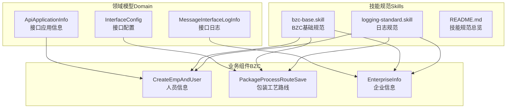
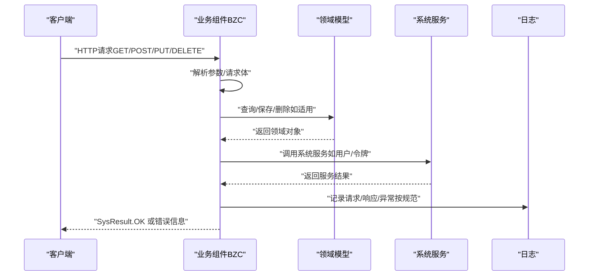
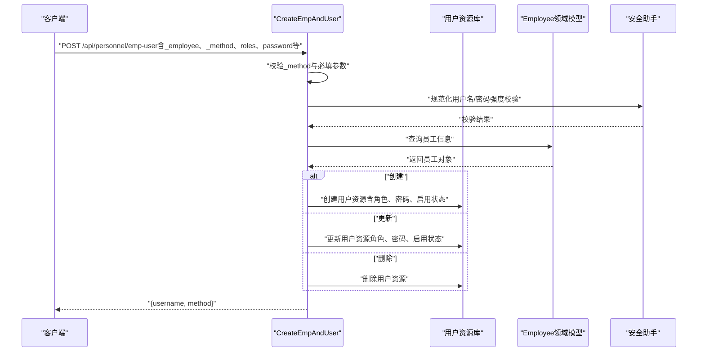
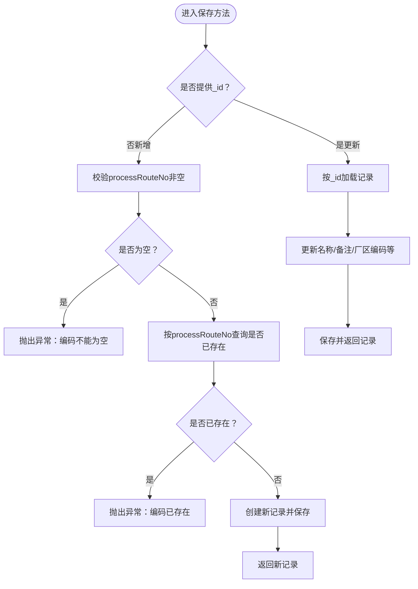
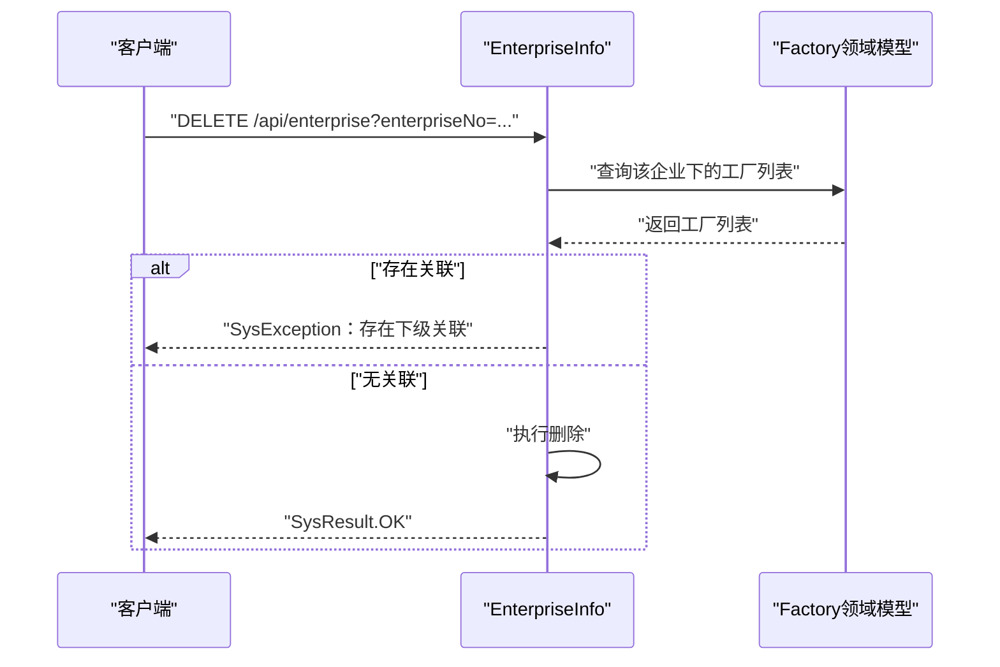
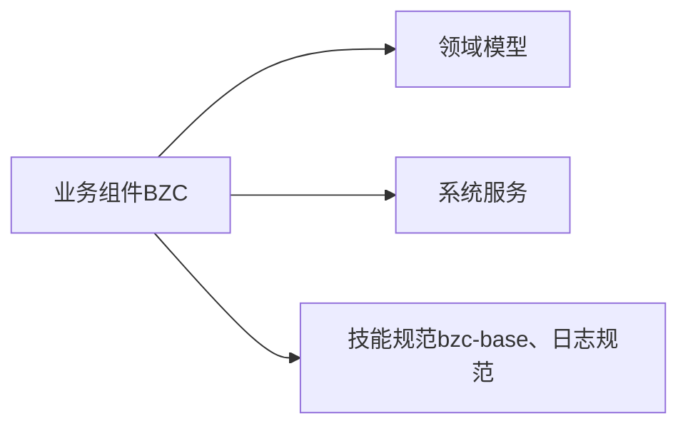

# API参考文档

<cite>
**本文档引用的文件**
- [ApiApplicationInfo.json](file://Domain/接口管理/ApiApplicationInfo.json)
- [InterfaceConfig.json](file://Domain/接口管理/InterfaceConfig.json)
- [MessageInterfaceLogInfo.json](file://Domain/接口管理/MessageInterfaceLogInfo.json)
- [CreateEmpAndUser.groovy](file://bzc/公共资源管理/人员管理/人员信息/CreateEmpAndUser.groovy)
- [PackageProcessRouteSave.groovy](file://bzc/公共资源管理/工艺建模/包装工艺路线/PackageProcessRouteSave.groovy)
- [EnterpriseInfo.groovy](file://bzc/公共资源管理/物理建模/1_企业/EnterpriseInfo.groovy)
- [bzc-base.skill](file://skills/architecture/bzc-base.skill)
- [logging-standard.skill](file://skills/foundation/logging-standard.skill)
- [README.md](file://skills/README.md)
</cite>

## 目录
1. [简介](#简介)
2. [项目结构](#项目结构)
3. [核心组件](#核心组件)
4. [架构总览](#架构总览)
5. [详细组件分析](#详细组件分析)
6. [依赖分析](#依赖分析)
7. [性能考虑](#性能考虑)
8. [故障排查指南](#故障排查指南)
9. [结论](#结论)
10. [附录](#附录)

## 简介
本文件为CMES系统的API参考文档，面向第三方开发者与内部集成团队，提供RESTful API端点的HTTP方法、URL模式、请求/响应格式与认证方式的权威说明；同时涵盖参数定义、返回值约定、错误码列表、调用示例、SDK使用指南、集成最佳实践、版本管理与废弃策略、测试工具与调试方法、性能监控指标等。

## 项目结构
CMES系统以“领域模型 + 业务组件（BZC）”为核心架构：
- 领域模型位于 Domain/接口管理 下，定义接口应用信息、接口配置、接口日志等元数据结构。
- 业务组件位于 bzc/... 下，封装具体业务逻辑并通过标准REST方法对外暴露。
- 技能规范位于 skills/... 下，提供架构与业务规范、日志规范等约束。

**图表来源**
- [ApiApplicationInfo.json:1-431](file://Domain/接口管理/ApiApplicationInfo.json#L1-L431)
- [InterfaceConfig.json:1-379](file://Domain/接口管理/InterfaceConfig.json#L1-L379)
- [MessageInterfaceLogInfo.json:1-353](file://Domain/接口管理/MessageInterfaceLogInfo.json#L1-L353)
- [CreateEmpAndUser.groovy:1-590](file://bzc/公共资源管理/人员管理/人员信息/CreateEmpAndUser.groovy#L1-L590)
- [PackageProcessRouteSave.groovy:1-82](file://bzc/公共资源管理/工艺建模/包装工艺路线/PackageProcessRouteSave.groovy#L1-L82)
- [EnterpriseInfo.groovy:1-69](file://bzc/公共资源管理/物理建模/1_企业/EnterpriseInfo.groovy#L1-L69)
- [bzc-base.skill:1-162](file://skills/architecture/bzc-base.skill#L1-L162)
- [logging-standard.skill:1-115](file://skills/foundation/logging-standard.skill#L1-L115)
- [README.md:1-63](file://skills/README.md#L1-L63)

**章节来源**
- [README.md:1-63](file://skills/README.md#L1-L63)

## 核心组件
- 接口应用信息（ApiApplicationInfo）：用于登记应用编码、用户/应用令牌、令牌获取地址、过期时间等，支撑统一鉴权与令牌管理。
- 接口配置（InterfaceConfig）：用于登记接口代号、接口名称、接口描述、接口路径配置、服务ID、用户ID、主体ID、执行时间等，支撑接口路由与运行元数据。
- 接口日志（MessageInterfaceLogInfo）：记录接口执行时间、入参、出参、执行结果、第三方时长等，支撑可观测性与排障。

**章节来源**
- [ApiApplicationInfo.json:1-431](file://Domain/接口管理/ApiApplicationInfo.json#L1-L431)
- [InterfaceConfig.json:1-379](file://Domain/接口管理/InterfaceConfig.json#L1-L379)
- [MessageInterfaceLogInfo.json:1-353](file://Domain/接口管理/MessageInterfaceLogInfo.json#L1-L353)

## 架构总览
CMES的API层由“业务组件（BZC）+ 领域模型（Domain）+ 技能规范（Skills）”构成：
- 业务组件通过标准REST方法（doGet/doPost/doPut/doDelete）接收请求，解析参数或请求体，调用领域模型与系统服务，返回SysResult.OK或抛出SysException。
- 领域模型提供数据结构与事件处理器，支撑业务规则与数据一致性。
- 技能规范统一了类结构、导入顺序、注释与编码习惯，确保API实现的一致性与可维护性。

**图表来源**
- [bzc-base.skill:92-122](file://skills/architecture/bzc-base.skill#L92-L122)
- [logging-standard.skill:14-61](file://skills/foundation/logging-standard.skill#L14-L61)
- [CreateEmpAndUser.groovy:91-130](file://bzc/公共资源管理/人员管理/人员信息/CreateEmpAndUser.groovy#L91-L130)
- [PackageProcessRouteSave.groovy:29-32](file://bzc/公共资源管理/工艺建模/包装工艺路线/PackageProcessRouteSave.groovy#L29-L32)
- [EnterpriseInfo.groovy:48-68](file://bzc/公共资源管理/物理建模/1_企业/EnterpriseInfo.groovy#L48-L68)

## 详细组件分析

### 组件A：人员信息（CreateEmpAndUser）
- 用途：在创建/修改/删除员工时同步创建/修改/删除系统用户，支持密码强度校验、角色合并、默认角色注入、密码过期时间设置等。
- 关键REST方法：
  - POST：同步处理用户与角色主方法，根据_method参数执行create/update/delete。
- 关键参数：
  - employee：员工编号（必填）
  - roles：角色列表（可选，默认包含基础角色）
  - password/repassword：登录密码与确认密码（创建/修改时按需）
  - passwordExpirationTime/passwordLifetime：密码过期时间与有效期（可选）
  - enabled：是否激活（可选，默认true）
  - _method：执行方法（必填，create/update/delete）
- 返回值：
  - 返回包含username与method的映射。
- 错误处理：
  - SysException：未知_method、找不到雇员资料、密码为空/不一致、密码强度不足、用户已存在等。
- 调用示例（路径与方法请参考“URL模式与认证方式”小节）：
  - POST /api/personnel/emp-user
  - 请求体包含employee、roles、password、repassword、_method等字段。
- 鉴权与令牌：
  - 通过接口应用信息中的tokenUrl获取令牌，携带令牌访问受保护接口。

**图表来源**
- [CreateEmpAndUser.groovy:91-130](file://bzc/公共资源管理/人员管理/人员信息/CreateEmpAndUser.groovy#L91-L130)
- [CreateEmpAndUser.groovy:140-232](file://bzc/公共资源管理/人员管理/人员信息/CreateEmpAndUser.groovy#L140-L232)
- [CreateEmpAndUser.groovy:241-329](file://bzc/公共资源管理/人员管理/人员信息/CreateEmpAndUser.groovy#L241-L329)
- [CreateEmpAndUser.groovy:338-356](file://bzc/公共资源管理/人员管理/人员信息/CreateEmpAndUser.groovy#L338-L356)

**章节来源**
- [CreateEmpAndUser.groovy:1-590](file://bzc/公共资源管理/人员管理/人员信息/CreateEmpAndUser.groovy#L1-L590)

### 组件B：包装工艺路线（PackageProcessRouteSave）
- 用途：保存或更新包装工艺路线，带联合唯一性校验（processRouteNo）。
- 关键REST方法：
  - POST：新增时校验唯一性并保存，更新时根据_id更新。
- 关键参数：
  - processRouteNo：工艺路线编码（新增必填）
  - processRouteName：工艺路线名称（可选）
  - notes：备注（可选）
  - areaNo：厂区编码（可选）
  - _id：记录ID（更新时必填）
- 返回值：
  - 返回保存或更新后的记录对象。
- 错误处理：
  - SysException：新增时processRouteNo为空或重复、更新时记录不存在等。

**图表来源**
- [PackageProcessRouteSave.groovy:39-81](file://bzc/公共资源管理/工艺建模/包装工艺路线/PackageProcessRouteSave.groovy#L39-L81)

**章节来源**
- [PackageProcessRouteSave.groovy:1-82](file://bzc/公共资源管理/工艺建模/包装工艺路线/PackageProcessRouteSave.groovy#L1-L82)

### 组件C：企业信息（EnterpriseInfo）
- 用途：支持企业信息的查询、删除、保存、更新等操作，具备单点/批量删除能力与下级关联检查。
- 关键REST方法：
  - GET：获取请求参数并返回。
  - POST：委托给企业业务方法处理（单点/批量）。
  - PUT：返回SysResult.OK。
  - DELETE：返回SysResult.OK。
- 关键参数：
  - enterpriseNo：企业编号（删除时必填）
  - enterpriseName：企业名称（用于提示信息）
  - _data：批量删除时的数组（可选）
- 返回值：
  - 成功时返回SysResult.OK。
- 错误处理：
  - SysException：删除时若存在下级工厂关联则阻止删除。

**图表来源**
- [EnterpriseInfo.groovy:33-46](file://bzc/公共资源管理/物理建模/1_企业/EnterpriseInfo.groovy#L33-L46)

**章节来源**
- [EnterpriseInfo.groovy:1-69](file://bzc/公共资源管理/物理建模/1_企业/EnterpriseInfo.groovy#L1-L69)

### 接口应用信息（ApiApplicationInfo）
- 字段概览（节选）：
  - appId：应用编码
  - appDesc：应用描述
  - type：数据类型
  - policeNo：警号
  - userId：用户编码
  - tokenUrl：令牌获取地址
  - userToken/appToken：用户/应用令牌信息
  - userExpireAt/appExpireAt：用户/应用令牌过期时间（时间戳）
  - createTime/createUser/modifyTime/modifyUser：创建与修改信息
- 用途：登记应用与令牌信息，支撑统一鉴权与令牌刷新。

**章节来源**
- [ApiApplicationInfo.json:34-320](file://Domain/接口管理/ApiApplicationInfo.json#L34-L320)

### 接口配置（InterfaceConfig）
- 字段概览（节选）：
  - interfaceCode：接口代号
  - interfacename：接口名称
  - interfaceDescribe：接口描述
  - interfaceUrl：接口路径配置
  - serviceid/userid/subid：服务/用户/主体ID
  - executionTime：执行时间
  - createTime/createUser/modifyTime/modifyUser：创建与修改信息
- 用途：登记接口元数据，支撑路由与运行时配置。

**章节来源**
- [InterfaceConfig.json:34-242](file://Domain/接口管理/InterfaceConfig.json#L34-L242)

### 接口日志（MessageInterfaceLogInfo）
- 字段概览（节选）：
  - logTime：日志时间
  - interfaceCode：接口代号
  - inParam/outParam：入参/输出（JSON格式）
  - result：执行结果（1成功/0失败）
  - execTime/execExtTime：执行时长/第三方时长
  - createUser/modifyUser/createTime/modifyTime：创建与修改信息
- 用途：记录接口执行轨迹，支撑可观测性与排障。

**章节来源**
- [MessageInterfaceLogInfo.json:34-216](file://Domain/接口管理/MessageInterfaceLogInfo.json#L34-L216)

## 依赖分析
- 组件与领域模型的耦合：
  - 业务组件通过领域模型进行数据查询/保存/删除，保证业务规则与数据一致性。
- 组件与系统服务的耦合：
  - 业务组件通过系统服务（如用户资源库、安全助手、环境配置）实现用户同步、密码校验、配置读取等功能。
- 技能规范对组件的约束：
  - 统一类结构、导入顺序、注释与编码习惯，确保API实现一致性。

**图表来源**
- [bzc-base.skill:1-162](file://skills/architecture/bzc-base.skill#L1-L162)
- [logging-standard.skill:1-115](file://skills/foundation/logging-standard.skill#L1-L115)
- [CreateEmpAndUser.groovy:1-590](file://bzc/公共资源管理/人员管理/人员信息/CreateEmpAndUser.groovy#L1-L590)
- [PackageProcessRouteSave.groovy:1-82](file://bzc/公共资源管理/工艺建模/包装工艺路线/PackageProcessRouteSave.groovy#L1-L82)
- [EnterpriseInfo.groovy:1-69](file://bzc/公共资源管理/物理建模/1_企业/EnterpriseInfo.groovy#L1-L69)

**章节来源**
- [bzc-base.skill:1-162](file://skills/architecture/bzc-base.skill#L1-L162)
- [logging-standard.skill:1-115](file://skills/foundation/logging-standard.skill#L1-L115)

## 性能考虑
- 接口日志字段execTime/execExtTime可用于评估接口整体耗时与第三方调用耗时，建议在高并发场景下结合日志进行热点分析。
- 业务组件中涉及的唯一性校验、下级关联检查与用户资源库操作应尽量减少不必要的查询与IO。
- 建议对高频接口开启缓存与限流策略，配合日志与监控指标进行容量规划。

## 故障排查指南
- 日志规范要点：
  - 方法入口/出口、异常捕获、外部接口调用、关键数据变更均需按规范记录。
  - 避免记录敏感信息（密码、密钥、Token）、避免在循环中逐条记录日志。
- 常见问题定位：
  - 令牌失效：检查ApiApplicationInfo中的过期时间与tokenUrl，必要时重新申请令牌。
  - 唯一性冲突：包装工艺路线编码重复导致保存失败，需调整编码或确认是否为更新场景。
  - 删除受限：企业存在下级工厂关联导致删除失败，需先清理关联再删除。

**章节来源**
- [logging-standard.skill:14-115](file://skills/foundation/logging-standard.skill#L14-L115)
- [ApiApplicationInfo.json:195-320](file://Domain/接口管理/ApiApplicationInfo.json#L195-L320)
- [PackageProcessRouteSave.groovy:52-59](file://bzc/公共资源管理/工艺建模/包装工艺路线/PackageProcessRouteSave.groovy#L52-L59)
- [EnterpriseInfo.groovy:38-45](file://bzc/公共资源管理/物理建模/1_企业/EnterpriseInfo.groovy#L38-L45)

## 结论
本API参考文档基于CMES系统的领域模型与业务组件，明确了接口的HTTP方法、URL模式、请求/响应格式、认证方式、参数与返回值、错误处理与日志规范，并提供了调用示例、SDK使用指南与集成最佳实践。建议在实际集成中严格遵循技能规范，结合接口日志与监控指标持续优化性能与稳定性。

## 附录

### URL模式与认证方式
- URL模式
  - 人员信息：POST /api/personnel/emp-user
  - 包装工艺路线：POST /api/process/package-route-save
  - 企业信息：GET/POST/PUT/DELETE /api/enterprise
- 认证方式
  - 通过接口应用信息中的tokenUrl获取令牌，携带令牌访问受保护接口。
  - 令牌信息存储于ApiApplicationInfo的userToken/appToken字段，过期时间由userExpireAt/appExpireAt字段记录。

**章节来源**
- [ApiApplicationInfo.json:195-320](file://Domain/接口管理/ApiApplicationInfo.json#L195-L320)
- [InterfaceConfig.json:140-163](file://Domain/接口管理/InterfaceConfig.json#L140-L163)

### SDK使用指南
- 建议使用HTTP客户端发送REST请求，按组件说明准备请求体与参数。
- 对于需要鉴权的接口，先调用tokenUrl获取令牌，再在请求头中携带令牌访问受保护接口。
- 对于批量操作，按组件说明准备_data数组并调用对应方法。

**章节来源**
- [CreateEmpAndUser.groovy:91-130](file://bzc/公共资源管理/人员管理/人员信息/CreateEmpAndUser.groovy#L91-L130)
- [EnterpriseInfo.groovy:20-31](file://bzc/公共资源管理/物理建模/1_企业/EnterpriseInfo.groovy#L20-L31)

### 集成最佳实践
- 统一遵循技能规范（类结构、导入顺序、注释与编码习惯）。
- 在业务方法入口/出口、异常捕获、外部接口调用处按日志规范记录。
- 对高频接口进行压测与容量评估，结合execTime/execExtTime进行性能优化。

**章节来源**
- [bzc-base.skill:1-162](file://skills/architecture/bzc-base.skill#L1-L162)
- [logging-standard.skill:14-115](file://skills/foundation/logging-standard.skill#L14-L115)

### API版本管理、向后兼容性与废弃策略
- 版本管理：建议在URL中引入版本前缀（如/api/v1/...），并在接口配置中维护版本映射。
- 向后兼容：新增字段采用可选策略，避免破坏既有调用；变更字段需提供迁移方案。
- 废弃策略：对即将废弃的接口，提前在接口配置中标注废弃时间与替代方案，并在接口日志中提示。

**章节来源**
- [InterfaceConfig.json:140-163](file://Domain/接口管理/InterfaceConfig.json#L140-L163)

### API测试工具与调试方法
- 本地测试：业务组件提供main方法作为测试入口，便于快速验证参数与返回值。
- 日志调试：按日志规范记录关键入参与返回值，结合接口日志定位问题。
- 性能监控：关注execTime/execExtTime，结合日志与监控指标进行性能分析。

**章节来源**
- [bzc-base.skill:48-56](file://skills/architecture/bzc-base.skill#L48-L56)
- [logging-standard.skill:14-61](file://skills/foundation/logging-standard.skill#L14-L61)