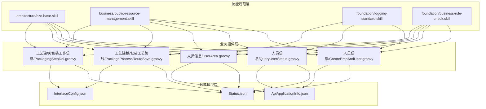
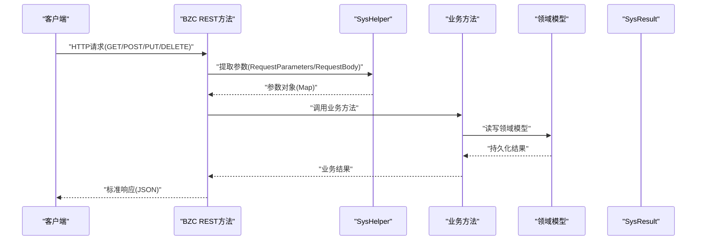
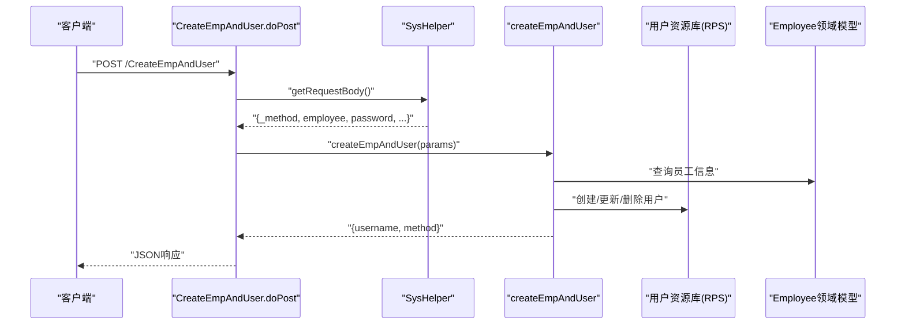
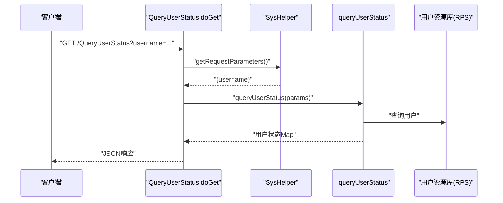
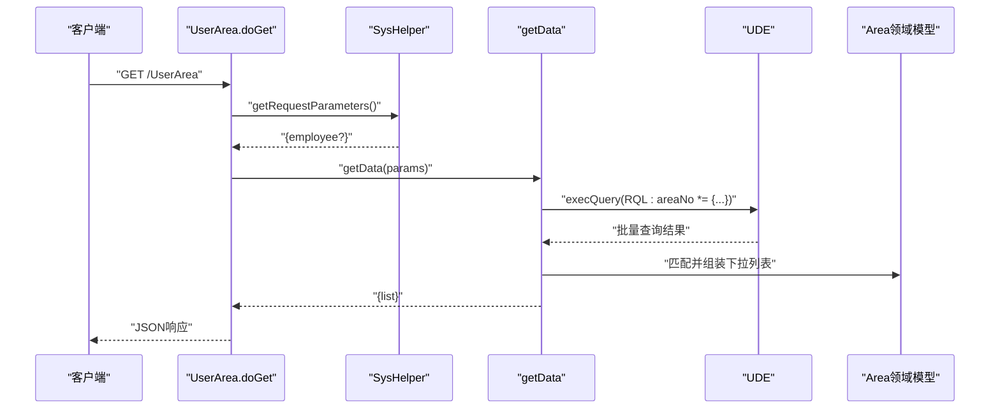
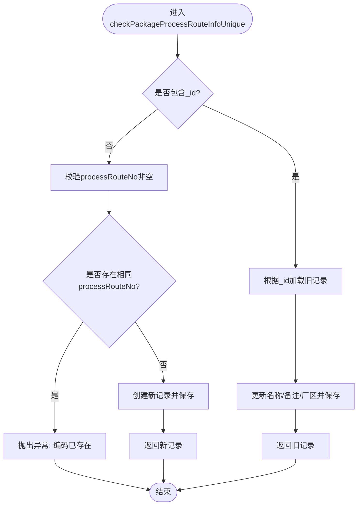
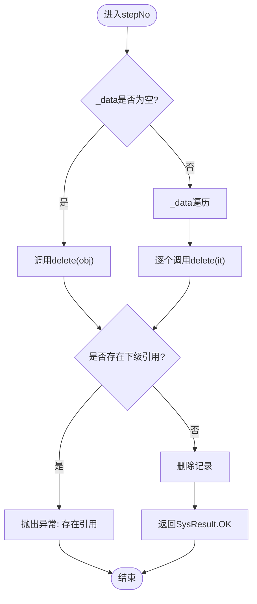
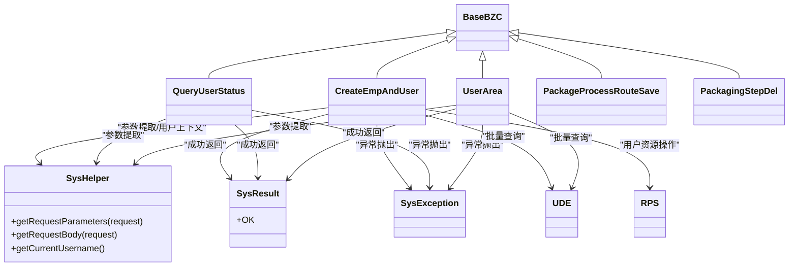

# BZC业务组件API

<cite>
**本文档引用的文件**
- [bzc-base.skill](file://skills/architecture/bzc-base.skill)
- [public-resource-management.skill](file://skills/business/public-resource-management.skill)
- [logging-standard.skill](file://skills/foundation/logging-standard.skill)
- [business-rule-check.skill](file://skills/foundation/business-rule-check.skill)
- [CreateEmpAndUser.groovy](file://bzc/公共资源管理/人员管理/人员信息/CreateEmpAndUser.groovy)
- [QueryUserStatus.groovy](file://bzc/公共资源管理/人员管理/人员信息/QueryUserStatus.groovy)
- [UserArea.groovy](file://bzc/公共资源管理/人员管理/人员信息/UserArea.groovy)
- [PackageProcessRouteSave.groovy](file://bzc/公共资源管理/工艺建模/包装工艺路线/PackageProcessRouteSave.groovy)
- [PackagingStepDel.groovy](file://bzc/公共资源管理/工艺建模/包装工步信息/PackagingStepDel.groovy)
- [Status.json](file://Domain/公共资源管理/Status.json)
- [ApiApplicationInfo.json](file://Domain/接口管理/ApiApplicationInfo.json)
- [InterfaceConfig.json](file://Domain/接口管理/InterfaceConfig.json)
</cite>

## 目录
1. [简介](#简介)
2. [项目结构](#项目结构)
3. [核心组件](#核心组件)
4. [架构总览](#架构总览)
5. [详细组件分析](#详细组件分析)
6. [依赖关系分析](#依赖关系分析)
7. [性能考量](#性能考量)
8. [故障排除指南](#故障排除指南)
9. [结论](#结论)
10. [附录](#附录)

## 简介
本文件为BZC（业务组件）API的详细技术文档，面向开发者与集成方，系统阐述RESTful API的标准实现模式与最佳实践。文档覆盖doGet、doPost、doPut、doDelete四类核心HTTP方法的映射规范、请求参数处理、响应格式标准化、参数传递机制、数据序列化与反序列化流程、错误处理策略与异常类型定义，并提供各业务组件的调用示例与集成指南。

## 项目结构
BZC业务组件遵循“模块化+分层”的组织方式：
- 技能规范层：定义架构、业务、基础能力规范（skills/）
- 业务组件层：具体业务实现（bzc/公共资源管理/...）
- 领域模型层：数据结构与约束（Domain/公共资源管理/...）

**图表来源**
- [bzc-base.skill:1-162](file://skills/architecture/bzc-base.skill#L1-L162)
- [public-resource-management.skill:1-514](file://skills/business/public-resource-management.skill#L1-L514)

**章节来源**
- [bzc-base.skill:1-162](file://skills/architecture/bzc-base.skill#L1-L162)
- [public-resource-management.skill:1-514](file://skills/business/public-resource-management.skill#L1-L514)

## 核心组件
- BaseBZC基类：所有BZC组件的父类，提供统一的生命周期与工具方法。
- SysHelper：请求参数提取（GET参数、POST请求体）、当前用户上下文等。
- SysResult：标准成功响应封装（如OK）。
- SysException：统一异常类型，承载业务异常信息。
- UDE/RPS：统一数据访问与资源操作抽象（RQL批量查询、资源创建/更新/删除）。

关键规范要点：
- 类结构：继承BaseBZC，方法命名规范，main方法作为本地测试入口。
- RESTful映射：doGet/doPost/doPut/doDelete分别对应HTTP GET/POST/PUT/DELETE。
- 参数处理：GET使用SysHelper.getRequestParameters，POST使用SysHelper.getRequestBody。
- 响应格式：业务方法返回业务对象或Map；REST方法返回业务结果或SysResult.OK。
- 删除策略：删除前检查下级引用，存在引用抛出SysException，无引用执行删除。
- 批量删除：通过obj._data判断，遍历调用delete。

**章节来源**
- [bzc-base.skill:10-26](file://skills/architecture/bzc-base.skill#L10-L26)
- [bzc-base.skill:92-122](file://skills/architecture/bzc-base.skill#L92-L122)
- [bzc-base.skill:74-90](file://skills/architecture/bzc-base.skill#L74-L90)
- [business-rule-check.skill:39-46](file://skills/foundation/business-rule-check.skill#L39-L46)

## 架构总览
BZC API采用“控制器（REST方法）—业务方法—领域模型”的分层架构。REST方法负责协议适配与参数解析，业务方法负责业务逻辑与校验，领域模型承载数据结构与约束。

**图表来源**
- [bzc-base.skill:92-122](file://skills/architecture/bzc-base.skill#L92-L122)
- [QueryUserStatus.groovy:40-45](file://bzc/公共资源管理/人员管理/人员信息/QueryUserStatus.groovy#L40-L45)
- [UserArea.groovy:192-197](file://bzc/公共资源管理/人员管理/人员信息/UserArea.groovy#L192-L197)

## 详细组件分析

### 人员信息模块

#### 组件：CreateEmpAndUser（员工与用户同步）
- 功能：在创建/修改/删除员工时同步创建/修改/删除系统用户，支持密码强度校验、角色合并、默认角色等。
- REST映射：
  - doGet：本地测试入口（main方法）
  - doPost：创建/修改/删除用户（_method参数）
  - doPut：占位返回SysResult.OK
  - doDelete：占位返回SysResult.OK
- 参数处理：
  - GET：无
  - POST：请求体包含_employee、_method、password、repassword、roles、enabled、passwordLifetime、passwordExpirationTime等
- 响应格式：返回username与_method，或SysResult.OK
- 错误处理：SysException，包含“未知的_method”、“找不到雇员资料”、“密码强度不足”等

**图表来源**
- [CreateEmpAndUser.groovy:91-130](file://bzc/公共资源管理/人员管理/人员信息/CreateEmpAndUser.groovy#L91-L130)
- [CreateEmpAndUser.groovy:140-232](file://bzc/公共资源管理/人员管理/人员信息/CreateEmpAndUser.groovy#L140-L232)

**章节来源**
- [CreateEmpAndUser.groovy:1-590](file://bzc/公共资源管理/人员管理/人员信息/CreateEmpAndUser.groovy#L1-L590)

#### 组件：QueryUserStatus（查询用户状态）
- 功能：查询用户密码有效期、激活状态、停用/启用时间等。
- REST映射：
  - doGet：接收username参数，返回用户状态信息
  - doPost/doPut/doDelete：返回SysResult.OK
- 参数处理：GET参数username必填
- 响应格式：用户状态Map，包含passwordLifetime、passwordExpirationTime、enabled、userStatusTime、userUri等
- 错误处理：SysException，如“登录用户不可为空”

**图表来源**
- [QueryUserStatus.groovy:40-45](file://bzc/公共资源管理/人员管理/人员信息/QueryUserStatus.groovy#L40-L45)
- [QueryUserStatus.groovy:62-109](file://bzc/公共资源管理/人员管理/人员信息/QueryUserStatus.groovy#L62-L109)

**章节来源**
- [QueryUserStatus.groovy:1-144](file://bzc/公共资源管理/人员管理/人员信息/QueryUserStatus.groovy#L1-L144)

#### 组件：UserArea（用户厂区信息）
- 功能：维护用户默认厂区信息，提供下拉选择与保存。
- REST映射：
  - doGet：获取下拉列表数据
  - doPost：保存默认厂区
  - doPut/doDelete：返回SysResult.OK
- 参数处理：
  - doGet：可选employee参数，默认当前登录用户
  - doPost：请求体包含selectedValue（厂区编号）
- 响应格式：下拉列表list（value/name），或保存后的areaNo/value
- 错误处理：SysException，如员工不存在
- 性能优化：使用RQL批量查询避免N+1问题

**图表来源**
- [UserArea.groovy:192-197](file://bzc/公共资源管理/人员管理/人员信息/UserArea.groovy#L192-L197)
- [UserArea.groovy:113-183](file://bzc/公共资源管理/人员管理/人员信息/UserArea.groovy#L113-L183)

**章节来源**
- [UserArea.groovy:1-235](file://bzc/公共资源管理/人员管理/人员信息/UserArea.groovy#L1-L235)

### 工艺建模模块

#### 组件：PackageProcessRouteSave（包装工艺路线保存）
- 功能：保存或更新包装工艺路线，带processRouteNo唯一性校验。
- REST映射：
  - doPost：接收请求体，校验唯一性并保存/更新
  - doGet/doPut/doDelete：返回SysResult.OK
- 参数处理：请求体包含processRouteNo、processRouteName、notes、areaNo、_id等
- 响应格式：保存/更新后的PackageProcessRouteInfo对象
- 错误处理：SysException，如“工艺路线编码不能为空”、“该工艺路线编码已存在”

**图表来源**
- [PackageProcessRouteSave.groovy:39-81](file://bzc/公共资源管理/工艺建模/包装工艺路线/PackageProcessRouteSave.groovy#L39-L81)

**章节来源**
- [PackageProcessRouteSave.groovy:1-82](file://bzc/公共资源管理/工艺建模/包装工艺路线/PackageProcessRouteSave.groovy#L1-L82)

#### 组件：PackagingStepDel（包装工步删除）
- 功能：支持单点/批量删除包装工步，删除前检查下级引用。
- REST映射：
  - doGet：透传请求参数（用于调试）
  - doPost：接收请求体，判断单点/批量并调用delete
  - doPut/doDelete：返回SysResult.OK
- 参数处理：请求体包含workStepNo、workStepName、_data（批量时）
- 响应格式：SysResult.OK
- 错误处理：SysException，如“已在包装工艺路线明细中使用”

**图表来源**
- [PackagingStepDel.groovy:50-79](file://bzc/公共资源管理/工艺建模/包装工步信息/PackagingStepDel.groovy#L50-L79)

**章节来源**
- [PackagingStepDel.groovy:1-79](file://bzc/公共资源管理/工艺建模/包装工步信息/PackagingStepDel.groovy#L1-L79)

## 依赖关系分析

**图表来源**
- [bzc-base.skill:10-26](file://skills/architecture/bzc-base.skill#L10-L26)
- [CreateEmpAndUser.groovy:1-590](file://bzc/公共资源管理/人员管理/人员信息/CreateEmpAndUser.groovy#L1-L590)
- [UserArea.groovy:1-235](file://bzc/公共资源管理/人员管理/人员信息/UserArea.groovy#L1-L235)

**章节来源**
- [bzc-base.skill:1-162](file://skills/architecture/bzc-base.skill#L1-L162)
- [business-rule-check.skill:39-46](file://skills/foundation/business-rule-check.skill#L39-L46)

## 性能考量
- RQL批量查询：使用“*= 左连接”替代循环单条查询，避免N+1问题，显著提升批量读取性能。
- 批量删除：通过obj._data批量遍历，减少网络往返与数据库交互次数。
- 日志记录：建议在关键节点记录入参与返回，避免在大循环中逐条记录，防止日志风暴。

**章节来源**
- [business-rule-check.skill:48-56](file://skills/foundation/business-rule-check.skill#L48-L56)
- [logging-standard.skill:14-23](file://skills/foundation/logging-standard.skill#L14-L23)
- [logging-standard.skill:99-102](file://skills/foundation/logging-standard.skill#L99-L102)

## 故障排除指南
- 参数缺失：GET参数或POST请求体缺失必填字段时，抛出SysException，检查请求URL与Body。
- 唯一性冲突：新增时若唯一字段已存在，抛出SysException，需调整唯一值。
- 关联引用：删除前检查下级引用，存在引用会抛出SysException，需先清理下级数据。
- 异常捕获：所有异常需被捕获并记录日志，避免空catch块与e.printStackTrace()。
- 日志规范：记录方法入口/出口、外部接口调用、异常信息与关键数据变更，避免记录敏感信息与大对象。

**章节来源**
- [business-rule-check.skill:22-46](file://skills/foundation/business-rule-check.skill#L22-L46)
- [logging-standard.skill:43-52](file://skills/foundation/logging-standard.skill#L43-L52)
- [logging-standard.skill:78-86](file://skills/foundation/logging-standard.skill#L78-L86)

## 结论
BZC业务组件API以BaseBZC为核心，遵循统一的REST映射与参数处理规范，结合SysHelper、SysResult、SysException与UDE/RPS等基础设施，实现了高内聚、低耦合的业务组件体系。通过RQL批量查询与严格的删除校验，保障了性能与数据一致性。开发者可基于本文档快速集成与扩展各类业务组件。

## 附录

### API调用示例（示例路径）
- 查询用户状态
  - 方法：GET
  - 路径：/QueryUserStatus
  - 参数：username（必填）
  - 响应：用户状态Map
  - 参考路径：[QueryUserStatus.groovy:40-45](file://bzc/公共资源管理/人员管理/人员信息/QueryUserStatus.groovy#L40-L45)

- 保存默认厂区
  - 方法：POST
  - 路径：/UserArea
  - 请求体：selectedValue（厂区编号）
  - 响应：value或areaNo
  - 参考路径：[UserArea.groovy:206-211](file://bzc/公共资源管理/人员管理/人员信息/UserArea.groovy#L206-L211)

- 保存包装工艺路线
  - 方法：POST
  - 路径：/PackageProcessRouteSave
  - 请求体：processRouteNo、processRouteName、notes、areaNo、_id（可选）
  - 响应：保存/更新后的对象
  - 参考路径：[PackageProcessRouteSave.groovy:29-32](file://bzc/公共资源管理/工艺建模/包装工艺路线/PackageProcessRouteSave.groovy#L29-L32)

- 删除包装工步（单点/批量）
  - 方法：POST
  - 路径：/PackagingStepDel
  - 请求体：workStepNo、workStepName、_data（批量时）
  - 响应：SysResult.OK
  - 参考路径：[PackagingStepDel.groovy:40-43](file://bzc/公共资源管理/工艺建模/包装工步信息/PackagingStepDel.groovy#L40-L43)

### 参数传递机制与序列化
- GET参数：通过SysHelper.getRequestParameters(request)提取，返回Map。
- POST请求体：通过SysHelper.getRequestBody(request)提取，返回Map。
- 响应：业务方法返回业务对象或Map；REST方法返回业务结果或SysResult.OK。

**章节来源**
- [bzc-base.skill:92-122](file://skills/architecture/bzc-base.skill#L92-L122)
- [QueryUserStatus.groovy:40-45](file://bzc/公共资源管理/人员管理/人员信息/QueryUserStatus.groovy#L40-L45)
- [UserArea.groovy:206-211](file://bzc/公共资源管理/人员管理/人员信息/UserArea.groovy#L206-L211)

### 错误处理策略与异常类型
- 异常类型：SysException，统一承载业务异常信息。
- 成功响应：SysResult.OK。
- 建议：所有异常捕获处记录日志，外部接口调用记录请求/响应，避免记录敏感信息与大对象。

**章节来源**
- [bzc-base.skill:140-145](file://skills/architecture/bzc-base.skill#L140-L145)
- [logging-standard.skill:43-61](file://skills/foundation/logging-standard.skill#L43-L61)