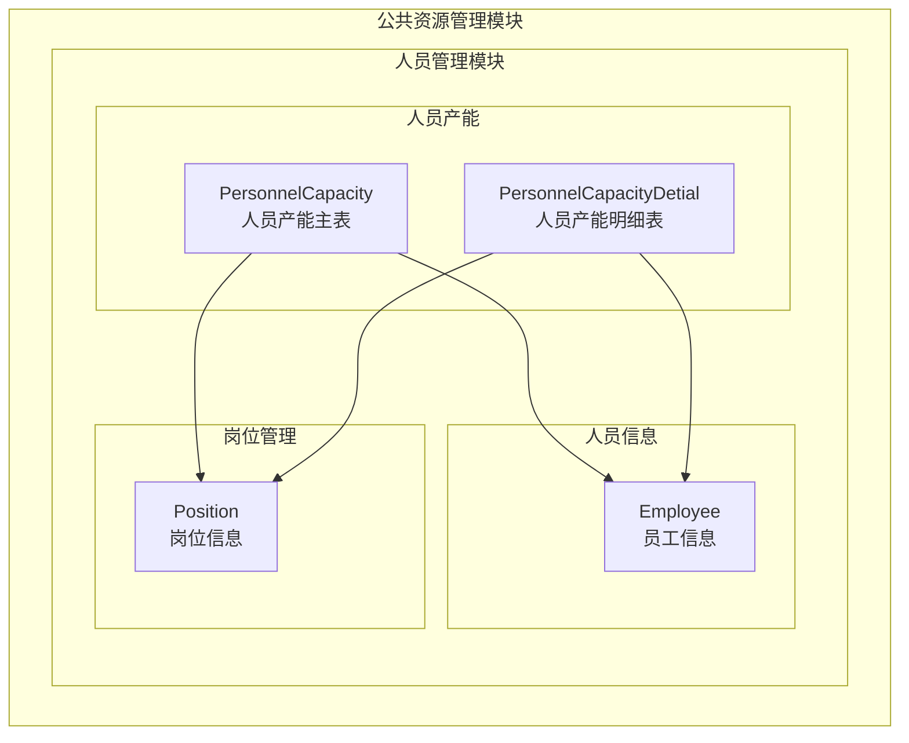
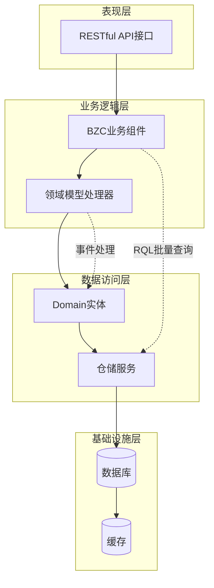
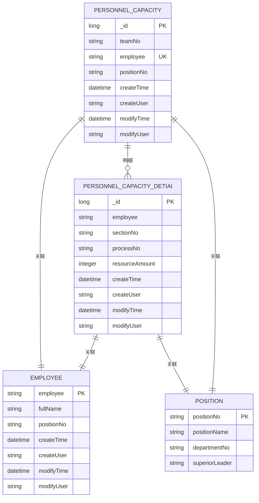
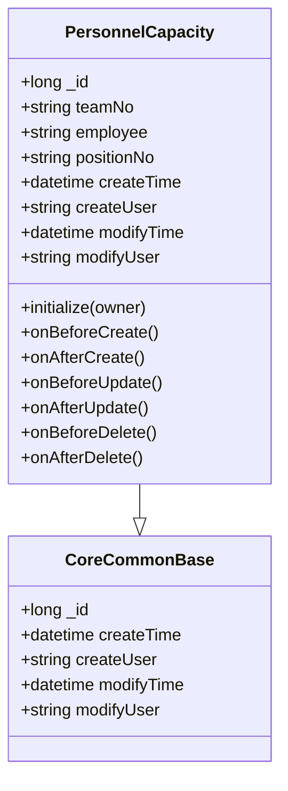
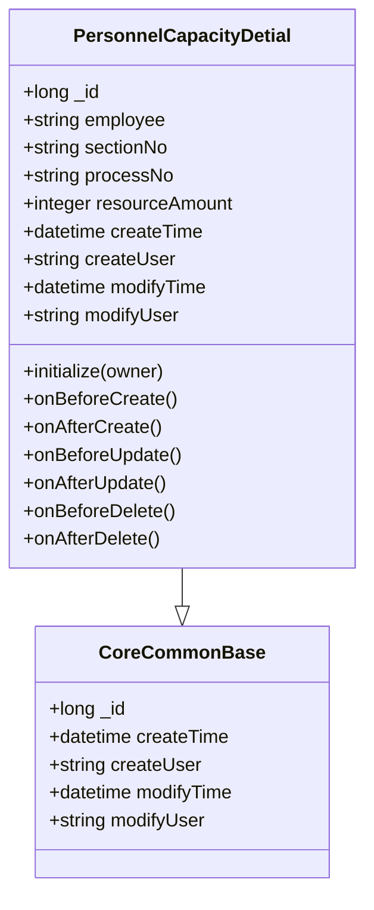
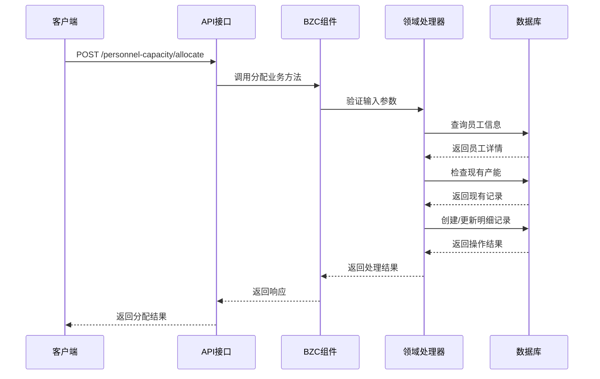
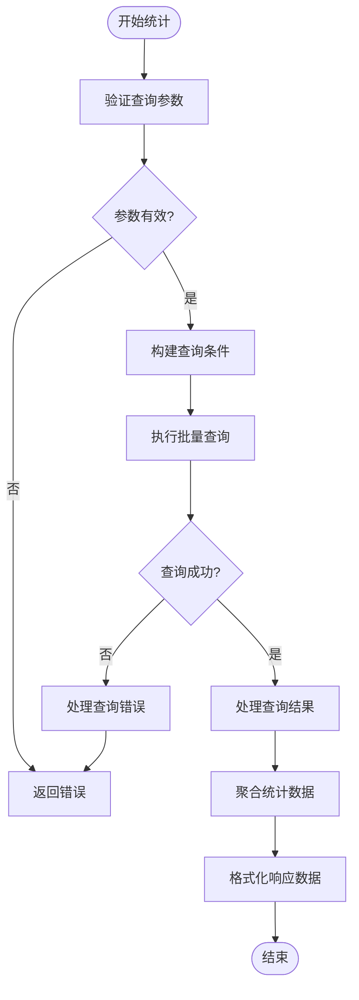
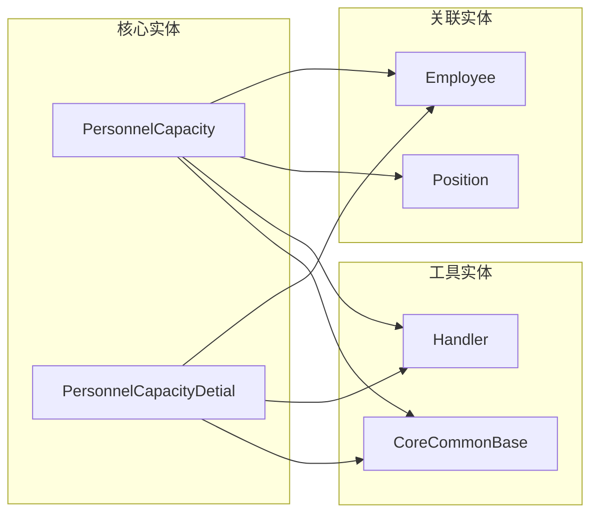
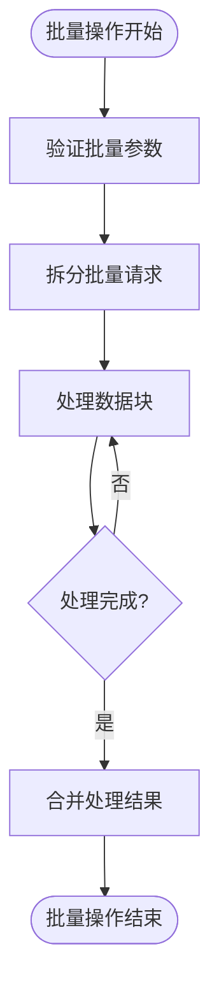

# 人员产能管理API

<cite>
**本文档引用的文件**
- [PersonnelCapacity.json](file://Domain/公共资源管理/人员管理/人员产能/PersonnelCapacity.json)
- [PersonnelCapacityDetial.json](file://Domain/公共资源管理/人员管理/人员产能/PersonnelCapacityDetial.json)
- [Employee.json](file://Domain/公共资源管理/人员管理/人员信息/Employee.json)
- [public-resource-management.skill](file://skills/business/public-resource-management.skill)
- [bzc-base.skill](file://skills/architecture/bzc-base.skill)
</cite>

## 目录
1. [简介](#简介)
2. [项目结构](#项目结构)
3. [核心组件](#核心组件)
4. [架构概览](#架构概览)
5. [详细组件分析](#详细组件分析)
6. [依赖关系分析](#依赖关系分析)
7. [性能考虑](#性能考虑)
8. [故障排除指南](#故障排除指南)
9. [结论](#结论)

## 简介

人员产能管理模块是CMES（制造执行系统）中用于管理人员生产能力的核心功能模块。该模块通过PersonnelCapacity和PersonnelCapacityDetial两个实体来实现人员产能的计算、分配和管理功能，包括产能计划制定、实际产能统计、产能调整等操作。

该模块采用领域驱动设计（DDD）原则，基于CoreCommonBase基类构建，实现了完整的生命周期管理和数据完整性控制。模块支持人员产能的动态管理，能够根据实际生产需求进行产能优化配置。

## 项目结构

人员产能管理模块位于公共资源管理模块下的人员管理子模块中，采用标准的分层架构设计：

**图表来源**
- [public-resource-management.skill:317-342](file://skills/business/public-resource-management.skill#L317-L342)
- [PersonnelCapacity.json:1-249](file://Domain/公共资源管理/人员管理/人员产能/PersonnelCapacity.json#L1-L249)
- [PersonnelCapacityDetial.json:1-275](file://Domain/公共资源管理/人员管理/人员产能/PersonnelCapacityDetial.json#L1-L275)

**章节来源**
- [public-resource-management.skill:317-342](file://skills/business/public-resource-management.skill#L317-L342)

## 核心组件

### PersonnelCapacity（人员产能）

PersonnelCapacity是人员产能管理的主表实体，负责存储人员的基本产能信息。该实体继承自CoreCommonBase基类，自动获得标准的时间戳和用户信息字段。

**实体属性说明：**

| 字段名 | 中文名 | 数据类型 | 是否可空 | 唯一性 | 说明 |
|--------|--------|----------|----------|--------|------|
| _id | 系统标识 | Long | 否 | 无 | 主键标识，继承自CoreCommonBase |
| teamNo | 班组编码 | String(30) | 是 | 无 | 关联班组信息 |
| employee | 雇员ID | String(30) | 否 | 唯一 | 主键标识，关联员工信息 |
| positionNo | 岗位编码 | String(30) | 是 | 无 | 关联岗位信息 |
| createTime | 创建时间 | Datetime | 是 | 无 | 继承自CoreCommonBase |
| createUser | 创建用户 | String(30) | 是 | 无 | 继承自CoreCommonBase |
| modifyTime | 最后修改时间 | Datetime | 是 | 无 | 继承自CoreCommonBase |
| modifyUser | 最后修改用户 | String(30) | 是 | 无 | 继承自CoreCommonBase |

### PersonnelCapacityDetial（人员产能明细）

PersonnelCapacityDetial是人员产能管理的明细表实体，用于存储更精细的产能分配信息，支持按工段、工序维度进行产能细分。

**实体属性说明：**

| 字段名 | 中文名 | 数据类型 | 是否可空 | 唯一性 | 说明 |
|--------|--------|----------|----------|--------|------|
| _id | 系统标识 | Long | 否 | 无 | 主键标识，继承自CoreCommonBase |
| employee | 雇员ID | String(30) | 是 | 唯一 | 关联员工信息 |
| sectionNo | 工段编码 | String(30) | 是 | 无 | 关联工段信息 |
| processNo | 工序编码 | String(50) | 是 | 无 | 关联工序信息 |
| resourceAmount | 资源量 | Integer | 是 | 无 | 默认值0，表示产能数量 |
| createTime | 创建时间 | Datetime | 是 | 无 | 继承自CoreCommonBase |
| createUser | 创建用户 | String(30) | 是 | 无 | 继承自CoreCommonBase |
| modifyTime | 最后修改时间 | Datetime | 是 | 无 | 继承自CoreCommonBase |
| modifyUser | 最后修改用户 | String(30) | 是 | 无 | 继承自CoreCommonBase |

**章节来源**
- [PersonnelCapacity.json:34-242](file://Domain/公共资源管理/人员管理/人员产能/PersonnelCapacity.json#L34-L242)
- [PersonnelCapacityDetial.json:34-268](file://Domain/公共资源管理/人员管理/人员产能/PersonnelCapacityDetial.json#L34-L268)

## 架构概览

人员产能管理模块采用分层架构设计，结合领域驱动设计原则，实现了完整的业务逻辑封装：

**图表来源**
- [bzc-base.skill:9-26](file://skills/architecture/bzc-base.skill#L9-L26)
- [public-resource-management.skill:481-488](file://skills/business/public-resource-management.skill#L481-L488)

### 数据模型关系

**图表来源**
- [PersonnelCapacity.json:88-138](file://Domain/公共资源管理/人员管理/人员产能/PersonnelCapacity.json#L88-L138)
- [PersonnelCapacityDetial.json:62-138](file://Domain/公共资源管理/人员管理/人员产能/PersonnelCapacityDetial.json#L62-L138)
- [Employee.json:62-86](file://Domain/公共资源管理/人员管理/人员信息/Employee.json#L62-L86)

## 详细组件分析

### PersonnelCapacity实体分析

PersonnelCapacity实体是人员产能管理的核心，负责维护人员的基础产能信息。该实体具有以下特点：

#### 数据结构特征

**图表来源**
- [PersonnelCapacity.json:245-249](file://Domain/公共资源管理/人员管理/人员产能/PersonnelCapacity.json#L245-L249)
- [PersonnelCapacity.json:34-242](file://Domain/公共资源管理/人员管理/人员产能/PersonnelCapacity.json#L34-L242)

#### 业务规则

1. **唯一性约束**：employee字段具有唯一性约束，确保每个员工只能有一条主产能记录
2. **外键关联**：positionNo字段关联到Position实体，确保岗位信息的有效性
3. **时间戳管理**：自动维护创建和修改时间戳，支持审计追踪
4. **用户信息追踪**：记录创建和修改用户的标识，便于责任追溯

### PersonnelCapacityDetial实体分析

PersonnelCapacityDetial实体提供更细粒度的产能管理能力，支持按工段和工序维度进行产能分配。

#### 数据结构特征

**图表来源**
- [PersonnelCapacityDetial.json:271-275](file://Domain/公共资源管理/人员管理/人员产能/PersonnelCapacityDetial.json#L271-L275)
- [PersonnelCapacityDetial.json:34-268](file://Domain/公共资源管理/人员管理/人员产能/PersonnelCapacityDetial.json#L34-L268)

#### 业务规则

1. **默认值管理**：resourceAmount字段默认值为0，表示初始状态下无产能分配
2. **组合唯一性**：employee字段具有唯一性约束，确保每个员工在明细表中只有一条记录
3. **维度细化**：支持按sectionNo和processNo进行产能维度细化，提供更精确的管理能力

### 业务流程分析

#### 产能分配流程

**图表来源**
- [bzc-base.skill:92-122](file://skills/architecture/bzc-base.skill#L92-L122)

#### 产能统计流程

**图表来源**
- [public-resource-management.skill:481-495](file://skills/business/public-resource-management.skill#L481-L495)

**章节来源**
- [PersonnelCapacity.json:245-249](file://Domain/公共资源管理/人员管理/人员产能/PersonnelCapacity.json#L245-L249)
- [PersonnelCapacityDetial.json:271-275](file://Domain/公共资源管理/人员管理/人员产能/PersonnelCapacityDetial.json#L271-L275)

## 依赖关系分析

### 内部依赖关系

人员产能管理模块内部各实体之间存在紧密的依赖关系：

**图表来源**
- [PersonnelCapacity.json:29-29](file://Domain/公共资源管理/人员管理/人员产能/PersonnelCapacity.json#L29-L29)
- [PersonnelCapacityDetial.json:29-29](file://Domain/公共资源管理/人员管理/人员产能/PersonnelCapacityDetial.json#L29-L29)

### 外部依赖关系

模块对外部系统的依赖主要体现在以下几个方面：

1. **系统集成**：与员工管理系统集成，确保员工信息的实时同步
2. **权限控制**：与用户认证系统集成，确保操作权限的正确性
3. **数据一致性**：与数据库系统集成，保证数据的完整性和一致性

**章节来源**
- [public-resource-management.skill:317-342](file://skills/business/public-resource-management.skill#L317-L342)

## 性能考虑

### 查询优化策略

针对人员产能管理的查询需求，建议采用以下优化策略：

1. **批量查询**：使用RQL语法进行批量查询，避免N+1查询问题
2. **索引优化**：为常用查询字段建立合适的数据库索引
3. **缓存策略**：对频繁访问的静态数据建立缓存机制

### 批量操作优化

**图表来源**
- [public-resource-management.skill:481-495](file://skills/business/public-resource-management.skill#L481-L495)

## 故障排除指南

### 常见问题及解决方案

#### 数据唯一性冲突

**问题描述**：当尝试插入重复的employee记录时出现唯一性冲突

**解决方案**：
1. 检查现有数据是否存在相同的employee标识
2. 使用更新操作而非插入操作
3. 实施数据去重逻辑

#### 外键约束错误

**问题描述**：删除或更新引用实体时出现外键约束错误

**解决方案**：
1. 先删除或更新相关的明细记录
2. 检查删除顺序，先处理子表再处理主表
3. 实施级联删除策略

#### 性能问题

**问题描述**：大批量数据操作时出现性能问题

**解决方案**：
1. 使用RQL批量查询替代循环查询
2. 实施分页查询策略
3. 优化数据库索引

**章节来源**
- [bzc-base.skill:74-90](file://skills/architecture/bzc-base.skill#L74-L90)

## 结论

人员产能管理模块通过PersonnelCapacity和PersonnelCapacityDetial两个核心实体，实现了完整的人员产能管理体系。该模块具有以下特点：

1. **完整的生命周期管理**：基于CoreCommonBase基类，自动管理时间戳和用户信息
2. **灵活的业务规则**：支持按不同维度进行产能分配和管理
3. **良好的扩展性**：采用领域驱动设计，便于后续功能扩展
4. **完善的错误处理**：提供完整的异常处理和数据验证机制

通过合理的API设计和业务逻辑封装，该模块能够有效支撑CMES系统的人员产能管理工作，为生产调度和资源配置提供可靠的数据基础。