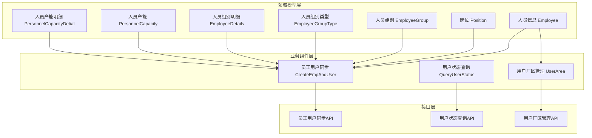
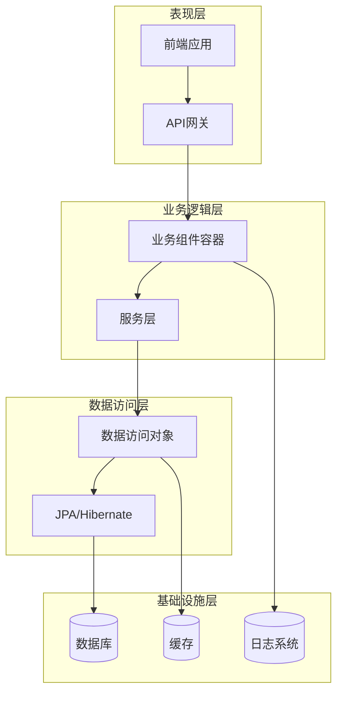
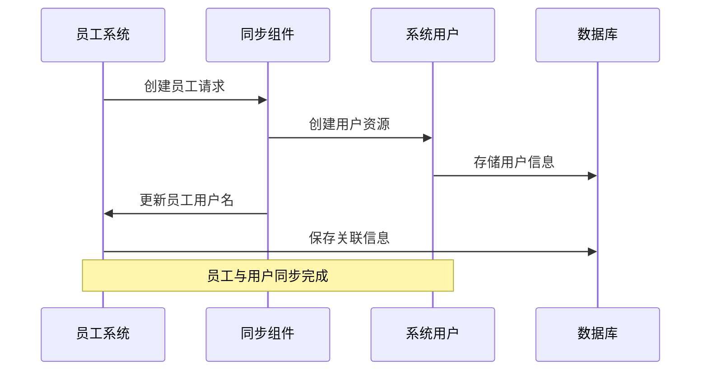
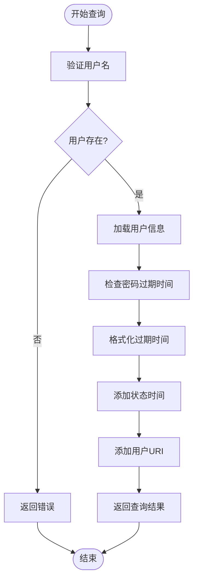
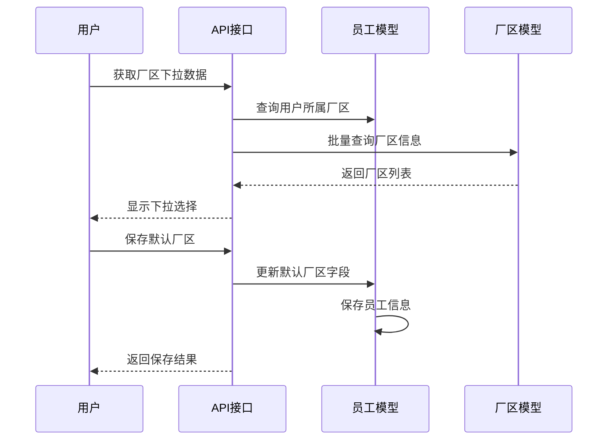
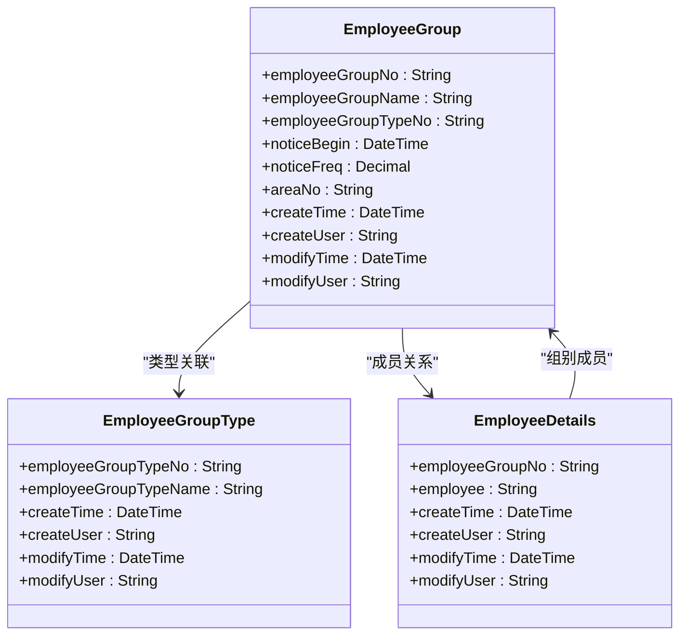
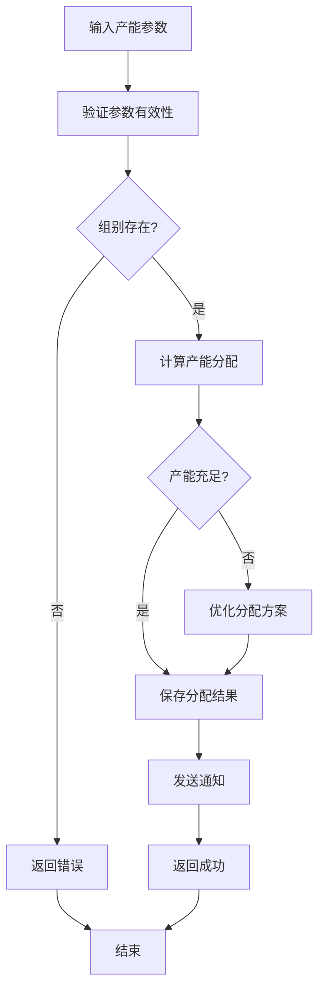
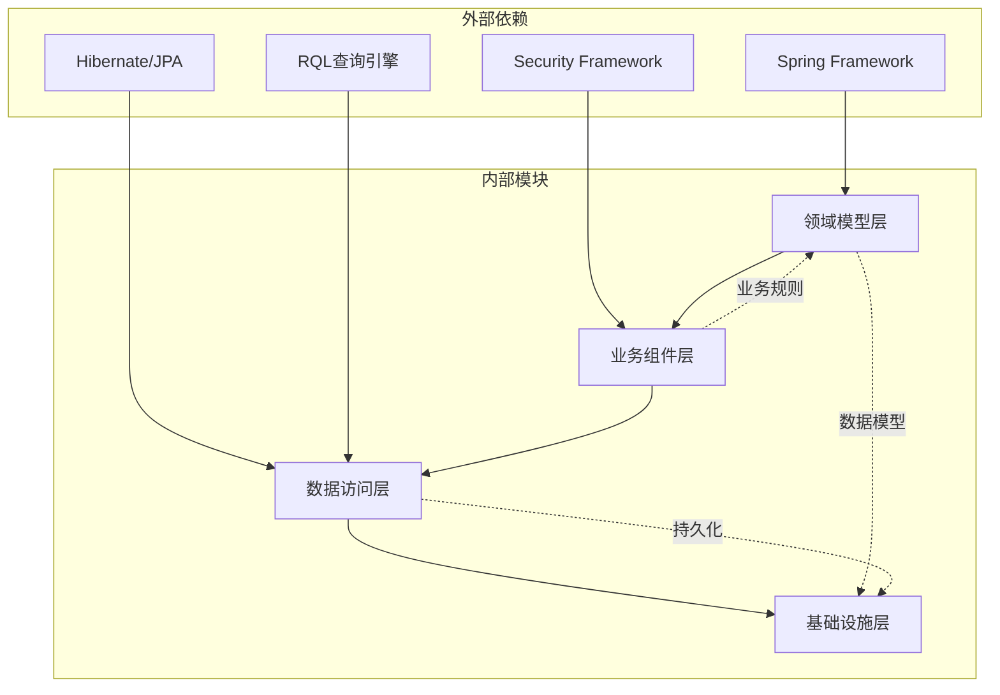

# 人员管理API

<cite>
**本文档引用的文件**
- [Employee.json](file://Domain/公共资源管理/人员管理/人员信息/Employee.json)
- [Position.json](file://Domain/公共资源管理/人员管理/岗位/Position.json)
- [EmployeeGroup.json](file://Domain/公共资源管理/人员管理/人员组别/EmployeeGroup.json)
- [EmployeeGroupType.json](file://Domain/公共资源管理/人员管理/人员组别/EmployeeGroupType.json)
- [EmployeeDetails.json](file://Domain/公共资源管理/人员管理/人员组别/EmployeeDetails.json)
- [PersonnelCapacity.json](file://Domain/公共资源管理/人员管理/人员产能/PersonnelCapacity.json)
- [PersonnelCapacityDetial.json](file://Domain/公共资源管理/人员管理/人员产能/PersonnelCapacityDetial.json)
- [CreateEmpAndUser.groovy](file://bzc/公共资源管理/人员管理/人员信息/CreateEmpAndUser.groovy)
- [QueryUserStatus.groovy](file://bzc/公共资源管理/人员管理/人员信息/QueryUserStatus.groovy)
- [UserArea.groovy](file://bzc/公共资源管理/人员管理/人员信息/UserArea.groovy)
</cite>

## 目录
1. [简介](#简介)
2. [项目结构](#项目结构)
3. [核心组件](#核心组件)
4. [架构概览](#架构概览)
5. [详细组件分析](#详细组件分析)
6. [依赖分析](#依赖分析)
7. [性能考虑](#性能考虑)
8. [故障排除指南](#故障排除指南)
9. [结论](#结论)

## 简介

CMES人员管理系统是一个集成的企业资源管理平台，专注于人员信息管理、岗位管理、人员组别管理和人员产能管理四大核心功能模块。该系统通过统一的API接口提供完整的人员生命周期管理能力，包括员工信息维护、用户账户同步、权限管理、默认厂区设置以及产能分配等功能。

系统采用领域驱动设计（DDD）架构，通过领域模型（Domain）定义业务实体，业务组件（BZC）实现业务逻辑，确保了系统的可维护性和扩展性。所有API接口均遵循RESTful设计原则，提供标准化的HTTP方法和响应格式。

## 项目结构

人员管理模块采用清晰的分层架构，按照功能域进行组织：



**图表来源**
- [Employee.json:1-743](file://Domain/公共资源管理/人员管理/人员信息/Employee.json#L1-L743)
- [Position.json:1-275](file://Domain/公共资源管理/人员管理/岗位/Position.json#L1-L275)
- [CreateEmpAndUser.groovy:1-590](file://bzc/公共资源管理/人员管理/人员信息/CreateEmpAndUser.groovy#L1-L590)

**章节来源**
- [Employee.json:1-743](file://Domain/公共资源管理/人员管理/人员信息/Employee.json#L1-L743)
- [Position.json:1-275](file://Domain/公共资源管理/人员管理/岗位/Position.json#L1-L275)
- [EmployeeGroup.json:1-327](file://Domain/公共资源管理/人员管理/人员组别/EmployeeGroup.json#L1-L327)

## 核心组件

### 员工信息管理

员工信息管理模块提供完整的员工数据维护功能，包括基本信息、联系方式、部门归属、岗位信息等。系统通过领域模型定义了详细的员工属性，支持多厂区管理、部门关联和岗位映射。

### 岗位管理

岗位管理模块负责企业内部岗位的标准化管理，包括岗位编码、名称、部门归属、上级领导等信息。系统支持岗位层级关系维护，为人员组别和权限管理提供基础数据支撑。

### 人员组别管理

人员组别管理模块实现了灵活的人员组织结构，支持多层级的组别类型和成员管理。系统通过组合模式实现组别与成员的动态关联，支持通知频率、生效时间等高级特性。

### 人员产能管理

人员产能管理模块提供精确的人员资源配置能力，包括班组分配、岗位映射、工段工序关联等。系统支持资源量统计和产能优化，为企业生产计划提供数据支撑。

**章节来源**
- [EmployeeDetails.json:1-223](file://Domain/公共资源管理/人员管理/人员组别/EmployeeDetails.json#L1-L223)
- [PersonnelCapacity.json:1-249](file://Domain/公共资源管理/人员管理/人员产能/PersonnelCapacity.json#L1-L249)
- [PersonnelCapacityDetial.json:1-275](file://Domain/公共资源管理/人员管理/人员产能/PersonnelCapacityDetial.json#L1-L275)

## 架构概览

系统采用分层架构设计，确保关注点分离和模块化管理：



**图表来源**
- [CreateEmpAndUser.groovy:37-130](file://bzc/公共资源管理/人员管理/人员信息/CreateEmpAndUser.groovy#L37-L130)
- [QueryUserStatus.groovy:21-144](file://bzc/公共资源管理/人员管理/人员信息/QueryUserStatus.groovy#L21-L144)

系统的核心优势在于其松耦合的设计，业务组件通过统一的接口与领域模型交互，确保了系统的可扩展性和可维护性。

## 详细组件分析

### 员工用户同步机制

员工用户同步机制是系统的核心功能之一，实现了员工信息与系统用户的双向同步。该机制确保了用户认证、授权和权限管理的一致性。

#### 同步流程



**图表来源**
- [CreateEmpAndUser.groovy:91-130](file://bzc/公共资源管理/人员管理/人员信息/CreateEmpAndUser.groovy#L91-L130)
- [CreateEmpAndUser.groovy:140-232](file://bzc/公共资源管理/人员管理/人员信息/CreateEmpAndUser.groovy#L140-L232)

#### API接口定义

**创建员工用户同步**
- HTTP方法: POST
- URL路径: `/api/personnel/employee-user-sync`
- 请求参数:
  - employee: 员工编号 (必填)
  - password: 登录密码 (必填)
  - repassword: 确认密码 (必填)
  - roles: 角色列表 (可选)
  - passwordExpirationTime: 密码过期时间 (可选)
  - enabled: 是否激活 (可选)
- 响应格式: JSON
- 错误码: 200-成功, 400-参数错误, 500-系统错误

**更新员工用户同步**
- HTTP方法: PUT
- URL路径: `/api/personnel/employee-user-sync/{employee}`
- 请求参数: 同创建接口
- 响应格式: JSON
- 错误码: 200-成功, 404-员工不存在, 500-系统错误

**删除员工用户同步**
- HTTP方法: DELETE
- URL路径: `/api/personnel/employee-user-sync/{employee}`
- 响应格式: JSON
- 错误码: 200-成功, 404-用户不存在, 500-系统错误

**章节来源**
- [CreateEmpAndUser.groovy:91-130](file://bzc/公共资源管理/人员管理/人员信息/CreateEmpAndUser.groovy#L91-L130)
- [CreateEmpAndUser.groovy:140-356](file://bzc/公共资源管理/人员管理/人员信息/CreateEmpAndUser.groovy#L140-L356)

### 用户状态查询

用户状态查询功能提供了全面的用户账户信息查询能力，包括密码有效期、激活状态、停用启用时间等关键信息。

#### 查询流程



**图表来源**
- [QueryUserStatus.groovy:62-109](file://bzc/公共资源管理/人员管理/人员信息/QueryUserStatus.groovy#L62-L109)

#### API接口定义

**查询用户状态**
- HTTP方法: GET
- URL路径: `/api/personnel/user-status`
- 请求参数:
  - username: 登录用户 (必填)
- 响应格式: JSON
- 错误码: 200-成功, 400-参数错误, 404-用户不存在

**响应数据结构**
```json
{
  "passwordLifetime": "密码有效期(分钟)",
  "passwordExpirationTime": "密码过期时间",
  "enabled": "是否激活",
  "userStatusTime": "停用/启用时间",
  "userUri": "用户URI路径"
}
```

**章节来源**
- [QueryUserStatus.groovy:40-109](file://bzc/公共资源管理/人员管理/人员信息/QueryUserStatus.groovy#L40-L109)

### 默认厂区管理

默认厂区管理功能允许用户设置和维护个人的默认工作厂区，支持下拉选择和实时保存功能。

#### 厂区管理流程



**图表来源**
- [UserArea.groovy:113-182](file://bzc/公共资源管理/人员管理/人员信息/UserArea.groovy#L113-L182)
- [UserArea.groovy:80-101](file://bzc/公共资源管理/人员管理/人员信息/UserArea.groovy#L80-L101)

#### API接口定义

**获取厂区下拉数据**
- HTTP方法: GET
- URL路径: `/api/personnel/user-area`
- 请求参数:
  - employee: 员工编号 (可选，默认当前登录用户)
- 响应格式: JSON
- 错误码: 200-成功, 400-参数错误

**保存默认厂区**
- HTTP方法: POST
- URL路径: `/api/personnel/user-area`
- 请求参数:
  - selectedValue: 用户选择的厂区编号 (必填)
- 响应格式: JSON
- 错误码: 200-成功, 404-员工不存在

**批量查询优化**
系统采用RQL批量查询技术，避免N+1查询问题，提高数据加载效率。通过一次性查询所有相关厂区信息，减少了数据库访问次数。

**章节来源**
- [UserArea.groovy:113-182](file://bzc/公共资源管理/人员管理/人员信息/UserArea.groovy#L113-L182)
- [UserArea.groovy:42-70](file://bzc/公共资源管理/人员管理/人员信息/UserArea.groovy#L42-L70)

### 人员组别管理

人员组别管理模块实现了灵活的组织结构管理，支持多层级的组别类型和成员关系维护。

#### 组别层级关系



**图表来源**
- [EmployeeGroup.json:34-321](file://Domain/公共资源管理/人员管理/人员组别/EmployeeGroup.json#L34-L321)
- [EmployeeGroupType.json:34-216](file://Domain/公共资源管理/人员管理/人员组别/EmployeeGroupType.json#L34-L216)
- [EmployeeDetails.json:34-216](file://Domain/公共资源管理/人员管理/人员组别/EmployeeDetails.json#L34-L216)

#### API接口定义

**创建人员组别**
- HTTP方法: POST
- URL路径: `/api/personnel/employee-groups`
- 请求参数: 组别基本信息
- 响应格式: JSON
- 错误码: 201-创建成功, 400-参数错误

**获取人员组别列表**
- HTTP方法: GET
- URL路径: `/api/personnel/employee-groups`
- 响应格式: JSON
- 错误码: 200-成功

**添加组别成员**
- HTTP方法: POST
- URL路径: `/api/personnel/employee-groups/{groupNo}/members`
- 请求参数: 成员信息
- 响应格式: JSON
- 错误码: 201-添加成功, 404-组别不存在

**移除组别成员**
- HTTP方法: DELETE
- URL路径: `/api/personnel/employee-groups/{groupNo}/members/{employee}`
- 响应格式: JSON
- 错误码: 200-删除成功, 404-关系不存在

**章节来源**
- [EmployeeGroup.json:34-321](file://Domain/公共资源管理/人员管理/人员组别/EmployeeGroup.json#L34-L321)
- [EmployeeDetails.json:34-216](file://Domain/公共资源管理/人员管理/人员组别/EmployeeDetails.json#L34-L216)

### 人员产能管理

人员产能管理模块提供精确的人员资源配置和统计分析功能，支持按班组、岗位、工段等维度进行产能分配。

#### 产能分配机制



**图表来源**
- [PersonnelCapacity.json:34-242](file://Domain/公共资源管理/人员管理/人员产能/PersonnelCapacity.json#L34-L242)
- [PersonnelCapacityDetial.json:34-268](file://Domain/公共资源管理/人员管理/人员产能/PersonnelCapacityDetial.json#L34-L268)

#### API接口定义

**创建人员产能**
- HTTP方法: POST
- URL路径: `/api/personnel/personnel-capacity`
- 请求参数: 产能分配信息
- 响应格式: JSON
- 错误码: 201-创建成功, 400-参数错误

**获取产能统计**
- HTTP方法: GET
- URL路径: `/api/personnel/personnel-capacity/stats`
- 请求参数:
  - startDate: 开始日期 (可选)
  - endDate: 结束日期 (可选)
  - areaNo: 厂区编号 (可选)
- 响应格式: JSON
- 错误码: 200-成功

**更新产能详情**
- HTTP方法: PUT
- URL路径: `/api/personnel/personnel-capacity/{id}`
- 请求参数: 产能详情信息
- 响应格式: JSON
- 错误码: 200-更新成功, 404-记录不存在

**章节来源**
- [PersonnelCapacity.json:34-242](file://Domain/公共资源管理/人员管理/人员产能/PersonnelCapacity.json#L34-L242)
- [PersonnelCapacityDetial.json:34-268](file://Domain/公共资源管理/人员管理/人员产能/PersonnelCapacityDetial.json#L34-L268)

## 依赖分析

系统各组件之间的依赖关系体现了清晰的分层架构：



**图表来源**
- [CreateEmpAndUser.groovy:1-590](file://bzc/公共资源管理/人员管理/人员信息/CreateEmpAndUser.groovy#L1-L590)
- [QueryUserStatus.groovy:1-144](file://bzc/公共资源管理/人员管理/人员信息/QueryUserStatus.groovy#L1-L144)

系统采用依赖注入模式，通过Spring框架管理组件生命周期，确保了组件间的松耦合和高内聚。

**章节来源**
- [CreateEmpAndUser.groovy:1-590](file://bzc/公共资源管理/人员管理/人员信息/CreateEmpAndUser.groovy#L1-L590)
- [QueryUserStatus.groovy:1-144](file://bzc/公共资源管理/人员管理/人员信息/QueryUserStatus.groovy#L1-L144)

## 性能考虑

系统在设计时充分考虑了性能优化，采用了多种策略提升响应速度和吞吐量：

### 缓存策略
- 用户状态信息采用Redis缓存，减少数据库查询压力
- 厂区信息批量查询使用内存缓存，避免重复计算
- 岗位层级关系缓存，提升组别查询性能

### 查询优化
- 使用RQL批量查询替代N+1查询模式
- 员工与用户关联查询使用JOIN优化
- 大数据量场景采用分页查询和索引优化

### 异步处理
- 用户密码强度验证异步执行
- 厂区信息同步采用消息队列
- 产能统计报表异步生成

## 故障排除指南

### 常见问题及解决方案

**用户同步失败**
- 检查员工编号是否唯一且存在
- 验证密码强度是否符合系统要求
- 确认用户分类目录是否正确创建

**用户状态查询异常**
- 验证用户名格式是否正确
- 检查用户是否存在且已激活
- 确认系统配置中密码过期时间格式

**默认厂区设置失败**
- 验证厂区编号是否在员工权限范围内
- 检查员工所属厂区字符串格式
- 确认批量查询RQL语法正确性

**产能分配冲突**
- 检查组别成员数量是否超过限制
- 验证工段工序编码是否有效
- 确认资源量分配是否合理

**章节来源**
- [CreateEmpAndUser.groovy:175-191](file://bzc/公共资源管理/人员管理/人员信息/CreateEmpAndUser.groovy#L175-L191)
- [UserArea.groovy:134-140](file://bzc/公共资源管理/人员管理/人员信息/UserArea.groovy#L134-L140)

## 结论

CMES人员管理系统通过模块化的架构设计和完善的API接口，为企业提供了全面的人员管理解决方案。系统不仅涵盖了传统的员工信息管理功能，还集成了现代企业所需的用户权限管理、默认厂区设置和产能分配等高级功能。

通过采用领域驱动设计和分层架构，系统确保了良好的可维护性和扩展性。同时，通过性能优化和故障排除机制，保证了系统的稳定运行和高效性能。

未来可以进一步增强的功能包括：移动端适配、多语言支持、审计日志完善、实时通知机制等，以满足企业不断发展的管理需求。