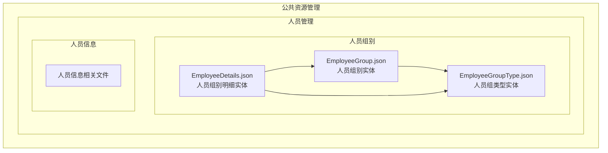
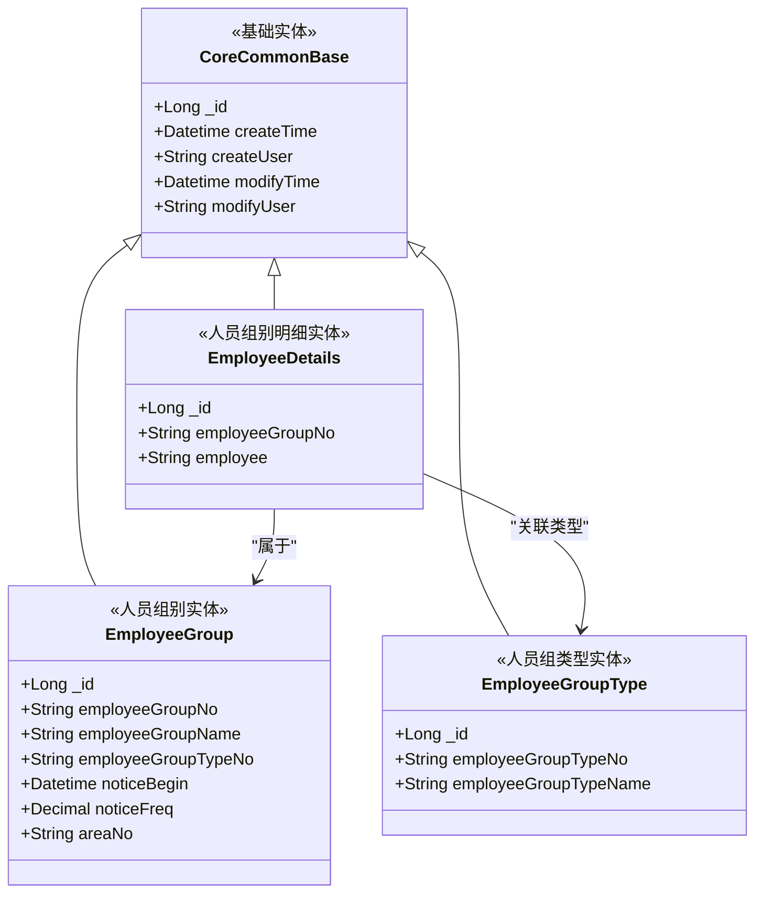
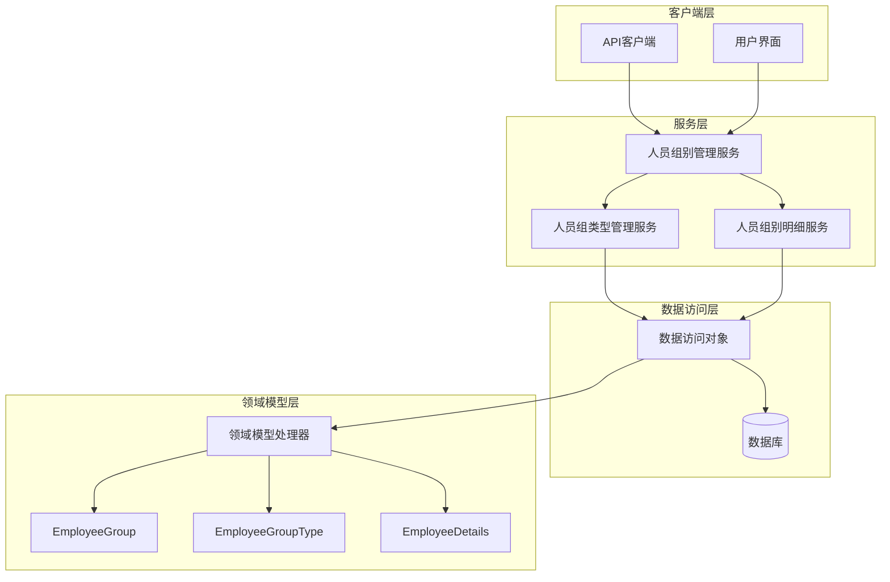
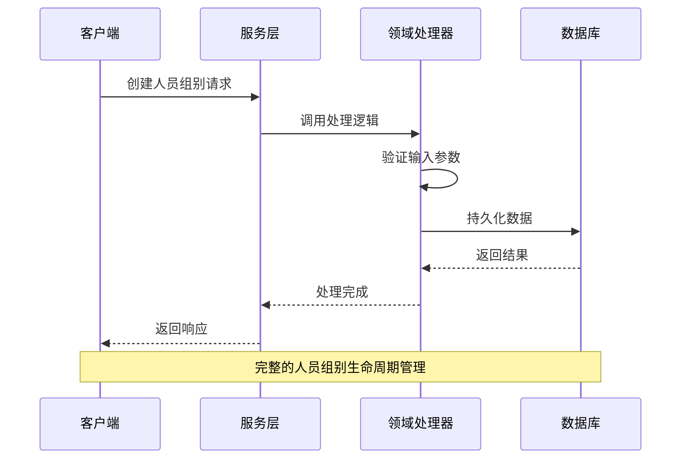
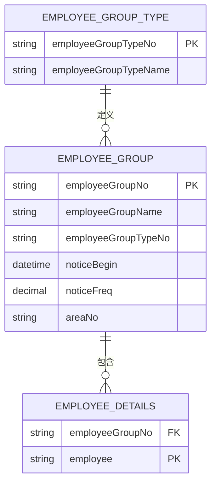
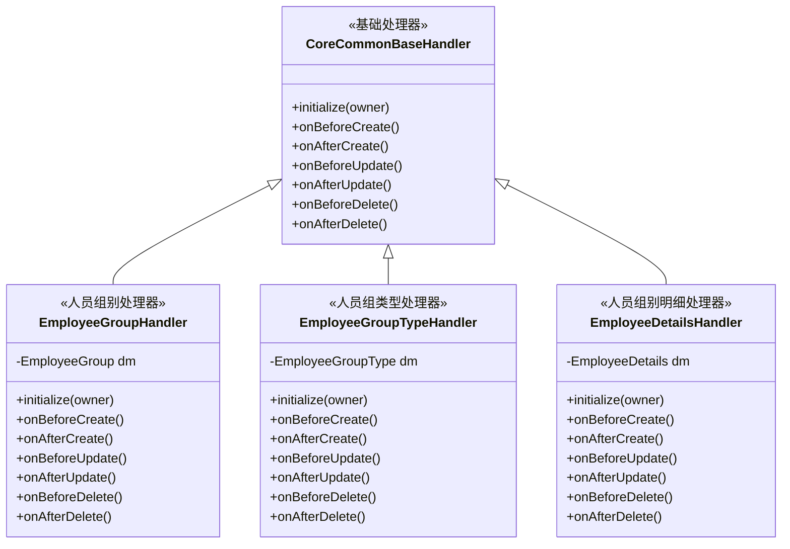
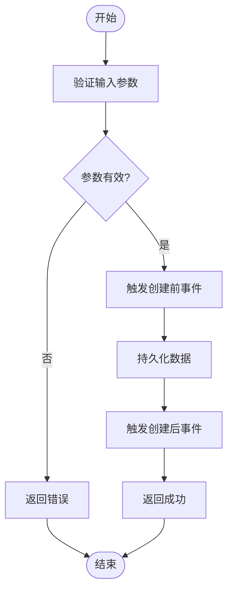

# 人员组别管理API

<cite>
**本文档引用的文件**
- [EmployeeGroup.json](file://Domain/公共资源管理/人员管理/人员组别/EmployeeGroup.json)
- [EmployeeGroupType.json](file://Domain/公共资源管理/人员管理/人员组别/EmployeeGroupType.json)
- [EmployeeDetails.json](file://Domain/公共资源管理/人员管理/人员组别/EmployeeDetails.json)
</cite>

## 目录
1. [简介](#简介)
2. [项目结构](#项目结构)
3. [核心组件](#核心组件)
4. [架构概览](#架构概览)
5. [详细组件分析](#详细组件分析)
6. [依赖关系分析](#依赖关系分析)
7. [性能考虑](#性能考虑)
8. [故障排除指南](#故障排除指南)
9. [结论](#结论)

## 简介

人员组别管理模块是CMES（制造执行系统）中的核心人力资源管理功能，负责维护和管理企业内部的人员组织结构。该模块通过三层架构实现了完整的人员组别生命周期管理，包括组别类型定义、组别创建、成员管理以及权限控制等功能。

本模块采用领域驱动设计（DDD）原则，通过JSON配置文件定义了三个核心实体：EmployeeGroup（人员组别）、EmployeeGroupType（人员组类型）和EmployeeDetails（人员组别明细），形成了完整的人员组织管理体系。

## 项目结构

人员组别管理模块位于系统的公共资源管理领域中，采用层次化的文件组织结构：

**图表来源**
- [EmployeeGroup.json:1-327](file://Domain/公共资源管理/人员管理/人员组别/EmployeeGroup.json#L1-L327)
- [EmployeeGroupType.json:1-223](file://Domain/公共资源管理/人员管理/人员组别/EmployeeGroupType.json#L1-L223)
- [EmployeeDetails.json:1-223](file://Domain/公共资源管理/人员管理/人员组别/EmployeeDetails.json#L1-L223)

**章节来源**
- [EmployeeGroup.json:1-327](file://Domain/公共资源管理/人员管理/人员组别/EmployeeGroup.json#L1-L327)
- [EmployeeGroupType.json:1-223](file://Domain/公共资源管理/人员管理/人员组别/EmployeeGroupType.json#L1-L223)
- [EmployeeDetails.json:1-223](file://Domain/公共资源管理/人员管理/人员组别/EmployeeDetails.json#L1-L223)

## 核心组件

### 数据模型概述

人员组别管理模块基于三个核心实体构建，每个实体都继承自通用的基础领域模型：

**图表来源**
- [EmployeeGroup.json:34-321](file://Domain/公共资源管理/人员管理/人员组别/EmployeeGroup.json#L34-L321)
- [EmployeeGroupType.json:34-217](file://Domain/公共资源管理/人员管理/人员组别/EmployeeGroupType.json#L34-L217)
- [EmployeeDetails.json:34-217](file://Domain/公共资源管理/人员管理/人员组别/EmployeeDetails.json#L34-L217)

### 核心属性详解

#### EmployeeGroup（人员组别）
- **employeeGroupNo**: 人员组编码（唯一标识符，长度30字符）
- **employeeGroupName**: 人员组名称（可选，长度50字符）
- **employeeGroupTypeNo**: 人员组类型编码（关联到组类型）
- **noticeBegin**: 通知起始时间（可选）
- **noticeFreq**: 通知频率（小时为单位，精度6位）
- **areaNo**: 厂区编码（可选）

#### EmployeeGroupType（人员组类型）
- **employeeGroupTypeNo**: 人员组类型编码（唯一标识符，长度30字符）
- **employeeGroupTypeName**: 人员组类型名称（可选，长度50字符）

#### EmployeeDetails（人员组别明细）
- **employeeGroupNo**: 人员组编码（复合唯一索引的一部分）
- **employee**: 雇员ID（复合唯一索引的一部分）

**章节来源**
- [EmployeeGroup.json:65-190](file://Domain/公共资源管理/人员管理/人员组别/EmployeeGroup.json#L65-L190)
- [EmployeeGroupType.json:65-112](file://Domain/公共资源管理/人员管理/人员组别/EmployeeGroupType.json#L65-L112)
- [EmployeeDetails.json:65-112](file://Domain/公共资源管理/人员管理/人员组别/EmployeeDetails.json#L65-L112)

## 架构概览

### 系统架构图

### 数据流图

## 详细组件分析

### EmployeeGroup（人员组别实体）

#### 属性定义与约束

| 属性名 | 类型 | 长度 | 是否必填 | 唯一性 | 描述 |
|--------|------|------|----------|--------|------|
| _id | Long | - | 是 | 主键 | 系统自动生成的唯一标识符 |
| employeeGroupNo | String | 30 | 是 | 唯一 | 人员组编码，全局唯一 |
| employeeGroupName | String | 50 | 否 | 无 | 人员组名称 |
| employeeGroupTypeNo | String | 30 | 是 | 无 | 关联的组类型编码 |
| noticeBegin | Datetime | - | 否 | 无 | 通知起始时间 |
| noticeFreq | Decimal | 24,6 | 否 | 无 | 通知频率（小时） |
| areaNo | String | - | 否 | 无 | 厂区编码 |
| createTime | Datetime | - | 否 | 无 | 创建时间 |
| createUser | String | 30 | 否 | 无 | 创建用户 |
| modifyTime | Datetime | - | 否 | 无 | 最后修改时间 |
| modifyUser | String | 30 | 否 | 无 | 最后修改用户 |

#### 业务规则

1. **唯一性约束**: employeeGroupNo 必须全局唯一
2. **关联完整性**: employeeGroupTypeNo 必须对应存在的组类型
3. **时间字段**: noticeBegin 和 noticeFreq 需要配合使用
4. **层级结构**: 支持多层级的组别嵌套管理

### EmployeeGroupType（人员组类型实体）

#### 属性定义

| 属性名 | 类型 | 长度 | 是否必填 | 唯一性 | 描述 |
|--------|------|------|----------|--------|------|
| _id | Long | - | 是 | 主键 | 系统自动生成的唯一标识符 |
| employeeGroupTypeNo | String | 30 | 是 | 唯一 | 组类型编码，全局唯一 |
| employeeGroupTypeName | String | 50 | 否 | 无 | 组类型名称 |
| createTime | Datetime | - | 否 | 无 | 创建时间 |
| createUser | String | 30 | 否 | 无 | 创建用户 |
| modifyTime | Datetime | - | 否 | 无 | 最后修改时间 |
| modifyUser | String | 30 | 否 | 无 | 最后修改用户 |

#### 功能特性

1. **类型分类**: 定义不同类型的人员组别（如生产组、质检组、管理组等）
2. **模板作用**: 作为创建组别的模板和规范
3. **权限控制**: 不同类型可能具有不同的操作权限

### EmployeeDetails（人员组别明细实体）

#### 属性定义与复合唯一性

| 属性名 | 类型 | 长度 | 是否必填 | 唯一性 | 描述 |
|--------|------|------|----------|--------|------|
| _id | Long | - | 是 | 主键 | 系统自动生成的唯一标识符 |
| employeeGroupNo | String | 30 | 是 | 复合唯一(与employee组合) | 所属人员组编码 |
| employee | String | 30 | 是 | 复合唯一(与employeeGroupNo组合) | 雇员ID |
| createTime | Datetime | - | 否 | 无 | 创建时间 |
| createUser | String | 30 | 否 | 无 | 创建用户 |
| modifyTime | Datetime | - | 否 | 无 | 最后修改时间 |
| modifyUser | String | 30 | 否 | 无 | 最后修改用户 |

#### 关系映射

**图表来源**
- [EmployeeGroup.json:65-190](file://Domain/公共资源管理/人员管理/人员组别/EmployeeGroup.json#L65-L190)
- [EmployeeGroupType.json:65-112](file://Domain/公共资源管理/人员管理/人员组别/EmployeeGroupType.json#L65-L112)
- [EmployeeDetails.json:65-112](file://Domain/公共资源管理/人员管理/人员组别/EmployeeDetails.json#L65-L112)

**章节来源**
- [EmployeeGroup.json:34-321](file://Domain/公共资源管理/人员管理/人员组别/EmployeeGroup.json#L34-L321)
- [EmployeeGroupType.json:34-217](file://Domain/公共资源管理/人员管理/人员组别/EmployeeGroupType.json#L34-L217)
- [EmployeeDetails.json:34-217](file://Domain/公共资源管理/人员管理/人员组别/EmployeeDetails.json#L34-L217)

## 依赖关系分析

### 处理器架构

每个实体都配备了相应的领域处理器，用于实现业务逻辑和数据验证：

**图表来源**
- [EmployeeGroup.json:323](file://Domain/公共资源管理/人员管理/人员组别/EmployeeGroup.json#L323)
- [EmployeeGroupType.json:219](file://Domain/公共资源管理/人员管理/人员组别/EmployeeGroupType.json#L219)
- [EmployeeDetails.json:219](file://Domain/公共资源管理/人员管理/人员组别/EmployeeDetails.json#L219)

### 事件处理流程

**章节来源**
- [EmployeeGroup.json:323-327](file://Domain/公共资源管理/人员管理/人员组别/EmployeeGroup.json#L323-L327)
- [EmployeeGroupType.json:219-223](file://Domain/公共资源管理/人员管理/人员组别/EmployeeGroupType.json#L219-L223)
- [EmployeeDetails.json:219-223](file://Domain/公共资源管理/人员管理/人员组别/EmployeeDetails.json#L219-L223)

## 性能考虑

### 查询优化策略

1. **索引设计**: 建议为 employeeGroupNo、employeeGroupTypeNo、employee 等常用查询字段建立索引
2. **分页查询**: 对于大量数据的查询操作，建议实现分页机制
3. **缓存策略**: 对于频繁访问的组类型信息，可以考虑引入缓存层

### 存储优化

1. **数据压缩**: 对于文本类型的描述信息，可以考虑压缩存储
2. **归档策略**: 对历史数据实施定期归档，减少主表数据量
3. **分区设计**: 对于超大规模数据，可以考虑按时间或业务维度进行分区

## 故障排除指南

### 常见问题及解决方案

#### 数据唯一性冲突
- **问题**: 创建人员组别时出现编码重复
- **原因**: employeeGroupNo 或 employeeGroupTypeNo 重复
- **解决**: 检查现有数据，生成新的唯一编码

#### 关联数据不一致
- **问题**: 删除组类型后，相关组别数据无法正常显示
- **原因**: 外键约束或级联删除设置不当
- **解决**: 实施适当的级联删除策略或手动清理关联数据

#### 性能问题
- **问题**: 查询响应时间过长
- **原因**: 缺少必要的索引或查询条件不当
- **解决**: 添加合适的索引，优化查询语句

### 错误处理机制

系统通过领域处理器的事件回调机制实现统一的错误处理：

1. **前置验证**: 在数据持久化前进行完整性检查
2. **异常捕获**: 捕获并处理各种业务异常
3. **回滚机制**: 发生错误时自动回滚事务
4. **日志记录**: 记录详细的错误信息便于排查

**章节来源**
- [EmployeeGroup.json:323-327](file://Domain/公共资源管理/人员管理/人员组别/EmployeeGroup.json#L323-L327)
- [EmployeeGroupType.json:219-223](file://Domain/公共资源管理/人员管理/人员组别/EmployeeGroupType.json#L219-L223)
- [EmployeeDetails.json:219-223](file://Domain/公共资源管理/人员管理/人员组别/EmployeeDetails.json#L219-L223)

## 结论

人员组别管理模块通过清晰的三层架构设计，实现了完整的人员组织管理功能。三个核心实体相互协作，形成了灵活而强大的人员组别管理体系。

该模块的主要优势包括：

1. **清晰的层次结构**: 通过组类型、组别和明细的分层设计，实现了复杂的组织关系管理
2. **完善的生命周期管理**: 从创建到删除的全生命周期支持
3. **灵活的权限控制**: 通过组类型定义不同的权限级别
4. **可扩展性**: 基于领域模型的设计便于功能扩展和定制

未来可以考虑的功能增强方向：
- 增加组别层级的可视化管理界面
- 实现更精细的权限粒度控制
- 添加组别间的继承和继承关系管理
- 提供批量操作和导入导出功能