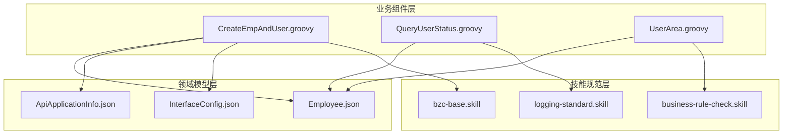
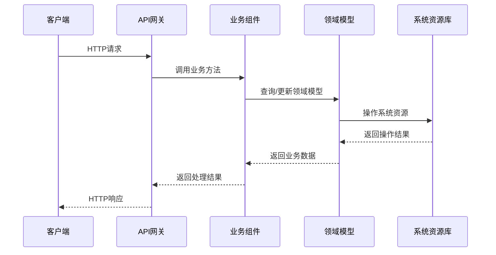
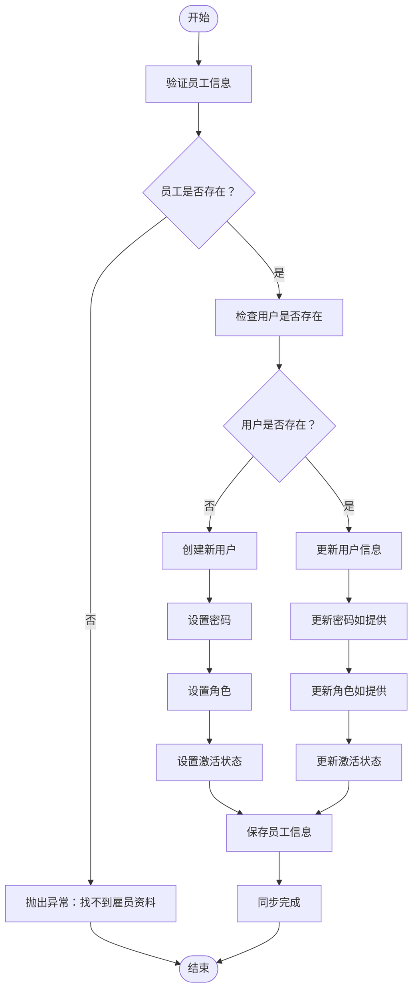
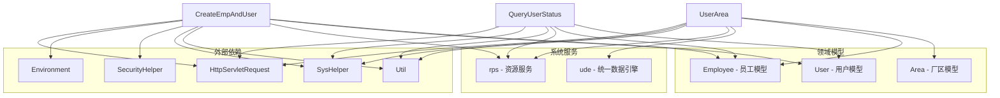

# 员工信息管理API

<cite>
**本文档引用的文件**
- [CreateEmpAndUser.groovy](file://bzc/公共资源管理/人员管理/人员信息/CreateEmpAndUser.groovy)
- [QueryUserStatus.groovy](file://bzc/公共资源管理/人员管理/人员信息/QueryUserStatus.groovy)
- [UserArea.groovy](file://bzc/公共资源管理/人员管理/人员信息/UserArea.groovy)
- [Employee.json](file://Domain/公共资源管理/人员管理/人员信息/Employee.json)
- [ApiApplicationInfo.json](file://Domain/接口管理/ApiApplicationInfo.json)
- [InterfaceConfig.json](file://Domain/接口管理/InterfaceConfig.json)
- [bzc-base.skill](file://skills/architecture/bzc-base.skill)
- [logging-standard.skill](file://skills/foundation/logging-standard.skill)
- [business-rule-check.skill](file://skills/foundation/business-rule-check.skill)
</cite>

## 目录
1. [简介](#简介)
2. [项目结构](#项目结构)
3. [核心组件](#核心组件)
4. [架构概览](#架构概览)
5. [详细组件分析](#详细组件分析)
6. [依赖关系分析](#依赖关系分析)
7. [性能考虑](#性能考虑)
8. [故障排除指南](#故障排除指南)
9. [结论](#结论)

## 简介

员工信息管理模块是一个基于Low-code platform系统的业务组件集合，专门负责员工信息与系统用户的同步管理。该模块实现了员工信息创建、用户账号创建、密码管理、角色分配以及用户状态查询等核心功能。

该系统采用RESTful API设计模式，通过Groovy脚本实现业务逻辑，支持员工与系统用户的双向同步，确保数据一致性。模块包含三个主要业务组件：员工与用户同步创建组件、用户状态查询组件和用户厂区信息管理组件。

## 项目结构



**图表来源**
- [CreateEmpAndUser.groovy:1-590](file://bzc/公共资源管理/人员管理/人员信息/CreateEmpAndUser.groovy#L1-L590)
- [QueryUserStatus.groovy:1-144](file://bzc/公共资源管理/人员管理/人员信息/QueryUserStatus.groovy#L1-L144)
- [UserArea.groovy:1-235](file://bzc/公共资源管理/人员管理/人员信息/UserArea.groovy#L1-L235)

**章节来源**
- [CreateEmpAndUser.groovy:1-50](file://bzc/公共资源管理/人员管理/人员信息/CreateEmpAndUser.groovy#L1-L50)
- [QueryUserStatus.groovy:1-30](file://bzc/公共资源管理/人员管理/人员信息/QueryUserStatus.groovy#L1-L30)
- [UserArea.groovy:1-35](file://bzc/公共资源管理/人员管理/人员信息/UserArea.groovy#L1-L35)

## 核心组件

### 员工与用户同步创建组件

员工与用户同步创建组件是整个系统的核心业务组件，负责在创建、修改、删除员工信息时同步操作对应的系统用户。

**主要功能特性：**
- 支持员工信息与用户账号的一对一同步
- 自动密码加密和强度验证
- 角色权限管理
- 用户激活状态控制
- 密码过期时间管理

**默认配置：**
- 默认角色：base
- 用户存储路径：/repository/system/user/employee
- 密码加密前缀：*: 

**章节来源**
- [CreateEmpAndUser.groovy:75-130](file://bzc/公共资源管理/人员管理/人员信息/CreateEmpAndUser.groovy#L75-L130)
- [CreateEmpAndUser.groovy:140-232](file://bzc/公共资源管理/人员管理/人员信息/CreateEmpAndUser.groovy#L140-L232)

### 用户状态查询组件

用户状态查询组件提供用户信息查询功能，包括密码有效期、激活状态、停用/启用时间等详细信息。

**查询能力：**
- 用户基本信息查询
- 密码有效期管理
- 用户激活状态控制
- 扩展字段支持

**章节来源**
- [QueryUserStatus.groovy:48-109](file://bzc/公共资源管理/人员管理/人员信息/QueryUserStatus.groovy#L48-L109)

### 用户厂区信息管理组件

用户厂区信息管理组件负责维护用户的默认厂区信息，提供下拉选择和保存功能。

**功能特性：**
- 厂区信息下拉选择
- 默认厂区设置
- 厂区权限管理
- 批量查询优化

**章节来源**
- [UserArea.groovy:49-101](file://bzc/公共资源管理/人员管理/人员信息/UserArea.groovy#L49-L101)

## 架构概览



**图表来源**
- [CreateEmpAndUser.groovy:91-130](file://bzc/公共资源管理/人员管理/人员信息/CreateEmpAndUser.groovy#L91-L130)
- [QueryUserStatus.groovy:62-109](file://bzc/公共资源管理/人员管理/人员信息/QueryUserStatus.groovy#L62-L109)
- [UserArea.groovy:113-183](file://bzc/公共资源管理/人员管理/人员信息/UserArea.groovy#L113-L183)

## 详细组件分析

### 员工与用户同步创建API

#### 创建员工和用户API

**HTTP方法：** POST
**URL路径：** `/public_resource_management/personnel_management/employee_information/createEmpAndUser`

**请求参数：**
| 参数名 | 必填 | 类型 | 描述 | 默认值 |
|--------|------|------|------|--------|
| _method | 是 | String | 执行方法：create | - |
| employee | 是 | String | 员工编号 | - |
| password | 是 | String | 登录密码 | - |
| repassword | 是 | String | 确认密码 | - |
| roles | 否 | Array | 角色列表 | ["base"] |
| passwordExpirationTime | 否 | String | 密码过期时间 | null |
| passwordLifetime | 否 | Number | 密码有效期(分钟) | 0 |
| enabled | 否 | Boolean | 是否激活 | true |

**响应格式：**
```json
{
  "username": "string",
  "method": "string"
}
```

**错误码：**
- 400: 参数验证失败
- 404: 员工信息不存在
- 409: 用户已存在
- 500: 系统内部错误

#### 更新员工和用户API

**HTTP方法：** POST
**URL路径：** `/public_resource_management/personnel_management/employee_information/updateEmpAndUser`

**请求参数：**
- 与创建API相同，但_method为"update"

**响应格式：**
```json
{
  "username": "string"
}
```

#### 删除员工和用户API

**HTTP方法：** POST
**URL路径：** `/public_resource_management/personnel_management/employee_information/deleteEmpAndUser`

**请求参数：**
- employee: 员工编号
- _method: "delete"

**响应格式：**
```json
{
  "username": "string"
}
```

**章节来源**
- [CreateEmpAndUser.groovy:91-130](file://bzc/公共资源管理/人员管理/人员信息/CreateEmpAndUser.groovy#L91-L130)
- [CreateEmpAndUser.groovy:140-356](file://bzc/公共资源管理/人员管理/人员信息/CreateEmpAndUser.groovy#L140-L356)

### 用户状态查询API

#### 查询用户状态API

**HTTP方法：** GET
**URL路径：** `/public_resource_management/personnel_management/employee_information/queryUserStatus`

**请求参数：**
| 参数名 | 必填 | 类型 | 描述 |
|--------|------|------|------|
| username | 是 | String | 用户名 |

**响应格式：**
```json
{
  "passwordLifetime": "number",
  "passwordExpirationTime": "string|null",
  "enabled": "boolean",
  "userStatusTime": "string|null",
  "userUri": "string"
}
```

**错误码：**
- 400: 用户名为空
- 404: 用户不存在
- 500: 系统内部错误

**章节来源**
- [QueryUserStatus.groovy:62-109](file://bzc/公共资源管理/人员管理/人员信息/QueryUserStatus.groovy#L62-L109)

### 用户厂区信息管理API

#### 获取厂区下拉列表API

**HTTP方法：** GET
**URL路径：** `/public_resource_management/personnel_management/employee_information/getUserAreaData`

**请求参数：**
| 参数名 | 必填 | 类型 | 描述 | 默认值 |
|--------|------|------|------|--------|
| employee | 否 | String | 员工编号 | 当前登录用户 |
| selectedValue | 否 | String | 选中的厂区编号 | null |

**响应格式：**
```json
{
  "list": [
    {
      "value": "string",
      "name": "string"
    }
  ]
}
```

#### 保存默认厂区API

**HTTP方法：** POST
**URL路径：** `/public_resource_management/personnel_management/employee_information/saveDefaultArea`

**请求参数：**
| 参数名 | 必填 | 类型 | 描述 |
|--------|------|------|------|
| selectedValue | 是 | String | 选中的厂区编号 |

**响应格式：**
```json
{
  "value": "string"
}
```

**错误码：**
- 400: 参数验证失败
- 500: 系统内部错误

**章节来源**
- [UserArea.groovy:113-183](file://bzc/公共资源管理/人员管理/人员信息/UserArea.groovy#L113-L183)
- [UserArea.groovy:186-233](file://bzc/公共资源管理/人员管理/人员信息/UserArea.groovy#L186-L233)

### 员工信息同步流程图



**图表来源**
- [CreateEmpAndUser.groovy:140-232](file://bzc/公共资源管理/人员管理/人员信息/CreateEmpAndUser.groovy#L140-L232)
- [CreateEmpAndUser.groovy:241-329](file://bzc/公共资源管理/人员管理/人员信息/CreateEmpAndUser.groovy#L241-L329)

## 依赖关系分析



**图表来源**
- [CreateEmpAndUser.groovy:3-28](file://bzc/公共资源管理/人员管理/人员信息/CreateEmpAndUser.groovy#L3-L28)
- [QueryUserStatus.groovy:3-16](file://bzc/公共资源管理/人员管理/人员信息/QueryUserStatus.groovy#L3-L16)
- [UserArea.groovy:3-18](file://bzc/公共资源管理/人员管理/人员信息/UserArea.groovy#L3-L18)

**章节来源**
- [CreateEmpAndUser.groovy:14-24](file://bzc/公共资源管理/人员管理/人员信息/CreateEmpAndUser.groovy#L14-L24)
- [QueryUserStatus.groovy:14-16](file://bzc/公共资源管理/人员管理/人员信息/QueryUserStatus.groovy#L14-L16)
- [UserArea.groovy:14-18](file://bzc/公共资源管理/人员管理/人员信息/UserArea.groovy#L14-L18)

## 性能考虑

### 查询优化策略

1. **批量查询优化**
   - 使用RQL批量查询避免N+1问题
   - 支持IN查询语法提高查询效率

2. **缓存策略**
   - 用户状态信息缓存
   - 厂区信息批量获取

### 安全考虑

1. **密码安全**
   - 明文密码自动加密存储
   - 密码强度验证
   - 密码过期时间管理

2. **权限控制**
   - 角色权限分离
   - 用户激活状态控制
   - 接口访问控制

## 故障排除指南

### 常见错误及解决方案

**员工信息不存在**
- 错误信息：找不到雇员资料！
- 解决方案：确认员工编号正确性和员工信息完整性

**用户已存在**
- 错误信息：用户已存在
- 解决方案：检查用户名唯一性或使用更新操作

**密码验证失败**
- 错误信息：密码强度不足
- 解决方案：调整密码复杂度符合系统要求

**章节来源**
- [CreateEmpAndUser.groovy:160-191](file://bzc/公共资源管理/人员管理/人员信息/CreateEmpAndUser.groovy#L160-L191)
- [CreateEmpAndUser.groovy:420-428](file://bzc/公共资源管理/人员管理/人员信息/CreateEmpAndUser.groovy#L420-L428)

### 日志记录规范

系统遵循统一的日志记录规范，建议在以下场景记录日志：

1. **业务操作日志**
   - 员工信息创建/更新/删除
   - 用户账号创建/更新/删除
   - 密码修改操作

2. **异常处理日志**
   - 参数验证失败
   - 系统内部错误
   - 外部接口调用异常

**章节来源**
- [logging-standard.skill:43-89](file://skills/foundation/logging-standard.skill#L43-L89)

## 结论

员工信息管理模块通过三个核心业务组件实现了员工信息与系统用户的完整生命周期管理。系统采用RESTful API设计，具有以下特点：

1. **完整性**：覆盖员工信息管理的所有关键环节
2. **安全性**：完善的密码管理和权限控制机制
3. **可扩展性**：基于领域模型的设计便于功能扩展
4. **易用性**：清晰的API接口和详细的错误处理

该模块为企业的人员管理系统提供了坚实的技术基础，支持员工信息的标准化管理和用户权限的精细化控制。