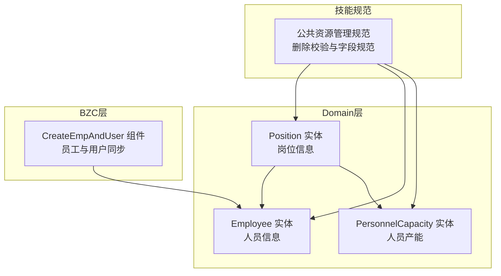
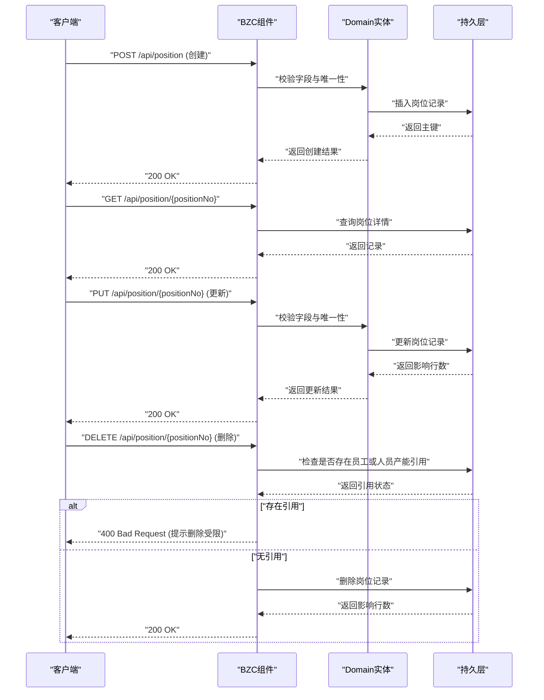
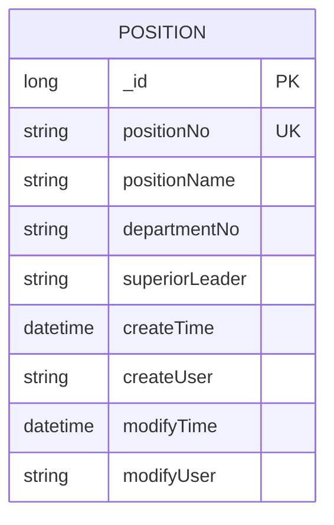
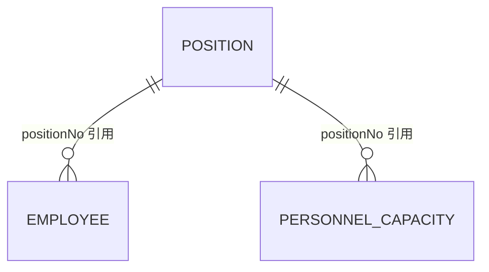
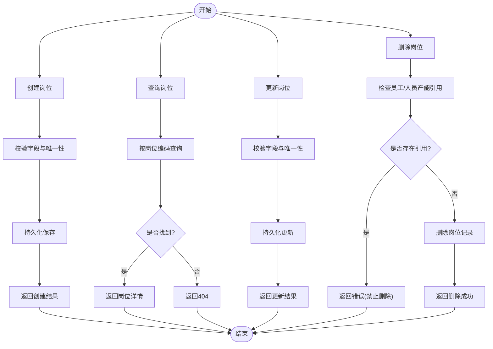
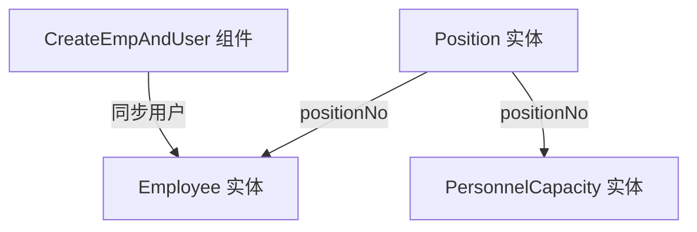

# 岗位管理API

<cite>
**本文档引用的文件**
- [Position.json](file://Domain/公共资源管理/人员管理/岗位/Position.json)
- [Employee.json](file://Domain/公共资源管理/人员管理/人员信息/Employee.json)
- [PersonnelCapacity.json](file://Domain/公共资源管理/人员管理/人员产能/PersonnelCapacity.json)
- [public-resource-management.skill](file://skills/business/public-resource-management.skill)
- [CreateEmpAndUser.groovy](file://bzc/公共资源管理/人员管理/人员信息/CreateEmpAndUser.groovy)
- [bzc-base.skill](file://skills/architecture/bzc-base.skill)
</cite>

## 目录
1. [简介](#简介)
2. [项目结构](#项目结构)
3. [核心组件](#核心组件)
4. [架构总览](#架构总览)
5. [详细组件分析](#详细组件分析)
6. [依赖关系分析](#依赖关系分析)
7. [性能考虑](#性能考虑)
8. [故障排除指南](#故障排除指南)
9. [结论](#结论)

## 简介
本文件面向岗位管理模块的API设计与使用，聚焦于岗位信息的CRUD操作接口，涵盖岗位实体的数据结构、字段定义、层级关系与约束，以及岗位与人员管理之间的关联关系与数据一致性保障机制。文档同时提供典型使用场景与最佳实践建议，帮助开发者与运维人员高效、安全地集成与维护岗位管理能力。

## 项目结构
岗位管理模块位于公共资源管理的人员管理子模块中，采用“Domain实体 + BZC业务组件”的分层设计：
- Domain层：岗位实体定义（Position.json），包含字段元数据、唯一性约束、继承关系等。
- BZC层：岗位相关的业务组件（如人员与用户同步组件），负责与系统用户、权限等外部资源交互。
- 技能规范：公共资源管理模块规范（public-resource-management.skill），定义了模块内的实体关系、删除校验规则与字段命名规范。

**图表来源**
- [Position.json:1-275](file://Domain/公共资源管理/人员管理/岗位/Position.json#L1-L275)
- [Employee.json:1-743](file://Domain/公共资源管理/人员管理/人员信息/Employee.json#L1-L743)
- [PersonnelCapacity.json:1-249](file://Domain/公共资源管理/人员管理/人员产能/PersonnelCapacity.json#L1-L249)
- [public-resource-management.skill:343-355](file://skills/business/public-resource-management.skill#L343-L355)

**章节来源**
- [public-resource-management.skill:1-60](file://skills/business/public-resource-management.skill#L1-L60)

## 核心组件
- 岗位实体（Position）：定义岗位编码、岗位名称、部门编码、上级领导等字段，具备唯一性约束与通用基类字段。
- 人员实体（Employee）：包含岗位编码字段，用于将员工与岗位建立关联。
- 人员产能实体（PersonnelCapacity）：包含岗位编码字段，用于统计与岗位相关的产能信息。
- 岗位删除校验：删除岗位前需检查是否存在员工或人员产能记录引用该岗位编码。

**章节来源**
- [Position.json:34-275](file://Domain/公共资源管理/人员管理/岗位/Position.json#L34-L275)
- [Employee.json:607-631](file://Domain/公共资源管理/人员管理/人员信息/Employee.json#L607-L631)
- [PersonnelCapacity.json:113-138](file://Domain/公共资源管理/人员管理/人员产能/PersonnelCapacity.json#L113-L138)
- [public-resource-management.skill:343-355](file://skills/business/public-resource-management.skill#L343-L355)

## 架构总览
岗位管理API遵循“RESTful + BZC业务组件”的架构模式：
- RESTful接口：由BZC组件暴露HTTP端点（doGet/doPost/doPut/doDelete），处理CRUD请求。
- Domain实体：通过JSON定义实体结构与字段元数据，确保前后端契约一致。
- 业务规则：删除岗位前进行引用检查，防止破坏数据完整性。

**图表来源**
- [CreateEmpAndUser.groovy:91-130](file://bzc/公共资源管理/人员管理/人员信息/CreateEmpAndUser.groovy#L91-L130)
- [public-resource-management.skill:343-355](file://skills/business/public-resource-management.skill#L343-L355)

## 详细组件分析

### 岗位实体（Position）数据模型
岗位实体包含以下关键字段：
- 岗位编码（positionNo）：字符串，长度30，非空且唯一，作为主键标识。
- 岗位名称（positionName）：字符串，长度60，非空。
- 部门编码（departmentNo）：字符串，长度30，可空。
- 上级领导（superiorLeader）：字符串，长度30，可空。
- 通用基类字段：_id、createTime、createUser、modifyTime、modifyUser（继承自CoreCommonBase）。

**图表来源**
- [Position.json:34-275](file://Domain/公共资源管理/人员管理/岗位/Position.json#L34-L275)

**章节来源**
- [Position.json:61-111](file://Domain/公共资源管理/人员管理/岗位/Position.json#L61-L111)

### 岗位与人员管理的关系
- 岗位与员工：员工实体包含岗位编码字段（positionNo），用于将员工与岗位建立关联。
- 岗位与人员产能：人员产能实体包含岗位编码字段（positionNo），用于统计与岗位相关的产能信息。
- 删除约束：删除岗位前需检查是否存在员工或人员产能记录引用该岗位编码，若存在引用则禁止删除。

**图表来源**
- [Employee.json:607-631](file://Domain/公共资源管理/人员管理/人员信息/Employee.json#L607-L631)
- [PersonnelCapacity.json:113-138](file://Domain/公共资源管理/人员管理/人员产能/PersonnelCapacity.json#L113-L138)
- [public-resource-management.skill:343-355](file://skills/business/public-resource-management.skill#L343-L355)

**章节来源**
- [Employee.json:607-631](file://Domain/公共资源管理/人员管理/人员信息/Employee.json#L607-L631)
- [PersonnelCapacity.json:113-138](file://Domain/公共资源管理/人员管理/人员产能/PersonnelCapacity.json#L113-L138)
- [public-resource-management.skill:343-355](file://skills/business/public-resource-management.skill#L343-L355)

### API接口设计与调用流程
- 接口风格：RESTful，由BZC组件暴露doGet/doPost/doPut/doDelete方法。
- 典型流程：创建/查询/更新/删除岗位，删除前进行引用检查。
- 错误处理：删除受限时返回错误信息，确保数据一致性。

**图表来源**
- [CreateEmpAndUser.groovy:91-130](file://bzc/公共资源管理/人员管理/人员信息/CreateEmpAndUser.groovy#L91-L130)
- [public-resource-management.skill:343-355](file://skills/business/public-resource-management.skill#L343-L355)

**章节来源**
- [CreateEmpAndUser.groovy:91-130](file://bzc/公共资源管理/人员管理/人员信息/CreateEmpAndUser.groovy#L91-L130)
- [bzc-base.skill:124-162](file://skills/architecture/bzc-base.skill#L124-L162)

### 数据一致性保证机制
- 唯一性约束：岗位编码（positionNo）唯一，防止重复。
- 引用检查：删除岗位前检查员工与人员产能中是否存在引用，避免悬挂引用。
- 通用基类字段：自动记录创建/修改时间与用户，便于审计与追踪。

**章节来源**
- [Position.json:78-85](file://Domain/公共资源管理/人员管理/岗位/Position.json#L78-L85)
- [public-resource-management.skill:343-355](file://skills/business/public-resource-management.skill#L343-L355)

## 依赖关系分析
- 岗位实体依赖CoreCommonBase，继承通用字段。
- 岗位与员工、人员产能形成一对多引用关系。
- BZC组件通过系统服务访问资源库与用户管理，实现员工与用户同步。

**图表来源**
- [Position.json:34-275](file://Domain/公共资源管理/人员管理/岗位/Position.json#L34-L275)
- [Employee.json:607-631](file://Domain/公共资源管理/人员管理/人员信息/Employee.json#L607-L631)
- [PersonnelCapacity.json:113-138](file://Domain/公共资源管理/人员管理/人员产能/PersonnelCapacity.json#L113-L138)
- [CreateEmpAndUser.groovy:1-50](file://bzc/公共资源管理/人员管理/人员信息/CreateEmpAndUser.groovy#L1-L50)

**章节来源**
- [public-resource-management.skill:343-355](file://skills/business/public-resource-management.skill#L343-L355)

## 性能考虑
- 批量查询优化：使用RQL批量查询减少N+1问题，提升查询效率。
- 删除前检查：提前检查引用关系，避免无效删除尝试带来的开销。
- 字段长度与索引：合理设置字段长度与唯一性约束，降低存储与查询成本。

**章节来源**
- [bzc-base.skill:481-495](file://skills/architecture/bzc-base.skill#L481-L495)

## 故障排除指南
- 删除岗位失败：检查是否存在员工或人员产能记录引用该岗位编码，根据提示清理引用后再试。
- 唯一性冲突：岗位编码重复导致创建/更新失败，修正编码后重试。
- 字段校验错误：确保必填字段非空、长度符合要求，避免非法字符。

**章节来源**
- [public-resource-management.skill:343-355](file://skills/business/public-resource-management.skill#L343-L355)

## 结论
岗位管理模块通过清晰的实体定义、严格的删除校验与完善的业务组件，实现了岗位信息的稳定管理。结合RQL批量查询与统一的RESTful接口风格，既保证了数据一致性，又提升了系统的可维护性与扩展性。建议在实际集成中遵循字段命名规范与删除校验规则，确保业务流程的顺畅与数据的完整性。