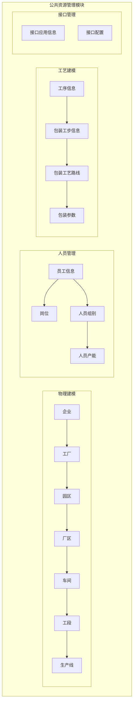
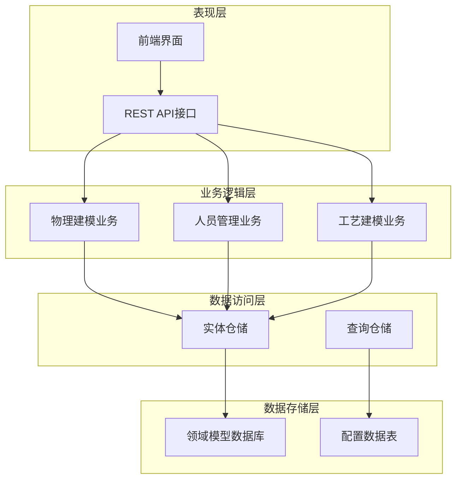
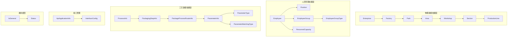

# 公共资源管理API

<cite>
**本文档引用的文件**
- [Employee.json](file://Domain/公共资源管理/人员管理/人员信息/Employee.json)
- [Position.json](file://Domain/公共资源管理/人员管理/岗位/Position.json)
- [EmployeeGroup.json](file://Domain/公共资源管理/人员管理/人员组别/EmployeeGroup.json)
- [EmployeeGroupType.json](file://Domain/公共资源管理/人员管理/人员组别/EmployeeGroupType.json)
- [PersonnelCapacity.json](file://Domain/公共资源管理/人员管理/人员产能/PersonnelCapacity.json)
- [PersonnelCapacityDetial.json](file://Domain/公共资源管理/人员管理/人员产能/PersonnelCapacityDetial.json)
- [ProcessInfo.json](file://Domain/公共资源管理/工艺建模/工序信息/ProcessInfo.json)
- [PackagingStepInfo.json](file://Domain/公共资源管理/工艺建模/包装工步信息/PackagingStepInfo.json)
- [PackageProcessRouteInfo.json](file://Domain/公共资源管理/工艺建模/包装工艺路线/PackageProcessRouteInfo.json)
- [ParameterInfo.json](file://Domain/公共资源管理/工艺建模/包装参数/ParameterInfo.json)
- [ParameterType.json](file://Domain/公共资源管理/工艺建模/包装参数/ParameterType.json)
- [ParameterMatchingType.json](file://Domain/公共资源管理/工艺建模/包装参数/ParameterMatchingType.json)
- [Enterprise.json](file://Domain/公共资源管理/物理建模/1_企业/Enterprise.json)
- [Factory.json](file://Domain/公共资源管理/物理建模/2_工厂/Factory.json)
- [ParkInformation.json](file://Domain/公共资源管理/物理建模/3_园区/ParkInformation.json)
- [Area.json](file://Domain/公共资源管理/物理建模/4_厂区/Area.json)
- [WorkshopInformation.json](file://Domain/公共资源管理/物理建模/5_车间/WorkshopInformation.json)
- [SectionInformation.json](file://Domain/公共资源管理/物理建模/6_工段/SectionInformation.json)
- [ProductionLine.json](file://Domain/公共资源管理/物理建模/7_生产线/ProductionLine.json)
- [ApiApplicationInfo.json](file://Domain/接口管理/ApiApplicationInfo.json)
- [InterfaceConfig.json](file://Domain/接口管理/InterfaceConfig.json)
- [IsGeneral.json](file://Domain/公共资源管理/IsGeneral.json)
- [Status.json](file://Domain/公共资源管理/Status.json)
</cite>

## 目录
1. [简介](#简介)
2. [项目结构](#项目结构)
3. [核心组件](#核心组件)
4. [架构概览](#架构概览)
5. [详细组件分析](#详细组件分析)
6. [依赖关系分析](#依赖关系分析)
7. [性能考虑](#性能考虑)
8. [故障排除指南](#故障排除指南)
9. [结论](#结论)

## 简介

公共资源管理模块是CMES（制造执行系统）的核心组成部分，负责管理企业生产过程中的各类公共资源。该模块涵盖了物理建模、人员管理和工艺建模三大子系统，为整个制造系统提供基础数据支撑。

本模块采用领域驱动设计（DDD）理念，通过JSON配置文件定义各个领域的实体模型，包括企业、工厂、园区、厂区、车间、工段、生产线等物理建模实体，以及员工信息、岗位、人员组别、人员产能等人员管理实体，还有包装工艺路线、工序信息、包装参数等工艺建模实体。

## 项目结构

公共资源管理模块采用分层架构设计，按照功能域进行组织：



**图表来源**
- [Enterprise.json:1-223](file://Domain/公共资源管理/物理建模/1_企业/Enterprise.json#L1-L223)
- [Factory.json:1-249](file://Domain/公共资源管理/物理建模/2_工厂/Factory.json#L1-L249)
- [Employee.json:1-743](file://Domain/公共资源管理/人员管理/人员信息/Employee.json#L1-L743)
- [ProcessInfo.json:1-301](file://Domain/公共资源管理/工艺建模/工序信息/ProcessInfo.json#L1-L301)

**章节来源**
- [Enterprise.json:1-223](file://Domain/公共资源管理/物理建模/1_企业/Enterprise.json#L1-L223)
- [Factory.json:1-249](file://Domain/公共资源管理/物理建模/2_工厂/Factory.json#L1-L249)
- [Employee.json:1-743](file://Domain/公共资源管理/人员管理/人员信息/Employee.json#L1-L743)
- [ProcessInfo.json:1-301](file://Domain/公共资源管理/工艺建模/工序信息/ProcessInfo.json#L1-L301)

## 核心组件

### 物理建模实体

物理建模模块提供了完整的制造业基础设施建模能力，从企业到生产线的层级结构清晰明确：

| 实体层级 | 编码字段 | 名称字段 | 关联关系 |
|---------|---------|---------|---------|
| 企业 | enterpriseNo | enterpriseName | 最高层级 |
| 工厂 | factoryNo | factoryName | 企业下级 |
| 园区 | parkNo | parkName | 工厂下级 |
| 厂区 | areaNo | areaName | 园区内级 |
| 车间 | workshopNo | workshopName | 厂区内级 |
| 工段 | sectionNo | sectionName | 车间内级 |
| 生产线 | productionLineNo | productionLineName | 工段内级 |

### 人员管理实体

人员管理模块涵盖了人力资源管理的核心要素：

| 实体类型 | 主要字段 | 功能特性 |
|---------|---------|---------|
| 员工信息 | employee, fullName, phone, email | 基础员工档案 |
| 岗位 | positionNo, positionName, departmentNo | 组织架构定位 |
| 人员组别 | employeeGroupNo, employeeGroupName | 团队组织管理 |
| 人员产能 | capacityNo, capacityValue | 生产能力评估 |

### 工艺建模实体

工艺建模模块支持复杂的包装工艺流程管理：

| 实体类型 | 主要字段 | 应用场景 |
|---------|---------|---------|
| 工序信息 | processNo, processName, workCenterNo | 生产工序定义 |
| 包装工步信息 | workStepNo, workStepName | 包装操作步骤 |
| 包装工艺路线 | processRouteNo, processRouteName | 工艺流程路径 |
| 包装参数 | parameterNo, parameterName | 工艺参数配置 |

**章节来源**
- [Area.json:1-249](file://Domain/公共资源管理/物理建模/4_厂区/Area.json#L1-L249)
- [WorkshopInformation.json:1-249](file://Domain/公共资源管理/物理建模/5_车间/WorkshopInformation.json#L1-L249)
- [SectionInformation.json:1-301](file://Domain/公共资源管理/物理建模/6_工段/SectionInformation.json#L1-L301)
- [ProductionLine.json:1-431](file://Domain/公共资源管理/物理建模/7_生产线/ProductionLine.json#L1-L431)

## 架构概览

公共资源管理模块采用分层架构，确保各子系统之间的松耦合和高内聚：



**图表来源**
- [ApiApplicationInfo.json:1-431](file://Domain/接口管理/ApiApplicationInfo.json#L1-L431)
- [InterfaceConfig.json:1-379](file://Domain/接口管理/InterfaceConfig.json#L1-L379)

## 详细组件分析

### 物理建模API规范

#### 企业信息管理API

| API类型 | HTTP方法 | URL路径 | 功能描述 |
|---------|---------|---------|---------|
| 查询列表 | GET | `/api/public-resource/enterprise` | 获取企业列表 |
| 查询详情 | GET | `/api/public-resource/enterprise/{enterpriseNo}` | 获取企业详情 |
| 新增企业 | POST | `/api/public-resource/enterprise` | 创建新企业 |
| 更新企业 | PUT | `/api/public-resource/enterprise/{enterpriseNo}` | 更新企业信息 |
| 删除企业 | DELETE | `/api/public-resource/enterprise/{enterpriseNo}` | 删除企业记录 |

**请求参数示例：**
```json
{
  "enterpriseNo": "ENT001",
  "enterpriseName": "示例制造公司",
  "createTime": "2025-12-31T12:50:06.382+08:00",
  "createUser": "admin",
  "modifyTime": "2025-12-31T12:50:06.382+08:00",
  "modifyUser": "admin"
}
```

**响应格式：**
```json
{
  "code": 200,
  "message": "操作成功",
  "data": {
    "enterpriseNo": "ENT001",
    "enterpriseName": "示例制造公司"
  }
}
```

**错误码：**
- 400: 参数验证失败
- 404: 企业不存在
- 500: 服务器内部错误

#### 工厂信息管理API

| API类型 | HTTP方法 | URL路径 | 功能描述 |
|---------|---------|---------|---------|
| 查询列表 | GET | `/api/public-resource/factory` | 获取工厂列表 |
| 查询详情 | GET | `/api/public-resource/factory/{factoryNo}` | 获取工厂详情 |
| 新增工厂 | POST | `/api/public-resource/factory` | 创建新工厂 |
| 更新工厂 | PUT | `/api/public-resource/factory/{factoryNo}` | 更新工厂信息 |
| 删除工厂 | DELETE | `/api/public-resource/factory/{factoryNo}` | 删除工厂记录 |

**请求参数示例：**
```json
{
  "factoryNo": "FACT001",
  "factoryName": "一工厂",
  "enterpriseNo": "ENT001",
  "createTime": "2025-12-31T12:50:27.513+08:00"
}
```

#### 厂区信息管理API

| API类型 | HTTP方法 | URL路径 | 功能描述 |
|---------|---------|---------|---------|
| 查询列表 | GET | `/api/public-resource/area` | 获取厂区列表 |
| 查询详情 | GET | `/api/public-resource/area/{areaNo}` | 获取厂区详情 |
| 新增厂区 | POST | `/api/public-resource/area` | 创建新区区 |
| 更新厂区 | PUT | `/api/public-resource/area/{areaNo}` | 更新厂区信息 |
| 删除厂区 | DELETE | `/api/public-resource/area/{areaNo}` | 删除厂区记录 |

**章节来源**
- [Enterprise.json:61-86](file://Domain/公共资源管理/物理建模/1_企业/Enterprise.json#L61-L86)
- [Factory.json:61-86](file://Domain/公共资源管理/物理建模/2_工厂/Factory.json#L61-L86)
- [Area.json:61-86](file://Domain/公共资源管理/物理建模/4_厂区/Area.json#L61-L86)

### 人员管理API规范

#### 员工信息管理API

| API类型 | HTTP方法 | URL路径 | 功能描述 |
|---------|---------|---------|---------|
| 查询列表 | GET | `/api/public-resource/employee` | 获取员工列表 |
| 查询详情 | GET | `/api/public-resource/employee/{employee}` | 获取员工详情 |
| 新增员工 | POST | `/api/public-resource/employee` | 创建新员工 |
| 更新员工 | PUT | `/api/public-resource/employee/{employee}` | 更新员工信息 |
| 删除员工 | DELETE | `/api/public-resource/employee/{employee}` | 删除员工记录 |

**请求参数示例：**
```json
{
  "employee": "EMP001",
  "fullName": "张三",
  "phone": "13800001111",
  "email": "zhangsan@company.com",
  "employeeJobNumber": "E001",
  "positionNo": "POS001",
  "departmentNo": "DEPT001"
}
```

#### 岗位信息管理API

| API类型 | HTTP方法 | URL路径 | 功能描述 |
|---------|---------|---------|---------|
| 查询列表 | GET | `/api/public-resource/position` | 获取岗位列表 |
| 查询详情 | GET | `/api/public-resource/position/{positionNo}` | 获取岗位详情 |
| 新增岗位 | POST | `/api/public-resource/position` | 创建新岗位 |
| 更新岗位 | PUT | `/api/public-resource/position/{positionNo}` | 更新岗位信息 |
| 删除岗位 | DELETE | `/api/public-resource/position/{positionNo}` | 删除岗位记录 |

**请求参数示例：**
```json
{
  "positionNo": "POS001",
  "positionName": "生产主管",
  "departmentNo": "DEPT001",
  "superiorLeader": "POS002"
}
```

#### 人员组别管理API

| API类型 | HTTP方法 | URL路径 | 功能描述 |
|---------|---------|---------|---------|
| 查询列表 | GET | `/api/public-resource/employee-group` | 获取人员组别列表 |
| 查询详情 | GET | `/api/public-resource/employee-group/{employeeGroupNo}` | 获取人员组别详情 |
| 新增组别 | POST | `/api/public-resource/employee-group` | 创建新人员组别 |
| 更新组别 | PUT | `/api/public-resource/employee-group/{employeeGroupNo}` | 更新人员组别信息 |
| 删除组别 | DELETE | `/api/public-resource/employee-group/{employeeGroupNo}` | 删除人员组别记录 |

**章节来源**
- [Employee.json:61-86](file://Domain/公共资源管理/人员管理/人员信息/Employee.json#L61-L86)
- [Position.json:61-86](file://Domain/公共资源管理/人员管理/岗位/Position.json#L61-L86)
- [EmployeeGroup.json:61-86](file://Domain/公共资源管理/人员管理/人员组别/EmployeeGroup.json#L61-L86)

### 工艺建模API规范

#### 工序信息管理API

| API类型 | HTTP方法 | URL路径 | 功能描述 |
|---------|---------|---------|---------|
| 查询列表 | GET | `/api/public-resource/process` | 获取工序列表 |
| 查询详情 | GET | `/api/public-resource/process/{processNo}` | 获取工序详情 |
| 新增工序 | POST | `/api/public-resource/process` | 创建新工序 |
| 更新工序 | PUT | `/api/public-resource/process/{processNo}` | 更新工序信息 |
| 删除工序 | DELETE | `/api/public-resource/process/{processNo}` | 删除工序记录 |

**请求参数示例：**
```json
{
  "processNo": "PROC001",
  "processName": "包装工序",
  "workCenterNo": "WC001",
  "areaNo": "AREA001",
  "cpflag": "成品标识"
}
```

#### 包装工步信息管理API

| API类型 | HTTP方法 | URL路径 | 功能描述 |
|---------|---------|---------|---------|
| 查询列表 | GET | `/api/public-resource/packaging-step` | 获取包装工步列表 |
| 查询详情 | GET | `/api/public-resource/packaging-step/{workStepNo}` | 获取包装工步详情 |
| 新增工步 | POST | `/api/public-resource/packaging-step` | 创建新包装工步 |
| 更新工步 | PUT | `/api/public-resource/packaging-step/{workStepNo}` | 更新包装工步信息 |
| 删除工步 | DELETE | `/api/public-resource/packaging-step/{workStepNo}` | 删除包装工步记录 |

**请求参数示例：**
```json
{
  "workStepNo": "STEP001",
  "workStepName": "装箱操作",
  "description": "产品装箱标准操作流程"
}
```

#### 包装工艺路线管理API

| API类型 | HTTP方法 | URL路径 | 功能描述 |
|---------|---------|---------|---------|
| 查询列表 | GET | `/api/public-resource/package-process-route` | 获取工艺路线列表 |
| 查询详情 | GET | `/api/public-resource/package-process-route/{processRouteNo}` | 获取工艺路线详情 |
| 新增路线 | POST | `/api/public-resource/package-process-route` | 创建新工艺路线 |
| 更新路线 | PUT | `/api/public-resource/package-process-route/{processRouteNo}` | 更新工艺路线信息 |
| 删除路线 | DELETE | `/api/public-resource/package-process-route/{processRouteNo}` | 删除工艺路线记录 |

**章节来源**
- [ProcessInfo.json:61-86](file://Domain/公共资源管理/工艺建模/工序信息/ProcessInfo.json#L61-L86)
- [PackagingStepInfo.json:61-86](file://Domain/公共资源管理/工艺建模/包装工步信息/PackagingStepInfo.json#L61-L86)
- [PackageProcessRouteInfo.json:61-86](file://Domain/公共资源管理/工艺建模/包装工艺路线/PackageProcessRouteInfo.json#L61-L86)

## 依赖关系分析

公共资源管理模块内部存在复杂的依赖关系，主要体现在以下几个方面：



**图表来源**
- [Employee.json:296-320](file://Domain/公共资源管理/人员管理/人员信息/Employee.json#L296-L320)
- [EmployeeGroup.json:113-138](file://Domain/公共资源管理/人员管理/人员组别/EmployeeGroup.json#L113-L138)
- [ProcessInfo.json:113-138](file://Domain/公共资源管理/工艺建模/工序信息/ProcessInfo.json#L113-L138)

**章节来源**
- [IsGeneral.json:34-112](file://Domain/公共资源管理/IsGeneral.json#L34-L112)
- [Status.json:34-112](file://Domain/公共资源管理/Status.json#L34-L112)

## 性能考虑

公共资源管理模块在设计时充分考虑了性能优化：

### 数据访问优化
- 使用唯一索引确保查询效率
- 合理的字段长度设置避免存储浪费
- 时间戳字段统一格式化处理

### 缓存策略
- 常用配置数据采用缓存机制
- 查询结果进行适当的缓存管理
- 避免重复的数据库查询操作

### 并发控制
- 事务管理确保数据一致性
- 锁机制防止并发冲突
- 异步处理提升用户体验

## 故障排除指南

### 常见问题及解决方案

**1. 数据重复异常**
- 症状：新增实体时报唯一约束冲突
- 解决方案：检查实体编码是否已存在，使用系统提供的唯一性校验

**2. 外键关联异常**
- 症状：更新或删除实体时报外键约束错误
- 解决方案：先清理相关联的子实体，再删除父实体

**3. 权限访问异常**
- 症状：接口调用返回401或403错误
- 解决方案：检查API应用配置和接口权限设置

**4. 数据格式异常**
- 症状：接口返回400错误
- 解决方案：检查请求参数格式是否符合JSON Schema要求

### 日志监控

系统提供完善的日志记录机制：
- 所有API调用都会记录访问日志
- 数据变更操作记录审计日志
- 错误信息包含详细的堆栈跟踪

**章节来源**
- [ApiApplicationInfo.json:191-216](file://Domain/接口管理/ApiApplicationInfo.json#L191-L216)
- [InterfaceConfig.json:140-164](file://Domain/接口管理/InterfaceConfig.json#L140-L164)

## 结论

公共资源管理模块通过精心设计的领域模型和清晰的API接口，为CMES系统提供了完整的公共资源管理能力。模块采用分层架构设计，确保了良好的可维护性和扩展性。

该模块的主要优势包括：
- 完整的物理建模覆盖从企业到生产线的全层级结构
- 丰富的人员管理功能满足HR和生产管理需求  
- 灵活的工艺建模支持复杂的包装工艺流程
- 规范化的API设计便于集成和二次开发
- 完善的错误处理和日志记录机制

通过合理使用本模块提供的API接口，可以有效提升制造企业的资源管理水平，为数字化转型奠定坚实基础。