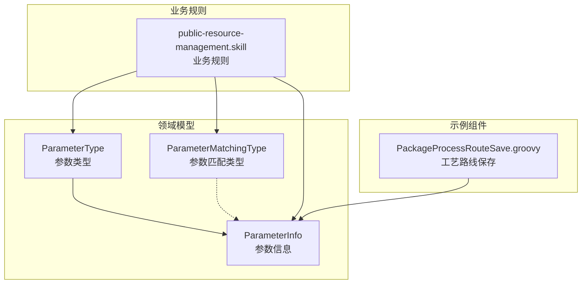
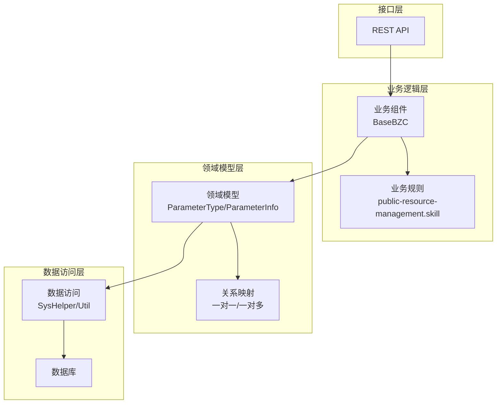
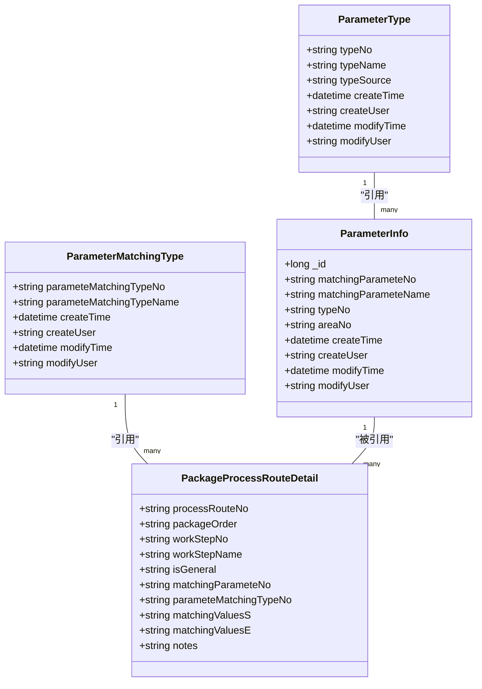
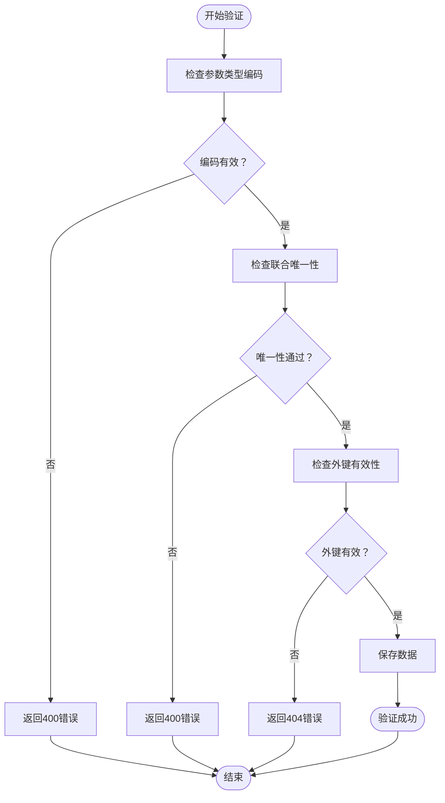

# 包装参数API

<cite>
**本文档引用的文件**
- [ParameterInfo.json](file://Domain/公共资源管理/工艺建模/包装参数/ParameterInfo.json)
- [ParameterType.json](file://Domain/公共资源管理/工艺建模/包装参数/ParameterType.json)
- [ParameterMatchingType.json](file://Domain/公共资源管理/工艺建模/包装工艺路线/ParameterMatchingType.json)
- [public-resource-management.skill](file://skills/business/public-resource-management.skill)
- [PackageProcessRouteSave.groovy](file://bzc/公共资源管理/工艺建模/包装工艺路线/PackageProcessRouteSave.groovy)
</cite>

## 目录
1. [简介](#简介)
2. [项目结构](#项目结构)
3. [核心组件](#核心组件)
4. [架构概览](#架构概览)
5. [详细组件分析](#详细组件分析)
6. [依赖分析](#依赖分析)
7. [性能考虑](#性能考虑)
8. [故障排除指南](#故障排除指南)
9. [结论](#结论)

## 简介
本文件为CMES系统中包装参数管理模块的完整API文档。涵盖包装参数类型管理与参数值维护功能，详细说明参数类型定义、参数信息配置、参数值范围设置等API接口。文档记录了参数匹配类型与参数值的业务规则，包括唯一性校验和数据验证机制，并提供HTTP方法、URL路径、请求参数、响应格式和错误码说明。同时包含实际的API调用示例，展示包装参数的配置和查询流程。

## 项目结构
包装参数管理模块由以下关键文件组成：
- 参数类型定义：ParameterType.json
- 参数信息定义：ParameterInfo.json
- 参数匹配类型定义：ParameterMatchingType.json
- 业务规则说明：public-resource-management.skill
- 示例业务组件：PackageProcessRouteSave.groovy



**图表来源**
- [ParameterType.json:1-249](file://Domain/公共资源管理/工艺建模/包装参数/ParameterType.json#L1-L249)
- [ParameterInfo.json:1-275](file://Domain/公共资源管理/工艺建模/包装参数/ParameterInfo.json#L1-L275)
- [ParameterMatchingType.json:1-223](file://Domain/公共资源管理/工艺建模/包装工艺路线/ParameterMatchingType.json#L1-L223)
- [public-resource-management.skill:378-449](file://skills/business/public-resource-management.skill#L378-L449)

**章节来源**
- [ParameterType.json:1-249](file://Domain/公共资源管理/工艺建模/包装参数/ParameterType.json#L1-L249)
- [ParameterInfo.json:1-275](file://Domain/公共资源管理/工艺建模/包装参数/ParameterInfo.json#L1-L275)
- [ParameterMatchingType.json:1-223](file://Domain/公共资源管理/工艺建模/包装工艺路线/ParameterMatchingType.json#L1-L223)
- [public-resource-management.skill:378-449](file://skills/business/public-resource-management.skill#L378-L449)

## 核心组件
包装参数管理模块包含三个核心实体：

### 参数类型（ParameterType）
- 主键字段：typeNo（字符串，长度30，唯一约束）
- 名称字段：typeName（字符串，长度64）
- 来源字段：typeSource（字符串，长度50）
- 支持标准的增删改查操作

### 参数信息（ParameterInfo）
- 联合唯一键：matchingParameteNo + typeNo
- 关键字段：
  - matchingParameteNo：参数编码（字符串，长度30，联合唯一）
  - matchingParameteName：参数名称（字符串，长度50）
  - typeNo：参数类型编码（字符串，长度50，外键引用ParameterType）
  - areaNo：厂区编码（字符串，长度40）

### 参数匹配类型（ParameterMatchingType）
- 主键字段：parameteMatchingTypeNo（字符串，长度30，唯一约束）
- 名称字段：parameteMatchingTypeName（字符串，长度64）
- 用于定义参数值的匹配规则

**章节来源**
- [ParameterType.json:62-86](file://Domain/公共资源管理/工艺建模/包装参数/ParameterType.json#L62-L86)
- [ParameterInfo.json:61-138](file://Domain/公共资源管理/工艺建模/包装参数/ParameterInfo.json#L61-L138)
- [ParameterMatchingType.json:62-86](file://Domain/公共资源管理/工艺建模/包装工艺路线/ParameterMatchingType.json#L62-L86)

## 架构概览
包装参数管理采用分层架构设计，包含领域模型层、业务规则层和接口层：



**图表来源**
- [public-resource-management.skill:378-449](file://skills/business/public-resource-management.skill#L378-L449)
- [PackageProcessRouteSave.groovy:1-82](file://bzc/公共资源管理/工艺建模/包装工艺路线/PackageProcessRouteSave.groovy#L1-L82)

## 详细组件分析

### 参数类型管理API

#### 创建参数类型
- HTTP方法：POST
- URL路径：/api/parametetype
- 请求参数：
  - typeNo：参数类型编码（必填，唯一）
  - typeName：参数类型名称（可选）
  - typeSource：来源（可选）

- 响应格式：
```json
{
  "success": true,
  "data": {
    "_id": "long",
    "typeNo": "string",
    "typeName": "string",
    "typeSource": "string"
  }
}
```

- 错误码：
  - 400：参数类型编码已存在
  - 500：系统内部错误

#### 查询参数类型列表
- HTTP方法：GET
- URL路径：/api/parametetype/list
- 查询参数：
  - typeNo：参数类型编码（可选）
  - typeName：参数类型名称（可选）

- 响应格式：
```json
{
  "success": true,
  "data": [
    {
      "typeNo": "string",
      "typeName": "string",
      "typeSource": "string"
    }
  ]
}
```

#### 更新参数类型
- HTTP方法：PUT
- URL路径：/api/parametetype/{typeNo}
- 路径参数：typeNo（参数类型编码）
- 请求参数：typeName、typeSource

#### 删除参数类型
- HTTP方法：DELETE
- URL路径：/api/parametetype/{typeNo}
- 业务规则：删除前需检查是否存在引用关系

**章节来源**
- [ParameterType.json:62-86](file://Domain/公共资源管理/工艺建模/包装参数/ParameterType.json#L62-L86)
- [public-resource-management.skill:384-391](file://skills/business/public-resource-management.skill#L384-L391)

### 参数信息管理API

#### 创建参数信息
- HTTP方法：POST
- URL路径：/api/parameterinfo
- 请求参数：
  - matchingParameteNo：参数编码（必填，联合唯一）
  - matchingParameteName：参数名称（可选）
  - typeNo：参数类型编码（必填，外键）
  - areaNo：厂区编码（可选）

- 响应格式：
```json
{
  "success": true,
  "data": {
    "_id": "long",
    "matchingParameteNo": "string",
    "matchingParameteName": "string",
    "typeNo": "string",
    "areaNo": "string"
  }
}
```

- 错误码：
  - 400：联合唯一性冲突
  - 404：参数类型不存在
  - 500：系统内部错误

#### 查询参数信息
- HTTP方法：GET
- URL路径：/api/parameterinfo/{matchingParameteNo}
- 路径参数：matchingParameteNo（参数编码）

#### 更新参数信息
- HTTP方法：PUT
- URL路径：/api/parameterinfo/{matchingParameteNo}
- 路径参数：matchingParameteNo
- 请求参数：matchingParameteName、areaNo

#### 删除参数信息
- HTTP方法：DELETE
- URL路径：/api/parameterinfo/{matchingParameteNo}

**章节来源**
- [ParameterInfo.json:61-138](file://Domain/公共资源管理/工艺建模/包装参数/ParameterInfo.json#L61-L138)
- [public-resource-management.skill:392-404](file://skills/business/public-resource-management.skill#L392-L404)

### 参数匹配类型API

#### 创建参数匹配类型
- HTTP方法：POST
- URL路径：/api/parametermatchingtype
- 请求参数：
  - parameteMatchingTypeNo：参数匹配类型编码（必填，唯一）
  - parameteMatchingTypeName：参数匹配类型名称（可选）

#### 查询参数匹配类型
- HTTP方法：GET
- URL路径：/api/parametermatchingtype/{parameteMatchingTypeNo}

#### 更新参数匹配类型
- HTTP方法：PUT
- URL路径：/api/parametermatchingtype/{parameteMatchingTypeNo}

#### 删除参数匹配类型
- HTTP方法：DELETE
- URL路径：/api/parametermatchingtype/{parameteMatchingTypeNo}

**章节来源**
- [ParameterMatchingType.json:62-86](file://Domain/公共资源管理/工艺建模/包装工艺路线/ParameterMatchingType.json#L62-L86)

### 参数值范围设置API

#### 设置参数值范围
- HTTP方法：POST
- URL路径：/api/parameterinfo/{matchingParameteNo}/range
- 路径参数：matchingParameteNo
- 请求参数：
  - matchingValuesS：匹配值起始（可选）
  - matchingValuesE：匹配值结束（可选）
  - notes：备注（可选）

#### 查询参数值范围
- HTTP方法：GET
- URL路径：/api/parameterinfo/{matchingParameteNo}/range

**章节来源**
- [public-resource-management.skill:444-449](file://skills/business/public-resource-management.skill#L444-L449)

## 依赖分析



**图表来源**
- [ParameterType.json:62-86](file://Domain/公共资源管理/工艺建模/包装参数/ParameterType.json#L62-L86)
- [ParameterInfo.json:61-138](file://Domain/公共资源管理/工艺建模/包装参数/ParameterInfo.json#L61-L138)
- [ParameterMatchingType.json:62-86](file://Domain/公共资源管理/工艺建模/包装工艺路线/ParameterMatchingType.json#L62-L86)
- [public-resource-management.skill:429-442](file://skills/business/public-resource-management.skill#L429-L442)

### 数据验证规则



**图表来源**
- [public-resource-management.skill:384-404](file://skills/business/public-resource-management.skill#L384-L404)
- [ParameterInfo.json:78-131](file://Domain/公共资源管理/工艺建模/包装参数/ParameterInfo.json#L78-L131)

## 性能考虑
- 唯一性检查：在创建和更新操作前进行数据库查询，建议在应用层添加缓存机制
- 外键约束：参数类型删除前需要检查引用关系，避免级联删除造成数据不一致
- 批量操作：支持批量删除参数信息，但需要注意事务边界和错误处理
- 查询优化：建议为常用查询字段建立索引，如typeNo、matchingParameteNo

## 故障排除指南

### 常见错误及解决方案

#### 400 错误（参数验证失败）
- 参数类型编码已存在：检查typeNo是否唯一
- 联合唯一性冲突：检查matchingParameteNo+typeNo组合是否重复
- 参数类型不存在：确认typeNo对应的参数类型已创建

#### 404 错误（资源未找到）
- 参数类型不存在：确认typeNo是否正确
- 参数信息不存在：确认matchingParameteNo是否正确

#### 500 错误（系统内部错误）
- 数据库连接异常：检查数据库配置
- 业务规则异常：查看具体异常信息

### 调试建议
1. 使用Postman或curl工具进行API测试
2. 启用详细的日志记录
3. 检查数据库约束和索引状态
4. 验证业务规则的执行顺序

**章节来源**
- [PackageProcessRouteSave.groovy:50-78](file://bzc/公共资源管理/工艺建模/包装工艺路线/PackageProcessRouteSave.groovy#L50-L78)

## 结论
包装参数管理模块提供了完整的参数类型和参数信息管理能力，包括：
- 参数类型的创建、查询、更新和删除
- 参数信息的全生命周期管理
- 参数匹配类型的定义和维护
- 参数值范围的设置和查询
- 完整的业务规则和数据验证机制

该模块采用清晰的分层架构设计，具有良好的扩展性和维护性，能够满足CMES系统中包装参数管理的各种需求。