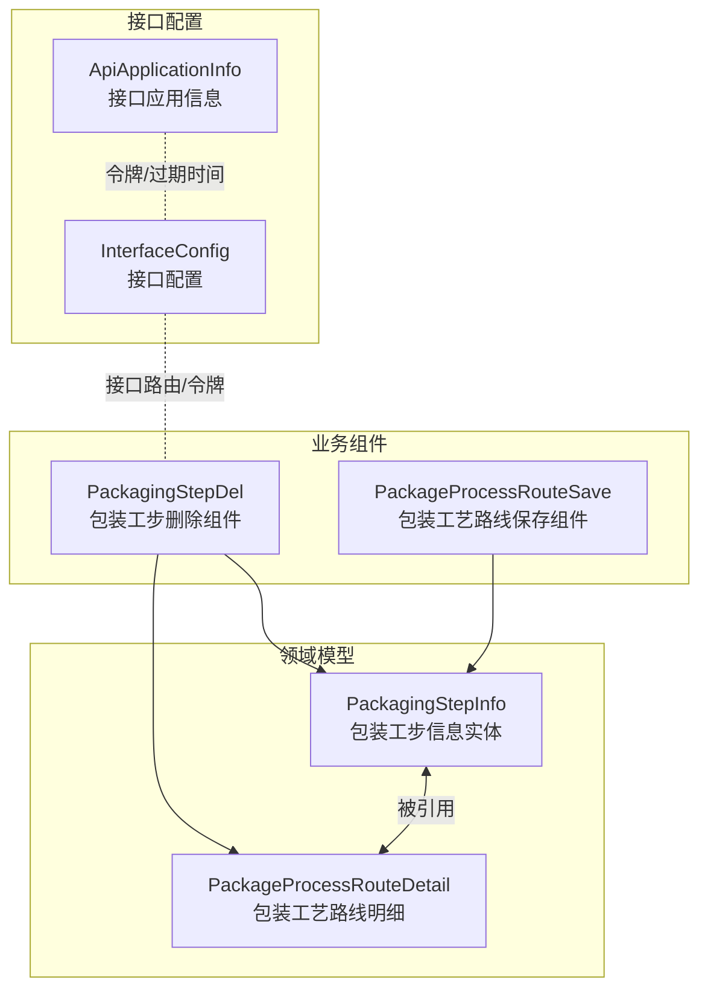
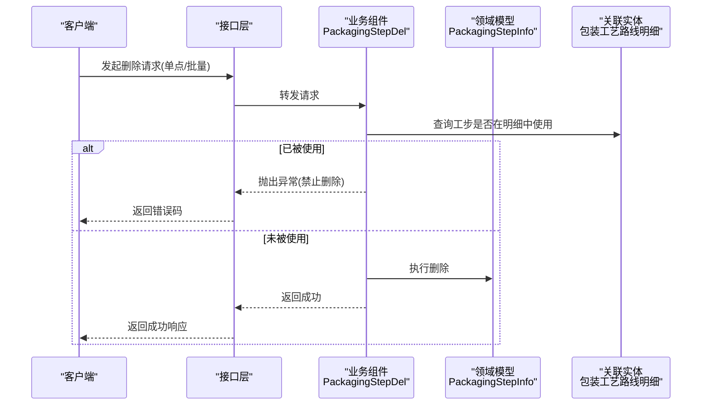
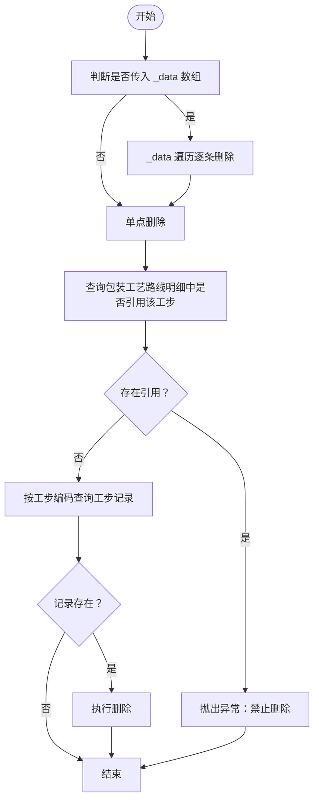
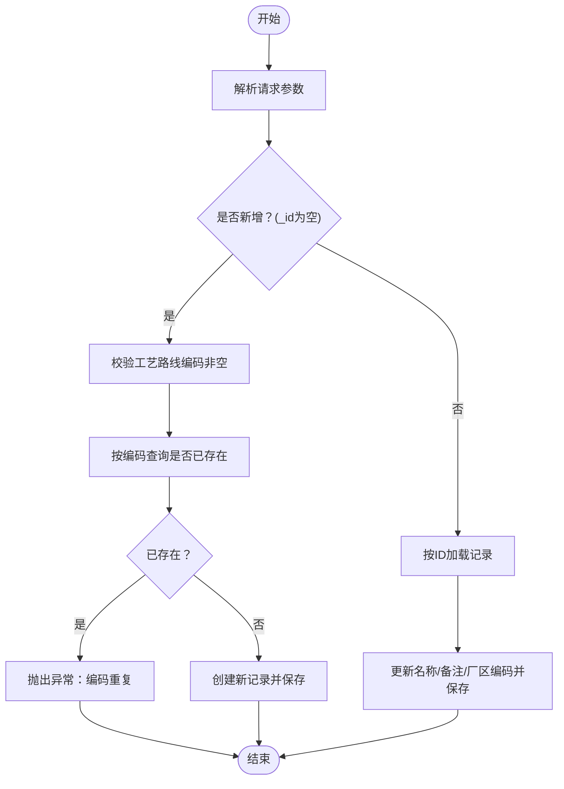
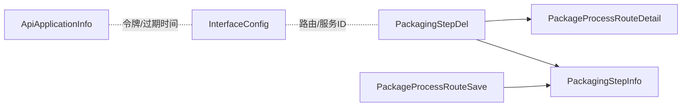

# 包装工步信息API

<cite>
**本文引用的文件**
- [PackagingStepInfo.json](file://Domain/公共资源管理/工艺建模/包装工步信息/PackagingStepInfo.json)
- [PackagingStepDel.groovy](file://bzc/公共资源管理/工艺建模/包装工步信息/PackagingStepDel.groovy)
- [PackageProcessRouteSave.groovy](file://bzc/公共资源管理/工艺建模/包装工艺路线/PackageProcessRouteSave.groovy)
- [InterfaceConfig.json](file://Domain/接口管理/InterfaceConfig.json)
- [ApiApplicationInfo.json](file://Domain/接口管理/ApiApplicationInfo.json)
- [ParameterInfo.json](file://Domain/公共资源管理/工艺建模/包装参数/ParameterInfo.json)
- [ProcessInfo.json](file://Domain/公共资源管理/工艺建模/工序信息/ProcessInfo.json)
</cite>

## 目录
1. [简介](#简介)
2. [项目结构](#项目结构)
3. [核心组件](#核心组件)
4. [架构总览](#架构总览)
5. [详细组件分析](#详细组件分析)
6. [依赖分析](#依赖分析)
7. [性能考虑](#性能考虑)
8. [故障排查指南](#故障排查指南)
9. [结论](#结论)
10. [附录](#附录)

## 简介
本文件为“包装工步信息”管理模块的完整API文档，覆盖包装工步的增删改查（CRUD）操作与删除业务规则，重点说明删除时的完整性保护机制（禁止删除已被“包装工艺路线明细”引用的工步）。文档同时给出HTTP方法、URL路径、请求参数、响应格式与错误码，并提供可复现的调用示例，帮助开发者快速集成与验证。

## 项目结构
围绕“包装工步信息”的API实现主要由以下部分组成：
- 领域模型定义：包装工步信息实体及其属性
- 业务组件：包装工步删除业务组件（含删除前置校验）
- 接口配置：接口路径、应用令牌等配置
- 关联实体：包装工艺路线明细（删除保护的关键关联）

图表来源
- [PackagingStepInfo.json:34-242](file://Domain/公共资源管理/工艺建模/包装工步信息/PackagingStepInfo.json#L34-L242)
- [PackagingStepDel.groovy:14-79](file://bzc/公共资源管理/工艺建模/包装工步信息/PackagingStepDel.groovy#L14-L79)
- [PackageProcessRouteSave.groovy:13-82](file://bzc/公共资源管理/工艺建模/包装工艺路线/PackageProcessRouteSave.groovy#L13-L82)
- [InterfaceConfig.json:34-379](file://Domain/接口管理/InterfaceConfig.json#L34-L379)
- [ApiApplicationInfo.json:34-431](file://Domain/接口管理/ApiApplicationInfo.json#L34-L431)

章节来源
- [PackagingStepInfo.json:1-249](file://Domain/公共资源管理/工艺建模/包装工步信息/PackagingStepInfo.json#L1-L249)
- [PackagingStepDel.groovy:1-79](file://bzc/公共资源管理/工艺建模/包装工步信息/PackagingStepDel.groovy#L1-L79)
- [PackageProcessRouteSave.groovy:1-82](file://bzc/公共资源管理/工艺建模/包装工艺路线/PackageProcessRouteSave.groovy#L1-L82)
- [InterfaceConfig.json:1-379](file://Domain/接口管理/InterfaceConfig.json#L1-L379)
- [ApiApplicationInfo.json:1-431](file://Domain/接口管理/ApiApplicationInfo.json#L1-L431)

## 核心组件
- 包装工步信息实体（PackagingStepInfo）
  - 字段：工步编码、工步名称、描述、创建/修改时间与用户等
  - 唯一性约束：工步编码唯一
- 包装工步删除组件（PackagingStepDel）
  - 支持单点与批量删除
  - 删除前置校验：若工步已在“包装工艺路线明细”中使用，则拒绝删除
- 包装工艺路线保存组件（PackageProcessRouteSave）
  - 新增/更新时对工艺路线编码进行唯一性校验
- 接口配置与应用信息
  - 提供接口路径、服务ID、用户ID、令牌URL、令牌与过期时间等

章节来源
- [PackagingStepInfo.json:34-242](file://Domain/公共资源管理/工艺建模/包装工步信息/PackagingStepInfo.json#L34-L242)
- [PackagingStepDel.groovy:50-79](file://bzc/公共资源管理/工艺建模/包装工步信息/PackagingStepDel.groovy#L50-L79)
- [PackageProcessRouteSave.groovy:39-81](file://bzc/公共资源管理/工艺建模/包装工艺路线/PackageProcessRouteSave.groovy#L39-L81)
- [InterfaceConfig.json:34-379](file://Domain/接口管理/InterfaceConfig.json#L34-L379)
- [ApiApplicationInfo.json:34-431](file://Domain/接口管理/ApiApplicationInfo.json#L34-L431)

## 架构总览
包装工步信息API遵循“领域模型 + 业务组件 + 接口配置”的分层设计：
- 领域模型负责数据结构与约束
- 业务组件封装业务规则（如删除保护）
- 接口配置提供统一的路由与安全信息

图表来源
- [PackagingStepDel.groovy:30-79](file://bzc/公共资源管理/工艺建模/包装工步信息/PackagingStepDel.groovy#L30-L79)
- [PackagingStepInfo.json:34-242](file://Domain/公共资源管理/工艺建模/包装工步信息/PackagingStepInfo.json#L34-L242)

## 详细组件分析

### 包装工步信息实体（PackagingStepInfo）
- 数据模型要点
  - 主键：自增长整型
  - 工步编码：字符串，长度30，必填且唯一
  - 工步名称：字符串，长度50，可选
  - 描述：字符串，长度255，可选
  - 时间与用户：创建/修改时间与用户，用于审计
- 处理器扩展点
  - 提供创建/更新/删除前后事件钩子，便于扩展业务逻辑

章节来源
- [PackagingStepInfo.json:34-242](file://Domain/公共资源管理/工艺建模/包装工步信息/PackagingStepInfo.json#L34-L242)

### 包装工步删除组件（PackagingStepDel）
- 功能概述
  - 支持GET与POST两种入口（GET用于参数透传，POST用于请求体）
  - stepNo方法支持单点与批量删除
  - 删除前校验：若工步在“包装工艺路线明细”中存在使用，则拒绝删除
- 删除流程图

图表来源
- [PackagingStepDel.groovy:50-79](file://bzc/公共资源管理/工艺建模/包装工步信息/PackagingStepDel.groovy#L50-L79)

章节来源
- [PackagingStepDel.groovy:30-79](file://bzc/公共资源管理/工艺建模/包装工步信息/PackagingStepDel.groovy#L30-L79)

### 包装工艺路线保存组件（PackageProcessRouteSave）
- 功能概述
  - 新增时对工艺路线编码进行唯一性校验
  - 支持新增与更新两种模式
- 流程图

图表来源
- [PackageProcessRouteSave.groovy:39-81](file://bzc/公共资源管理/工艺建模/包装工艺路线/PackageProcessRouteSave.groovy#L39-L81)

章节来源
- [PackageProcessRouteSave.groovy:29-81](file://bzc/公共资源管理/工艺建模/包装工艺路线/PackageProcessRouteSave.groovy#L29-L81)

### 接口配置与应用信息
- 接口配置（InterfaceConfig）
  - 提供接口路径、服务ID、用户ID、执行时间等元数据
- 接口应用信息（ApiApplicationInfo）
  - 提供应用编码、令牌获取地址、用户/应用令牌及过期时间等

章节来源
- [InterfaceConfig.json:34-379](file://Domain/接口管理/InterfaceConfig.json#L34-L379)
- [ApiApplicationInfo.json:34-431](file://Domain/接口管理/ApiApplicationInfo.json#L34-L431)

## 依赖分析
- 删除保护依赖
  - PackagingStepDel依赖“包装工艺路线明细”实体进行引用校验
  - 若存在引用，直接抛出异常，阻止删除
- 业务耦合度
  - 删除组件与领域模型解耦，通过查询与删除接口完成业务逻辑
- 接口层与配置
  - 接口配置与应用信息为接口层提供路由与令牌支撑

图表来源
- [PackagingStepDel.groovy:66-78](file://bzc/公共资源管理/工艺建模/包装工步信息/PackagingStepDel.groovy#L66-L78)
- [PackageProcessRouteSave.groovy:39-81](file://bzc/公共资源管理/工艺建模/包装工艺路线/PackageProcessRouteSave.groovy#L39-L81)
- [InterfaceConfig.json:34-379](file://Domain/接口管理/InterfaceConfig.json#L34-L379)
- [ApiApplicationInfo.json:34-431](file://Domain/接口管理/ApiApplicationInfo.json#L34-L431)

章节来源
- [PackagingStepDel.groovy:14-79](file://bzc/公共资源管理/工艺建模/包装工步信息/PackagingStepDel.groovy#L14-L79)
- [PackageProcessRouteSave.groovy:13-82](file://bzc/公共资源管理/工艺建模/包装工艺路线/PackageProcessRouteSave.groovy#L13-L82)
- [InterfaceConfig.json:1-379](file://Domain/接口管理/InterfaceConfig.json#L1-L379)
- [ApiApplicationInfo.json:1-431](file://Domain/接口管理/ApiApplicationInfo.json#L1-L431)

## 性能考虑
- 删除校验
  - 删除前对“包装工艺路线明细”进行查询，建议在该字段上建立索引以提升查询效率
- 批量删除
  - 批量场景下逐条校验，建议前端合并请求或后端优化为批量查询
- 唯一性校验
  - 新增/更新时对工艺路线编码进行唯一性检查，避免重复数据

## 故障排查指南
- 删除失败（已被引用）
  - 现象：删除请求返回异常，提示工步已在“包装工艺路线明细”中使用
  - 处理：先清理相关工艺路线明细，再执行删除
- 新增失败（编码重复）
  - 现象：新增工艺路线时报“编码已存在”
  - 处理：更换唯一编码或更新现有记录
- 参数缺失
  - 现象：新增工艺路线时报“编码不能为空”
  - 处理：确保请求体包含合法的工艺路线编码

章节来源
- [PackagingStepDel.groovy:70-71](file://bzc/公共资源管理/工艺建模/包装工步信息/PackagingStepDel.groovy#L70-L71)
- [PackageProcessRouteSave.groovy:52-59](file://bzc/公共资源管理/工艺建模/包装工艺路线/PackageProcessRouteSave.groovy#L52-L59)

## 结论
本API文档系统化梳理了“包装工步信息”的增删改查能力与删除保护机制。通过在删除前对“包装工艺路线明细”进行引用校验，有效保障了数据完整性。结合接口配置与应用信息，可进一步完善路由与安全策略。建议在生产环境中为高频查询字段建立索引，并对批量操作进行性能优化。

## 附录

### API定义与调用示例

- 删除包装工步（单点/批量）
  - 方法与路径
    - POST /packaging-step/delete
  - 请求参数
    - 单点删除：workStepNo（工步编码），workStepName（工步名称，仅用于异常提示）
    - 批量删除：_data（数组，元素为上述单点参数对象）
  - 响应
    - 成功：返回统一成功结果
    - 失败：返回异常信息（例如“已在包装工艺路线明细中使用”）
  - 错误码
    - 业务异常：删除失败（已被引用）
  - 示例流程
    1) 查询：先确认工步是否存在
    2) 校验：检查是否在“包装工艺路线明细”中使用
    3) 删除：未被使用则执行删除；否则抛出异常

- 新增/更新包装工艺路线
  - 方法与路径
    - POST /package-process-route/save
  - 请求参数
    - 新增：processRouteNo（必填）、processRouteName、notes、areaNo
    - 更新：_id（必填）、processRouteName、notes、areaNo
  - 响应
    - 成功：返回保存/更新后的记录
    - 失败：返回异常信息（例如“编码不能为空”、“编码已存在”）
  - 错误码
    - 参数校验：编码为空
    - 唯一性冲突：编码重复

- 获取接口配置与应用信息
  - 方法与路径
    - GET /interface-config/list 或 /api-application-info/list
  - 请求参数
    - 可选过滤条件（如服务ID、应用ID）
  - 响应
    - 成功：返回配置列表或单条记录
  - 用途
    - 获取接口路径、令牌URL、令牌与过期时间等

章节来源
- [PackagingStepDel.groovy:30-43](file://bzc/公共资源管理/工艺建模/包装工步信息/PackagingStepDel.groovy#L30-L43)
- [PackageProcessRouteSave.groovy:29-32](file://bzc/公共资源管理/工艺建模/包装工艺路线/PackageProcessRouteSave.groovy#L29-L32)
- [InterfaceConfig.json:34-379](file://Domain/接口管理/InterfaceConfig.json#L34-L379)
- [ApiApplicationInfo.json:34-431](file://Domain/接口管理/ApiApplicationInfo.json#L34-L431)