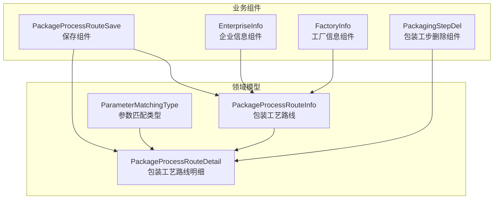
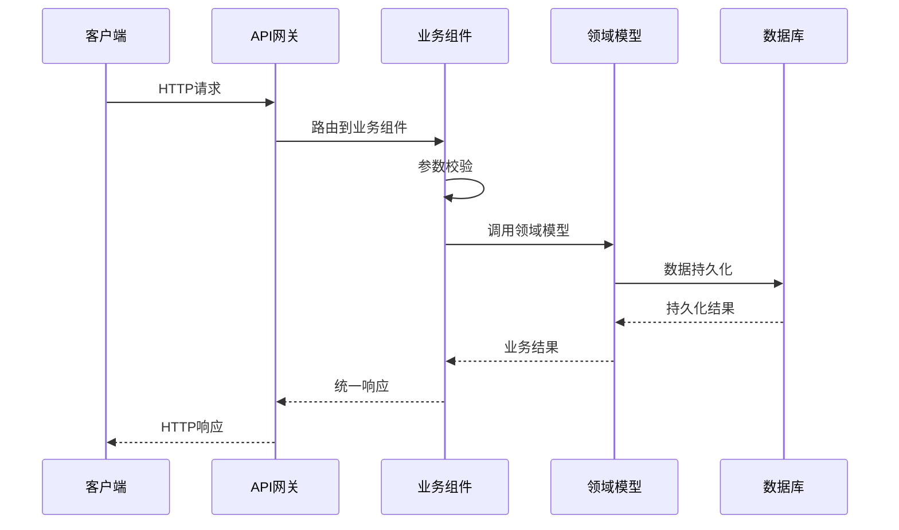
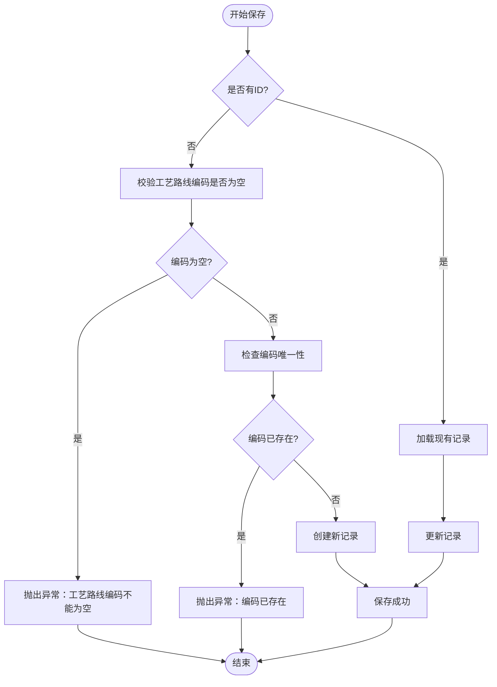
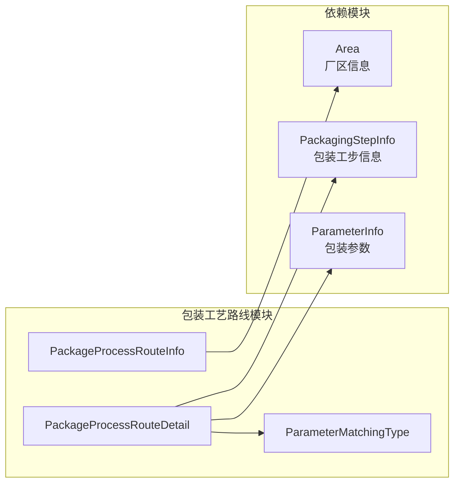
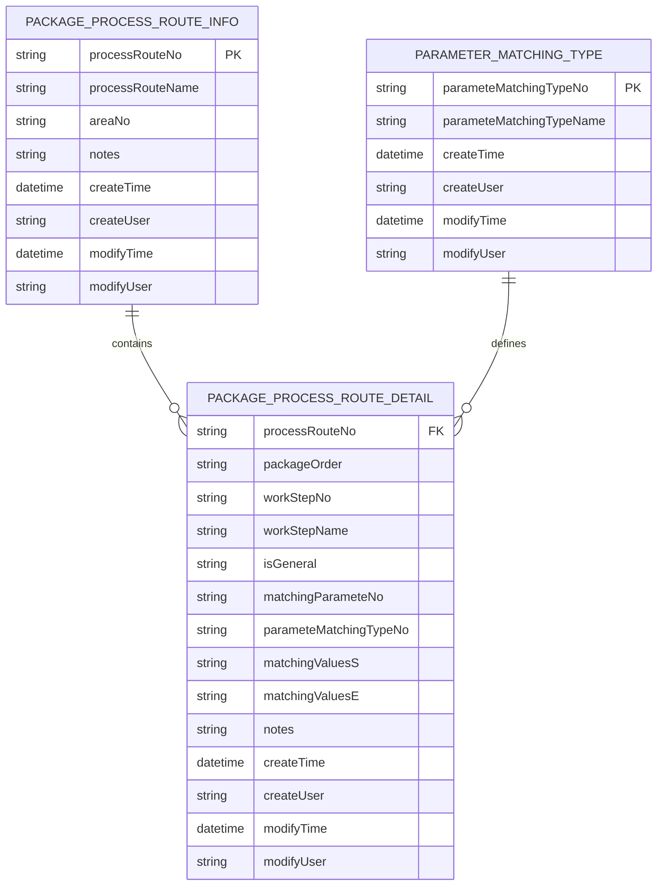

# 包装工艺路线API

<cite>
**本文档引用的文件**
- [PackageProcessRouteInfo.json](file://Domain/公共资源管理/工艺建模/包装工艺路线/PackageProcessRouteInfo.json)
- [PackageProcessRouteDetail.json](file://Domain/公共资源管理/工艺建模/包装工艺路线/PackageProcessRouteDetail.json)
- [ParameterMatchingType.json](file://Domain/公共资源管理/工艺建模/包装工艺路线/ParameterMatchingType.json)
- [PackageProcessRouteSave.groovy](file://bzc/公共资源管理/工艺建模/包装工艺路线/PackageProcessRouteSave.groovy)
- [InterfaceConfig.json](file://Domain/接口管理/InterfaceConfig.json)
- [EnterpriseInfo.groovy](file://bzc/公共资源管理/物理建模/1_企业/EnterpriseInfo.groovy)
- [FactoryInfo.groovy](file://bzc/公共资源管理/物理建模/2_工厂/FactoryInfo.groovy)
- [PackagingStepDel.groovy](file://bzc/公共资源管理/工艺建模/包装工步信息/PackagingStepDel.groovy)
- [business-rule-check.skill](file://skills/foundation/business-rule-check.skill)
- [bzc-base.skill](file://skills/architecture/bzc-base.skill)
</cite>

## 目录
1. [简介](#简介)
2. [项目结构](#项目结构)
3. [核心组件](#核心组件)
4. [架构概览](#架构概览)
5. [详细组件分析](#详细组件分析)
6. [依赖分析](#依赖分析)
7. [性能考虑](#性能考虑)
8. [故障排除指南](#故障排除指南)
9. [结论](#结论)
10. [附录](#附录)

## 简介
本文件为包装工艺路线管理模块的完整API文档，覆盖工艺路线的完整配置流程，包括工艺路线基本信息、路线明细、参数匹配类型等核心功能。详细说明工艺路线保存、唯一性校验、参数匹配机制等业务逻辑，并记录创建、更新、查询、删除等API接口。重点说明参数匹配类型的配置和使用方法，提供HTTP方法、URL路径、请求参数、响应格式和错误码。包含实际的API调用示例，展示完整工艺路线配置和参数匹配的业务流程。

## 项目结构
包装工艺路线模块由领域模型（Domain）和业务组件（BZC）两部分组成：
- 领域模型：定义了包装工艺路线主表、明细表和参数匹配类型的数据结构与约束
- 业务组件：实现RESTful接口，提供保存、查询、删除等业务操作



**图表来源**
- [PackageProcessRouteInfo.json:34-275](file://Domain/公共资源管理/工艺建模/包装工艺路线/PackageProcessRouteInfo.json#L34-L275)
- [PackageProcessRouteDetail.json:34-431](file://Domain/公共资源管理/工艺建模/包装工艺路线/PackageProcessRouteDetail.json#L34-L431)
- [ParameterMatchingType.json:34-223](file://Domain/公共资源管理/工艺建模/包装工艺路线/ParameterMatchingType.json#L34-L223)
- [PackageProcessRouteSave.groovy:13-82](file://bzc/公共资源管理/工艺建模/包装工艺路线/PackageProcessRouteSave.groovy#L13-L82)

**章节来源**
- [PackageProcessRouteInfo.json:1-275](file://Domain/公共资源管理/工艺建模/包装工艺路线/PackageProcessRouteInfo.json#L1-L275)
- [PackageProcessRouteDetail.json:1-431](file://Domain/公共资源管理/工艺建模/包装工艺路线/PackageProcessRouteDetail.json#L1-L431)
- [ParameterMatchingType.json:1-223](file://Domain/公共资源管理/工艺建模/包装工艺路线/ParameterMatchingType.json#L1-L223)

## 核心组件
包装工艺路线模块包含以下核心实体：

### 包装工艺路线主表 (PackageProcessRouteInfo)
- 主键：processRouteNo（包装工艺路线编码），唯一约束
- 关键字段：
  - processRouteNo：包装工艺路线编码（唯一）
  - processRouteName：包装工艺路线名称
  - areaNo：厂区编码
  - notes：备注

### 包装工艺路线明细 (PackageProcessRouteDetail)
- 关联字段：processRouteNo（外键）
- 关键字段：
  - packageOrder：顺序
  - workStepNo：包装工步编码
  - workStepName：包装工步名称
  - isGeneral：是否通用
  - matchingParameteNo：包装参数编码
  - parameteMatchingTypeNo：参数匹配类型编码
  - matchingValuesS：匹配值（起）
  - matchingValuesE：匹配值（止）
  - notes：备注

### 参数匹配类型 (ParameterMatchingType)
- 主键：parameteMatchingTypeNo（参数匹配类型编码），唯一约束
- 关键字段：
  - parameteMatchingTypeNo：参数匹配类型编码（唯一）
  - parameteMatchingTypeName：参数匹配类型名称

**章节来源**
- [PackageProcessRouteInfo.json:65-85](file://Domain/公共资源管理/工艺建模/包装工艺路线/PackageProcessRouteInfo.json#L65-L85)
- [PackageProcessRouteDetail.json:195-241](file://Domain/公共资源管理/工艺建模/包装工艺路线/PackageProcessRouteDetail.json#L195-L241)
- [ParameterMatchingType.json:78-85](file://Domain/公共资源管理/工艺建模/包装工艺路线/ParameterMatchingType.json#L78-L85)

## 架构概览
包装工艺路线API采用分层架构设计，遵循RESTful风格：



**图表来源**
- [PackageProcessRouteSave.groovy:29-32](file://bzc/公共资源管理/工艺建模/包装工艺路线/PackageProcessRouteSave.groovy#L29-L32)
- [InterfaceConfig.json:140-163](file://Domain/接口管理/InterfaceConfig.json#L140-L163)

## 详细组件分析

### 保存组件 (PackageProcessRouteSave)
保存组件提供工艺路线的创建和更新功能，包含唯一性校验逻辑。

#### API定义
- HTTP方法：POST
- URL路径：/api/public_resource_management/process_modeling/package_process_route/save
- 请求参数：
  - processRouteNo：包装工艺路线编码（新增必填）
  - processRouteName：包装工艺路线名称
  - areaNo：厂区编码
  - notes：备注
  - _id：记录ID（更新时必填）

- 响应格式：
  ```json
  {
    "success": true,
    "data": {
      "_id": "long",
      "processRouteNo": "string",
      "processRouteName": "string",
      "areaNo": "string",
      "notes": "string",
      "createTime": "datetime",
      "createUser": "string",
      "modifyTime": "datetime",
      "modifyUser": "string"
    },
    "message": "string"
  }
  ```

#### 业务流程


**图表来源**
- [PackageProcessRouteSave.groovy:39-81](file://bzc/公共资源管理/工艺建模/包装工艺路线/PackageProcessRouteSave.groovy#L39-L81)

#### 错误码
- 1001：工艺路线编码不能为空
- 1002：该工艺路线编码已存在，不可重复

**章节来源**
- [PackageProcessRouteSave.groovy:29-81](file://bzc/公共资源管理/工艺建模/包装工艺路线/PackageProcessRouteSave.groovy#L29-L81)

### 参数匹配类型管理
参数匹配类型用于定义包装参数的匹配规则，支持多种匹配方式。

#### API定义
- HTTP方法：GET/POST/PUT/DELETE
- URL路径：/api/public_resource_management/process_modeling/package_process_route/matching_type
- 请求参数：
  - parameteMatchingTypeNo：参数匹配类型编码（唯一）
  - parameteMatchingTypeName：参数匹配类型名称

- 响应格式：
  ```json
  {
    "success": true,
    "data": {
      "parameteMatchingTypeNo": "string",
      "parameteMatchingTypeName": "string",
      "createTime": "datetime",
      "createUser": "string",
      "modifyTime": "datetime",
      "modifyUser": "string"
    },
    "message": "string"
  }
  ```

#### 参数匹配机制
参数匹配类型支持以下匹配方式：
- 精确匹配：完全相等
- 范围匹配：起止值范围
- 模糊匹配：包含关系
- 前缀匹配：以指定字符开头
- 后缀匹配：以指定字符结尾

**章节来源**
- [ParameterMatchingType.json:65-85](file://Domain/公共资源管理/工艺建模/包装工艺路线/ParameterMatchingType.json#L65-L85)
- [PackageProcessRouteDetail.json:195-241](file://Domain/公共资源管理/工艺建模/包装工艺路线/PackageProcessRouteDetail.json#L195-L241)

### 工艺路线明细管理
工艺路线明细表记录具体的工步信息和参数匹配规则。

#### API定义
- HTTP方法：GET/POST/PUT/DELETE
- URL路径：/api/public_resource_management/process_modeling/package_process_route/detail
- 请求参数：
  - processRouteNo：包装工艺路线编码
  - packageOrder：顺序
  - workStepNo：包装工步编码
  - workStepName：包装工步名称
  - isGeneral：是否通用
  - matchingParameteNo：包装参数编码
  - parameteMatchingTypeNo：参数匹配类型编码
  - matchingValuesS：匹配值（起）
  - matchingValuesE：匹配值（止）

**章节来源**
- [PackageProcessRouteDetail.json:195-241](file://Domain/公共资源管理/工艺建模/包装工艺路线/PackageProcessRouteDetail.json#L195-L241)

## 依赖分析
包装工艺路线模块与其他模块存在以下依赖关系：



**图表来源**
- [PackageProcessRouteInfo.json:117-137](file://Domain/公共资源管理/工艺建模/包装工艺路线/PackageProcessRouteInfo.json#L117-L137)
- [PackageProcessRouteDetail.json:117-137](file://Domain/公共资源管理/工艺建模/包装工艺路线/PackageProcessRouteDetail.json#L117-L137)

**章节来源**
- [PackageProcessRouteInfo.json:117-137](file://Domain/公共资源管理/工艺建模/包装工艺路线/PackageProcessRouteInfo.json#L117-L137)
- [PackageProcessRouteDetail.json:117-137](file://Domain/公共资源管理/工艺建模/包装工艺路线/PackageProcessRouteDetail.json#L117-L137)

## 性能考虑
1. **索引优化**：processRouteNo、parameteMatchingTypeNo等唯一字段应建立数据库索引
2. **批量操作**：支持批量删除和批量保存，减少网络往返
3. **缓存策略**：参数匹配类型等静态数据可考虑缓存
4. **分页查询**：大量数据时使用分页机制避免内存溢出

## 故障排除指南
### 常见错误及解决方案
1. **唯一性冲突**
   - 现象：保存失败，提示编码已存在
   - 解决：修改工艺路线编码或删除重复记录

2. **参数校验失败**
   - 现象：保存失败，提示必填字段为空
   - 解决：确保processRouteNo等必填字段完整

3. **关联数据删除失败**
   - 现象：删除厂区或工步时提示已被使用
   - 解决：先删除相关的工艺路线明细

### 日志记录规范
- 使用SysException记录业务异常
- 记录关键操作的请求和响应
- 遵循统一的日志格式规范

**章节来源**
- [business-rule-check.skill:108-144](file://skills/foundation/business-rule-check.skill#L108-L144)
- [bzc-base.skill:124-162](file://skills/architecture/bzc-base.skill#L124-L162)

## 结论
包装工艺路线API提供了完整的工艺路线管理能力，包括基本信息维护、明细配置和参数匹配等功能。通过清晰的RESTful接口设计和严格的业务规则校验，确保了数据的一致性和完整性。建议在生产环境中结合缓存策略和索引优化，进一步提升系统性能。

## 附录

### API调用示例

#### 创建工艺路线
```bash
curl -X POST "http://localhost:8080/api/public_resource_management/process_modeling/package_process_route/save" \
  -H "Content-Type: application/json" \
  -d '{
    "processRouteNo": "PR001",
    "processRouteName": "标准包装工艺",
    "areaNo": "AREA001",
    "notes": "标准产品包装流程"
  }'
```

#### 更新工艺路线
```bash
curl -X PUT "http://localhost:8080/api/public_resource_management/process_modeling/package_process_route/save" \
  -H "Content-Type: application/json" \
  -d '{
    "_id": "123456789",
    "processRouteNo": "PR001",
    "processRouteName": "更新后的包装工艺",
    "areaNo": "AREA001",
    "notes": "更新备注信息"
  }'
```

#### 查询参数匹配类型
```bash
curl -X GET "http://localhost:8080/api/public_resource_management/process_modeling/package_process_route/matching_type?parameteMatchingTypeNo=MT001"
```

### 数据模型关系图


**图表来源**
- [PackageProcessRouteInfo.json:65-85](file://Domain/公共资源管理/工艺建模/包装工艺路线/PackageProcessRouteInfo.json#L65-L85)
- [PackageProcessRouteDetail.json:195-241](file://Domain/公共资源管理/工艺建模/包装工艺路线/PackageProcessRouteDetail.json#L195-L241)
- [ParameterMatchingType.json:78-85](file://Domain/公共资源管理/工艺建模/包装工艺路线/ParameterMatchingType.json#L78-L85)