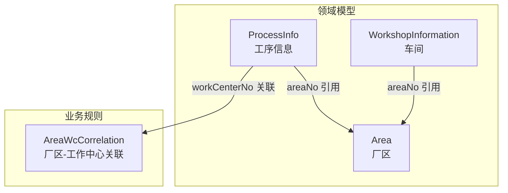
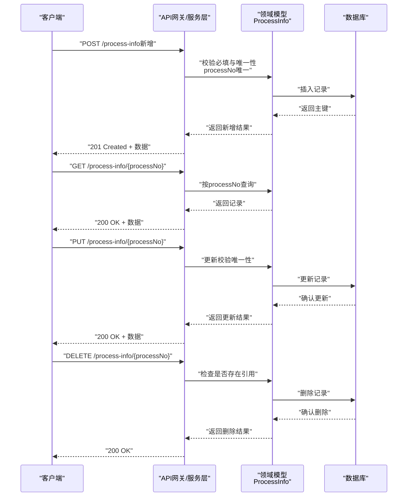
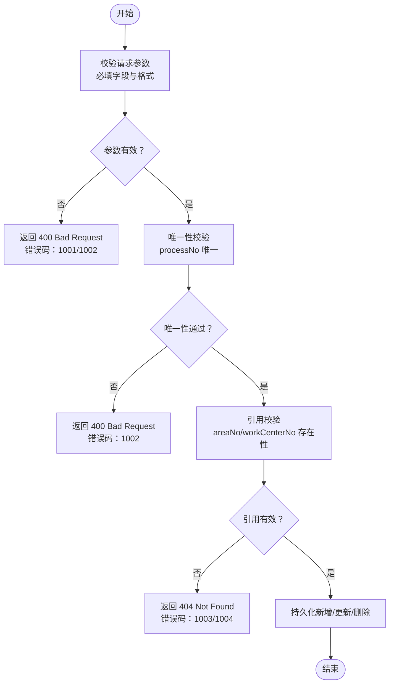
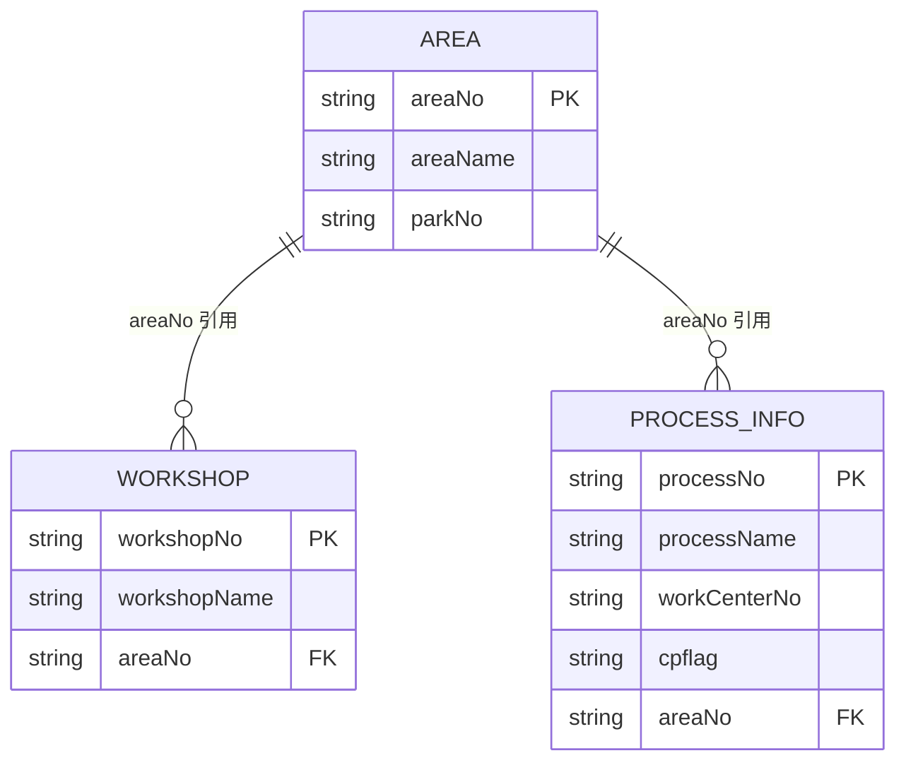

# 工序信息API

<cite>
**本文档引用的文件**
- [ProcessInfo.json](file://Domain/公共资源管理/工艺建模/工序信息/ProcessInfo.json)
- [Area.json](file://Domain/公共资源管理/物理建模/4_厂区/Area.json)
- [WorkshopInformation.json](file://Domain/公共资源管理/物理建模/5_车间/WorkshopInformation.json)
- [public-resource-management.skill](file://skills/business/public-resource-management.skill)
</cite>

## 目录
1. [简介](#简介)
2. [项目结构](#项目结构)
3. [核心组件](#核心组件)
4. [架构总览](#架构总览)
5. [详细组件分析](#详细组件分析)
6. [依赖分析](#依赖分析)
7. [性能考虑](#性能考虑)
8. [故障排除指南](#故障排除指南)
9. [结论](#结论)

## 简介
本文件为“工序信息”模块的完整API文档，覆盖工序编码、工序名称、工作中心编码、成品标识、厂区编码等字段的增删改查接口定义，明确唯一性约束（工序编码唯一）与必填字段校验规则，并给出HTTP方法、URL路径、请求参数、响应格式及错误码说明。同时，结合物理建模层级关系，说明与工作中心、厂区的关联业务规则，提供从创建到删除的完整生命周期示例流程。

## 项目结构
- 工序信息实体定义位于领域模型目录，字段属性由JSON元数据描述，包含必填、唯一性、长度等约束。
- 物理建模层级（厂区、车间）与工序存在业务关联，工作中心通过厂区关联表与工序建立间接联系。
- 业务规范文档对各模块字段、唯一性、引用关系进行了统一说明。

**图表来源**
- [ProcessInfo.json:65-189](file://Domain/公共资源管理/工艺建模/工序信息/ProcessInfo.json#L65-L189)
- [Area.json:65-137](file://Domain/公共资源管理/物理建模/4_厂区/Area.json#L65-L137)
- [WorkshopInformation.json:65-137](file://Domain/公共资源管理/物理建模/5_车间/WorkshopInformation.json#L65-L137)

**章节来源**
- [ProcessInfo.json:65-189](file://Domain/公共资源管理/工艺建模/工序信息/ProcessInfo.json#L65-L189)
- [Area.json:65-137](file://Domain/公共资源管理/物理建模/4_厂区/Area.json#L65-L137)
- [WorkshopInformation.json:65-137](file://Domain/公共资源管理/物理建模/5_车间/WorkshopInformation.json#L65-L137)
- [public-resource-management.skill:368-377](file://skills/business/public-resource-management.skill#L368-L377)

## 核心组件
- 工序信息实体（ProcessInfo）
  - 必填字段：工序编码（processNo，唯一）
  - 可选字段：工序名称（processName）、工作中心编码（workCenterNo）、成品标识（cpflag）、厂区编码（areaNo）
  - 时间与用户字段：创建时间、创建用户、最后修改时间、最后修改用户（继承自基础模型）

- 厂区实体（Area）
  - 必填字段：厂区编码（areaNo，唯一）
  - 可选字段：厂区名称、园区编码
  - 与工作中心存在关联表（AreaWcCorrelation），用于维护厂区与工作中心的映射

- 车间实体（WorkshopInformation）
  - 必填字段：车间编码（workshopNo，唯一）
  - 可选字段：车间名称、厂区编码（areaNo）
  - 与厂区存在一对一或一对多关系

**章节来源**
- [ProcessInfo.json:65-189](file://Domain/公共资源管理/工艺建模/工序信息/ProcessInfo.json#L65-L189)
- [Area.json:65-137](file://Domain/公共资源管理/物理建模/4_厂区/Area.json#L65-L137)
- [WorkshopInformation.json:65-137](file://Domain/公共资源管理/物理建模/5_车间/WorkshopInformation.json#L65-L137)
- [public-resource-management.skill:165-188](file://skills/business/public-resource-management.skill#L165-L188)
- [public-resource-management.skill:190-206](file://skills/business/public-resource-management.skill#L190-L206)

## 架构总览
- 工序信息作为独立实体，通过字段areaNo与厂区建立引用关系；通过workCenterNo与工作中心建立关联（经由厂区关联表间接实现）。
- 工序信息的生命周期遵循通用的REST接口约定，结合领域模型的唯一性与必填约束进行校验。

**图表来源**
- [ProcessInfo.json:65-189](file://Domain/公共资源管理/工艺建模/工序信息/ProcessInfo.json#L65-L189)
- [public-resource-management.skill:368-377](file://skills/business/public-resource-management.skill#L368-L377)

## 详细组件分析

### 工序信息实体字段定义
- 工序编码（processNo）
  - 类型：字符串
  - 长度：30
  - 必填：是
  - 唯一：是
- 工序名称（processName）
  - 类型：字符串
  - 长度：50
  - 必填：否
- 工作中心编码（workCenterNo）
  - 类型：字符串
  - 长度：64
  - 必填：否
- 成品标识（cpflag）
  - 类型：字符串
  - 长度：64
  - 必填：否
- 厂区编码（areaNo）
  - 类型：字符串
  - 长度：50
  - 必填：否
- 时间与用户字段
  - 创建时间、创建用户、最后修改时间、最后修改用户（继承自基础模型）

**章节来源**
- [ProcessInfo.json:65-189](file://Domain/公共资源管理/工艺建模/工序信息/ProcessInfo.json#L65-L189)

### 业务规则与关联关系
- 唯一性约束
  - 工序编码（processNo）必须唯一，新增/更新时需校验冲突
- 必填字段
  - 新增时必须提供工序编码（processNo）
- 与厂区的关联
  - 工序信息可通过areaNo引用厂区（Area）
- 与工作中心的关联
  - 工序信息提供workCenterNo字段，实际工作中心与厂区的映射通过AreaWcCorrelation关联表维护
- 与车间的关联
  - 车间（WorkshopInformation）同样通过areaNo引用厂区，体现物理建模层级关系

**章节来源**
- [public-resource-management.skill:368-377](file://skills/business/public-resource-management.skill#L368-L377)
- [public-resource-management.skill:165-188](file://skills/business/public-resource-management.skill#L165-L188)
- [public-resource-management.skill:190-206](file://skills/business/public-resource-management.skill#L190-L206)

### API接口定义

- 新增工序信息
  - 方法：POST
  - 路径：/process-info
  - 请求参数：
    - 工序编码（processNo，必填，唯一）
    - 工序名称（processName，可选）
    - 工作中心编码（workCenterNo，可选）
    - 成品标识（cpflag，可选）
    - 厂区编码（areaNo，可选）
  - 响应：
    - 201 Created：创建成功，返回新增记录
    - 400 Bad Request：参数缺失或违反唯一性
    - 500 Internal Server Error：服务器异常
  - 错误码：
    - 1001：必填字段缺失
    - 1002：工序编码重复
    - 1003：厂区编码不存在
    - 1004：工作中心编码不存在

- 查询工序信息
  - 方法：GET
  - 路径：/process-info/{processNo}
  - 路径参数：
    - processNo：工序编码（必填）
  - 响应：
    - 200 OK：返回记录
    - 404 Not Found：未找到
    - 500 Internal Server Error：服务器异常

- 更新工序信息
  - 方法：PUT
  - 路径：/process-info/{processNo}
  - 路径参数：
    - processNo：工序编码（必填）
  - 请求参数：
    - 工序名称（processName，可选）
    - 工作中心编码（workCenterNo，可选）
    - 成品标识（cpflag，可选）
    - 厂区编码（areaNo，可选）
  - 响应：
    - 200 OK：更新成功
    - 400 Bad Request：参数非法或违反唯一性
    - 404 Not Found：未找到
    - 500 Internal Server Error：服务器异常
  - 错误码：
    - 1001：必填字段缺失
    - 1002：工序编码重复
    - 1003：厂区编码不存在
    - 1004：工作中心编码不存在

- 删除工序信息
  - 方法：DELETE
  - 路径：/process-info/{processNo}
  - 路径参数：
    - processNo：工序编码（必填）
  - 响应：
    - 200 OK：删除成功
    - 404 Not Found：未找到
    - 409 Conflict：存在引用（如被其他实体引用）
    - 500 Internal Server Error：服务器异常
  - 错误码：
    - 1005：存在引用无法删除

- 列表查询（可选）
  - 方法：GET
  - 路径：/process-info
  - 查询参数：
    - areaNo：厂区编码（可选）
    - workCenterNo：工作中心编码（可选）
    - cpflag：成品标识（可选）
  - 响应：
    - 200 OK：返回列表
    - 500 Internal Server Error：服务器异常

**章节来源**
- [ProcessInfo.json:65-189](file://Domain/公共资源管理/工艺建模/工序信息/ProcessInfo.json#L65-L189)
- [public-resource-management.skill:368-377](file://skills/business/public-resource-management.skill#L368-L377)

### API调用示例（完整生命周期）

- 新增
  - 请求：POST /process-info
  - Body：
    - processNo: "P001"
    - processName: "装配工步"
    - workCenterNo: "WC001"
    - cpflag: "FINISHED"
    - areaNo: "AREA001"
  - 响应：201 Created + 新增记录

- 查询详情
  - 请求：GET /process-info/P001
  - 响应：200 OK + 记录详情

- 更新
  - 请求：PUT /process-info/P001
  - Body：
    - processName: "最终装配"
    - workCenterNo: "WC002"
  - 响应：200 OK + 更新后的记录

- 删除
  - 请求：DELETE /process-info/P001
  - 响应：200 OK

- 列表查询（可选）
  - 请求：GET /process-info?areaNo=AREA001&cpflag=FINISHED
  - 响应：200 OK + 符合条件的列表

**章节来源**
- [ProcessInfo.json:65-189](file://Domain/公共资源管理/工艺建模/工序信息/ProcessInfo.json#L65-L189)
- [public-resource-management.skill:368-377](file://skills/business/public-resource-management.skill#L368-L377)

### 数据流与处理逻辑

**图表来源**
- [ProcessInfo.json:65-189](file://Domain/公共资源管理/工艺建模/工序信息/ProcessInfo.json#L65-L189)
- [public-resource-management.skill:368-377](file://skills/business/public-resource-management.skill#L368-L377)

## 依赖分析
- 工序信息（ProcessInfo）依赖于：
  - 厂区（Area）：通过areaNo引用
  - 工作中心：通过workCenterNo字段关联（实际映射见AreaWcCorrelation）
- 物理建模层级：
  - 厂区（Area）与车间（WorkshopInformation）存在层级关系，均通过areaNo引用同一厂区

**图表来源**
- [Area.json:65-137](file://Domain/公共资源管理/物理建模/4_厂区/Area.json#L65-L137)
- [WorkshopInformation.json:65-137](file://Domain/公共资源管理/物理建模/5_车间/WorkshopInformation.json#L65-L137)
- [ProcessInfo.json:65-189](file://Domain/公共资源管理/工艺建模/工序信息/ProcessInfo.json#L65-L189)

**章节来源**
- [Area.json:65-137](file://Domain/公共资源管理/物理建模/4_厂区/Area.json#L65-L137)
- [WorkshopInformation.json:65-137](file://Domain/公共资源管理/物理建模/5_车间/WorkshopInformation.json#L65-L137)
- [ProcessInfo.json:65-189](file://Domain/公共资源管理/工艺建模/工序信息/ProcessInfo.json#L65-L189)

## 性能考虑
- 唯一性校验：新增/更新时对processNo进行数据库层面唯一性检查，避免并发重复
- 引用校验：对areaNo、workCenterNo进行存在性检查，建议批量查询优化（RQL），避免N+1问题
- 分页与过滤：列表查询支持按areaNo、workCenterNo、cpflag过滤，建议结合分页参数提升性能

## 故障排除指南
- 400 Bad Request
  - 错误码1001：缺少必填字段（如processNo）
  - 错误码1002：工序编码重复
  - 错误码1003：厂区编码不存在
  - 错误码1004：工作中心编码不存在
- 404 Not Found：根据processNo查询不到记录
- 409 Conflict：删除时存在引用（如被其他实体引用）
- 500 Internal Server Error：服务器内部异常

**章节来源**
- [ProcessInfo.json:65-189](file://Domain/公共资源管理/工艺建模/工序信息/ProcessInfo.json#L65-L189)
- [public-resource-management.skill:368-377](file://skills/business/public-resource-management.skill#L368-L377)

## 结论
本API文档明确了工序信息的字段约束、唯一性与必填规则，以及与厂区、工作中心的业务关联。通过标准的REST接口与错误码体系，实现了从创建到删除的完整生命周期管理。在实际开发中，应严格遵守字段长度、唯一性与引用存在性校验，并结合批量查询优化提升性能。