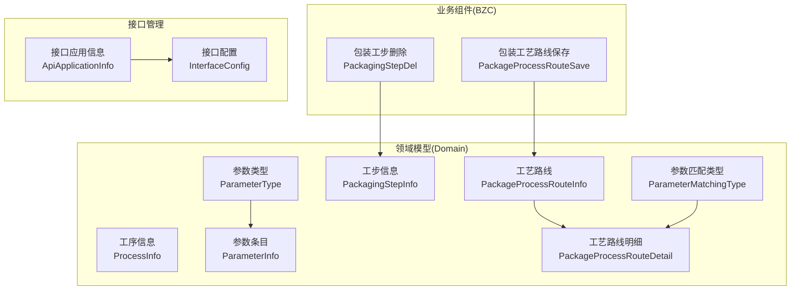
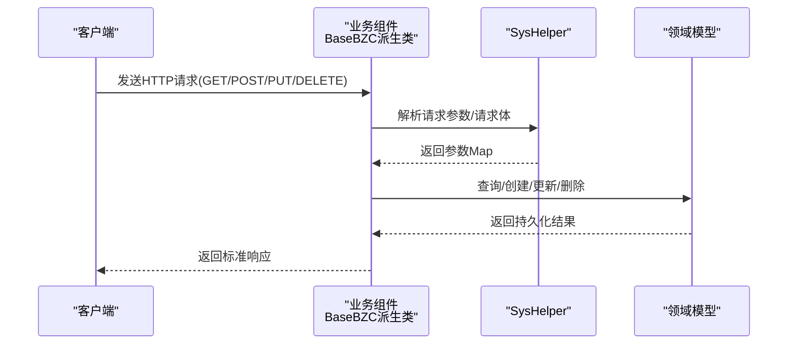
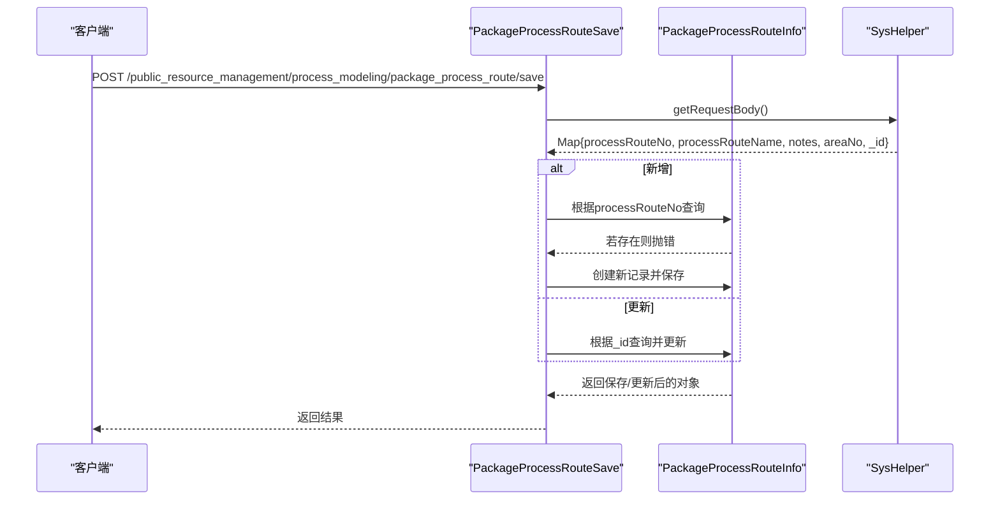
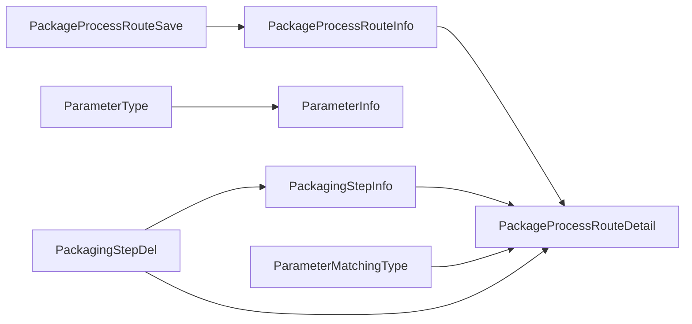

# 工艺建模API

<cite>
**本文档引用的文件**
- [ProcessInfo.json](file://Domain/公共资源管理/工艺建模/工序信息/ProcessInfo.json)
- [ParameterInfo.json](file://Domain/公共资源管理/工艺建模/包装参数/ParameterInfo.json)
- [ParameterType.json](file://Domain/公共资源管理/工艺建模/包装参数/ParameterType.json)
- [PackagingStepInfo.json](file://Domain/公共资源管理/工艺建模/包装工步信息/PackagingStepInfo.json)
- [PackageProcessRouteInfo.json](file://Domain/公共资源管理/工艺建模/包装工艺路线/PackageProcessRouteInfo.json)
- [PackageProcessRouteDetail.json](file://Domain/公共资源管理/工艺建模/包装工艺路线/PackageProcessRouteDetail.json)
- [ParameterMatchingType.json](file://Domain/公共资源管理/工艺建模/包装工艺路线/ParameterMatchingType.json)
- [PackageProcessRouteSave.groovy](file://bzc/公共资源管理/工艺建模/包装工艺路线/PackageProcessRouteSave.groovy)
- [PackagingStepDel.groovy](file://bzc/公共资源管理/工艺建模/包装工步信息/PackagingStepDel.groovy)
- [ApiApplicationInfo.json](file://Domain/接口管理/ApiApplicationInfo.json)
- [InterfaceConfig.json](file://Domain/接口管理/InterfaceConfig.json)
</cite>

## 目录
1. [简介](#简介)
2. [项目结构](#项目结构)
3. [核心组件](#核心组件)
4. [架构总览](#架构总览)
5. [详细组件分析](#详细组件分析)
6. [依赖分析](#依赖分析)
7. [性能考虑](#性能考虑)
8. [故障排除指南](#故障排除指南)
9. [结论](#结论)
10. [附录](#附录)

## 简介
本文件为CMES工艺建模子系统的完整API文档，覆盖以下四大核心功能模块：
- 工序信息管理：维护工序基本信息与关联属性
- 包装参数管理：定义参数类型与参数条目
- 包装工步信息管理：维护包装工步的基础信息
- 包装工艺路线管理：配置工艺路线及其明细、参数匹配规则

文档详细说明各模块的领域模型字段、业务组件的REST接口方法、请求参数、响应格式、错误码及典型调用流程；同时解释参数匹配类型与区间匹配机制，并给出BZC组件的业务逻辑实现要点。

## 项目结构
围绕“工艺建模”主题，系统采用分层结构：
- Domain层：定义各领域模型的元数据（字段、索引、处理器等）
- BZC层：封装业务组件，提供REST接口方法与业务逻辑
- 接口管理：提供应用与接口配置的元数据支撑

图表来源
- [ProcessInfo.json:1-301](file://Domain/公共资源管理/工艺建模/工序信息/ProcessInfo.json#L1-L301)
- [ParameterInfo.json:1-275](file://Domain/公共资源管理/工艺建模/包装参数/ParameterInfo.json#L1-L275)
- [ParameterType.json:1-249](file://Domain/公共资源管理/工艺建模/包装参数/ParameterType.json#L1-L249)
- [PackagingStepInfo.json:1-249](file://Domain/公共资源管理/工艺建模/包装工步信息/PackagingStepInfo.json#L1-L249)
- [PackageProcessRouteInfo.json:1-275](file://Domain/公共资源管理/工艺建模/包装工艺路线/PackageProcessRouteInfo.json#L1-L275)
- [PackageProcessRouteDetail.json:1-431](file://Domain/公共资源管理/工艺建模/包装工艺路线/PackageProcessRouteDetail.json#L1-L431)
- [ParameterMatchingType.json:1-223](file://Domain/公共资源管理/工艺建模/包装工艺路线/ParameterMatchingType.json#L1-L223)
- [PackageProcessRouteSave.groovy:1-82](file://bzc/公共资源管理/工艺建模/包装工艺路线/PackageProcessRouteSave.groovy#L1-L82)
- [PackagingStepDel.groovy:1-79](file://bzc/公共资源管理/工艺建模/包装工步信息/PackagingStepDel.groovy#L1-L79)
- [ApiApplicationInfo.json:1-431](file://Domain/接口管理/ApiApplicationInfo.json#L1-L431)
- [InterfaceConfig.json:1-379](file://Domain/接口管理/InterfaceConfig.json#L1-L379)

章节来源
- [ProcessInfo.json:1-301](file://Domain/公共资源管理/工艺建模/工序信息/ProcessInfo.json#L1-L301)
- [ParameterInfo.json:1-275](file://Domain/公共资源管理/工艺建模/包装参数/ParameterInfo.json#L1-L275)
- [ParameterType.json:1-249](file://Domain/公共资源管理/工艺建模/包装参数/ParameterType.json#L1-L249)
- [PackagingStepInfo.json:1-249](file://Domain/公共资源管理/工艺建模/包装工步信息/PackagingStepInfo.json#L1-L249)
- [PackageProcessRouteInfo.json:1-275](file://Domain/公共资源管理/工艺建模/包装工艺路线/PackageProcessRouteInfo.json#L1-L275)
- [PackageProcessRouteDetail.json:1-431](file://Domain/公共资源管理/工艺建模/包装工艺路线/PackageProcessRouteDetail.json#L1-L431)
- [ParameterMatchingType.json:1-223](file://Domain/公共资源管理/工艺建模/包装工艺路线/ParameterMatchingType.json#L1-L223)
- [PackageProcessRouteSave.groovy:1-82](file://bzc/公共资源管理/工艺建模/包装工艺路线/PackageProcessRouteSave.groovy#L1-L82)
- [PackagingStepDel.groovy:1-79](file://bzc/公共资源管理/工艺建模/包装工步信息/PackagingStepDel.groovy#L1-L79)
- [ApiApplicationInfo.json:1-431](file://Domain/接口管理/ApiApplicationInfo.json#L1-L431)
- [InterfaceConfig.json:1-379](file://Domain/接口管理/InterfaceConfig.json#L1-L379)

## 核心组件
本节概述四大模块的核心职责与关键字段，便于快速定位API范围。

- 工序信息管理
  - 关键实体：工序信息(ProcessInfo)
  - 主要字段：工序编码、工序名称、工作中心编码、成品标识、厂区编码等
  - 用途：作为工艺路线与工步的上层组织单元

- 包装参数管理
  - 关键实体：参数类型(ParameterType)、参数条目(ParameterInfo)
  - 主要字段：类型编码/名称、参数编码/名称、厂区编码等
  - 用途：为工艺路线明细中的参数匹配提供数据源

- 包装工步信息管理
  - 关键实体：工步信息(PackagingStepInfo)
  - 主要字段：工步编码、工步名称、描述、厂区编码等
  - 用途：定义可复用的包装作业步骤

- 包装工艺路线管理
  - 关键实体：工艺路线(PackageProcessRouteInfo)、工艺路线明细(PackageProcessRouteDetail)、参数匹配类型(ParameterMatchingType)
  - 主要字段：路线编码/名称、顺序、工步编码/名称、是否通用、参数匹配类型编码、匹配值区间、备注等
  - 用途：完整配置从原料到成品的包装作业序列与参数约束

章节来源
- [ProcessInfo.json:34-295](file://Domain/公共资源管理/工艺建模/工序信息/ProcessInfo.json#L34-L295)
- [ParameterType.json:34-243](file://Domain/公共资源管理/工艺建模/包装参数/ParameterType.json#L34-L243)
- [ParameterInfo.json:34-269](file://Domain/公共资源管理/工艺建模/包装参数/ParameterInfo.json#L34-L269)
- [PackagingStepInfo.json:34-243](file://Domain/公共资源管理/工艺建模/包装工步信息/PackagingStepInfo.json#L34-L243)
- [PackageProcessRouteInfo.json:34-269](file://Domain/公共资源管理/工艺建模/包装工艺路线/PackageProcessRouteInfo.json#L34-L269)
- [PackageProcessRouteDetail.json:34-425](file://Domain/公共资源管理/工艺建模/包装工艺路线/PackageProcessRouteDetail.json#L34-L425)
- [ParameterMatchingType.json:34-217](file://Domain/公共资源管理/工艺建模/包装工艺路线/ParameterMatchingType.json#L34-L217)

## 架构总览
系统采用“领域模型 + 业务组件”的分层设计。业务组件通过统一的BaseBZC基类提供REST方法入口，结合SysHelper工具解析请求参数与请求体，完成数据持久化与校验逻辑。

图表来源
- [PackageProcessRouteSave.groovy:29-32](file://bzc/公共资源管理/工艺建模/包装工艺路线/PackageProcessRouteSave.groovy#L29-L32)
- [PackagingStepDel.groovy:30-43](file://bzc/公共资源管理/工艺建模/包装工步信息/PackagingStepDel.groovy#L30-L43)

## 详细组件分析

### 工序信息管理API
- 功能概述
  - 维护工序基本信息，支持新增、更新、查询与删除
  - 关键字段：工序编码(processNo)、工序名称(processName)、工作中心编码(workCenterNo)、成品标识(cpflag)、厂区编码(areaNo)等

- API定义
  - 新增工序
    - 方法：POST
    - 路径：/public_resource_management/process_modeling/process_info
    - 请求体字段：processNo、processName、workCenterNo、cpflag、areaNo
    - 响应：工序对象
    - 错误码：400（必填缺失）、409（编码冲突）、500（内部错误）

  - 更新工序
    - 方法：PUT
    - 路径：/public_resource_management/process_modeling/process_info/{id}
    - 路径参数：id
    - 请求体字段：processNo、processName、workCenterNo、cpflag、areaNo
    - 响应：更新后的工序对象
    - 错误码：404（未找到）、400（参数非法）、500（内部错误）

  - 查询工序列表
    - 方法：GET
    - 路径：/public_resource_management/process_modeling/process_info
    - 查询参数：processNo、processName、areaNo
    - 响应：工序对象数组
    - 错误码：500（内部错误）

  - 删除工序
    - 方法：DELETE
    - 路径：/public_resource_management/process_modeling/process_info/{id}
    - 路径参数：id
    - 响应：成功状态
    - 错误码：404（未找到）、500（内部错误）

- 参数与约束
  - 工序编码唯一性：processNo唯一
  - 必填字段：processNo
  - 可选字段：processName、workCenterNo、cpflag、areaNo

- 示例调用流程
  - 新增：POST /public_resource_management/process_modeling/process_info，请求体包含processNo等字段
  - 查询：GET /public_resource_management/process_modeling/process_info?processNo=XXX
  - 更新：PUT /public_resource_management/process_modeling/process_info/{id}，携带更新字段
  - 删除：DELETE /public_resource_management/process_modeling/process_info/{id}

章节来源
- [ProcessInfo.json:34-295](file://Domain/公共资源管理/工艺建模/工序信息/ProcessInfo.json#L34-L295)
- [ApiApplicationInfo.json:1-431](file://Domain/接口管理/ApiApplicationInfo.json#L1-L431)
- [InterfaceConfig.json:1-379](file://Domain/接口管理/InterfaceConfig.json#L1-L379)

### 包装参数管理API
- 功能概述
  - 参数类型管理：维护参数类型编码与名称
  - 参数条目管理：维护参数编码、名称、所属类型与厂区

- API定义
  - 新增/更新参数类型
    - 方法：POST/PUT
    - 路径：/public_resource_management/process_modeling/parameter_type
    - 请求体字段：typeNo、typeName、typeSource
    - 响应：参数类型对象
    - 错误码：400、409、500

  - 查询参数类型
    - 方法：GET
    - 路径：/public_resource_management/process_modeling/parameter_type
    - 查询参数：typeNo、typeName
    - 响应：参数类型数组
    - 错误码：500

  - 新增/更新参数条目
    - 方法：POST/PUT
    - 路径：/public_resource_management/process_modeling/parameter_info
    - 请求体字段：matchingParameteNo、matchingParameteName、typeNo、areaNo
    - 响应：参数条目对象
    - 错误码：400、409、500

  - 查询参数条目
    - 方法：GET
    - 路径：/public_resource_management/process_modeling/parameter_info
    - 查询参数：matchingParameteNo、typeNo、areaNo
    - 响应：参数条目数组
    - 错误码：500

  - 删除参数条目
    - 方法：DELETE
    - 路径：/public_resource_management/process_modeling/parameter_info/{id}
    - 路径参数：id
    - 响应：成功状态
    - 错误码：404、500

- 参数与约束
  - 参数类型编码唯一：typeNo唯一
  - 参数条目联合唯一：matchingParameteNo + typeNo
  - 必填字段：matchingParameteNo、typeNo

- 示例调用流程
  - 新增参数类型：POST /public_resource_management/process_modeling/parameter_type
  - 新增参数条目：POST /public_resource_management/process_modeling/parameter_info
  - 查询参数条目：GET /public_resource_management/process_modeling/parameter_info?typeNo=XXX

章节来源
- [ParameterType.json:34-243](file://Domain/公共资源管理/工艺建模/包装参数/ParameterType.json#L34-L243)
- [ParameterInfo.json:34-269](file://Domain/公共资源管理/工艺建模/包装参数/ParameterInfo.json#L34-L269)
- [ApiApplicationInfo.json:1-431](file://Domain/接口管理/ApiApplicationInfo.json#L1-L431)
- [InterfaceConfig.json:1-379](file://Domain/接口管理/InterfaceConfig.json#L1-L379)

### 包装工步信息管理API
- 功能概述
  - 维护包装工步的基础信息，支持单点或批量删除
  - 删除前检查是否存在被工艺路线明细引用的关联关系

- API定义
  - 新增/更新工步
    - 方法：POST/PUT
    - 路径：/public_resource_management/process_modeling/packaging_step_info
    - 请求体字段：workStepNo、workStepName、description、areaNo
    - 响应：工步对象
    - 错误码：400、409、500

  - 查询工步
    - 方法：GET
    - 路径：/public_resource_management/process_modeling/packaging_step_info
    - 查询参数：workStepNo、workStepName
    - 响应：工步对象数组
    - 错误码：500

  - 删除工步（单点/批量）
    - 方法：DELETE
    - 路径：/public_resource_management/process_modeling/packaging_step_info
    - 请求体字段：workStepNo 或 _data（批量）
    - 响应：成功状态
    - 错误码：400（存在关联）、404、500

- 参数与约束
  - 工步编码唯一：workStepNo唯一
  - 删除限制：若被工艺路线明细引用则禁止删除

- 示例调用流程
  - 新增工步：POST /public_resource_management/process_modeling/packaging_step_info
  - 删除工步：DELETE /public_resource_management/process_modeling/packaging_step_info，请求体包含workStepNo或批量数组

章节来源
- [PackagingStepInfo.json:34-243](file://Domain/公共资源管理/工艺建模/包装工步信息/PackagingStepInfo.json#L34-L243)
- [PackagingStepDel.groovy:1-79](file://bzc/公共资源管理/工艺建模/包装工步信息/PackagingStepDel.groovy#L1-L79)

### 包装工艺路线管理API
- 功能概述
  - 维护工艺路线基本信息与明细，支持按路线编码唯一性校验的保存/更新
  - 明细包含工步、是否通用、参数匹配类型与匹配值区间

- API定义
  - 保存/更新工艺路线（带唯一性校验）
    - 方法：POST
    - 路径：/public_resource_management/process_modeling/package_process_route/save
    - 请求体字段：processRouteNo（必填）、processRouteName、notes、areaNo、_id（更新时提供）
    - 响应：保存后的路线对象
    - 错误码：400（编码为空/重复）、404、500

  - 查询工艺路线
    - 方法：GET
    - 路径：/public_resource_management/process_modeling/package_process_route
    - 查询参数：processRouteNo、processRouteName、areaNo
    - 响应：路线对象数组
    - 错误码：500

  - 新增/更新路线明细
    - 方法：POST/PUT
    - 路径：/public_resource_management/process_modeling/package_process_route_detail
    - 请求体字段：processRouteNo、packageOrder、workStepNo、workStepName、isGeneral、matchingParameteNo、parameteMatchingTypeNo、matchingValuesS、matchingValuesE、notes
    - 响应：明细对象
    - 错误码：400、409、500

  - 查询路线明细
    - 方法：GET
    - 路径：/public_resource_management/process_modeling/package_process_route_detail
    - 查询参数：processRouteNo、workStepNo
    - 响应：明细数组
    - 错误码：500

  - 删除路线明细
    - 方法：DELETE
    - 路径：/public_resource_management/process_modeling/package_process_route_detail/{id}
    - 路径参数：id
    - 响应：成功状态
    - 错误码：404、500

- 参数匹配类型与区间匹配机制
  - 参数匹配类型：由ParameterMatchingType提供匹配策略编码与名称
  - 区间匹配：通过matchingValuesS（起）与matchingValuesE（止）定义数值区间
  - 通用工步：isGeneral标记该明细是否适用于多条路线

- 示例调用流程
  - 保存路线：POST /public_resource_management/process_modeling/package_process_route/save，请求体包含processRouteNo等
  - 新增明细：POST /public_resource_management/process_modeling/package_process_route_detail，包含工步与匹配规则
  - 查询明细：GET /public_resource_management/process_modeling/package_process_route_detail?processRouteNo=XXX

图表来源
- [PackageProcessRouteSave.groovy:29-81](file://bzc/公共资源管理/工艺建模/包装工艺路线/PackageProcessRouteSave.groovy#L29-L81)
- [PackageProcessRouteInfo.json:34-269](file://Domain/公共资源管理/工艺建模/包装工艺路线/PackageProcessRouteInfo.json#L34-L269)

章节来源
- [PackageProcessRouteSave.groovy:1-82](file://bzc/公共资源管理/工艺建模/包装工艺路线/PackageProcessRouteSave.groovy#L1-L82)
- [PackageProcessRouteInfo.json:34-269](file://Domain/公共资源管理/工艺建模/包装工艺路线/PackageProcessRouteInfo.json#L34-L269)
- [PackageProcessRouteDetail.json:34-425](file://Domain/公共资源管理/工艺建模/包装工艺路线/PackageProcessRouteDetail.json#L34-L425)
- [ParameterMatchingType.json:34-217](file://Domain/公共资源管理/工艺建模/包装工艺路线/ParameterMatchingType.json#L34-L217)

## 依赖分析
- 实体依赖
  - 工序信息(ProcessInfo)为上层组织单元
  - 参数类型(ParameterType)与参数条目(ParameterInfo)为参数数据源
  - 工步信息(PackagingStepInfo)为作业步骤
  - 工艺路线(PackageProcessRouteInfo)与明细(PackageProcessRouteDetail)构成完整流程
  - 参数匹配类型(ParameterMatchingType)为匹配策略

- 业务组件依赖
  - PackageProcessRouteSave依赖PackageProcessRouteInfo进行唯一性校验与保存
  - PackagingStepDel依赖PackageProcessRouteDetail进行删除前关联检查

图表来源
- [PackageProcessRouteInfo.json:1-275](file://Domain/公共资源管理/工艺建模/包装工艺路线/PackageProcessRouteInfo.json#L1-L275)
- [PackageProcessRouteDetail.json:1-431](file://Domain/公共资源管理/工艺建模/包装工艺路线/PackageProcessRouteDetail.json#L1-L431)
- [ParameterMatchingType.json:1-223](file://Domain/公共资源管理/工艺建模/包装工艺路线/ParameterMatchingType.json#L1-L223)
- [ParameterType.json:1-249](file://Domain/公共资源管理/工艺建模/包装参数/ParameterType.json#L1-L249)
- [ParameterInfo.json:1-275](file://Domain/公共资源管理/工艺建模/包装参数/ParameterInfo.json#L1-L275)
- [PackagingStepInfo.json:1-249](file://Domain/公共资源管理/工艺建模/包装工步信息/PackagingStepInfo.json#L1-L249)
- [PackageProcessRouteSave.groovy:1-82](file://bzc/公共资源管理/工艺建模/包装工艺路线/PackageProcessRouteSave.groovy#L1-L82)
- [PackagingStepDel.groovy:1-79](file://bzc/公共资源管理/工艺建模/包装工步信息/PackagingStepDel.groovy#L1-L79)

章节来源
- [PackageProcessRouteInfo.json:1-275](file://Domain/公共资源管理/工艺建模/包装工艺路线/PackageProcessRouteInfo.json#L1-L275)
- [PackageProcessRouteDetail.json:1-431](file://Domain/公共资源管理/工艺建模/包装工艺路线/PackageProcessRouteDetail.json#L1-L431)
- [ParameterMatchingType.json:1-223](file://Domain/公共资源管理/工艺建模/包装工艺路线/ParameterMatchingType.json#L1-L223)
- [ParameterType.json:1-249](file://Domain/公共资源管理/工艺建模/包装参数/ParameterType.json#L1-L249)
- [ParameterInfo.json:1-275](file://Domain/公共资源管理/工艺建模/包装参数/ParameterInfo.json#L1-L275)
- [PackagingStepInfo.json:1-249](file://Domain/公共资源管理/工艺建模/包装工步信息/PackagingStepInfo.json#L1-L249)
- [PackageProcessRouteSave.groovy:1-82](file://bzc/公共资源管理/工艺建模/包装工艺路线/PackageProcessRouteSave.groovy#L1-L82)
- [PackagingStepDel.groovy:1-79](file://bzc/公共资源管理/工艺建模/包装工步信息/PackagingStepDel.groovy#L1-L79)

## 性能考虑
- 查询优化
  - 为常用查询字段建立索引：如processRouteNo、workStepNo、matchingParameteNo等
  - 分页查询：对列表接口增加limit/offset参数以避免一次性返回大量数据

- 写入优化
  - 批量删除工步时，建议前端合并请求，减少网络往返
  - 路由保存接口仅在新增时进行唯一性校验，避免不必要的数据库扫描

- 缓存策略
  - 参数匹配类型与参数类型可缓存于内存，降低频繁读取开销

## 故障排除指南
- 常见错误码
  - 400：请求参数缺失或格式不正确
  - 404：资源不存在（如删除时对象不存在）
  - 409：违反唯一性约束（如工艺路线编码重复）
  - 500：服务器内部错误

- 删除失败排查
  - 工步删除报错：检查是否已被工艺路线明细引用
  - 路线保存报错：确认processRouteNo是否为空或重复

- 参数匹配问题
  - 区间匹配无效：确认matchingValuesS与matchingValuesE是否为合法数值且满足S≤E

章节来源
- [PackagingStepDel.groovy:69-77](file://bzc/公共资源管理/工艺建模/包装工步信息/PackagingStepDel.groovy#L69-L77)
- [PackageProcessRouteSave.groovy:50-59](file://bzc/公共资源管理/工艺建模/包装工艺路线/PackageProcessRouteSave.groovy#L50-L59)

## 结论
本API文档系统性地梳理了CMES工艺建模子系统的四大模块，明确了领域模型字段、业务组件接口、参数匹配机制与典型调用流程。通过统一的BZC基类与SysHelper工具，系统实现了清晰的REST接口与稳健的业务逻辑。建议在生产环境中配合索引、缓存与分页策略进一步提升性能，并完善日志与监控以增强可观测性。

## 附录
- 接口应用与配置
  - 接口应用信息(ApiApplicationInfo)与接口配置(InterfaceConfig)为系统提供令牌与服务配置支撑，确保API访问安全与可追溯

章节来源
- [ApiApplicationInfo.json:1-431](file://Domain/接口管理/ApiApplicationInfo.json#L1-L431)
- [InterfaceConfig.json:1-379](file://Domain/接口管理/InterfaceConfig.json#L1-L379)