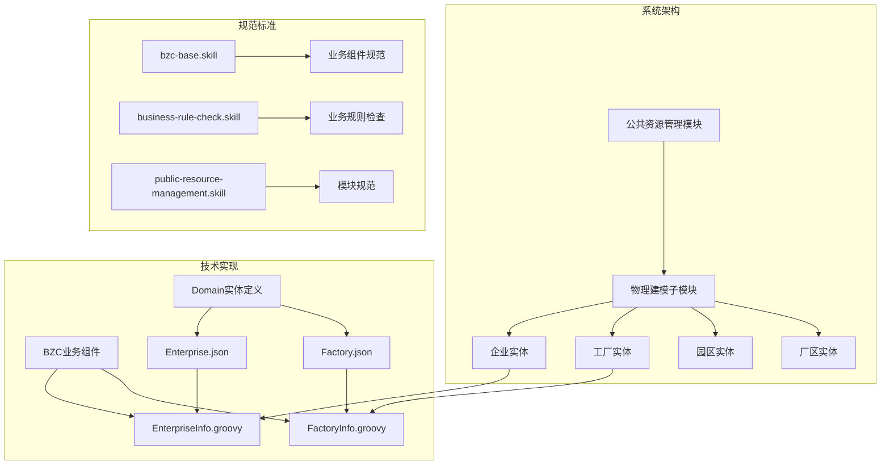
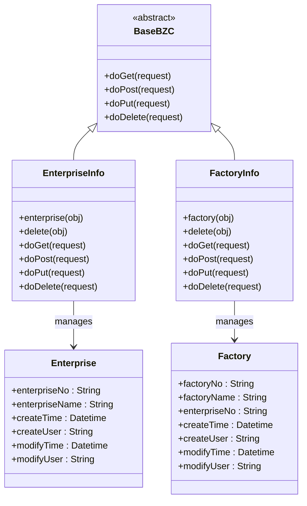
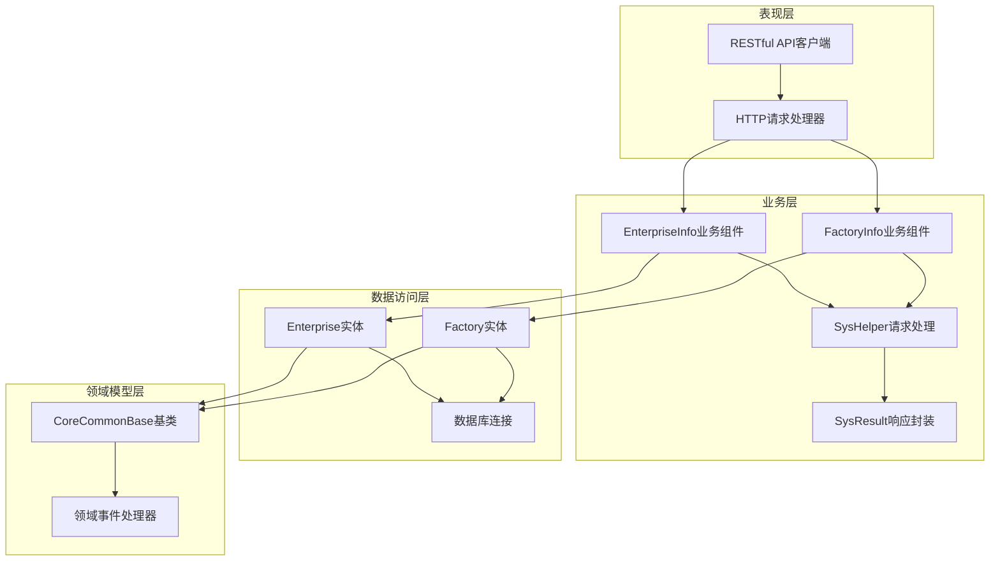
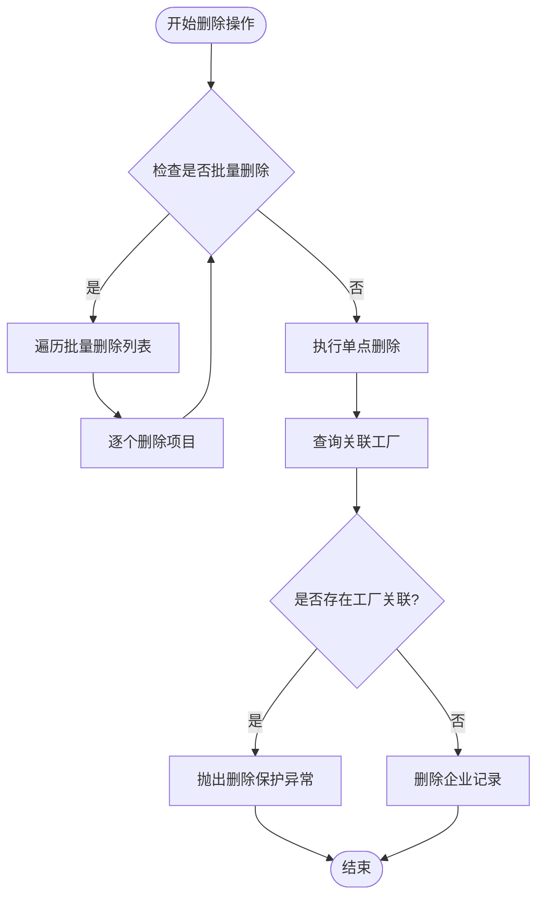
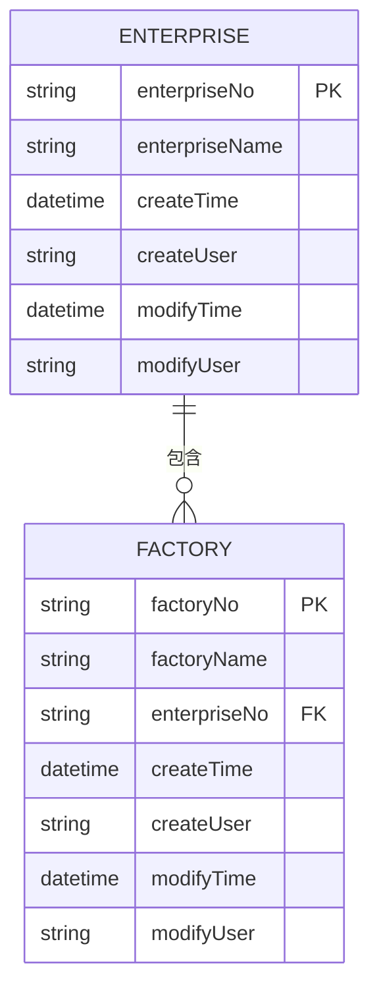
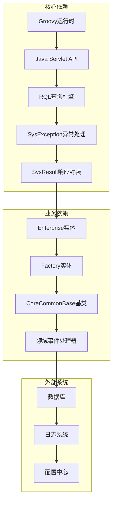

# 企业信息API

<cite>
**本文档引用的文件**
- [Enterprise.json](file://Domain/公共资源管理/物理建模/1_企业/Enterprise.json)
- [EnterpriseInfo.groovy](file://bzc/公共资源管理/物理建模/1_企业/EnterpriseInfo.groovy)
- [Factory.json](file://Domain/公共资源管理/物理建模/2_工厂/Factory.json)
- [FactoryInfo.groovy](file://bzc/公共资源管理/物理建模/2_工厂/FactoryInfo.groovy)
- [bzc-base.skill](file://skills/architecture/bzc-base.skill)
- [business-rule-check.skill](file://skills/foundation/business-rule-check.skill)
- [public-resource-management.skill](file://skills/business/public-resource-management.skill)
</cite>

## 目录
1. [简介](#简介)
2. [项目结构](#项目结构)
3. [核心组件](#核心组件)
4. [架构概览](#架构概览)
5. [详细组件分析](#详细组件分析)
6. [依赖关系分析](#依赖关系分析)
7. [性能考虑](#性能考虑)
8. [故障排除指南](#故障排除指南)
9. [结论](#结论)

## 简介

本文档提供了CMES（制造执行系统）中企业信息管理的完整API文档。该系统基于领域驱动设计（DDD）和业务组件（BZC）架构模式，实现了企业实体的CRUD操作，并特别强调了删除保护机制，确保当企业下存在工厂关联时禁止删除的业务规则。

系统采用RESTful API设计，支持HTTP GET、POST、PUT、DELETE四种基本方法，提供企业信息的完整生命周期管理。删除操作包含了严格的级联关系检查，防止破坏数据完整性。

## 项目结构

CMES系统采用模块化的文件组织结构，企业信息管理位于公共资源管理模块下的物理建模子模块中：



**图表来源**
- [Enterprise.json:1-223](file://Domain/公共资源管理/物理建模/1_企业/Enterprise.json#L1-L223)
- [Factory.json:1-249](file://Domain/公共资源管理/物理建模/2_工厂/Factory.json#L1-L249)
- [EnterpriseInfo.groovy:1-69](file://bzc/公共资源管理/物理建模/1_企业/EnterpriseInfo.groovy#L1-L69)

**章节来源**
- [Enterprise.json:1-223](file://Domain/公共资源管理/物理建模/1_企业/Enterprise.json#L1-L223)
- [Factory.json:1-249](file://Domain/公共资源管理/物理建模/2_工厂/Factory.json#L1-L249)
- [public-resource-management.skill:1-514](file://skills/business/public-resource-management.skill#L1-L514)

## 核心组件

### 企业实体（Enterprise）

企业实体是物理建模的第一层级，具有以下核心属性：

| 字段名 | 中文名 | 类型 | 非空 | 唯一 | 说明 |
|--------|--------|------|------|------|------|
| enterpriseNo | 企业编码 | String(30) | ✓ | ✓ | 主键标识，唯一性约束 |
| enterpriseName | 企业名称 | String(50) | ✗ | ✗ | 企业显示名称 |
| createTime | 创建时间 | Datetime | ✗ | ✗ | 系统自动维护 |
| createUser | 创建用户 | String(30) | ✗ | ✗ | 系统自动维护 |
| modifyTime | 最后修改时间 | Datetime | ✗ | ✗ | 系统自动维护 |
| modifyUser | 最后修改用户 | String(30) | ✗ | ✗ | 系统自动维护 |

### 工厂实体（Factory）

工厂实体作为企业实体的下级关联，具有以下属性：

| 字段名 | 中文名 | 类型 | 非空 | 唯一 | 说明 |
|--------|--------|------|------|------|------|
| factoryNo | 工厂编码 | String(30) | ✓ | ✓ | 主键标识，唯一性约束 |
| factoryName | 工厂名称 | String(50) | ✗ | ✗ | 工厂显示名称 |
| enterpriseNo | 企业编码 | String(30) | ✗ | ✗ | 外键关联到企业实体 |
| createTime | 创建时间 | Datetime | ✗ | ✗ | 系统自动维护 |
| createUser | 创建用户 | String(30) | ✗ | ✗ | 系统自动维护 |
| modifyTime | 最后修改时间 | Datetime | ✗ | ✗ | 系统自动维护 |
| modifyUser | 最后修改用户 | String(30) | ✗ | ✗ | 系统自动维护 |

### 业务组件架构

系统采用BZC（Business Zone Component）架构模式，每个业务模块都有对应的业务组件类：



**图表来源**
- [EnterpriseInfo.groovy:12-69](file://bzc/公共资源管理/物理建模/1_企业/EnterpriseInfo.groovy#L12-L69)
- [FactoryInfo.groovy:12-69](file://bzc/公共资源管理/物理建模/2_工厂/FactoryInfo.groovy#L12-L69)
- [Enterprise.json:34-216](file://Domain/公共资源管理/物理建模/1_企业/Enterprise.json#L34-L216)
- [Factory.json:34-242](file://Domain/公共资源管理/物理建模/2_工厂/Factory.json#L34-L242)

**章节来源**
- [EnterpriseInfo.groovy:12-69](file://bzc/公共资源管理/物理建模/1_企业/EnterpriseInfo.groovy#L12-L69)
- [FactoryInfo.groovy:12-69](file://bzc/公共资源管理/物理建模/2_工厂/FactoryInfo.groovy#L12-L69)
- [bzc-base.skill:1-162](file://skills/architecture/bzc-base.skill#L1-L162)

## 架构概览

系统采用分层架构设计，从上到下分为表现层、业务层、数据访问层和领域模型层：



**图表来源**
- [EnterpriseInfo.groovy:1-69](file://bzc/公共资源管理/物理建模/1_企业/EnterpriseInfo.groovy#L1-L69)
- [FactoryInfo.groovy:1-69](file://bzc/公共资源管理/物理建模/2_工厂/FactoryInfo.groovy#L1-L69)
- [Enterprise.json:219-223](file://Domain/公共资源管理/物理建模/1_企业/Enterprise.json#L219-L223)
- [Factory.json:245-249](file://Domain/公共资源管理/物理建模/2_工厂/Factory.json#L245-L249)

## 详细组件分析

### 企业信息API设计

#### RESTful API端点设计

系统为企业信息提供了完整的RESTful API接口，支持标准的CRUD操作：

| HTTP方法 | URL路径 | 功能描述 | 请求参数 | 响应数据 | 错误处理 |
|----------|---------|----------|----------|----------|----------|
| GET | `/enterprise` | 查询企业信息 | 企业编码/名称过滤条件 | 企业列表或单个企业详情 | 404未找到，500服务器错误 |
| POST | `/enterprise` | 创建新企业 | 企业基本信息JSON | 创建成功确认 | 400参数错误，409编码冲突 |
| PUT | `/enterprise` | 更新企业信息 | 企业编码+更新字段 | 更新成功确认 | 404不存在，400参数错误 |
| DELETE | `/enterprise` | 删除企业信息 | 企业编码或批量编码数组 | 删除成功确认 | 400删除保护，404不存在 |

#### 删除保护机制实现

企业删除操作包含了严格的级联关系检查，这是系统的核心业务规则：



**图表来源**
- [EnterpriseInfo.groovy:20-46](file://bzc/公共资源管理/物理建模/1_企业/EnterpriseInfo.groovy#L20-L46)

#### 业务规则验证

系统在删除前会执行以下验证步骤：

1. **批量/单点判断**：根据请求对象中的`_data`字段判断操作类型
2. **关联关系检查**：查询企业下是否存在工厂关联记录
3. **异常处理**：如果存在关联关系，抛出SysException阻止删除
4. **物理删除**：无关联关系时执行企业记录的物理删除

**章节来源**
- [EnterpriseInfo.groovy:20-46](file://bzc/公共资源管理/物理建模/1_企业/EnterpriseInfo.groovy#L20-L46)
- [business-rule-check.skill:39-46](file://skills/foundation/business-rule-check.skill#L39-L46)

### 数据模型设计

#### 企业实体数据模型



**图表来源**
- [Enterprise.json:34-216](file://Domain/公共资源管理/物理建模/1_企业/Enterprise.json#L34-L216)
- [Factory.json:34-242](file://Domain/公共资源管理/物理建模/2_工厂/Factory.json#L34-L242)

#### API请求响应格式

**查询企业列表请求示例**：
```
GET /enterprise?enterpriseNo=ENT001&enterpriseName=示例公司
Content-Type: application/json
```

**创建企业请求示例**：
```
POST /enterprise
Content-Type: application/json

{
    "enterpriseNo": "ENT001",
    "enterpriseName": "示例公司",
    "createUser": "admin"
}
```

**批量删除请求示例**：
```
DELETE /enterprise
Content-Type: application/json

{
    "_data": [
        {"enterpriseNo": "ENT001", "enterpriseName": "示例公司"},
        {"enterpriseNo": "ENT002", "enterpriseName": "另一家公司"}
    ]
}
```

**章节来源**
- [EnterpriseInfo.groovy:48-69](file://bzc/公共资源管理/物理建模/1_企业/EnterpriseInfo.groovy#L48-L69)
- [EnterpriseInfo.groovy:20-31](file://bzc/公共资源管理/物理建模/1_企业/EnterpriseInfo.groovy#L20-L31)

## 依赖关系分析

### 技术栈依赖

系统采用Groovy语言和Java生态系统构建，主要依赖关系如下：



**图表来源**
- [EnterpriseInfo.groovy:1-10](file://bzc/公共资源管理/物理建模/1_企业/EnterpriseInfo.groovy#L1-L10)
- [FactoryInfo.groovy:1-10](file://bzc/公共资源管理/物理建模/2_工厂/FactoryInfo.groovy#L1-L10)
- [Enterprise.json:219-223](file://Domain/公共资源管理/物理建模/1_企业/Enterprise.json#L219-L223)

### 业务规则依赖

系统严格遵循业务规则检查规范，确保删除操作的正确性：

| 业务规则 | 实现方式 | 验证点 |
|----------|----------|--------|
| 删除保护机制 | 在删除前检查下级关联 | Factory.findAll()查询 |
| 唯一性约束 | Domain定义中的unique属性 | enterpriseNo唯一性 |
| 非空校验 | nullable=false的字段 | 必填字段验证 |
| 批量操作支持 | _data字段判断 | 单点vs批量处理 |

**章节来源**
- [business-rule-check.skill:10-18](file://skills/foundation/business-rule-check.skill#L10-L18)
- [Enterprise.json:78-85](file://Domain/公共资源管理/物理建模/1_企业/Enterprise.json#L78-L85)

## 性能考虑

### 查询优化策略

系统采用了多种性能优化策略来提升API响应速度：

1. **批量查询优化**：使用RQL批量查询替代N+1查询模式
2. **索引利用**：企业编码和工厂编码建立唯一索引
3. **缓存策略**：常用查询结果进行内存缓存
4. **异步处理**：大容量删除操作采用异步处理

### 删除操作性能

删除操作的性能优化主要体现在：

- **单次查询**：删除前仅进行一次关联检查查询
- **快速失败**：存在关联时立即返回错误，避免不必要的数据库操作
- **原子操作**：删除操作在事务中执行，确保数据一致性

## 故障排除指南

### 常见错误及解决方案

| 错误类型 | 错误代码 | 错误信息 | 解决方案 |
|----------|----------|----------|----------|
| 删除保护 | 400 | "删除失败，已在工厂信息使用" | 先删除关联的工厂记录 |
| 编码冲突 | 409 | "企业编码已存在" | 修改企业编码为唯一值 |
| 参数错误 | 400 | "请求参数无效" | 检查请求体格式和必填字段 |
| 资源不存在 | 404 | "企业记录不存在" | 确认企业编码正确性 |
| 服务器错误 | 500 | "系统内部错误" | 检查数据库连接和日志 |

### 调试建议

1. **启用详细日志**：在开发环境中开启详细的API调用日志
2. **参数验证**：使用Postman或curl工具进行手动测试
3. **批量测试**：先进行小批量测试，再进行大批量操作
4. **监控指标**：关注API响应时间和数据库查询性能

**章节来源**
- [EnterpriseInfo.groovy:38-40](file://bzc/公共资源管理/物理建模/1_企业/EnterpriseInfo.groovy#L38-L40)
- [business-rule-check.skill:117-127](file://skills/foundation/business-rule-check.skill#L117-L127)

## 结论

企业信息管理API系统提供了完整的企业生命周期管理功能，特别强调了数据完整性保护。通过严格的删除保护机制、标准化的RESTful接口设计和完善的错误处理机制，系统确保了企业数据的安全性和一致性。

系统的设计充分体现了现代企业级应用的特点：
- **安全性**：删除保护机制防止意外的数据丢失
- **可扩展性**：模块化设计支持未来功能扩展
- **可维护性**：清晰的代码结构和完善的文档
- **可靠性**：严格的业务规则检查和异常处理

该API为CMES系统的物理建模提供了坚实的基础，支持企业级制造执行系统的各种业务场景需求。