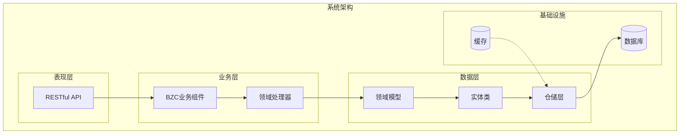
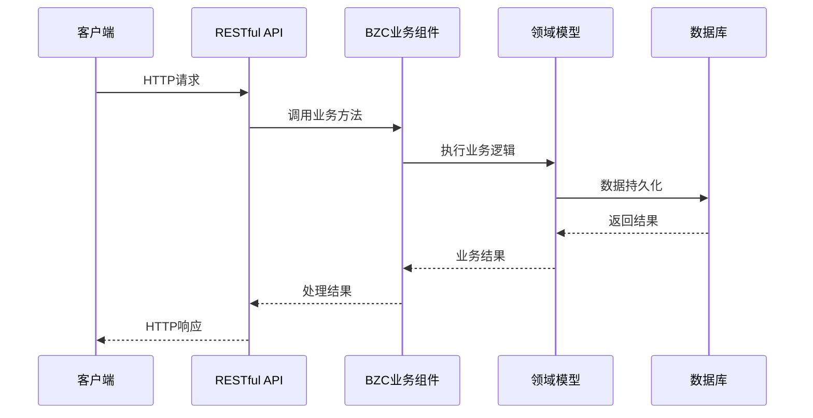
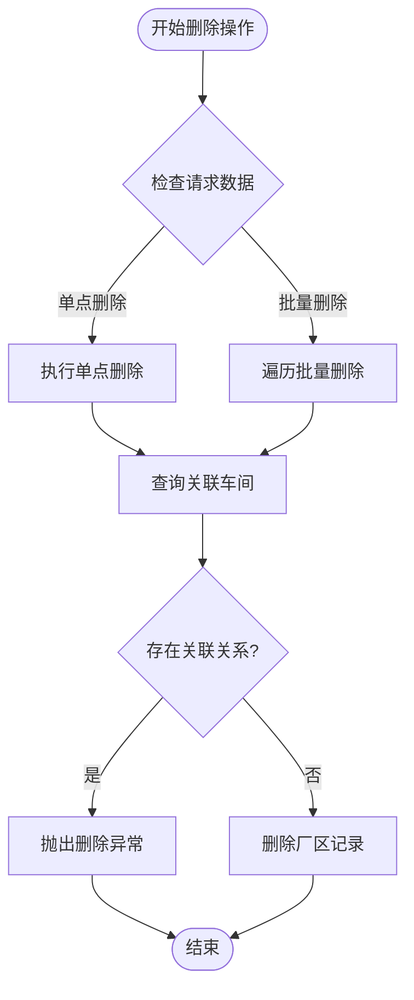
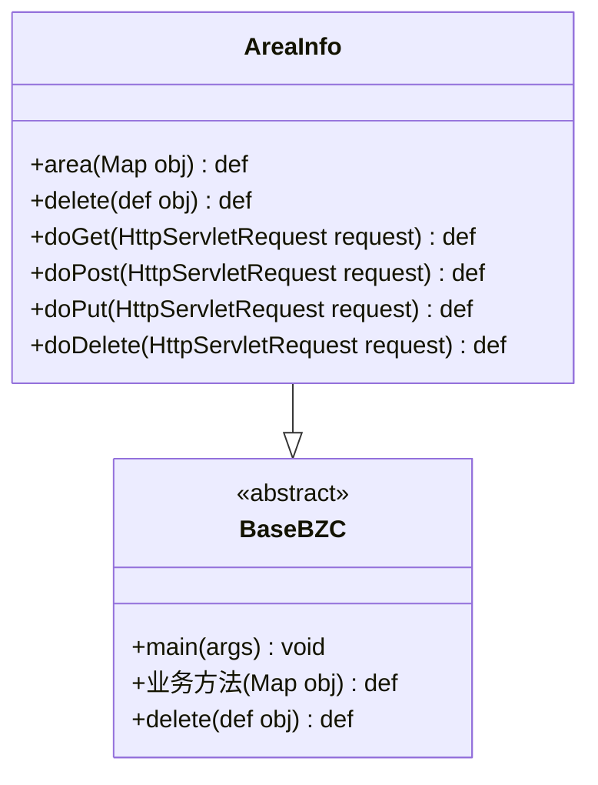
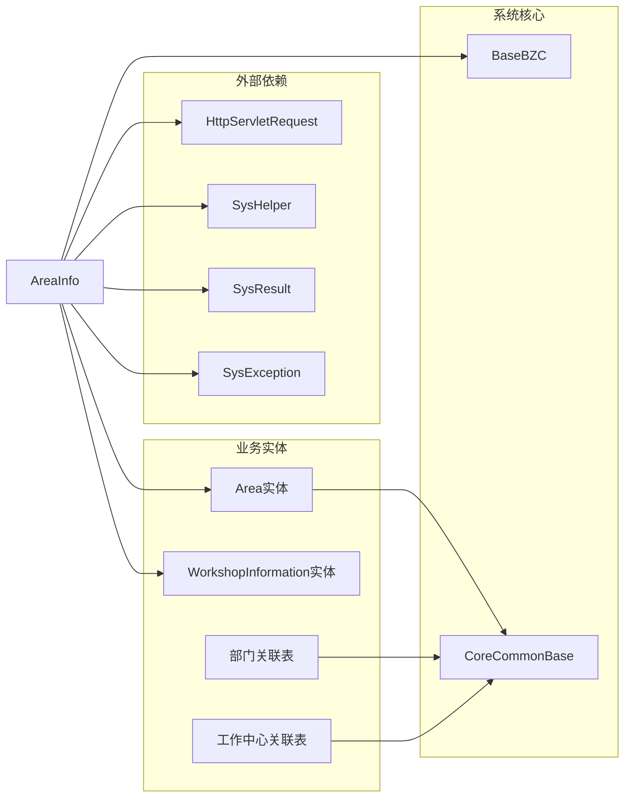
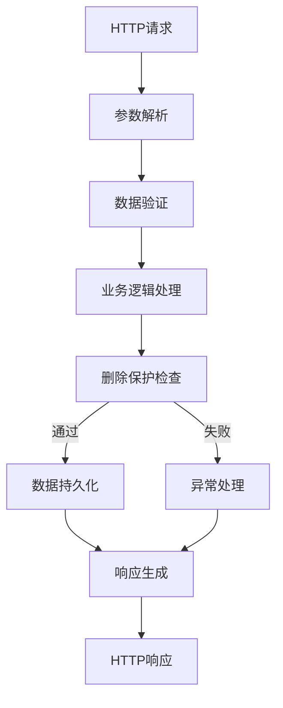

# 厂区管理API

<cite>
**本文档引用的文件**
- [AreaInfo.groovy](file://bzc/公共资源管理/物理建模/4_厂区/AreaInfo.groovy)
- [Area.json](file://Domain/公共资源管理/物理建模/4_厂区/Area.json)
- [AreaDepartmentCorrelation.json](file://Domain/公共资源管理/物理建模/4_厂区/AreaDepartmentCorrelation.json)
- [AreaWcCorrelation.json](file://Domain/公共资源管理/物理建模/4_厂区/AreaWcCorrelation.json)
- [WorkshopInformation.json](file://Domain/公共资源管理/物理建模/5_车间/WorkshopInformation.json)
- [public-resource-management.skill](file://skills/business/public-resource-management.skill)
- [bzc-base.skill](file://skills/architecture/bzc-base.skill)
</cite>

## 目录
1. [简介](#简介)
2. [项目结构](#项目结构)
3. [核心组件](#核心组件)
4. [架构概览](#架构概览)
5. [详细组件分析](#详细组件分析)
6. [依赖关系分析](#依赖关系分析)
7. [性能考虑](#性能考虑)
8. [故障排除指南](#故障排除指南)
9. [结论](#结论)

## 简介

本文档提供了CMES系统中厂区管理的完整API文档。厂区管理模块实现了基于RESTful风格的CRUD操作，包括厂区的创建、查询、更新和删除接口。特别关注了厂区删除时的删除保护机制，确保当厂区下存在车间关联时禁止删除的业务规则得到严格执行。

该系统采用分层架构设计，包含领域模型（Domain）、业务组件（BZC）和服务层三个主要层次。删除保护机制通过检查下级实体引用关系来实现数据完整性约束。

## 项目结构

厂区管理模块在系统中的组织结构如下：

**图表来源**
- [AreaInfo.groovy:1-70](file://bzc/公共资源管理/物理建模/4_厂区/AreaInfo.groovy#L1-L70)
- [Area.json:1-249](file://Domain/公共资源管理/物理建模/4_厂区/Area.json#L1-L249)

**章节来源**
- [AreaInfo.groovy:1-70](file://bzc/公共资源管理/物理建模/4_厂区/AreaInfo.groovy#L1-L70)
- [Area.json:1-249](file://Domain/公共资源管理/物理建模/4_厂区/Area.json#L1-L249)

## 核心组件

### 厂区实体模型

厂区实体是整个模块的核心数据模型，具有以下关键属性：

| 属性名 | 数据类型 | 非空 | 唯一 | 描述 |
|--------|----------|------|------|------|
| areaNo | String(30) | 是 | 是 | 厂区编码，主键标识 |
| areaName | String(50) | 否 | 否 | 厂区名称 |
| parkNo | String(30) | 是 | 否 | 园区编码，外键引用 |

### 关联表结构

厂区管理涉及两个重要的关联表：

1. **厂区部门关联表**：维护厂区与部门的关联关系
2. **厂区工作中心关联表**：维护厂区与工作中心的关联关系

这些关联表支持厂区的多维度管理和业务扩展需求。

**章节来源**
- [Area.json:34-242](file://Domain/公共资源管理/物理建模/4_厂区/Area.json#L34-L242)
- [AreaDepartmentCorrelation.json:34-268](file://Domain/公共资源管理/物理建模/4_厂区/AreaDepartmentCorrelation.json#L34-L268)
- [AreaWcCorrelation.json:34-242](file://Domain/公共资源管理/物理建模/4_厂区/AreaWcCorrelation.json#L34-L242)

## 架构概览

厂区管理API采用经典的三层架构模式：

**图表来源**
- [AreaInfo.groovy:21-47](file://bzc/公共资源管理/物理建模/4_厂区/AreaInfo.groovy#L21-L47)

### 删除保护机制

删除保护机制是厂区管理的核心业务规则，通过以下流程实现：

**图表来源**
- [AreaInfo.groovy:21-47](file://bzc/公共资源管理/物理建模/4_厂区/AreaInfo.groovy#L21-L47)

**章节来源**
- [AreaInfo.groovy:21-47](file://bzc/公共资源管理/物理建模/4_厂区/AreaInfo.groovy#L21-L47)

## 详细组件分析

### BZC业务组件

AreaInfo类作为厂区管理的业务组件，继承自BaseBZC基类，实现了完整的CRUD操作：

#### 核心方法结构

**图表来源**
- [AreaInfo.groovy:12-70](file://bzc/公共资源管理/物理建模/4_厂区/AreaInfo.groovy#L12-L70)
- [bzc-base.skill:10-26](file://skills/architecture/bzc-base.skill#L10-L26)

#### 删除业务逻辑

删除操作实现了严格的级联保护机制：

1. **单点删除**：直接删除指定厂区
2. **批量删除**：逐个处理删除请求
3. **关联检查**：查询是否存在关联的车间
4. **异常处理**：存在关联时抛出删除异常

**章节来源**
- [AreaInfo.groovy:21-47](file://bzc/公共资源管理/物理建模/4_厂区/AreaInfo.groovy#L21-L47)

### 领域模型

厂区领域模型定义了完整的数据结构和业务规则：

#### 实体属性定义

| 属性 | 类型 | 非空 | 唯一 | 描述 |
|------|------|------|------|------|
| _id | Long | 是 | 否 | 系统主键 |
| areaNo | String | 是 | 是 | 厂区编码 |
| areaName | String | 否 | 否 | 厂区名称 |
| parkNo | String | 否 | 否 | 园区编码 |
| createTime | Datetime | 否 | 否 | 创建时间 |
| createUser | String | 否 | 否 | 创建用户 |
| modifyTime | Datetime | 否 | 否 | 最后修改时间 |
| modifyUser | String | 否 | 否 | 最后修改用户 |

**章节来源**
- [Area.json:34-242](file://Domain/公共资源管理/物理建模/4_厂区/Area.json#L34-L242)

### 关联表设计

#### 厂区部门关联表

| 字段名 | 类型 | 非空 | 唯一 | 描述 |
|--------|------|------|------|------|
| areaNo | String | 否 | 否 | 厂区编码 |
| departmentNo | String | 否 | 否 | 部门编码 |
| departmentName | String | 否 | 否 | 部门名称 |
| departmentGrade | String | 否 | 否 | 部门级别 |

#### 厂区工作中心关联表

| 字段名 | 类型 | 非空 | 唯一 | 描述 |
|--------|------|------|------|------|
| areaNo | String | 否 | 否 | 厂区编码 |
| workCenterNo | String | 否 | 是 | 工作中心编码 |
| workCenterName | String | 否 | 否 | 工作中心名称 |

**章节来源**
- [AreaDepartmentCorrelation.json:34-268](file://Domain/公共资源管理/物理建模/4_厂区/AreaDepartmentCorrelation.json#L34-L268)
- [AreaWcCorrelation.json:34-242](file://Domain/公共资源管理/物理建模/4_厂区/AreaWcCorrelation.json#L34-L242)

## 依赖关系分析

厂区管理模块的依赖关系体现了清晰的分层架构：

**图表来源**
- [AreaInfo.groovy:1-10](file://bzc/公共资源管理/物理建模/4_厂区/AreaInfo.groovy#L1-L10)
- [Area.json:29](file://Domain/公共资源管理/物理建模/4_厂区/Area.json#L29)

### 数据流分析

**图表来源**
- [AreaInfo.groovy:21-47](file://bzc/公共资源管理/物理建模/4_厂区/AreaInfo.groovy#L21-L47)

**章节来源**
- [AreaInfo.groovy:1-70](file://bzc/公共资源管理/物理建模/4_厂区/AreaInfo.groovy#L1-L70)

## 性能考虑

### 查询优化策略

1. **批量查询优化**：使用RQL批量查询减少数据库访问次数
2. **索引设计**：合理利用areaNo等关键字段的索引
3. **缓存策略**：对常用查询结果实施缓存机制

### 删除操作优化

1. **快速失败**：在删除前进行关联检查，避免不必要的数据库操作
2. **事务管理**：确保删除操作的原子性和一致性
3. **异步处理**：对于复杂的删除场景考虑异步处理机制

## 故障排除指南

### 常见错误及解决方案

#### 删除保护异常

**错误信息**：`删除失败，{areaName}已在车间信息使用`

**原因分析**：
- 厂区下存在关联的车间记录
- 系统检测到数据完整性约束

**解决方案**：
1. 先删除所有关联的车间记录
2. 再执行厂区删除操作
3. 或者调整业务流程避免删除受保护的厂区

#### 参数验证错误

**常见问题**：
- 缺少必需的areaNo参数
- areaNo格式不正确
- areaName超出长度限制

**解决步骤**：
1. 检查请求参数格式
2. 验证字段长度和格式
3. 确保必填字段完整

**章节来源**
- [AreaInfo.groovy:39-40](file://bzc/公共资源管理/物理建模/4_厂区/AreaInfo.groovy#L39-L40)

## 结论

厂区管理API提供了完整的CRUD操作和严格的数据完整性保护机制。通过删除保护机制，系统有效防止了误删操作对业务数据造成的影响。模块化的架构设计使得代码具有良好的可维护性和扩展性。

关键特性包括：
- 完整的RESTful API支持
- 严格的数据完整性约束
- 清晰的业务逻辑分离
- 良好的错误处理机制
- 可扩展的关联表设计

该实现为后续的功能扩展和业务发展奠定了坚实的基础。