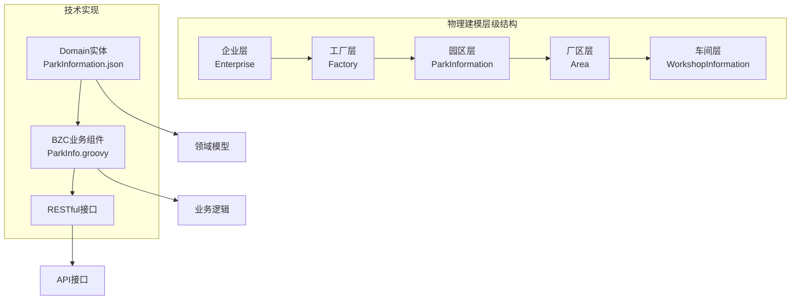
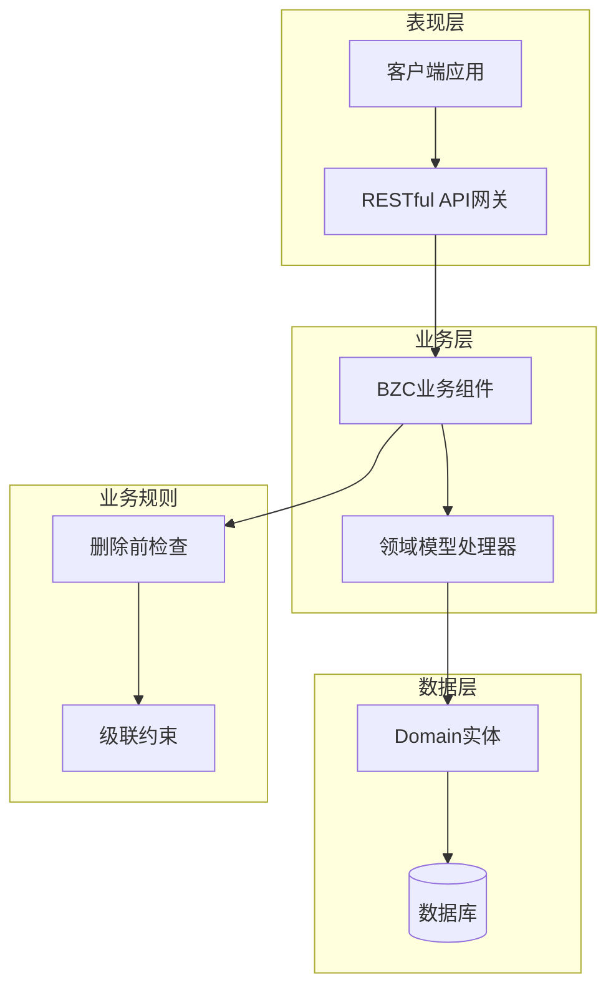
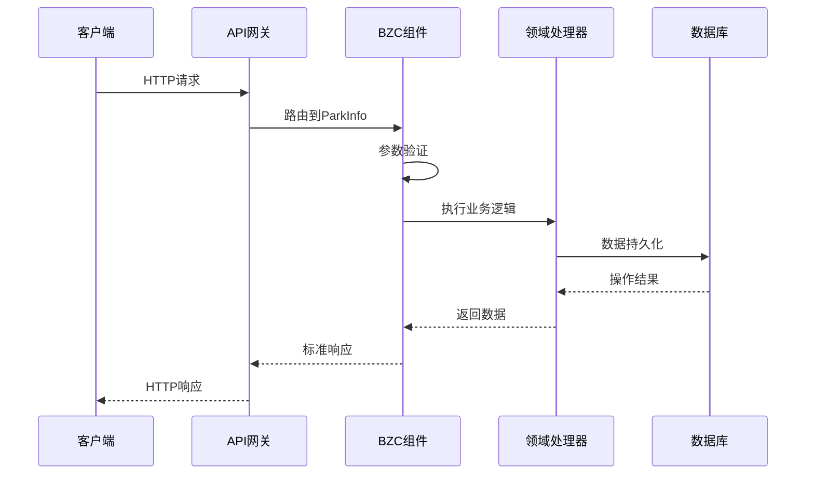
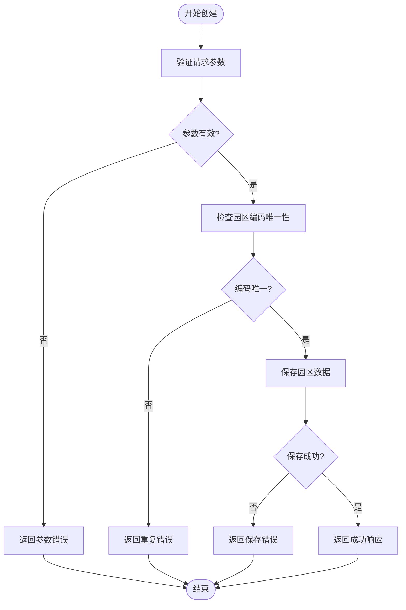
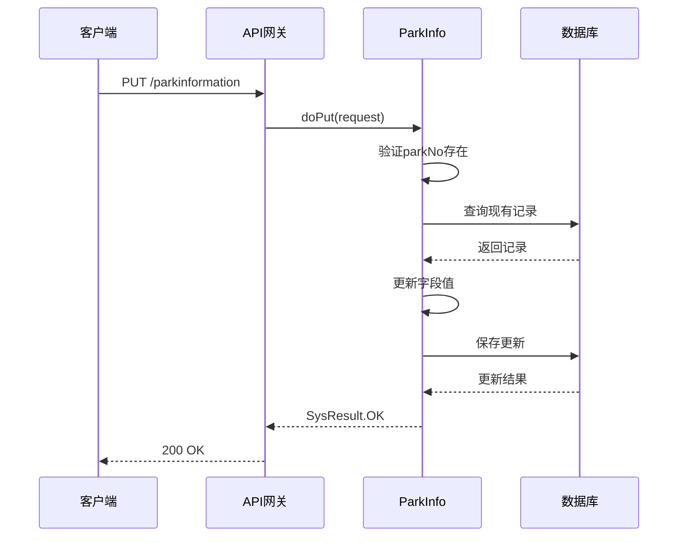
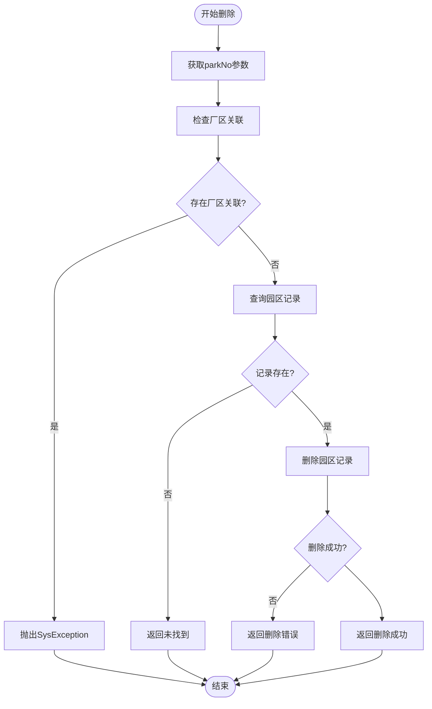
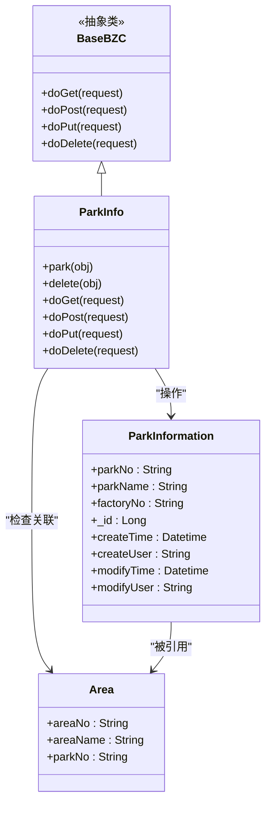

# 园区管理API

<cite>
**本文档引用的文件**
- [ParkInformation.json](file://Domain/公共资源管理/物理建模/3_园区/ParkInformation.json)
- [ParkInfo.groovy](file://bzc/公共资源管理/物理建模/3_园区/ParkInfo.groovy)
- [Factory.json](file://Domain/公共资源管理/物理建模/2_工厂/Factory.json)
- [Area.json](file://Domain/公共资源管理/物理建模/4_厂区/Area.json)
- [public-resource-management.skill](file://skills/business/public-resource-management.skill)
- [bzc-base.skill](file://skills/architecture/bzc-base.skill)
- [EnterpriseInfo.groovy](file://bzc/公共资源管理/物理建模/1_企业/EnterpriseInfo.groovy)
- [FactoryInfo.groovy](file://bzc/公共资源管理/物理建模/2_工厂/FactoryInfo.groovy)
- [AreaInfo.groovy](file://bzc/公共资源管理/物理建模/4_厂区/AreaInfo.groovy)
</cite>

## 目录
1. [简介](#简介)
2. [项目结构](#项目结构)
3. [核心组件](#核心组件)
4. [架构概览](#架构概览)
5. [详细组件分析](#详细组件分析)
6. [依赖分析](#依赖分析)
7. [性能考虑](#性能考虑)
8. [故障排除指南](#故障排除指南)
9. [结论](#结论)

## 简介

本文档提供了CMES系统中园区管理的完整API文档。园区作为物理建模层级中的第三级实体，位于工厂之下、厂区之上，是整个生产管理体系的重要组成部分。

园区管理API支持完整的CRUD操作，包括园区的创建、查询、更新和删除接口。系统采用RESTful API设计风格，遵循统一的HTTP方法约定和响应格式标准。

## 项目结构

CMES系统的物理建模采用分层架构，园区管理位于第3层级：



**图表来源**
- [public-resource-management.skill:122-134](file://skills/business/public-resource-management.skill#L122-L134)
- [ParkInformation.json:1-249](file://Domain/公共资源管理/物理建模/3_园区/ParkInformation.json#L1-L249)

**章节来源**
- [public-resource-management.skill:122-134](file://skills/business/public-resource-management.skill#L122-L134)
- [ParkInformation.json:1-249](file://Domain/公共资源管理/物理建模/3_园区/ParkInformation.json#L1-L249)

## 核心组件

### 园区实体定义

园区实体具有以下核心属性：

| 属性名 | 中文名 | 类型 | 是否必填 | 唯一性 | 描述 |
|--------|--------|------|----------|--------|------|
| parkNo | 园区编码 | String(30) | 是 | 唯一 | 主键标识，唯一标识园区 |
| parkName | 园区名称 | String(30) | 否 | 无 | 园区的显示名称 |
| factoryNo | 工厂编码 | String(30) | 否 | 无 | 关联到所属工厂 |

### 基础字段

所有实体继承自CoreCommonBase，自动具备以下通用字段：

| 属性名 | 类型 | 描述 |
|--------|------|------|
| _id | Long | 系统内部标识符 |
| createTime | Datetime | 创建时间 |
| createUser | String(30) | 创建用户 |
| modifyTime | Datetime | 最后修改时间 |
| modifyUser | String(30) | 最后修改用户 |

**章节来源**
- [ParkInformation.json:34-242](file://Domain/公共资源管理/物理建模/3_园区/ParkInformation.json#L34-L242)
- [public-resource-management.skill:100-102](file://skills/business/public-resource-management.skill#L100-L102)

## 架构概览

CMES系统的园区管理采用三层架构设计：



**图表来源**
- [ParkInfo.groovy:12-70](file://bzc/公共资源管理/物理建模/3_园区/ParkInfo.groovy#L12-L70)
- [bzc-base.skill:1-27](file://skills/architecture/bzc-base.skill#L1-L27)

### 数据流图



**图表来源**
- [ParkInfo.groovy:48-70](file://bzc/公共资源管理/物理建模/3_园区/ParkInfo.groovy#L48-L70)
- [bzc-base.skill:92-122](file://skills/architecture/bzc-base.skill#L92-L122)

## 详细组件分析

### RESTful API规范

#### HTTP方法映射

| HTTP方法 | BZC方法 | 功能描述 | 请求体类型 | 响应类型 |
|----------|---------|----------|------------|----------|
| GET | doGet | 查询园区信息 | URL参数 | JSON对象 |
| POST | doPost | 创建/更新园区 | JSON对象 | SysResult |
| PUT | doPut | 更新园区信息 | JSON对象 | SysResult |
| DELETE | doDelete | 删除园区 | URL参数 | SysResult |

#### URL路径规范

```
/rest/public_resource_management/physical_modeling/parkinformation
```

#### 请求参数格式

**查询参数 (GET)**
```json
{
  "parkNo": "字符串",
  "parkName": "字符串",
  "factoryNo": "字符串",
  "page": "数字",
  "size": "数字"
}
```

**请求体 (POST/PUT)**
```json
{
  "parkNo": "字符串(必填)",
  "parkName": "字符串(可选)",
  "factoryNo": "字符串(可选)"
}
```

#### 响应数据结构

**成功响应**
```json
{
  "code": "0000",
  "message": "操作成功",
  "data": {},
  "success": true
}
```

**错误响应**
```json
{
  "code": "9999",
  "message": "错误描述",
  "data": null,
  "success": false
}
```

### CRUD操作详解

#### 园区创建 (POST)



**图表来源**
- [ParkInfo.groovy:60-64](file://bzc/公共资源管理/物理建模/3_园区/ParkInfo.groovy#L60-L64)

#### 园区查询 (GET)

支持多种查询条件组合：

**单个查询**
```
GET /rest/public_resource_management/physical_modeling/parkinformation?parkNo=PK001
```

**批量查询**
```
GET /rest/public_resource_management/physical_modeling/parkinformation?page=1&size=10
```

**条件查询**
```
GET /rest/public_resource_management/physical_modeling/parkinformation?factoryNo=F001&parkName=园区
```

#### 园区更新 (PUT)



**图表来源**
- [ParkInfo.groovy:66-69](file://bzc/公共资源管理/物理建模/3_园区/ParkInfo.groovy#L66-L69)

#### 园区删除 (DELETE)

删除操作包含严格的级联检查机制：



**图表来源**
- [ParkInfo.groovy:33-46](file://bzc/公共资源管理/物理建模/3_园区/ParkInfo.groovy#L33-L46)

**章节来源**
- [ParkInfo.groovy:12-70](file://bzc/公共资源管理/物理建模/3_园区/ParkInfo.groovy#L12-L70)

### 业务规则与约束

#### 删除约束检查

园区删除时会检查是否存在下级关联：

1. **检查厂区关联**: 查询Area实体中是否存在对应的parkNo
2. **异常处理**: 如存在关联，抛出SysException阻止删除
3. **级联删除**: 无关联时执行物理删除

#### 数据完整性保证

- **主键约束**: parkNo作为唯一标识符
- **外键约束**: parkNo通过factoryNo关联到工厂实体
- **唯一性约束**: 园区编码必须唯一

**章节来源**
- [ParkInfo.groovy:33-46](file://bzc/公共资源管理/物理建模/3_园区/ParkInfo.groovy#L33-L46)
- [FactoryInfo.groovy:33-46](file://bzc/公共资源管理/物理建模/2_工厂/FactoryInfo.groovy#L33-L46)

## 依赖分析

### 组件依赖关系



**图表来源**
- [ParkInfo.groovy:12-18](file://bzc/公共资源管理/物理建模/3_园区/ParkInfo.groovy#L12-L18)
- [ParkInformation.json:34-138](file://Domain/公共资源管理/物理建模/3_园区/ParkInformation.json#L34-L138)

### 外部依赖

| 依赖组件 | 用途 | 版本要求 |
|----------|------|----------|
| SysHelper | 请求处理工具 | 系统内置 |
| SysResult | 结果封装 | 系统内置 |
| SysException | 异常处理 | 系统内置 |
| BaseBZC | 业务组件基类 | 系统框架 |

**章节来源**
- [bzc-base.skill:1-27](file://skills/architecture/bzc-base.skill#L1-L27)

## 性能考虑

### 查询优化

1. **索引策略**: 建议在parkNo、factoryNo字段建立索引
2. **分页查询**: 支持page和size参数进行分页
3. **条件过滤**: 支持多条件组合查询减少数据传输

### 缓存策略

- **读缓存**: 对常用查询结果进行短期缓存
- **配置缓存**: 对静态配置信息进行缓存
- **失效策略**: 基于时间戳的主动失效机制

### 并发控制

- **乐观锁**: 使用版本号防止并发更新冲突
- **事务管理**: 批量操作在单个事务中执行
- **死锁预防**: 按固定顺序访问相关实体

## 故障排除指南

### 常见错误及解决方案

| 错误代码 | 错误类型 | 可能原因 | 解决方案 |
|----------|----------|----------|----------|
| 9999 | 参数错误 | 缺少必要参数 | 检查请求参数完整性 |
| 9998 | 重复数据 | 园区编码已存在 | 修改为唯一编码 |
| 9997 | 外键约束 | 存在下级关联 | 先删除下级实体 |
| 9996 | 数据未找到 | 记录不存在 | 验证查询条件 |
| 9995 | 权限不足 | 用户无操作权限 | 检查用户角色 |

### 调试建议

1. **启用详细日志**: 在开发环境开启详细日志输出
2. **参数验证**: 严格验证所有输入参数
3. **异常捕获**: 捕获并记录所有异常信息
4. **性能监控**: 监控API响应时间和错误率

### API调用示例

**创建园区**
```bash
curl -X POST "http://localhost:8080/rest/public_resource_management/physical_modeling/parkinformation" \
  -H "Content-Type: application/json" \
  -d '{
    "parkNo": "PK001",
    "parkName": "新园区",
    "factoryNo": "F001"
  }'
```

**查询园区**
```bash
curl "http://localhost:8080/rest/public_resource_management/physical_modeling/parkinformation?parkNo=PK001"
```

**更新园区**
```bash
curl -X PUT "http://localhost:8080/rest/public_resource_management/physical_modeling/parkinformation" \
  -H "Content-Type: application/json" \
  -d '{
    "parkNo": "PK001",
    "parkName": "更新后的园区名称"
  }'
```

**删除园区**
```bash
curl -X DELETE "http://localhost:8080/rest/public_resource_management/physical_modeling/parkinformation?parkNo=PK001"
```

**章节来源**
- [ParkInfo.groovy:48-70](file://bzc/公共资源管理/物理建模/3_园区/ParkInfo.groovy#L48-L70)

## 结论

园区管理API提供了完整的CRUD操作支持，采用RESTful设计原则和标准化的响应格式。系统通过严格的业务规则检查和数据完整性约束，确保了数据的一致性和安全性。

主要特点包括：
- 完整的CRUD操作支持
- 严格的删除前检查机制
- 标准化的错误处理
- 清晰的API文档和示例
- 良好的扩展性和维护性

建议在生产环境中配合适当的缓存策略和监控机制，以获得最佳的性能和可靠性表现。