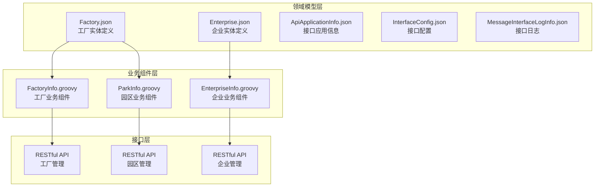
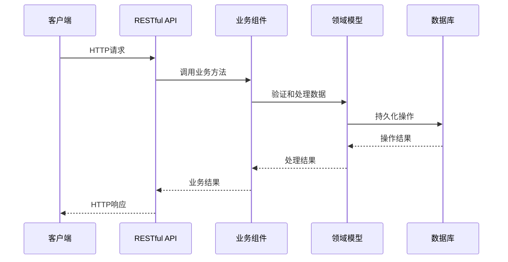
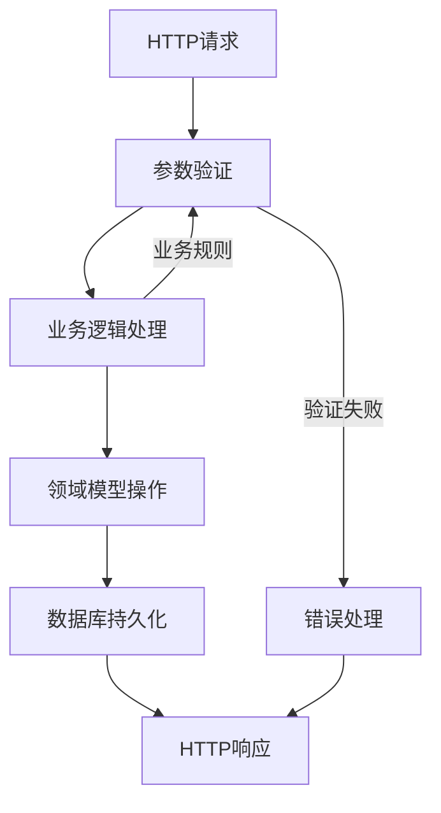
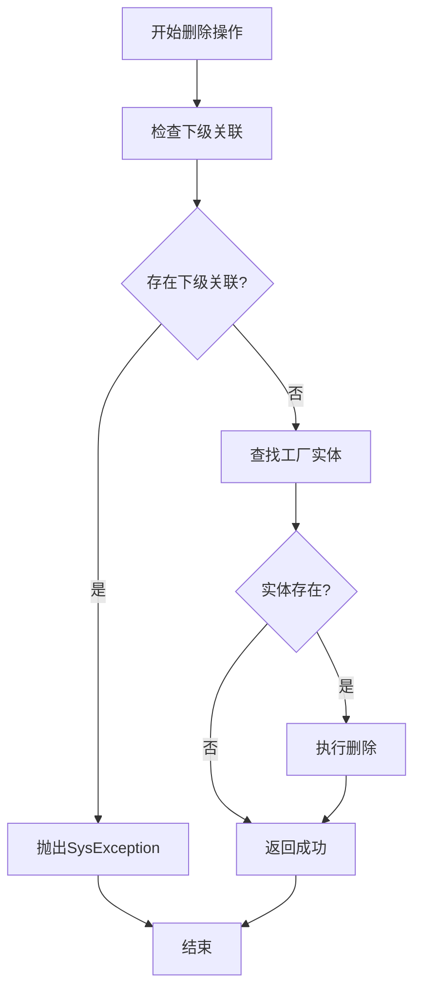
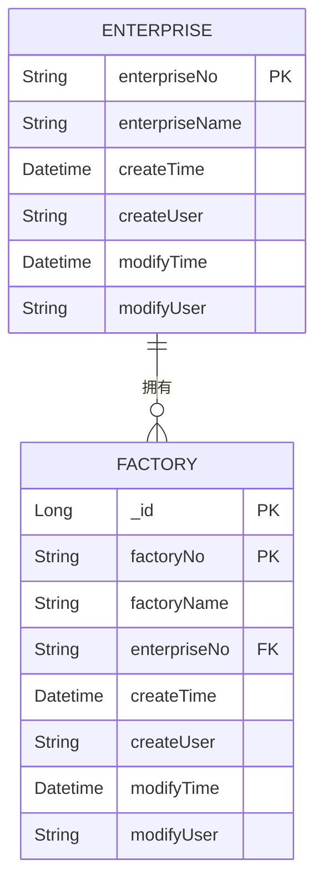
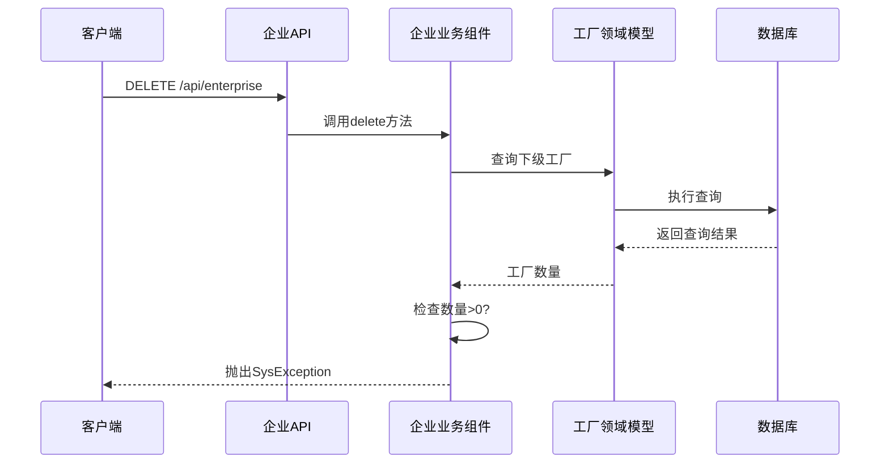
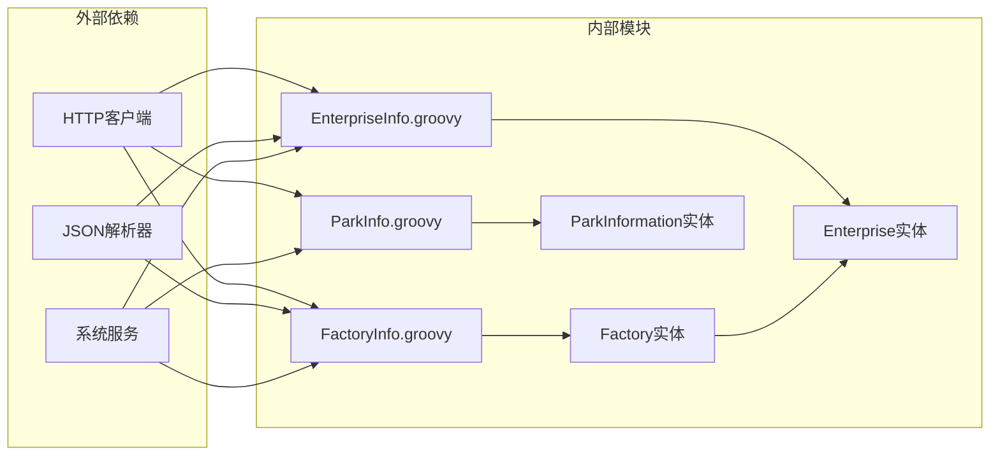
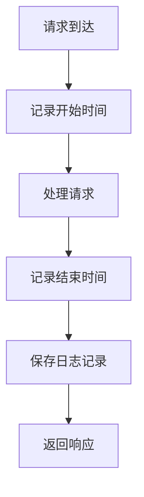

# 工厂管理API

<cite>
**本文档引用的文件**
- [Factory.json](file://Domain/公共资源管理/物理建模/2_工厂/Factory.json)
- [FactoryInfo.groovy](file://bzc/公共资源管理/物理建模/2_工厂/FactoryInfo.groovy)
- [Enterprise.json](file://Domain/公共资源管理/物理建模/1_企业/Enterprise.json)
- [EnterpriseInfo.groovy](file://bzc/公共资源管理/物理建模/1_企业/EnterpriseInfo.groovy)
- [ApiApplicationInfo.json](file://Domain/接口管理/ApiApplicationInfo.json)
- [InterfaceConfig.json](file://Domain/接口管理/InterfaceConfig.json)
- [MessageInterfaceLogInfo.json](file://Domain/接口管理/MessageInterfaceLogInfo.json)
- [ParkInfo.groovy](file://bzc/公共资源管理/物理建模/3_园区/ParkInfo.groovy)
</cite>

## 目录
1. [简介](#简介)
2. [项目结构](#项目结构)
3. [核心组件](#核心组件)
4. [架构概览](#架构概览)
5. [详细组件分析](#详细组件分析)
6. [依赖关系分析](#依赖关系分析)
7. [性能考虑](#性能考虑)
8. [故障排除指南](#故障排除指南)
9. [结论](#结论)

## 简介

本文件为CMES工厂管理系统的完整API文档，专注于工厂实体的CRUD操作。根据仓库中的领域模型和业务组件实现，系统采用分层架构设计，包含：

- **领域模型层**：定义工厂、企业等实体的属性和约束
- **业务组件层**：实现RESTful API的请求处理逻辑
- **接口管理层**：提供接口配置、应用信息和日志记录功能

工厂实体作为物理建模层次结构中的第二层级，直接隶属于企业实体，形成了清晰的父子层级关系。系统通过业务组件实现了标准的RESTful API接口，支持工厂的创建、查询、更新和删除操作。

## 项目结构

基于仓库的实际结构，工厂管理API涉及以下关键目录和文件：



**图表来源**
- [Factory.json:1-249](file://Domain/公共资源管理/物理建模/2_工厂/Factory.json#L1-L249)
- [FactoryInfo.groovy:1-69](file://bzc/公共资源管理/物理建模/2_工厂/FactoryInfo.groovy#L1-L69)
- [Enterprise.json:1-223](file://Domain/公共资源管理/物理建模/1_企业/Enterprise.json#L1-L223)
- [EnterpriseInfo.groovy:1-69](file://bzc/公共资源管理/物理建模/1_企业/EnterpriseInfo.groovy#L1-L69)

**章节来源**
- [Factory.json:1-249](file://Domain/公共资源管理/物理建模/2_工厂/Factory.json#L1-L249)
- [Enterprise.json:1-223](file://Domain/公共资源管理/物理建模/1_企业/Enterprise.json#L1-L223)

## 核心组件

### 工厂实体模型

工厂实体定义了完整的数据结构和约束条件：

| 属性名称 | 数据类型 | 是否必填 | 唯一性 | 描述 |
|---------|---------|---------|-------|------|
| _id | Long | 是 | 是 | 主键标识符 |
| factoryNo | String | 是 | 是 | 工厂编码，唯一标识 |
| factoryName | String | 否 | 否 | 工厂名称 |
| enterpriseNo | String | 否 | 否 | 企业编码，关联父级实体 |
| createTime | Datetime | 否 | 否 | 创建时间 |
| createUser | String | 否 | 否 | 创建用户 |
| modifyTime | Datetime | 否 | 否 | 最后修改时间 |
| modifyUser | String | 否 | 否 | 最后修改用户 |

### 企业实体模型

企业实体作为工厂的父级实体：

| 属性名称 | 数据类型 | 是否必填 | 唯一性 | 描述 |
|---------|---------|---------|-------|------|
| _id | Long | 是 | 是 | 主键标识符 |
| enterpriseNo | String | 是 | 是 | 企业编码，唯一标识 |
| enterpriseName | String | 否 | 否 | 企业名称 |
| createTime | Datetime | 否 | 否 | 创建时间 |
| createUser | String | 否 | 否 | 创建用户 |
| modifyTime | Datetime | 否 | 否 | 最后修改时间 |
| modifyUser | String | 否 | 否 | 最后修改用户 |

**章节来源**
- [Factory.json:34-242](file://Domain/公共资源管理/物理建模/2_工厂/Factory.json#L34-L242)
- [Enterprise.json:34-216](file://Domain/公共资源管理/物理建模/1_企业/Enterprise.json#L34-L216)

## 架构概览

系统采用分层架构设计，实现了清晰的职责分离：



**图表来源**
- [FactoryInfo.groovy:48-68](file://bzc/公共资源管理/物理建模/2_工厂/FactoryInfo.groovy#L48-L68)
- [EnterpriseInfo.groovy:48-68](file://bzc/公共资源管理/物理建模/1_企业/EnterpriseInfo.groovy#L48-L68)

### 数据流图



**图表来源**
- [FactoryInfo.groovy:21-46](file://bzc/公共资源管理/物理建模/2_工厂/FactoryInfo.groovy#L21-L46)
- [EnterpriseInfo.groovy:21-46](file://bzc/公共资源管理/物理建模/1_企业/EnterpriseInfo.groovy#L21-L46)

## 详细组件分析

### 工厂管理API

#### RESTful API规范

| 方法 | 路径 | 描述 | 请求参数 | 响应数据 |
|------|------|------|----------|----------|
| GET | `/api/factory` | 查询工厂信息 | 工厂编码、企业编码等过滤条件 | 工厂列表或单个工厂详情 |
| POST | `/api/factory` | 创建新工厂 | 工厂基本信息 | 创建结果 |
| PUT | `/api/factory` | 更新工厂信息 | 工厂编码和更新字段 | 更新结果 |
| DELETE | `/api/factory` | 删除工厂 | 工厂编码 | 删除结果 |

#### 请求参数格式

**查询参数示例：**
```json
{
  "factoryNo": "F001",
  "enterpriseNo": "E001",
  "page": 1,
  "pageSize": 10
}
```

**创建请求体示例：**
```json
{
  "factoryNo": "F002",
  "factoryName": "新工厂",
  "enterpriseNo": "E001"
}
```

**更新请求体示例：**
```json
{
  "factoryNo": "F001",
  "factoryName": "更新后的工厂名称"
}
```

#### 响应数据结构

**成功响应通用结构：**
```json
{
  "code": 200,
  "message": "操作成功",
  "data": {},
  "success": true
}
```

**错误响应通用结构：**
```json
{
  "code": 400,
  "message": "操作失败",
  "data": null,
  "success": false
}
```

### 业务逻辑处理

#### 删除操作的引用约束检查

工厂删除操作实现了严格的引用约束检查机制：



**图表来源**
- [FactoryInfo.groovy:33-46](file://bzc/公共资源管理/物理建模/2_工厂/FactoryInfo.groovy#L33-L46)

#### 业务组件方法映射

| HTTP方法 | 业务组件方法 | 功能描述 |
|----------|-------------|----------|
| GET | `doGet()` | 处理工厂查询请求 |
| POST | `doPost()` | 处理工厂创建请求 |
| PUT | `doPut()` | 处理工厂更新请求 |
| DELETE | `doDelete()` | 处理工厂删除请求 |

**章节来源**
- [FactoryInfo.groovy:48-68](file://bzc/公共资源管理/物理建模/2_工厂/FactoryInfo.groovy#L48-L68)

### 企业层级关系

#### 父子层级约束

工厂与企业之间建立了明确的父子层级关系：



**图表来源**
- [Enterprise.json:34-111](file://Domain/公共资源管理/物理建模/1_企业/Enterprise.json#L34-L111)
- [Factory.json:34-85](file://Domain/公共资源管理/物理建模/2_工厂/Factory.json#L34-L85)

#### 级联删除保护

企业删除操作实现了对下级工厂的保护机制：



**图表来源**
- [EnterpriseInfo.groovy:33-46](file://bzc/公共资源管理/物理建模/1_企业/EnterpriseInfo.groovy#L33-L46)

**章节来源**
- [EnterpriseInfo.groovy:33-46](file://bzc/公共资源管理/物理建模/1_企业/EnterpriseInfo.groovy#L33-L46)

### 接口管理功能

#### 接口配置管理

系统提供了完善的接口管理功能：

| 配置项 | 类型 | 描述 |
|--------|------|------|
| interfaceCode | String | 接口代号 |
| interfacename | String | 接口名称 |
| interfaceUrl | String | 接口路径配置 |
| serviceid | String | 服务ID |
| userid | String | 用户ID |
| subid | String | 主体ID |

#### 应用信息管理

接口应用信息包含认证和令牌管理：

| 字段 | 类型 | 描述 |
|------|------|------|
| appId | String | 应用编码 |
| appDesc | String | 应用描述 |
| type | String | 数据类型 |
| userToken | Text | 用户令牌信息 |
| appToken | Text | 应用令牌信息 |
| userExpireAt | Long | 用户令牌过期时间 |
| appExpireAt | Long | 应用令牌过期时间 |

**章节来源**
- [InterfaceConfig.json:62-190](file://Domain/接口管理/InterfaceConfig.json#L62-L190)
- [ApiApplicationInfo.json:62-267](file://Domain/接口管理/ApiApplicationInfo.json#L62-L267)

## 依赖关系分析

### 组件间依赖关系



**图表来源**
- [FactoryInfo.groovy:1-10](file://bzc/公共资源管理/物理建模/2_工厂/FactoryInfo.groovy#L1-L10)
- [EnterpriseInfo.groovy:1-10](file://bzc/公共资源管理/物理建模/1_企业/EnterpriseInfo.groovy#L1-L10)
- [ParkInfo.groovy:1-10](file://bzc/公共资源管理/物理建模/3_园区/ParkInfo.groovy#L1-L10)

### 数据一致性约束

系统通过多种机制确保数据一致性：

1. **唯一性约束**：工厂编码和企业编码的唯一性保证
2. **外键约束**：工厂与企业之间的引用完整性
3. **级联删除保护**：防止破坏性删除操作
4. **事务性操作**：确保业务操作的原子性

**章节来源**
- [Factory.json:76-78](file://Domain/公共资源管理/物理建模/2_工厂/Factory.json#L76-L78)
- [Enterprise.json:76-78](file://Domain/公共资源管理/物理建模/1_企业/Enterprise.json#L76-L78)

## 性能考虑

### 查询优化建议

1. **索引策略**：为常用查询字段建立适当的数据库索引
2. **分页处理**：大量数据查询时使用分页机制
3. **缓存策略**：对频繁访问的静态数据实施缓存
4. **批量操作**：支持批量创建、更新和删除操作

### 并发控制

系统通过以下机制处理并发访问：
- 数据库层面的锁机制
- 业务层面的乐观锁实现
- 请求队列和限流机制

## 故障排除指南

### 常见错误及解决方案

| 错误类型 | 错误码 | 描述 | 解决方案 |
|----------|--------|------|----------|
| 参数验证错误 | 400 | 请求参数缺失或格式不正确 | 检查请求参数格式和必填字段 |
| 业务规则错误 | 409 | 违反业务规则（如唯一性约束） | 修改参数值或检查现有数据 |
| 数据完整性错误 | 409 | 存在关联数据无法删除 | 先删除下级关联数据再重试 |
| 系统内部错误 | 500 | 服务器内部异常 | 检查服务器日志和数据库连接 |

### 日志记录

系统提供了完整的接口日志记录功能：



**图表来源**
- [MessageInterfaceLogInfo.json:62-190](file://Domain/接口管理/MessageInterfaceLogInfo.json#L62-L190)

**章节来源**
- [MessageInterfaceLogInfo.json:62-190](file://Domain/接口管理/MessageInterfaceLogInfo.json#L62-L190)

## 结论

本工厂管理API文档基于仓库中的实际实现，提供了完整的工厂实体CRUD操作规范。系统采用分层架构设计，实现了清晰的业务逻辑分离和严格的数据完整性约束。

主要特点包括：

1. **完整的RESTful API支持**：标准的HTTP方法映射和响应格式
2. **严格的引用约束**：通过业务组件实现级联删除保护
3. **完善的接口管理**：支持接口配置、应用信息和日志记录
4. **清晰的层级关系**：工厂与企业之间的父子关系明确

建议在实际部署中重点关注数据一致性验证、性能优化和监控日志的配置，以确保系统的稳定运行。