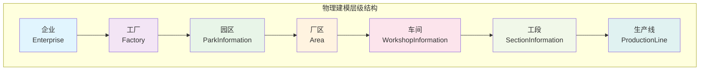
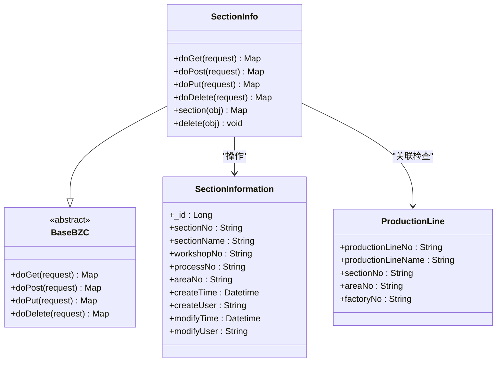
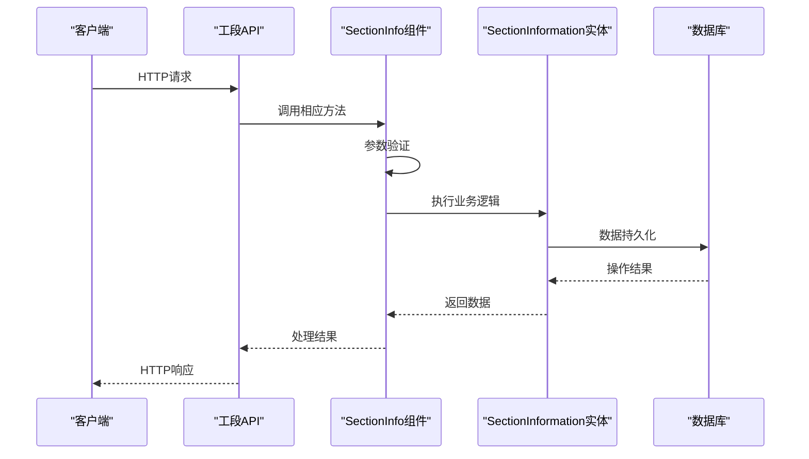
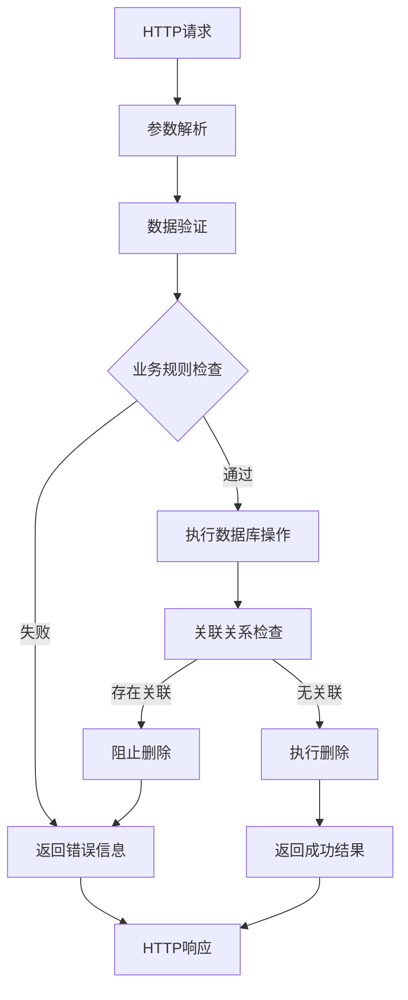
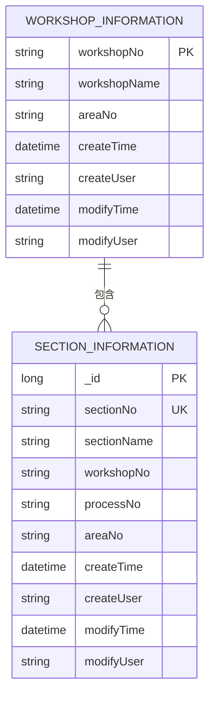
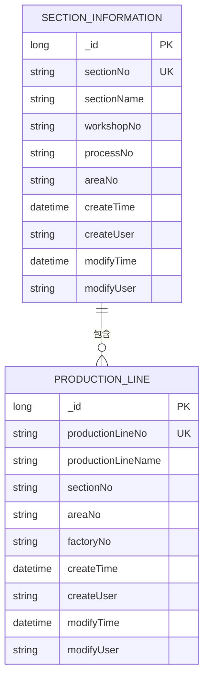
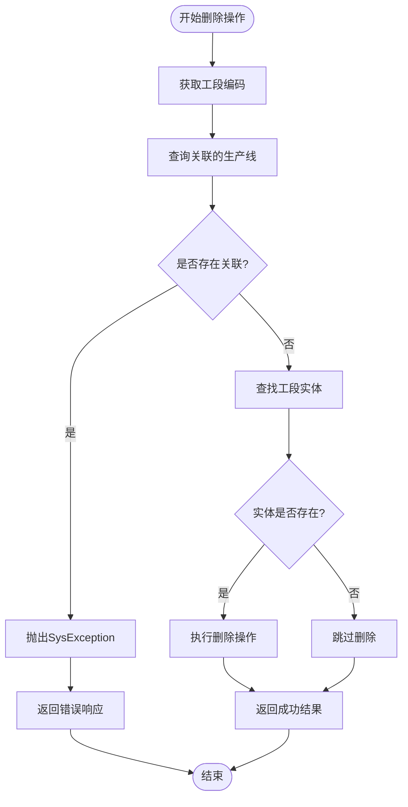
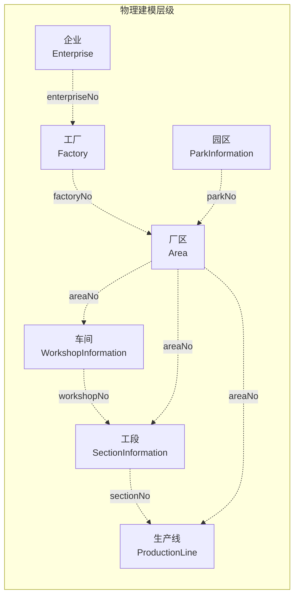

# 工段管理API

<cite>
**本文档引用的文件**
- [SectionInformation.json](file://Domain/公共资源管理/物理建模/6_工段/SectionInformation.json)
- [SectionInfo.groovy](file://bzc/公共资源管理/物理建模/6_工段/SectionInfo.groovy)
- [WorkshopInformation.json](file://Domain/公共资源管理/物理建模/5_车间/WorkshopInformation.json)
- [ProductionLine.json](file://Domain/公共资源管理/物理建模/7_生产线/ProductionLine.json)
- [Area.json](file://Domain/公共资源管理/物理建模/4_厂区/Area.json)
- [ParkInformation.json](file://Domain/公共资源管理/物理建模/3_园区/ParkInformation.json)
- [bzc-base.skill](file://skills/architecture/bzc-base.skill)
- [public-resource-management.skill](file://skills/business/public-resource-management.skill)
</cite>

## 目录
1. [简介](#简介)
2. [项目结构](#项目结构)
3. [核心组件](#核心组件)
4. [架构概览](#架构概览)
5. [详细组件分析](#详细组件分析)
6. [依赖关系分析](#依赖关系分析)
7. [性能考虑](#性能考虑)
8. [故障排除指南](#故障排除指南)
9. [结论](#结论)

## 简介

本文件提供了CMES系统中工段管理模块的完整API文档。工段作为物理建模层级中的第六层，位于车间和生产线之间，是生产组织管理的重要节点。该文档详细描述了工段实体的CRUD操作接口、数据模型定义、业务逻辑约束以及与其他层级的关系。

## 项目结构

CMES系统的物理建模采用分层架构设计，从企业到工段共分为七个层级：



**图表来源**
- [public-resource-management.skill:124-135](file://skills/business/public-resource-management.skill#L124-L135)

**章节来源**
- [public-resource-management.skill:122-135](file://skills/business/public-resource-management.skill#L122-L135)

## 核心组件

### 工段实体模型

工段实体是物理建模的核心数据结构，具有以下关键属性：

| 属性名 | 显示名 | 数据类型 | 可空 | 唯一性 | 描述 |
|--------|--------|----------|------|--------|------|
| _id | 主键 | Long | 否 | 唯一 | 系统自动生成的唯一标识符 |
| sectionNo | 工段编码 | String(30) | 否 | 唯一 | 工段的唯一编码标识 |
| sectionName | 工段名称 | String(30) | 否 | 非唯一 | 工段的显示名称 |
| workshopNo | 车间编码 | String(30) | 是 | 非唯一 | 所属车间的编码 |
| processNo | 工序编码 | String(30) | 是 | 非唯一 | 关联的工序编码 |
| areaNo | 厂区编码 | String(50) | 是 | 非唯一 | 所属厂区的编码 |
| createTime | 创建时间 | Datetime | 是 | 非唯一 | 记录创建时间 |
| createUser | 创建用户 | String(30) | 是 | 非唯一 | 创建用户的标识 |
| modifyTime | 最后修改时间 | Datetime | 是 | 非唯一 | 记录最后修改时间 |
| modifyUser | 最后修改用户 | String(30) | 是 | 非唯一 | 最后修改用户的标识 |

**章节来源**
- [SectionInformation.json:34-294](file://Domain/公共资源管理/物理建模/6_工段/SectionInformation.json#L34-L294)

### 工段业务组件

工段管理采用BZC（Business Zone Component）模式，通过专门的业务组件类处理工段的CRUD操作：



**图表来源**
- [SectionInfo.groovy:12-69](file://bzc/公共资源管理/物理建模/6_工段/SectionInfo.groovy#L12-L69)
- [SectionInformation.json:34-294](file://Domain/公共资源管理/物理建模/6_工段/SectionInformation.json#L34-L294)

**章节来源**
- [SectionInfo.groovy:12-69](file://bzc/公共资源管理/物理建模/6_工段/SectionInfo.groovy#L12-L69)

## 架构概览

### RESTful API架构

工段管理API遵循RESTful设计原则，提供标准的HTTP方法映射：



**图表来源**
- [SectionInfo.groovy:48-69](file://bzc/公共资源管理/物理建模/6_工段/SectionInfo.groovy#L48-L69)

### 数据流图



**图表来源**
- [SectionInfo.groovy:33-46](file://bzc/公共资源管理/物理建模/6_工段/SectionInfo.groovy#L33-L46)

## 详细组件分析

### 工段实体CRUD操作

#### 创建工段 (POST)

**HTTP方法**: POST
**URL路径**: `/api/section`
**请求参数**:
- sectionNo: 工段编码 (必填)
- sectionName: 工段名称 (必填)
- workshopNo: 车间编码 (可选)
- processNo: 工序编码 (可选)
- areaNo: 厂区编码 (可选)

**响应数据结构**:
```json
{
  "status": "success",
  "message": "工段创建成功",
  "data": {
    "_id": 12345,
    "sectionNo": "SECTION001",
    "sectionName": "装配工段",
    "workshopNo": "WORKSHOP001",
    "processNo": "PROCESS001",
    "areaNo": "AREA001",
    "createTime": "2025-01-01T12:00:00Z",
    "createUser": "admin",
    "modifyTime": "2025-01-01T12:00:00Z",
    "modifyUser": "admin"
  }
}
```

**错误处理**:
- 工段编码重复: 返回400状态码和重复编码错误
- 必填字段缺失: 返回400状态码和参数验证错误
- 车间不存在: 返回404状态码和车间不存在错误

#### 查询工段 (GET)

**HTTP方法**: GET
**URL路径**: `/api/section`
**查询参数**:
- sectionNo: 工段编码 (可选)
- sectionName: 工段名称 (可选)
- workshopNo: 车间编码 (可选)
- areaNo: 厂区编码 (可选)

**响应数据结构**:
```json
{
  "status": "success",
  "count": 1,
  "data": [
    {
      "_id": 12345,
      "sectionNo": "SECTION001",
      "sectionName": "装配工段",
      "workshopNo": "WORKSHOP001",
      "processNo": "PROCESS001",
      "areaNo": "AREA001",
      "createTime": "2025-01-01T12:00:00Z",
      "createUser": "admin",
      "modifyTime": "2025-01-01T12:00:00Z",
      "modifyUser": "admin"
    }
  ]
}
```

**错误处理**:
- 查询条件无效: 返回400状态码和参数错误
- 无匹配数据: 返回200状态码和空数组

#### 更新工段 (PUT)

**HTTP方法**: PUT
**URL路径**: `/api/section/{sectionNo}`
**路径参数**:
- sectionNo: 工段编码 (必填)

**请求参数**:
- sectionName: 工段名称 (可选)
- workshopNo: 车间编码 (可选)
- processNo: 工序编码 (可选)
- areaNo: 厂区编码 (可选)

**响应数据结构**:
```json
{
  "status": "success",
  "message": "工段更新成功",
  "data": {
    "_id": 12345,
    "sectionNo": "SECTION001",
    "sectionName": "更新后的工段名称",
    "workshopNo": "WORKSHOP001",
    "processNo": "PROCESS001",
    "areaNo": "AREA001",
    "createTime": "2025-01-01T12:00:00Z",
    "createUser": "admin",
    "modifyTime": "2025-01-01T13:00:00Z",
    "modifyUser": "admin"
  }
}
```

**错误处理**:
- 工段不存在: 返回404状态码和未找到错误
- 工段编码冲突: 返回400状态码和编码冲突错误

#### 删除工段 (DELETE)

**HTTP方法**: DELETE
**URL路径**: `/api/section/{sectionNo}`
**路径参数**:
- sectionNo: 工段编码 (必填)

**业务逻辑约束**:
删除工段前必须检查是否存在关联的生产线：
- 如果存在关联关系，阻止删除并返回错误信息
- 如果不存在关联关系，执行物理删除

**响应数据结构**:
```json
{
  "status": "success",
  "message": "工段删除成功"
}
```

**错误处理**:
- 存在关联关系: 返回400状态码和"已在生产线信息使用"错误
- 工段不存在: 返回404状态码和未找到错误

**章节来源**
- [SectionInfo.groovy:21-46](file://bzc/公共资源管理/物理建模/6_工段/SectionInfo.groovy#L21-L46)

### 工段与层级关系

#### 上级关系

工段的直接上级是车间，通过workshopNo字段建立关联关系：



**图表来源**
- [WorkshopInformation.json:62-137](file://Domain/公共资源管理/物理建模/5_车间/WorkshopInformation.json#L62-L137)
- [SectionInformation.json:62-137](file://Domain/公共资源管理/物理建模/6_工段/SectionInformation.json#L62-L137)

#### 下级关系

工段的直接下级是生产线，通过sectionNo字段建立关联关系：



**图表来源**
- [SectionInformation.json:62-137](file://Domain/公共资源管理/物理建模/6_工段/SectionInformation.json#L62-L137)
- [ProductionLine.json:62-267](file://Domain/公共资源管理/物理建模/7_生产线/ProductionLine.json#L62-L267)

**章节来源**
- [SectionInfo.groovy:37-45](file://bzc/公共资源管理/物理建模/6_工段/SectionInfo.groovy#L37-L45)

### 工段业务逻辑

#### 删除前关联检查流程



**图表来源**
- [SectionInfo.groovy:33-46](file://bzc/公共资源管理/物理建模/6_工段/SectionInfo.groovy#L33-L46)

**章节来源**
- [SectionInfo.groovy:33-46](file://bzc/公共资源管理/物理建模/6_工段/SectionInfo.groovy#L33-L46)

## 依赖关系分析

### 物理建模层级依赖

工段管理涉及多个物理建模层级的实体，形成复杂的依赖关系：



**图表来源**
- [public-resource-management.skill:124-135](file://skills/business/public-resource-management.skill#L124-L135)

### 数据模型依赖

工段实体依赖于其他层级的编码字段来维护层级关系：

| 依赖层级 | 依赖字段 | 用途 | 约束 |
|----------|----------|------|------|
| 车间 | workshopNo | 确定工段归属 | 可选，但建议保持一致 |
| 厂区 | areaNo | 确定工段地理位置 | 可选，建议与车间保持一致 |
| 工厂 | factoryNo | 确定工段所属工厂 | 通过厂区间接关联 |
| 园区 | parkNo | 确定工段所属园区 | 通过工厂间接关联 |

**章节来源**
- [SectionInformation.json:117-189](file://Domain/公共资源管理/物理建模/6_工段/SectionInformation.json#L117-L189)

## 性能考虑

### 查询优化

1. **索引策略**: 工段编码(sectionNo)应建立唯一索引以提高查询性能
2. **复合查询**: 支持多字段组合查询时，建议在常用查询字段上建立复合索引
3. **分页查询**: 大量数据查询时应支持分页机制

### 删除操作优化

1. **批量删除**: 支持批量删除操作时，应使用事务确保数据一致性
2. **关联检查**: 删除前的关联检查应使用高效的SQL查询
3. **缓存策略**: 对于频繁访问的工段信息可以考虑适当的缓存机制

### 并发控制

1. **乐观锁**: 在更新操作中使用版本号控制并发更新
2. **事务管理**: 删除操作应在事务中执行，确保数据完整性
3. **死锁预防**: 合理的锁定顺序避免死锁发生

## 故障排除指南

### 常见错误及解决方案

#### 删除失败错误

**错误信息**: "删除失败，已在生产线信息使用"
**原因**: 工段存在关联的生产线
**解决方案**: 
1. 先删除或调整关联的生产线
2. 或者修改生产线的工段编码指向其他工段

#### 编码冲突错误

**错误信息**: 工段编码重复
**原因**: 新增或更新的工段编码与现有记录重复
**解决方案**:
1. 检查现有工段编码
2. 生成唯一的工段编码
3. 遵循编码规则约定

#### 参数验证错误

**错误信息**: 必填字段缺失或格式不正确
**原因**: 请求参数不符合业务规则
**解决方案**:
1. 检查所有必填字段是否完整
2. 验证数据类型和长度限制
3. 确保编码格式符合约定

### 调试技巧

1. **日志记录**: 启用详细的API调用日志
2. **参数验证**: 在业务组件中添加参数验证逻辑
3. **异常捕获**: 捕获并记录SysException异常
4. **单元测试**: 编写针对各种场景的测试用例

**章节来源**
- [SectionInfo.groovy:38-40](file://bzc/公共资源管理/物理建模/6_工段/SectionInfo.groovy#L38-L40)

## 结论

工段管理API提供了完整的物理建模层级管理功能，通过RESTful接口实现了工段实体的CRUD操作。系统采用BZC模式，确保了业务逻辑的封装性和可维护性。工段作为连接车间和生产线的关键节点，在整个生产管理体系中发挥着重要作用。

通过合理的数据模型设计、严格的业务规则约束和完善的错误处理机制，工段管理API能够有效支撑CMES系统的生产组织管理需求。建议在实际部署中结合具体的业务场景进行参数配置和性能优化，以获得最佳的使用体验。