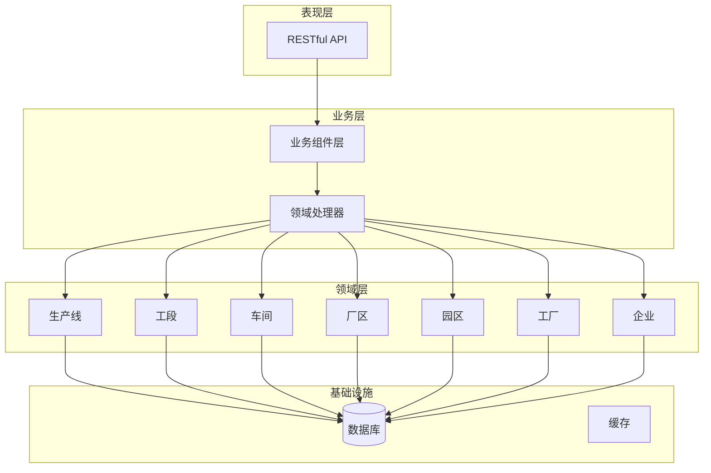
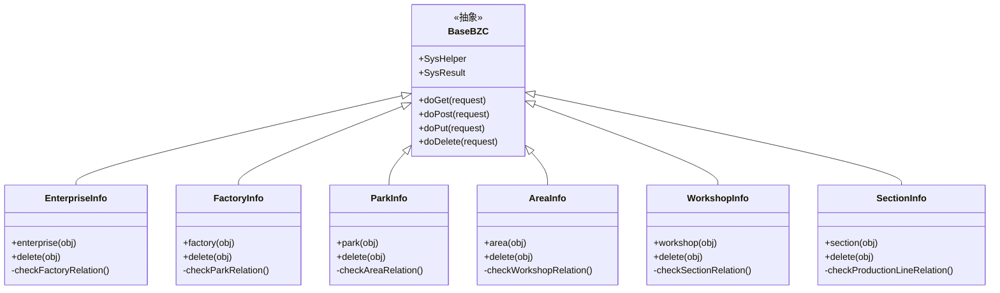
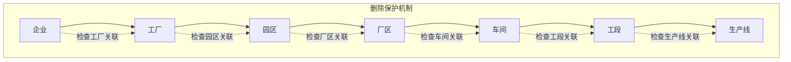
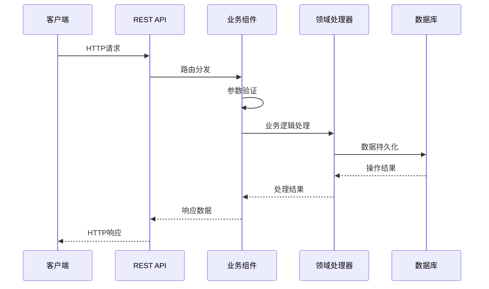
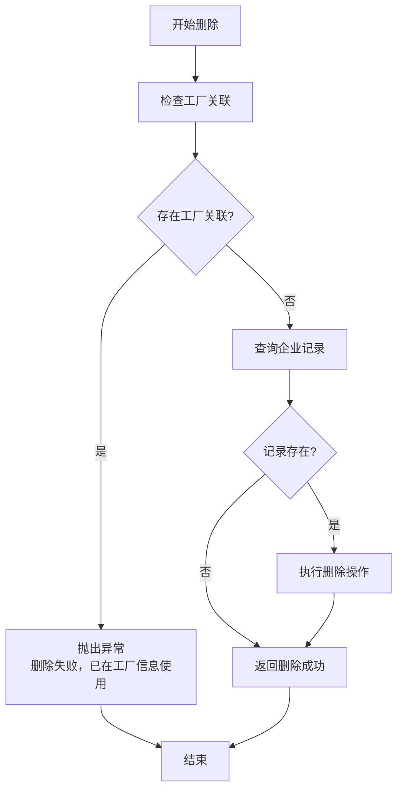
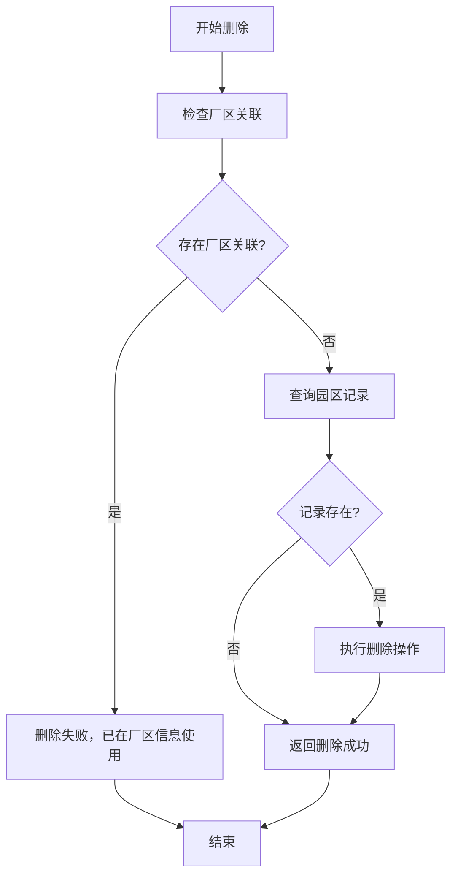
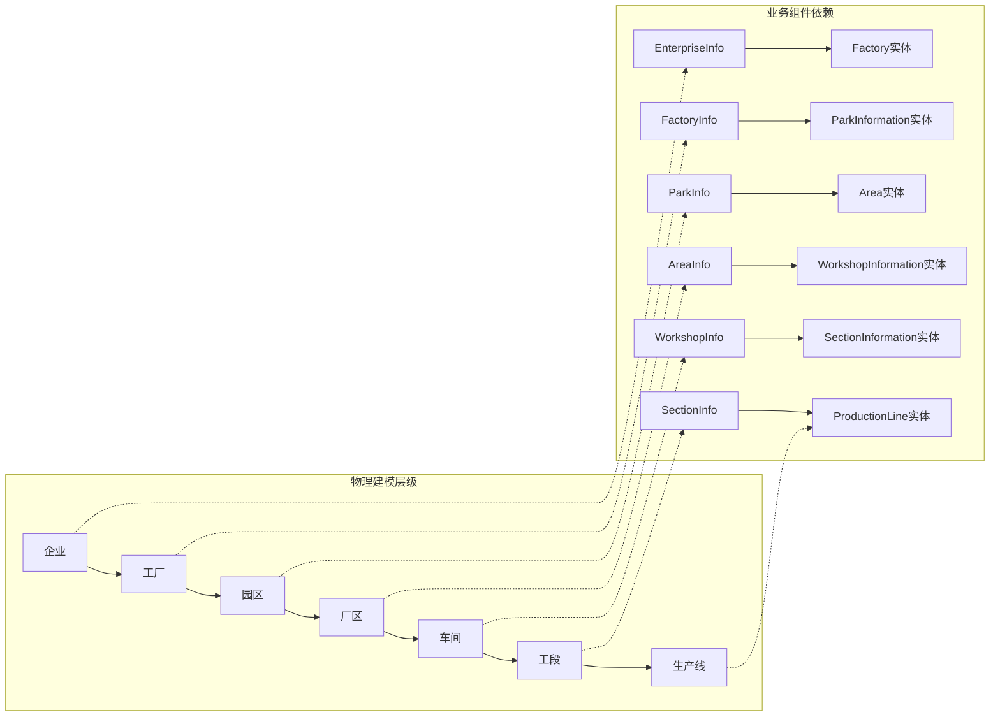
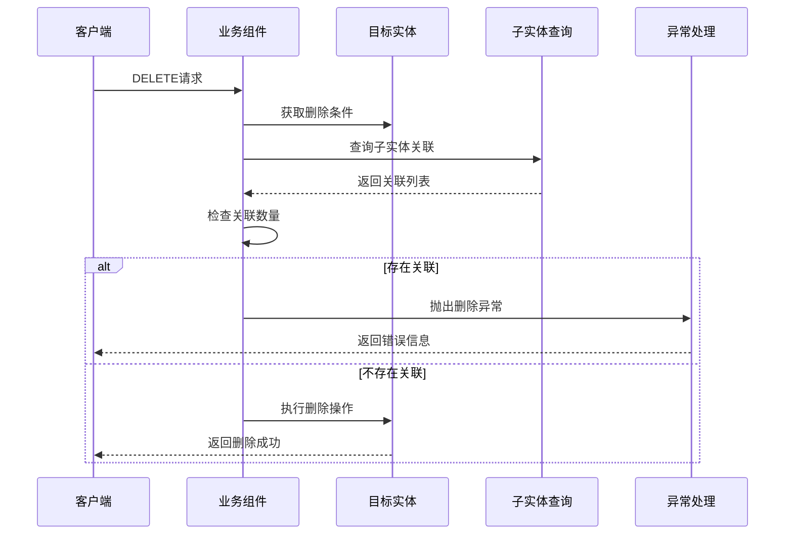

# 物理建模API

<cite>
**本文档引用的文件**
- [Enterprise.json](file://Domain/公共资源管理/物理建模/1_企业/Enterprise.json)
- [Factory.json](file://Domain/公共资源管理/物理建模/2_工厂/Factory.json)
- [ParkInformation.json](file://Domain/公共资源管理/物理建模/3_园区/ParkInformation.json)
- [Area.json](file://Domain/公共资源管理/物理建模/4_厂区/Area.json)
- [WorkshopInformation.json](file://Domain/公共资源管理/物理建模/5_车间/WorkshopInformation.json)
- [SectionInformation.json](file://Domain/公共资源管理/物理建模/6_工段/SectionInformation.json)
- [ProductionLine.json](file://Domain/公共资源管理/物理建模/7_生产线/ProductionLine.json)
- [EnterpriseInfo.groovy](file://bzc/公共资源管理/物理建模/1_企业/EnterpriseInfo.groovy)
- [FactoryInfo.groovy](file://bzc/公共资源管理/物理建模/2_工厂/FactoryInfo.groovy)
- [ParkInfo.groovy](file://bzc/公共资源管理/物理建模/3_园区/ParkInfo.groovy)
- [AreaInfo.groovy](file://bzc/公共资源管理/物理建模/4_厂区/AreaInfo.groovy)
- [WorkshopInfo.groovy](file://bzc/公共资源管理/物理建模/5_车间/WorkshopInfo.groovy)
- [SectionInfo.groovy](file://bzc/公共资源管理/物理建模/6_工段/SectionInfo.groovy)
</cite>

## 目录
1. [简介](#简介)
2. [项目结构](#项目结构)
3. [核心组件](#核心组件)
4. [架构概览](#架构概览)
5. [详细组件分析](#详细组件分析)
6. [依赖关系分析](#依赖关系分析)
7. [性能考虑](#性能考虑)
8. [故障排除指南](#故障排除指南)
9. [结论](#结论)

## 简介

本文件为CMES物理建模子系统的完整API文档。该系统实现了企业、工厂、园区、厂区、车间、工段、生产线七个层级的CRUD操作API，采用领域驱动设计（DDD）和RESTful架构风格。

系统基于Groovy语言开发，使用Low-code platform框架，通过业务组件（BZC）模式实现API逻辑。每个层级都具备完整的增删改查功能，并实现了严格的删除保护机制，防止级联删除造成数据不一致。

## 项目结构

物理建模子系统采用分层架构设计：



**图表来源**
- [Enterprise.json:1-223](file://Domain/公共资源管理/物理建模/1_企业/Enterprise.json#L1-L223)
- [Factory.json:1-249](file://Domain/公共资源管理/物理建模/2_工厂/Factory.json#L1-L249)
- [ParkInformation.json:1-249](file://Domain/公共资源管理/物理建模/3_园区/ParkInformation.json#L1-L249)

## 核心组件

### 实体定义规范

每个层级实体都遵循统一的属性规范：

| 属性名 | 类型 | 必填 | 唯一性 | 描述 |
|--------|------|------|--------|------|
| _id | Long | 是 | 是 | 主键标识符 |
| 编码 | String | 是 | 是 | 实体唯一编码 |
| 名称 | String | 否 | 否 | 实体显示名称 |
| createTime | Datetime | 否 | 否 | 创建时间 |
| createUser | String | 否 | 否 | 创建用户 |
| modifyTime | Datetime | 否 | 否 | 最后修改时间 |
| modifyUser | String | 否 | 否 | 最后修改用户 |

### 业务组件架构



**图表来源**
- [EnterpriseInfo.groovy:1-69](file://bzc/公共资源管理/物理建模/1_企业/EnterpriseInfo.groovy#L1-L69)
- [FactoryInfo.groovy:1-69](file://bzc/公共资源管理/物理建模/2_工厂/FactoryInfo.groovy#L1-L69)
- [ParkInfo.groovy:1-70](file://bzc/公共资源管理/物理建模/3_园区/ParkInfo.groovy#L1-L70)
- [AreaInfo.groovy:1-70](file://bzc/公共资源管理/物理建模/4_厂区/AreaInfo.groovy#L1-L70)
- [WorkshopInfo.groovy:1-69](file://bzc/公共资源管理/物理建模/5_车间/WorkshopInfo.groovy#L1-L69)
- [SectionInfo.groovy:1-69](file://bzc/公共资源管理/物理建模/6_工段/SectionInfo.groovy#L1-L69)

## 架构概览

### 层级关系与约束



**图表来源**
- [EnterpriseInfo.groovy:34-46](file://bzc/公共资源管理/物理建模/1_企业/EnterpriseInfo.groovy#L34-L46)
- [FactoryInfo.groovy:34-46](file://bzc/公共资源管理/物理建模/2_工厂/FactoryInfo.groovy#L34-L46)
- [ParkInfo.groovy:34-46](file://bzc/公共资源管理/物理建模/3_园区/ParkInfo.groovy#L34-L46)
- [AreaInfo.groovy:34-47](file://bzc/公共资源管理/物理建模/4_厂区/AreaInfo.groovy#L34-L47)
- [WorkshopInfo.groovy:34-46](file://bzc/公共资源管理/物理建模/5_车间/WorkshopInfo.groovy#L34-L46)
- [SectionInfo.groovy:34-46](file://bzc/公共资源管理/物理建模/6_工段/SectionInfo.groovy#L34-L46)

### 数据流处理



**图表来源**
- [EnterpriseInfo.groovy:48-69](file://bzc/公共资源管理/物理建模/1_企业/EnterpriseInfo.groovy#L48-L69)
- [FactoryInfo.groovy:48-69](file://bzc/公共资源管理/物理建模/2_工厂/FactoryInfo.groovy#L48-L69)

## 详细组件分析

### 企业层级API

#### 实体定义
企业实体包含以下关键属性：
- 企业编码（唯一标识）
- 企业名称
- 时间戳和用户追踪字段

#### CRUD操作规范

**创建企业**
- HTTP方法：POST
- URL路径：/api/enterprise
- 请求参数：企业编码、企业名称
- 响应格式：标准系统响应格式
- 错误码：200-成功，400-参数错误，500-服务器错误

**查询企业**
- HTTP方法：GET
- URL路径：/api/enterprise/{enterpriseNo}
- 请求参数：企业编码
- 响应格式：企业详情JSON
- 错误码：200-成功，404-未找到

**更新企业**
- HTTP方法：PUT
- URL路径：/api/enterprise/{enterpriseNo}
- 请求参数：企业编码、企业名称
- 响应格式：更新结果
- 错误码：200-成功，400-参数错误

**删除企业**
- HTTP方法：DELETE
- URL路径：/api/enterprise/{enterpriseNo}
- 请求参数：企业编码
- 响应格式：删除结果
- 错误码：200-成功，400-存在关联关系

#### 删除保护机制



**图表来源**
- [EnterpriseInfo.groovy:34-46](file://bzc/公共资源管理/物理建模/1_企业/EnterpriseInfo.groovy#L34-L46)

**章节来源**
- [Enterprise.json:34-223](file://Domain/公共资源管理/物理建模/1_企业/Enterprise.json#L34-L223)
- [EnterpriseInfo.groovy:1-69](file://bzc/公共资源管理/物理建模/1_企业/EnterpriseInfo.groovy#L1-L69)

### 工厂层级API

#### 实体定义
工厂实体扩展了企业层级，增加企业编码字段以建立层级关系。

#### CRUD操作规范

**批量删除支持**
- 支持单个删除和批量删除
- 批量删除通过_data数组传递多个实体
- 删除保护机制同企业层级

**章节来源**
- [Factory.json:34-249](file://Domain/公共资源管理/物理建模/2_工厂/Factory.json#L34-L249)
- [FactoryInfo.groovy:1-69](file://bzc/公共资源管理/物理建模/2_工厂/FactoryInfo.groovy#L1-L69)

### 园区层级API

#### 实体定义
园区实体建立在工厂层级之上，包含工厂编码字段。

#### 删除保护流程



**图表来源**
- [ParkInfo.groovy:34-46](file://bzc/公共资源管理/物理建模/3_园区/ParkInfo.groovy#L34-L46)

**章节来源**
- [ParkInformation.json:34-249](file://Domain/公共资源管理/物理建模/3_园区/ParkInformation.json#L34-L249)
- [ParkInfo.groovy:1-70](file://bzc/公共资源管理/物理建模/3_园区/ParkInfo.groovy#L1-L70)

### 厂区层级API

#### 实体定义
厂区实体建立在园区层级之上，包含园区编码字段。

**章节来源**
- [Area.json:34-249](file://Domain/公共资源管理/物理建模/4_厂区/Area.json#L34-L249)
- [AreaInfo.groovy:1-70](file://bzc/公共资源管理/物理建模/4_厂区/AreaInfo.groovy#L1-L70)

### 车间层级API

#### 实体定义
车间实体建立在厂区层级之上，包含厂区编码字段。

**章节来源**
- [WorkshopInformation.json:34-249](file://Domain/公共资源管理/物理建模/5_车间/WorkshopInformation.json#L34-L249)
- [WorkshopInfo.groovy:1-69](file://bzc/公共资源管理/物理建模/5_车间/WorkshopInfo.groovy#L1-L69)

### 工段层级API

#### 实体定义
工段实体建立在车间层级之上，包含车间编码字段，并扩展了工序编码和厂区编码字段。

**章节来源**
- [SectionInformation.json:34-301](file://Domain/公共资源管理/物理建模/6_工段/SectionInformation.json#L34-L301)
- [SectionInfo.groovy:1-69](file://bzc/公共资源管理/物理建模/6_工段/SectionInfo.groovy#L1-L69)

### 生产线层级API

#### 实体定义
生产线实体具有最复杂的字段结构，包含状态、打印机配置、删除标记等业务字段。

#### 关键字段说明

| 字段名 | 类型 | 描述 |
|--------|------|------|
| productionLineNo | String | 生产线编码（唯一） |
| productionLineName | String | 生产线名称 |
| status | String | 状态标识 |
| printName | String | 打印机名称 |
| printerIP | String | 打印机IP地址 |
| isBackLine | Boolean | 是否返修线 |
| deletionFlag | Boolean | 删除标记 |
| sectionNo | String | 工段编码 |
| areaNo | String | 厂区编码 |
| factoryNo | String | 工厂编码 |

**章节来源**
- [ProductionLine.json:34-431](file://Domain/公共资源管理/物理建模/7_生产线/ProductionLine.json#L34-L431)

## 依赖关系分析

### 层级依赖图



**图表来源**
- [EnterpriseInfo.groovy:8-9](file://bzc/公共资源管理/物理建模/1_企业/EnterpriseInfo.groovy#L8-L9)
- [FactoryInfo.groovy:8-9](file://bzc/公共资源管理/物理建模/2_工厂/FactoryInfo.groovy#L8-L9)
- [ParkInfo.groovy:8-9](file://bzc/公共资源管理/物理建模/3_园区/ParkInfo.groovy#L8-L9)
- [AreaInfo.groovy:8-9](file://bzc/公共资源管理/物理建模/4_厂区/AreaInfo.groovy#L8-L9)
- [WorkshopInfo.groovy:8-9](file://bzc/公共资源管理/物理建模/5_车间/WorkshopInfo.groovy#L8-L9)
- [SectionInfo.groovy:8-9](file://bzc/公共资源管理/物理建模/6_工段/SectionInfo.groovy#L8-L9)

### 删除保护机制实现

每个业务组件都实现了严格的删除保护机制：



**图表来源**
- [EnterpriseInfo.groovy:34-46](file://bzc/公共资源管理/物理建模/1_企业/EnterpriseInfo.groovy#L34-L46)
- [FactoryInfo.groovy:34-46](file://bzc/公共资源管理/物理建模/2_工厂/FactoryInfo.groovy#L34-L46)
- [ParkInfo.groovy:34-46](file://bzc/公共资源管理/物理建模/3_园区/ParkInfo.groovy#L34-L46)
- [AreaInfo.groovy:34-47](file://bzc/公共资源管理/物理建模/4_厂区/AreaInfo.groovy#L34-L47)
- [WorkshopInfo.groovy:34-46](file://bzc/公共资源管理/物理建模/5_车间/WorkshopInfo.groovy#L34-L46)
- [SectionInfo.groovy:34-46](file://bzc/公共资源管理/物理建模/6_工段/SectionInfo.groovy#L34-L46)

## 性能考虑

### 批量操作优化

系统支持批量删除操作，通过循环遍历减少数据库连接开销：

```groovy
// 批量删除实现
if(obj._data != null) {
    obj._data.each {
        this.delete(it)
    }
}
```

### 查询优化建议

1. **索引策略**：确保所有编码字段建立唯一索引
2. **关联查询**：使用JOIN查询减少N+1问题
3. **缓存机制**：对常用查询结果进行缓存
4. **分页处理**：大数据量查询使用分页

### 错误处理策略

- 统一的异常捕获和转换
- 详细的错误日志记录
- 用户友好的错误消息

## 故障排除指南

### 常见错误及解决方案

**删除失败 - 存在关联关系**
- 症状：删除操作抛出异常
- 原因：目标实体仍有子实体关联
- 解决方案：先删除子实体，再删除父实体

**参数验证失败**
- 症状：返回400错误
- 原因：缺少必要参数或参数格式错误
- 解决方案：检查请求参数格式和必填字段

**数据库连接异常**
- 症状：返回500错误
- 原因：数据库连接池耗尽或SQL执行超时
- 解决方案：检查数据库连接配置和SQL优化

### 调试技巧

1. **启用详细日志**：查看业务组件的执行日志
2. **参数验证**：确认请求参数的完整性和正确性
3. **层级检查**：验证实体层级关系的完整性
4. **事务回滚**：在测试环境中模拟异常情况

**章节来源**
- [EnterpriseInfo.groovy:38-40](file://bzc/公共资源管理/物理建模/1_企业/EnterpriseInfo.groovy#L38-L40)
- [FactoryInfo.groovy:38-40](file://bzc/公共资源管理/物理建模/2_工厂/FactoryInfo.groovy#L38-L40)
- [ParkInfo.groovy:38-40](file://bzc/公共资源管理/物理建模/3_园区/ParkInfo.groovy#L38-L40)
- [AreaInfo.groovy:39-41](file://bzc/公共资源管理/物理建模/4_厂区/AreaInfo.groovy#L39-L41)
- [WorkshopInfo.groovy:38-40](file://bzc/公共资源管理/物理建模/5_车间/WorkshopInfo.groovy#L38-L40)
- [SectionInfo.groovy:38-40](file://bzc/公共资源管理/物理建模/6_工段/SectionInfo.groovy#L38-L40)

## 结论

CMES物理建模子系统提供了完整的七层级CRUD操作API，具有以下特点：

1. **严格的层级关系**：通过编码字段建立了清晰的父子关系
2. **完善的删除保护**：防止级联删除造成的数据不一致
3. **统一的架构设计**：采用DDD和RESTful架构风格
4. **良好的扩展性**：业务组件模式便于功能扩展
5. **健壮的错误处理**：提供详细的错误信息和处理机制

该系统为企业资源管理提供了坚实的技术基础，支持复杂的物理建模需求和业务场景。