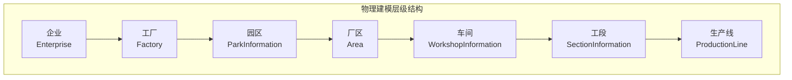
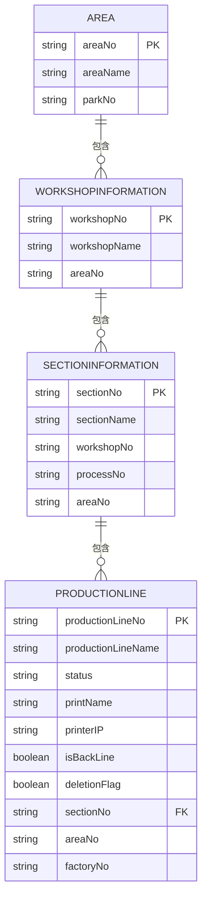
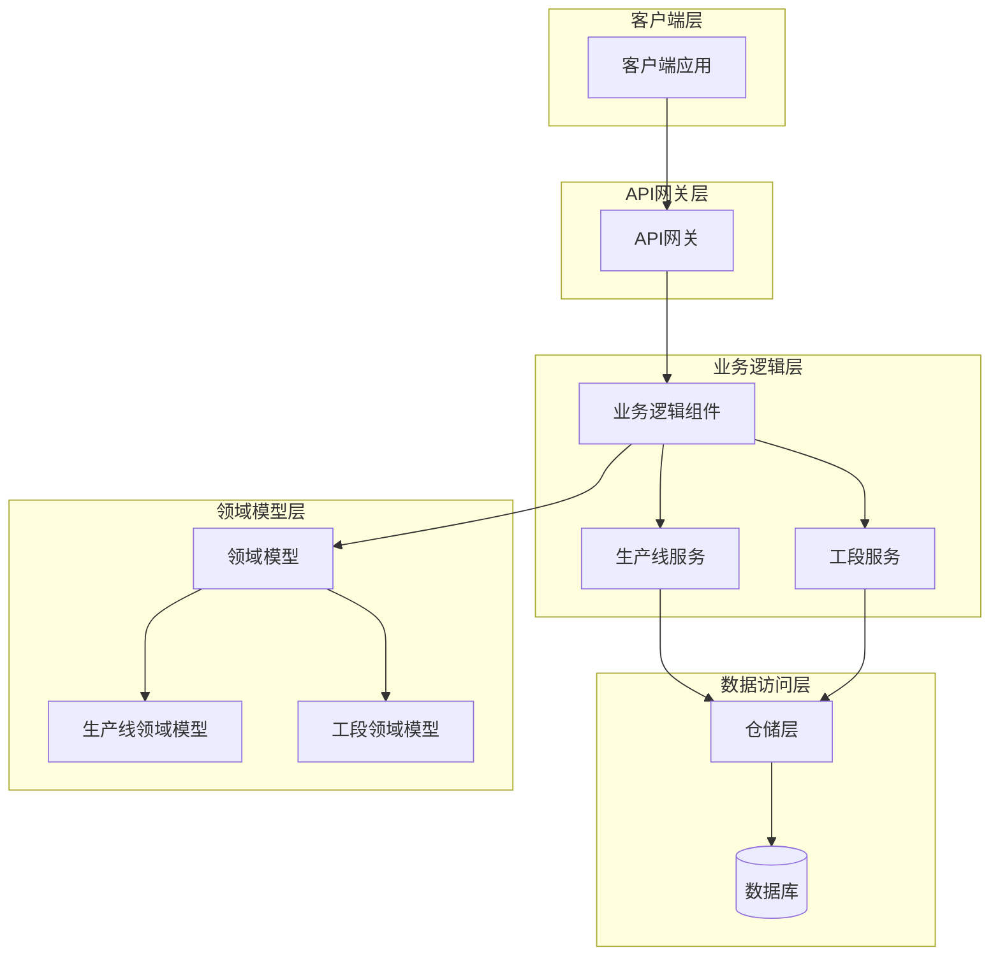
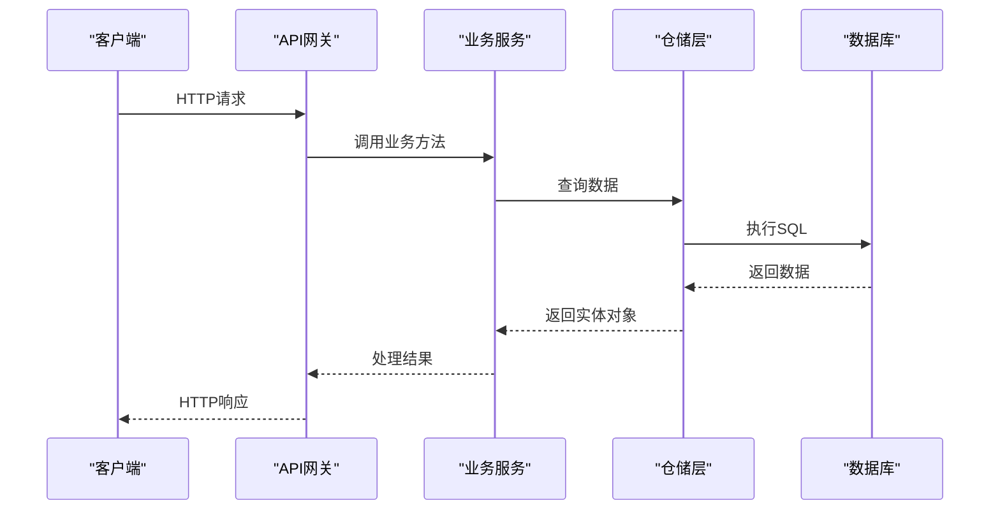
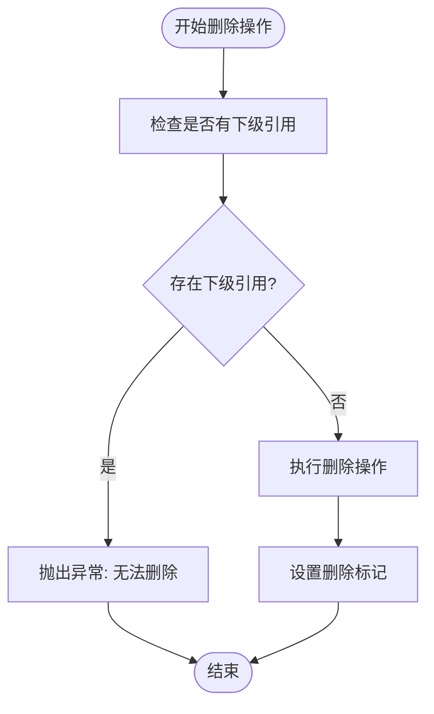
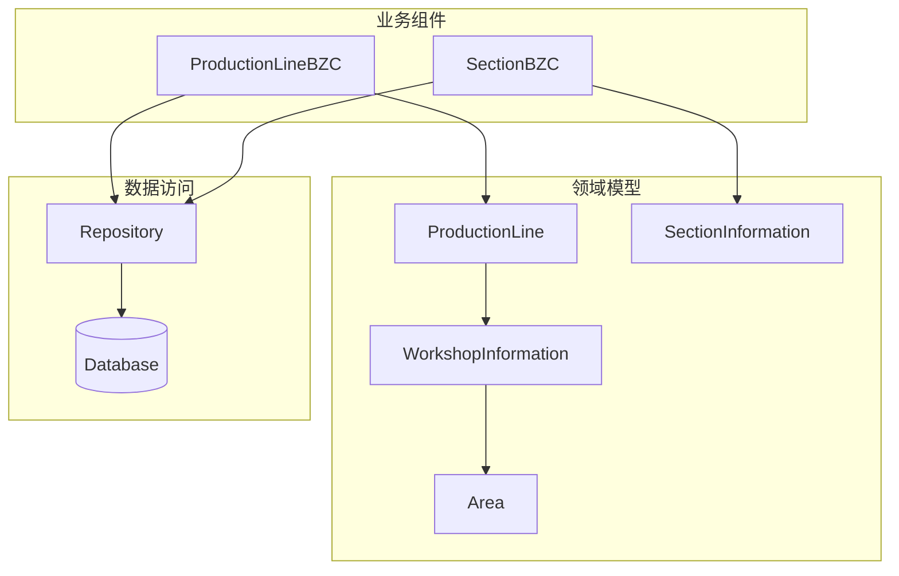
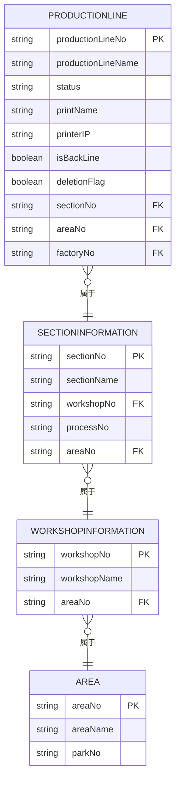
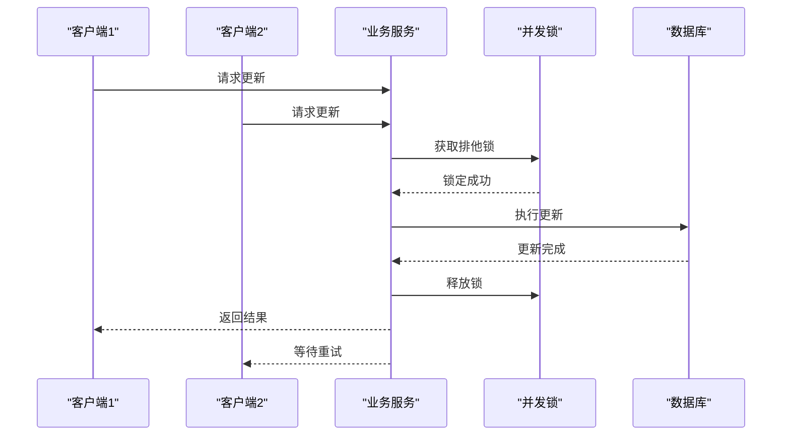

# 生产线管理API

<cite>
**本文档引用的文件**
- [ProductionLine.json](file://Domain/公共资源管理/物理建模/7_生产线/ProductionLine.json)
- [SectionInformation.json](file://Domain/公共资源管理/物理建模/6_工段/SectionInformation.json)
- [WorkshopInformation.json](file://Domain/公共资源管理/物理建模/5_车间/WorkshopInformation.json)
- [Area.json](file://Domain/公共资源管理/物理建模/4_厂区/Area.json)
- [Factory.json](file://Domain/公共资源管理/物理建模/2_工厂/Factory.json)
- [Enterprise.json](file://Domain/公共资源管理/物理建模/1_企业/Enterprise.json)
- [public-resource-management.skill](file://skills/business/public-resource-management.skill)
- [SectionInfo.groovy](file://bzc/公共资源管理/物理建模/6_工段/SectionInfo.groovy)
</cite>

## 目录
1. [简介](#简介)
2. [项目结构](#项目结构)
3. [核心组件](#核心组件)
4. [架构概览](#架构概览)
5. [详细组件分析](#详细组件分析)
6. [依赖关系分析](#依赖关系分析)
7. [性能考虑](#性能考虑)
8. [故障排除指南](#故障排除指南)
9. [结论](#结论)

## 简介

本文件为CMES（制造执行系统）中生产线管理模块的完整API文档。该模块负责管理物理建模层级中的生产线实体，提供完整的CRUD（创建、读取、更新、删除）操作接口。生产线作为物理建模的第七层级，位于工段之下，是生产组织的基本单元。

生产线管理API基于RESTful设计原则，遵循HTTP标准方法，提供标准化的请求和响应格式。系统采用领域驱动设计（DDD）架构，通过领域模型定义业务实体及其属性，结合业务组件实现具体的业务逻辑。

## 项目结构

CMES系统采用分层架构设计，物理建模层级从企业到生产线逐级细化：



**图表来源**
- [Enterprise.json:1-223](file://Domain/公共资源管理/物理建模/1_企业/Enterprise.json#L1-L223)
- [Factory.json:1-249](file://Domain/公共资源管理/物理建模/2_工厂/Factory.json#L1-L249)
- [Area.json:1-249](file://Domain/公共资源管理/物理建模/4_厂区/Area.json#L1-L249)
- [WorkshopInformation.json:1-249](file://Domain/公共资源管理/物理建模/5_车间/WorkshopInformation.json#L1-L249)
- [SectionInformation.json:1-301](file://Domain/公共资源管理/物理建模/6_工段/SectionInformation.json#L1-L301)
- [ProductionLine.json:1-431](file://Domain/公共资源管理/物理建模/7_生产线/ProductionLine.json#L1-L431)

**章节来源**
- [Enterprise.json:1-223](file://Domain/公共资源管理/物理建模/1_企业/Enterprise.json#L1-L223)
- [Factory.json:1-249](file://Domain/公共资源管理/物理建模/2_工厂/Factory.json#L1-L249)
- [Area.json:1-249](file://Domain/公共资源管理/物理建模/4_厂区/Area.json#L1-L249)
- [WorkshopInformation.json:1-249](file://Domain/公共资源管理/物理建模/5_车间/WorkshopInformation.json#L1-L249)
- [SectionInformation.json:1-301](file://Domain/公共资源管理/物理建模/6_工段/SectionInformation.json#L1-L301)
- [ProductionLine.json:1-431](file://Domain/公共资源管理/物理建模/7_生产线/ProductionLine.json#L1-L431)

## 核心组件

### 生产线实体模型

生产线作为物理建模的核心实体，具有以下关键属性：

| 属性名 | 数据类型 | 可空 | 唯一性 | 描述 |
|--------|----------|------|--------|------|
| productionLineNo | String(64) | false | true | 生产线编码，主键标识 |
| productionLineName | String(64) | true | none | 生产线名称 |
| status | String(64) | true | none | 状态 |
| printName | String(64) | true | none | 打印机名称 |
| printerIP | String(128) | true | none | 打印机所在电脑的IP |
| isBackLine | Boolean | true | none | 是否返修线 |
| deletionFlag | Boolean | true | none | 删除标记 |
| sectionNo | String(64) | true | none | 工段编码，外键引用 |

### 关联实体关系



**图表来源**
- [SectionInformation.json:1-301](file://Domain/公共资源管理/物理建模/6_工段/SectionInformation.json#L1-L301)
- [ProductionLine.json:1-431](file://Domain/公共资源管理/物理建模/7_生产线/ProductionLine.json#L1-L431)
- [WorkshopInformation.json:1-249](file://Domain/公共资源管理/物理建模/5_车间/WorkshopInformation.json#L1-L249)
- [Area.json:1-249](file://Domain/公共资源管理/物理建模/4_厂区/Area.json#L1-L249)

**章节来源**
- [ProductionLine.json:208-220](file://Domain/公共资源管理/物理建模/7_生产线/ProductionLine.json#L208-L220)
- [SectionInformation.json:198-206](file://Domain/公共资源管理/物理建模/6_工段/SectionInformation.json#L198-L206)
- [WorkshopInformation.json:190-196](file://Domain/公共资源管理/物理建模/5_车间/WorkshopInformation.json#L190-L196)

## 架构概览

### 系统架构图



### 数据流图



**图表来源**
- [ProductionLine.json:427-431](file://Domain/公共资源管理/物理建模/7_生产线/ProductionLine.json#L427-L431)
- [SectionInfo.groovy:1-18](file://bzc/公共资源管理/物理建模/6_工段/SectionInfo.groovy#L1-L18)

## 详细组件分析

### 生产线CRUD操作API

#### 创建生产线

**HTTP方法**: POST  
**URL路径**: `/api/production-line`  
**请求头**: `Content-Type: application/json`  
**请求体参数**:

| 参数名 | 类型 | 必填 | 描述 |
|--------|------|------|------|
| productionLineNo | String | 是 | 生产线编码 |
| productionLineName | String | 否 | 生产线名称 |
| status | String | 否 | 状态 |
| printName | String | 否 | 打印机名称 |
| printerIP | String | 否 | 打印机IP地址 |
| isBackLine | Boolean | 否 | 是否返修线 |
| sectionNo | String | 否 | 工段编码 |

**响应数据结构**:
```json
{
    "success": true,
    "data": {
        "productionLineNo": "string",
        "productionLineName": "string",
        "status": "string",
        "printName": "string",
        "printerIP": "string",
        "isBackLine": boolean,
        "sectionNo": "string",
        "areaNo": "string",
        "factoryNo": "string",
        "createTime": "datetime",
        "createUser": "string",
        "modifyTime": "datetime",
        "modifyUser": "string"
    },
    "message": "string"
}
```

**错误处理**:
- 400 Bad Request: 参数验证失败
- 409 Conflict: 生产线编码已存在
- 500 Internal Server Error: 服务器内部错误

#### 查询生产线列表

**HTTP方法**: GET  
**URL路径**: `/api/production-line`  
**查询参数**:

| 参数名 | 类型 | 必填 | 描述 |
|--------|------|------|------|
| page | Integer | 否 | 页码，默认1 |
| size | Integer | 否 | 每页条数，默认10 |
| sectionNo | String | 否 | 工段编码过滤条件 |
| status | String | 否 | 状态过滤条件 |

**响应数据结构**:
```json
{
    "success": true,
    "data": {
        "content": [
            {
                "productionLineNo": "string",
                "productionLineName": "string",
                "status": "string",
                "printName": "string",
                "printerIP": "string",
                "isBackLine": boolean,
                "sectionNo": "string"
            }
        ],
        "totalElements": 0,
        "totalPages": 0,
        "number": 0,
        "size": 0
    },
    "message": "string"
}
```

#### 获取单个生产线详情

**HTTP方法**: GET  
**URL路径**: `/api/production-line/{productionLineNo}`  
**路径参数**:

| 参数名 | 类型 | 必填 | 描述 |
|--------|------|------|------|
| productionLineNo | String | 是 | 生产线编码 |

**响应数据结构**:
```json
{
    "success": true,
    "data": {
        "productionLineNo": "string",
        "productionLineName": "string",
        "status": "string",
        "printName": "string",
        "printerIP": "string",
        "isBackLine": boolean,
        "deletionFlag": boolean,
        "sectionNo": "string",
        "areaNo": "string",
        "factoryNo": "string",
        "createTime": "datetime",
        "createUser": "string",
        "modifyTime": "datetime",
        "modifyUser": "string"
    },
    "message": "string"
}
```

#### 更新生产线

**HTTP方法**: PUT  
**URL路径**: `/api/production-line/{productionLineNo}`  
**路径参数**:

| 参数名 | 类型 | 必填 | 描述 |
|--------|------|------|------|
| productionLineNo | String | 是 | 生产线编码 |

**请求体参数**:
```json
{
    "productionLineName": "string",
    "status": "string",
    "printName": "string",
    "printerIP": "string",
    "isBackLine": boolean,
    "sectionNo": "string"
}
```

**响应数据结构**:
```json
{
    "success": true,
    "data": {
        "productionLineNo": "string",
        "productionLineName": "string",
        "status": "string",
        "printName": "string",
        "printerIP": "string",
        "isBackLine": boolean,
        "sectionNo": "string",
        "modifyTime": "datetime",
        "modifyUser": "string"
    },
    "message": "string"
}
```

#### 删除生产线

**HTTP方法**: DELETE  
**URL路径**: `/api/production-line/{productionLineNo}`  
**路径参数**:

| 参数名 | 类型 | 必填 | 描述 |
|--------|------|------|------|
| productionLineNo | String | 是 | 生产线编码 |

**响应数据结构**:
```json
{
    "success": true,
    "data": null,
    "message": "删除成功"
}
```

### API调用示例

#### 创建生产线示例

```bash
curl -X POST "http://localhost:8080/api/production-line" \
  -H "Content-Type: application/json" \
  -d '{
    "productionLineNo": "PL001",
    "productionLineName": "装配生产线",
    "status": "active",
    "printName": "Printer-A",
    "printerIP": "192.168.1.100",
    "isBackLine": false,
    "sectionNo": "WS001"
  }'
```

#### 查询生产线列表示例

```bash
curl -X GET "http://localhost:8080/api/production-line?page=1&size=10&sectionNo=WS001"
```

#### 更新生产线示例

```bash
curl -X PUT "http://localhost:8080/api/production-line/PL001" \
  -H "Content-Type: application/json" \
  -d '{
    "productionLineName": "升级装配生产线",
    "status": "maintenance"
  }'
```

#### 删除生产线示例

```bash
curl -X DELETE "http://localhost:8080/api/production-line/PL001"
```

**章节来源**
- [ProductionLine.json:208-220](file://Domain/公共资源管理/物理建模/7_生产线/ProductionLine.json#L208-L220)
- [public-resource-management.skill:208-220](file://skills/business/public-resource-management.skill#L208-L220)

### 业务规则与约束

#### 删除校验规则



**图表来源**
- [public-resource-management.skill:221-225](file://skills/business/public-resource-management.skill#L221-L225)

#### 数据完整性约束

1. **主键约束**: productionLineNo 为主键且唯一
2. **外键约束**: sectionNo 引用工段信息
3. **状态约束**: status 字段必须符合预定义状态值
4. **业务约束**: isBackLine 字段仅允许布尔值

**章节来源**
- [ProductionLine.json:78-79](file://Domain/公共资源管理/物理建模/7_生产线/ProductionLine.json#L78-L79)
- [SectionInformation.json:78-79](file://Domain/公共资源管理/物理建模/6_工段/SectionInformation.json#L78-L79)

## 依赖关系分析

### 组件依赖图



**图表来源**
- [SectionInfo.groovy:1-18](file://bzc/公共资源管理/物理建模/6_工段/SectionInfo.groovy#L1-L18)
- [ProductionLine.json:427-431](file://Domain/公共资源管理/物理建模/7_生产线/ProductionLine.json#L427-L431)

### 数据模型关系



**图表来源**
- [ProductionLine.json:244-320](file://Domain/公共资源管理/物理建模/7_生产线/ProductionLine.json#L244-L320)
- [SectionInformation.json:114-138](file://Domain/公共资源管理/物理建模/6_工段/SectionInformation.json#L114-L138)
- [WorkshopInformation.json:114-138](file://Domain/公共资源管理/物理建模/5_车间/WorkshopInformation.json#L114-L138)
- [Area.json:114-138](file://Domain/公共资源管理/物理建模/4_厂区/Area.json#L114-L138)

**章节来源**
- [ProductionLine.json:244-320](file://Domain/公共资源管理/物理建模/7_生产线/ProductionLine.json#L244-L320)
- [SectionInformation.json:114-138](file://Domain/公共资源管理/物理建模/6_工段/SectionInformation.json#L114-L138)

## 性能考虑

### 查询优化策略

1. **索引优化**: 在常用查询字段上建立适当索引
2. **分页查询**: 对大量数据采用分页机制
3. **批量查询**: 使用RQL批量查询提升性能
4. **缓存策略**: 对频繁访问的数据实施缓存

### 并发控制



**图表来源**
- [public-resource-management.skill:224-225](file://skills/business/public-resource-management.skill#L224-L225)

## 故障排除指南

### 常见错误及解决方案

#### 1. 数据重复错误
**错误代码**: 409 Conflict  
**原因**: 生产线编码已存在  
**解决方案**: 检查输入的生产线编码是否唯一

#### 2. 外键约束错误
**错误代码**: 400 Bad Request  
**原因**: 引用的工段不存在  
**解决方案**: 确保sectionNo对应的工段已存在

#### 3. 数据库连接错误
**错误代码**: 500 Internal Server Error  
**原因**: 数据库连接失败  
**解决方案**: 检查数据库配置和网络连接

#### 4. 权限不足错误
**错误代码**: 403 Forbidden  
**原因**: 用户权限不足  
**解决方案**: 检查用户角色和权限配置

### 调试建议

1. **启用详细日志**: 在开发环境中启用详细的API日志
2. **参数验证**: 确保所有必填参数都已正确提供
3. **数据类型检查**: 验证参数的数据类型是否正确
4. **业务规则验证**: 确保满足所有业务约束条件

**章节来源**
- [public-resource-management.skill:221-225](file://skills/business/public-resource-management.skill#L221-L225)

## 结论

生产线管理API提供了完整的CRUD操作接口，支持RESTful风格的HTTP请求。系统采用分层架构设计，通过领域模型定义业务实体，结合业务组件实现具体的业务逻辑。

关键特性包括：
- 完整的CRUD操作支持
- 严格的业务规则约束
- 完善的错误处理机制
- 优化的查询性能
- 安全的并发控制

该API设计遵循了现代Web服务的最佳实践，为企业级应用提供了稳定可靠的服务接口。通过合理的错误处理和性能优化，确保了系统的可用性和可维护性。