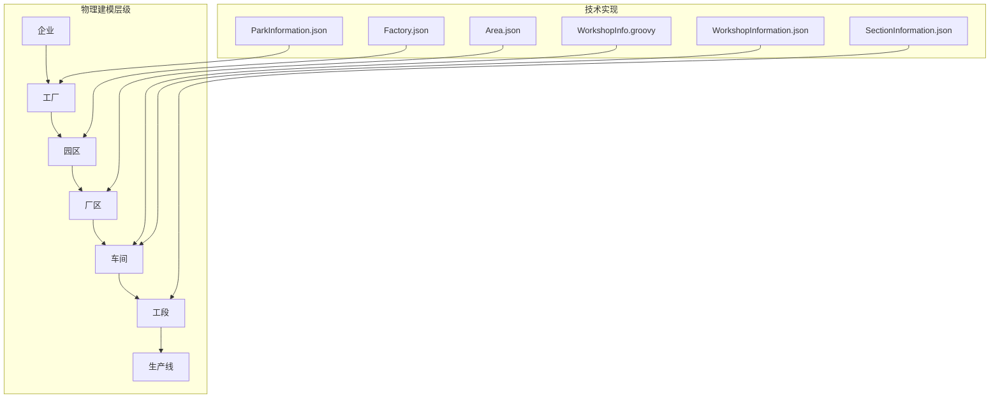
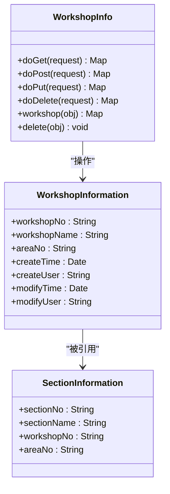
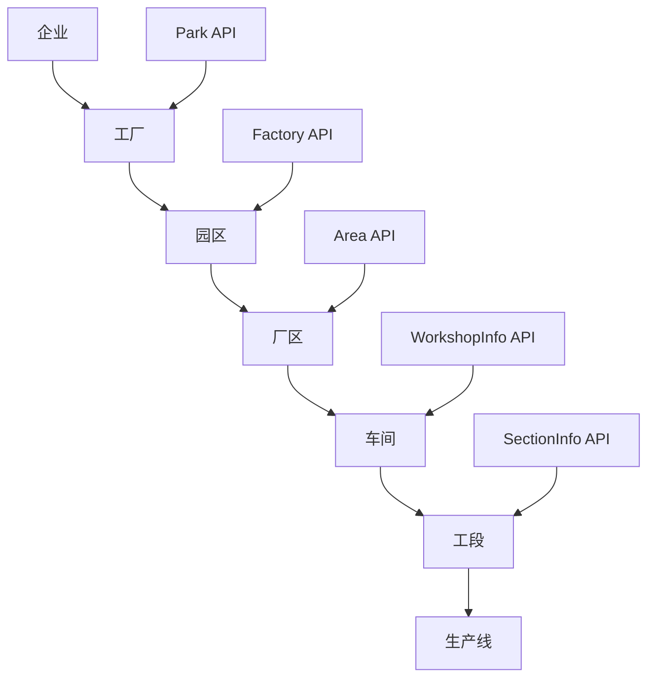
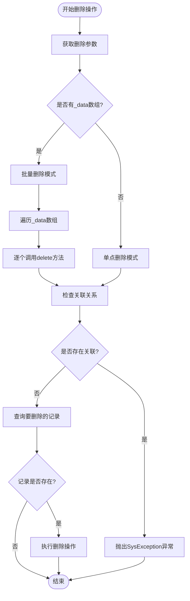
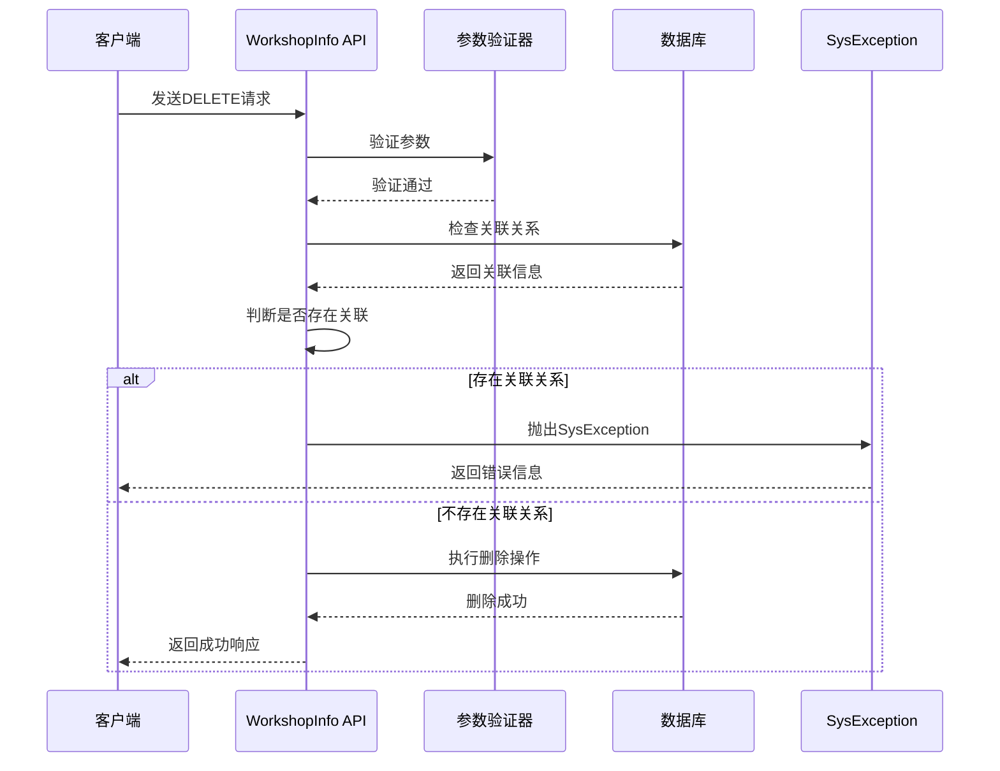
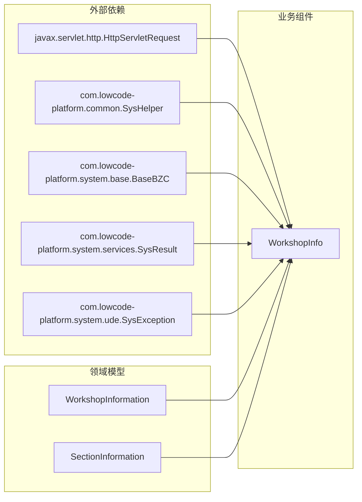
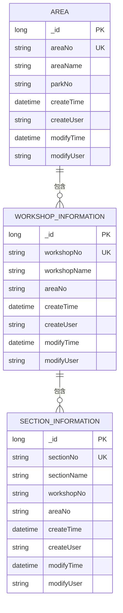

# 车间管理API

<cite>
**本文档引用的文件**
- [WorkshopInfo.groovy](file://bzc/公共资源管理/物理建模/5_车间/WorkshopInfo.groovy)
- [WorkshopInformation.json](file://Domain/公共资源管理/物理建模/5_车间/WorkshopInformation.json)
- [SectionInformation.json](file://Domain/公共资源管理/物理建模/6_工段/SectionInformation.json)
- [Area.json](file://Domain/公共资源管理/物理建模/4_厂区/Area.json)
- [Factory.json](file://Domain/公共资源管理/物理建模/2_工厂/Factory.json)
- [ParkInformation.json](file://Domain/公共资源管理/物理建模/3_园区/ParkInformation.json)
- [bzc-base.skill](file://skills/architecture/bzc-base.skill)
- [business-rule-check.skill](file://skills/foundation/business-rule-check.skill)
</cite>

## 目录
1. [简介](#简介)
2. [项目结构](#项目结构)
3. [核心组件](#核心组件)
4. [架构概览](#架构概览)
5. [详细组件分析](#详细组件分析)
6. [依赖分析](#依赖分析)
7. [性能考虑](#性能考虑)
8. [故障排除指南](#故障排除指南)
9. [结论](#结论)

## 简介

本文档提供了CMES（制造执行系统）中车间管理的完整API文档。基于仓库中的物理建模层级，车间作为第5级物理实体，在整个制造管理体系中扮演着关键角色。本文档详细记录了车间实体的CRUD操作接口，包括创建、查询、更新和删除功能，并说明了车间在物理建模层级中的作用以及与其他层级的关系。

## 项目结构

根据CMES项目的物理建模层级，车间管理涉及以下关键文件：



**图表来源**
- [WorkshopInfo.groovy:1-69](file://bzc/公共资源管理/物理建模/5_车间/WorkshopInfo.groovy#L1-L69)
- [WorkshopInformation.json:1-249](file://Domain/公共资源管理/物理建模/5_车间/WorkshopInformation.json#L1-L249)

**章节来源**
- [WorkshopInfo.groovy:1-69](file://bzc/公共资源管理/物理建模/5_车间/WorkshopInfo.groovy#L1-L69)
- [WorkshopInformation.json:1-249](file://Domain/公共资源管理/物理建模/5_车间/WorkshopInformation.json#L1-L249)

## 核心组件

### 车间实体模型

车间实体具有以下核心属性：

| 属性名称 | 显示名称 | 数据类型 | 唯一性 | 可空性 | 描述 |
|---------|---------|---------|--------|--------|------|
| _id | 未指定 | Long | 是 | 否 | 主键标识 |
| workshopNo | 车间编码 | String | 是 | 否 | 车间的唯一编码标识 |
| workshopName | 车间名称 | String | 否 | 是 | 车间的显示名称 |
| areaNo | 厂区编码 | String | 否 | 是 | 关联的厂区编码 |
| createTime | 创建时间 | Datetime | 否 | 是 | 记录创建时间 |
| createUser | 创建用户 | String | 否 | 是 | 创建用户标识 |
| modifyTime | 最后修改时间 | Datetime | 否 | 是 | 记录最后修改时间 |
| modifyUser | 最后修改用户 | String | 否 | 是 | 修改用户标识 |

### 车间业务组件

WorkshopInfo.groovy实现了完整的RESTful API接口，采用BZC（Business Zone Component）模式：



**图表来源**
- [WorkshopInfo.groovy:12-69](file://bzc/公共资源管理/物理建模/5_车间/WorkshopInfo.groovy#L12-L69)
- [WorkshopInformation.json:65-137](file://Domain/公共资源管理/物理建模/5_车间/WorkshopInformation.json#L65-L137)
- [SectionInformation.json:117-137](file://Domain/公共资源管理/物理建模/6_工段/SectionInformation.json#L117-L137)

**章节来源**
- [WorkshopInfo.groovy:12-69](file://bzc/公共资源管理/物理建模/5_车间/WorkshopInfo.groovy#L12-L69)
- [WorkshopInformation.json:65-137](file://Domain/公共资源管理/物理建模/5_车间/WorkshopInformation.json#L65-L137)

## 架构概览

### 物理建模层级关系



**图表来源**
- [WorkshopInfo.groovy:1-10](file://bzc/公共资源管理/物理建模/5_车间/WorkshopInfo.groovy#L1-L10)
- [SectionInformation.json:117-137](file://Domain/公共资源管理/物理建模/6_工段/SectionInformation.json#L117-L137)

### API架构设计

系统采用分层架构设计，每层都有对应的业务组件：

1. **表示层**: HTTP请求处理
2. **业务层**: BZC业务组件
3. **领域层**: 实体模型定义
4. **数据访问层**: CRUD操作实现

## 详细组件分析

### RESTful API接口规范

#### GET接口 - 查询车间信息

**接口定义**
- 方法: GET
- 路径: `/workshop`
- 功能: 查询车间信息

**请求参数**
```json
{
  "workshopNo": "string",
  "workshopName": "string",
  "areaNo": "string",
  "_id": "long"
}
```

**响应数据结构**
```json
{
  "success": true,
  "data": {
    "workshopNo": "string",
    "workshopName": "string",
    "areaNo": "string",
    "createTime": "datetime",
    "createUser": "string",
    "modifyTime": "datetime",
    "modifyUser": "string"
  },
  "message": "string"
}
```

#### POST接口 - 创建车间

**接口定义**
- 方法: POST
- 路径: `/workshop`
- 功能: 创建新的车间记录

**请求体参数**
```json
{
  "workshopNo": "string",
  "workshopName": "string",
  "areaNo": "string"
}
```

**响应数据结构**
```json
{
  "success": true,
  "data": "OK",
  "message": "创建成功"
}
```

#### PUT接口 - 更新车间

**接口定义**
- 方法: PUT
- 路径: `/workshop`
- 功能: 更新现有车间信息

**请求体参数**
```json
{
  "_id": "long",
  "workshopNo": "string",
  "workshopName": "string",
  "areaNo": "string"
}
```

**响应数据结构**
```json
{
  "success": true,
  "data": "OK",
  "message": "更新成功"
}
```

#### DELETE接口 - 删除车间

**接口定义**
- 方法: DELETE
- 路径: `/workshop`
- 功能: 删除车间记录

**请求参数**
```json
{
  "workshopNo": "string",
  "workshopName": "string"
}
```

**响应数据结构**
```json
{
  "success": true,
  "data": "OK",
  "message": "删除成功"
}
```

### 删除操作流程



**图表来源**
- [WorkshopInfo.groovy:21-46](file://bzc/公共资源管理/物理建模/5_车间/WorkshopInfo.groovy#L21-L46)

**章节来源**
- [WorkshopInfo.groovy:48-69](file://bzc/公共资源管理/物理建模/5_车间/WorkshopInfo.groovy#L48-L69)

### 错误处理机制

系统采用统一的异常处理机制：



**图表来源**
- [WorkshopInfo.groovy:34-46](file://bzc/公共资源管理/物理建模/5_车间/WorkshopInfo.groovy#L34-L46)

## 依赖分析

### 组件依赖关系



**图表来源**
- [WorkshopInfo.groovy:3-9](file://bzc/公共资源管理/物理建模/5_车间/WorkshopInfo.groovy#L3-L9)

### 数据模型关系



**图表来源**
- [WorkshopInformation.json:65-137](file://Domain/公共资源管理/物理建模/5_车间/WorkshopInformation.json#L65-L137)
- [SectionInformation.json:117-137](file://Domain/公共资源管理/物理建模/6_工段/SectionInformation.json#L117-L137)
- [Area.json:117-137](file://Domain/公共资源管理/物理建模/4_厂区/Area.json#L117-137)

**章节来源**
- [WorkshopInformation.json:117-137](file://Domain/公共资源管理/物理建模/5_车间/WorkshopInformation.json#L117-L137)
- [SectionInformation.json:117-137](file://Domain/公共资源管理/物理建模/6_工段/SectionInformation.json#L117-L137)

## 性能考虑

### 查询优化建议

1. **索引策略**: 车间编码(workshopNo)应建立唯一索引以提高查询性能
2. **批量操作**: 对于批量删除操作，建议使用事务处理确保数据一致性
3. **缓存机制**: 对于频繁查询的车间信息，可以考虑添加缓存层

### 删除操作注意事项

1. **关联检查**: 删除前必须检查是否存在下级关联关系
2. **事务处理**: 删除操作应在事务中执行，确保原子性
3. **日志记录**: 所有删除操作都应记录详细的审计日志

## 故障排除指南

### 常见错误及解决方案

| 错误类型 | 错误代码 | 描述 | 解决方案 |
|---------|---------|------|---------|
| 参数验证错误 | 400 | 必填参数缺失 | 确保提供workshopNo等必填参数 |
| 业务规则错误 | 409 | 存在关联关系 | 先删除下级工段信息再删除车间 |
| 数据库错误 | 500 | 数据库操作失败 | 检查数据库连接和权限设置 |
| 权限错误 | 403 | 无操作权限 | 确认用户具有相应的操作权限 |

### 调试建议

1. **启用详细日志**: 在开发环境中启用详细的API调用日志
2. **参数验证**: 确保所有请求参数都符合数据模型定义
3. **事务回滚**: 对于复杂的业务操作，确保支持事务回滚

**章节来源**
- [business-rule-check.skill:128-144](file://skills/foundation/business-rule-check.skill#L128-L144)

## 结论

本文档详细介绍了CMES系统中车间管理的完整API实现。基于物理建模层级的设计，车间作为第5级实体，承担着连接上层管理和下层生产执行的重要桥梁作用。

通过RESTful API接口，系统提供了完整的CRUD操作能力，包括：
- **查询**: 支持按多种条件组合查询车间信息
- **创建**: 提供标准化的车间创建接口
- **更新**: 支持车间信息的动态更新
- **删除**: 实现安全的级联删除机制

系统采用BZC模式和统一的异常处理机制，确保了代码的可维护性和系统的稳定性。同时，严格的业务规则检查和数据完整性约束保证了数据质量。

对于后续的扩展开发，建议重点关注：
1. 性能优化和缓存策略
2. 更丰富的查询过滤条件
3. 批量操作的并发处理
4. 审计日志的完善和分析