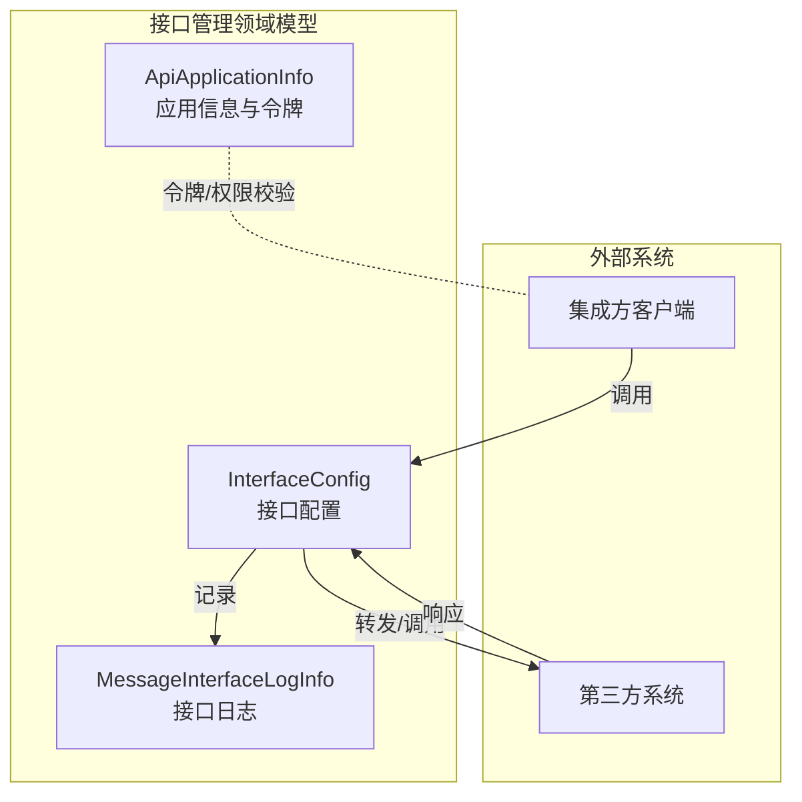
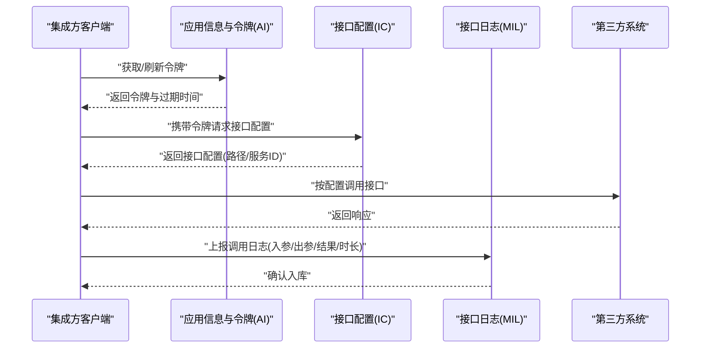
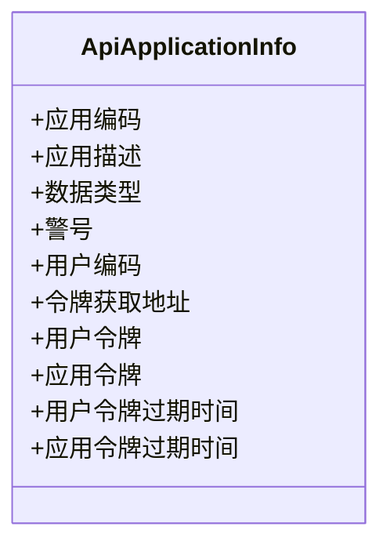
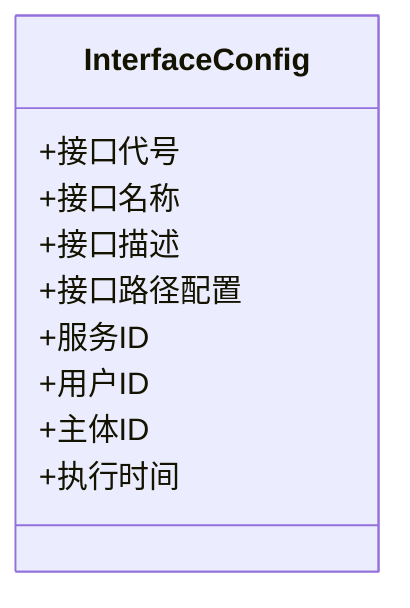
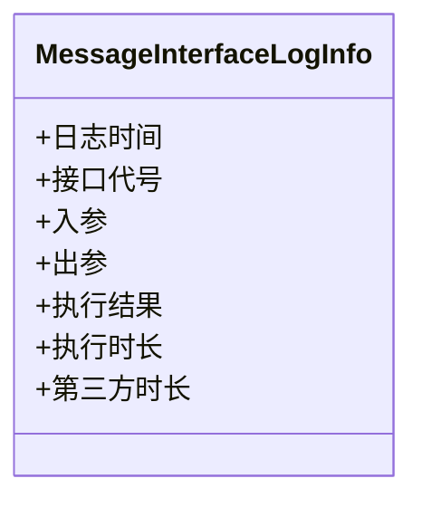
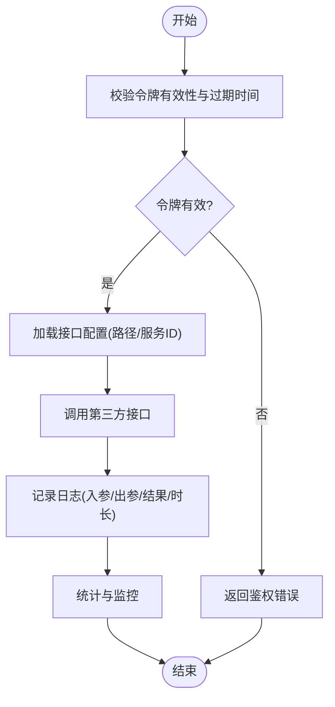

# 接口管理API

<cite>
**本文引用的文件**
- [ApiApplicationInfo.json](file://Domain/接口管理/ApiApplicationInfo.json)
- [InterfaceConfig.json](file://Domain/接口管理/InterfaceConfig.json)
- [MessageInterfaceLogInfo.json](file://Domain/接口管理/MessageInterfaceLogInfo.json)
</cite>

## 目录
1. [简介](#简介)
2. [项目结构](#项目结构)
3. [核心组件](#核心组件)
4. [架构总览](#架构总览)
5. [详细组件分析](#详细组件分析)
6. [依赖关系分析](#依赖关系分析)
7. [性能考虑](#性能考虑)
8. [故障排查指南](#故障排查指南)
9. [结论](#结论)
10. [附录](#附录)

## 简介
本文件面向系统集成与第三方应用接入，提供“接口管理模块”的API参考文档。内容覆盖以下方面：
- API应用信息管理：应用注册、令牌管理、权限控制相关接口规范
- 接口配置管理：接口配置的增删改查、配置验证与冲突检测
- 接口日志管理：接口调用日志记录、查询与统计
- 安全认证、访问控制与限流策略：统一鉴权与访问控制的API规范

本文件基于仓库中已提供的领域模型定义进行规范性说明，并以可视化图示呈现关键流程与数据结构。

## 项目结构
接口管理模块的核心由三个领域模型构成：
- API应用信息模型：用于登记应用、令牌与过期时间等
- 接口配置模型：用于登记接口代号、名称、URL、服务ID、用户ID、主体ID等
- 接口日志模型：用于记录接口调用时间、入参、出参、执行结果与时长等

图表来源
- [ApiApplicationInfo.json:1-431](file://Domain/接口管理/ApiApplicationInfo.json#L1-L431)
- [InterfaceConfig.json:1-379](file://Domain/接口管理/InterfaceConfig.json#L1-L379)
- [MessageInterfaceLogInfo.json:1-353](file://Domain/接口管理/MessageInterfaceLogInfo.json#L1-L353)

章节来源
- [ApiApplicationInfo.json:1-431](file://Domain/接口管理/ApiApplicationInfo.json#L1-L431)
- [InterfaceConfig.json:1-379](file://Domain/接口管理/InterfaceConfig.json#L1-L379)
- [MessageInterfaceLogInfo.json:1-353](file://Domain/接口管理/MessageInterfaceLogInfo.json#L1-L353)

## 核心组件
- 应用信息与令牌管理
  - 关键字段：应用编码、应用描述、数据类型、警号、用户编码、令牌获取地址、用户令牌、应用令牌、用户令牌过期时间、应用令牌过期时间
  - 用途：登记应用、颁发令牌、设置过期时间、提供令牌获取地址
- 接口配置管理
  - 关键字段：接口代号、接口名称、接口描述、接口路径配置、服务ID、用户ID、主体ID、执行时间
  - 用途：登记接口元数据、路由与转发规则、归属主体与用户
- 接口日志管理
  - 关键字段：日志时间、接口代号、入参、出参、执行结果、执行时长、第三方时长
  - 用途：记录调用轨迹、统计耗时、判定成功/失败

章节来源
- [ApiApplicationInfo.json:34-431](file://Domain/接口管理/ApiApplicationInfo.json#L34-L431)
- [InterfaceConfig.json:34-379](file://Domain/接口管理/InterfaceConfig.json#L34-L379)
- [MessageInterfaceLogInfo.json:34-353](file://Domain/接口管理/MessageInterfaceLogInfo.json#L34-L353)

## 架构总览
下图展示从“应用侧”到“接口配置”再到“第三方系统”的调用链路，以及日志采集与落库流程：

图表来源
- [ApiApplicationInfo.json:191-295](file://Domain/接口管理/ApiApplicationInfo.json#L191-L295)
- [InterfaceConfig.json:61-190](file://Domain/接口管理/InterfaceConfig.json#L61-L190)
- [MessageInterfaceLogInfo.json:61-242](file://Domain/接口管理/MessageInterfaceLogInfo.json#L61-L242)

## 详细组件分析

### 组件A：API应用信息管理
- 职责
  - 应用注册：登记应用编码、描述、类型、警号、用户编码等
  - 令牌管理：维护用户令牌与应用令牌、令牌过期时间、令牌获取地址
  - 权限控制：通过令牌与过期时间实现访问控制
- 数据模型要点
  - 应用标识与描述：应用编码、应用描述、数据类型
  - 用户与主体：警号、用户编码
  - 令牌与有效期：用户令牌、应用令牌、用户令牌过期时间、应用令牌过期时间、令牌获取地址
- API建议
  - 应用注册/更新：提交应用编码、描述、类型、警号、用户编码；返回应用ID
  - 获取令牌：根据应用ID与凭证申请令牌，返回令牌与过期时间
  - 刷新令牌：在过期前刷新令牌
  - 令牌校验：调用受控接口时携带令牌并校验有效性与过期时间
  - 令牌撤销：支持禁用或撤销令牌

图表来源
- [ApiApplicationInfo.json:34-431](file://Domain/接口管理/ApiApplicationInfo.json#L34-L431)

章节来源
- [ApiApplicationInfo.json:34-431](file://Domain/接口管理/ApiApplicationInfo.json#L34-L431)

### 组件B：接口配置管理
- 职责
  - 接口登记：接口代号、名称、描述
  - 路由配置：接口路径配置、服务ID、用户ID、主体ID
  - 执行信息：执行时间
- 数据模型要点
  - 接口标识：接口代号、接口名称、接口描述
  - 路由与归属：接口路径配置、服务ID、用户ID、主体ID
  - 时间信息：执行时间
- API建议
  - 新增接口配置：提交接口代号、名称、描述、接口路径配置、服务ID、用户ID、主体ID
  - 查询接口配置：按接口代号/名称/服务ID等条件检索
  - 更新接口配置：变更接口路径或归属信息
  - 删除接口配置：删除无效或废弃配置
  - 配置验证与冲突检测
    - 重复接口代号检测
    - 冲突路由检测（同一服务ID/主体ID下的路径冲突）
    - 必填字段校验（接口代号、接口路径配置、服务ID）

图表来源
- [InterfaceConfig.json:34-379](file://Domain/接口管理/InterfaceConfig.json#L34-L379)

章节来源
- [InterfaceConfig.json:34-379](file://Domain/接口管理/InterfaceConfig.json#L34-L379)

### 组件C：接口日志管理
- 职责
  - 记录接口调用：日志时间、接口代号、入参、出参
  - 统计与评估：执行结果、执行时长、第三方时长
- 数据模型要点
  - 时间与标识：日志时间、接口代号
  - 参数与结果：入参、出参、执行结果
  - 性能指标：执行时长、第三方时长
- API建议
  - 日志上报：集成方在调用完成后上报入参、出参、结果、时长
  - 日志查询：按接口代号、时间段、结果状态等条件查询
  - 日志统计：按接口维度统计成功率、平均时长、P95/P99时长

图表来源
- [MessageInterfaceLogInfo.json:34-353](file://Domain/接口管理/MessageInterfaceLogInfo.json#L34-L353)

章节来源
- [MessageInterfaceLogInfo.json:34-353](file://Domain/接口管理/MessageInterfaceLogInfo.json#L34-L353)

### 流程图：接口调用与日志记录

图表来源
- [ApiApplicationInfo.json:191-295](file://Domain/接口管理/ApiApplicationInfo.json#L191-L295)
- [InterfaceConfig.json:61-190](file://Domain/接口管理/InterfaceConfig.json#L61-L190)
- [MessageInterfaceLogInfo.json:61-242](file://Domain/接口管理/MessageInterfaceLogInfo.json#L61-L242)

## 依赖关系分析
- 应用信息与接口配置
  - 应用信息中的“令牌获取地址”与“令牌过期时间”为接口调用前置条件
  - 接口配置中的“服务ID/用户ID/主体ID”决定调用归属与权限范围
- 接口配置与日志
  - 接口配置提供“接口代号/路径”，日志以“接口代号”作为关联键
  - 日志记录“执行时长/第三方时长”用于性能分析与优化

图表来源
- [ApiApplicationInfo.json:191-295](file://Domain/接口管理/ApiApplicationInfo.json#L191-L295)
- [InterfaceConfig.json:61-190](file://Domain/接口管理/InterfaceConfig.json#L61-L190)
- [MessageInterfaceLogInfo.json:61-242](file://Domain/接口管理/MessageInterfaceLogInfo.json#L61-L242)

章节来源
- [ApiApplicationInfo.json:191-295](file://Domain/接口管理/ApiApplicationInfo.json#L191-L295)
- [InterfaceConfig.json:61-190](file://Domain/接口管理/InterfaceConfig.json#L61-L190)
- [MessageInterfaceLogInfo.json:61-242](file://Domain/接口管理/MessageInterfaceLogInfo.json#L61-L242)

## 性能考虑
- 令牌缓存与预刷新：在令牌过期前自动刷新，减少调用中断
- 日志异步化：日志上报采用异步队列，避免阻塞主流程
- 配置缓存：接口配置按服务ID/主体ID缓存，降低查询开销
- 监控与告警：对P95/P99时延、失败率设置阈值告警

## 故障排查指南
- 令牌相关
  - 现象：调用返回鉴权失败
  - 排查：确认令牌是否过期、是否被撤销、是否携带正确
- 配置相关
  - 现象：调用路径错误或路由冲突
  - 排查：核对接口代号、路径配置、服务ID/主体ID是否匹配
- 日志相关
  - 现象：缺少调用记录或统计异常
  - 排查：确认日志上报是否成功、接口代号是否一致、入参/出参是否为空

章节来源
- [ApiApplicationInfo.json:191-295](file://Domain/接口管理/ApiApplicationInfo.json#L191-L295)
- [InterfaceConfig.json:61-190](file://Domain/接口管理/InterfaceConfig.json#L61-L190)
- [MessageInterfaceLogInfo.json:61-242](file://Domain/接口管理/MessageInterfaceLogInfo.json#L61-L242)

## 结论
本API文档基于仓库中的领域模型定义，明确了接口管理模块在应用信息、接口配置与日志管理方面的职责边界与数据结构。建议在实际实现中补充具体的HTTP接口规范（如请求/响应体、状态码、鉴权方式、限流策略等），并与现有系统完成联调测试，确保安全、稳定与可观测。

## 附录
- 术语
  - 应用：第三方接入方的系统或服务
  - 接口：系统对外暴露的功能点
  - 日志：接口调用过程中的记录条目
- 参考字段清单
  - 应用信息：应用编码、应用描述、数据类型、警号、用户编码、令牌获取地址、用户令牌、应用令牌、用户令牌过期时间、应用令牌过期时间
  - 接口配置：接口代号、接口名称、接口描述、接口路径配置、服务ID、用户ID、主体ID、执行时间
  - 接口日志：日志时间、接口代号、入参、出参、执行结果、执行时长、第三方时长