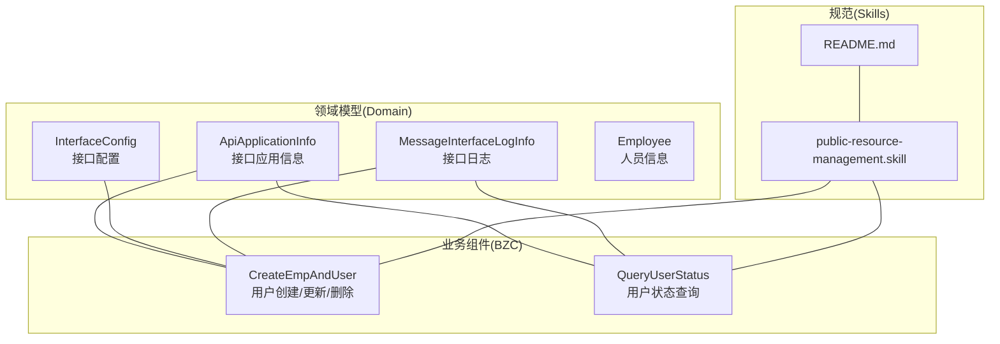
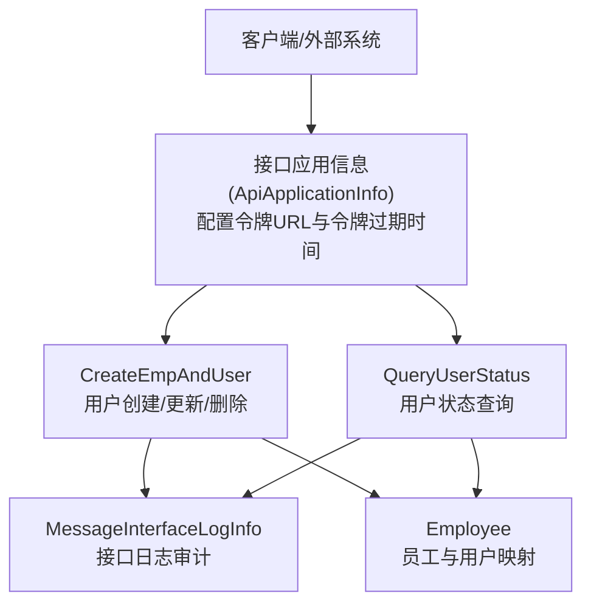
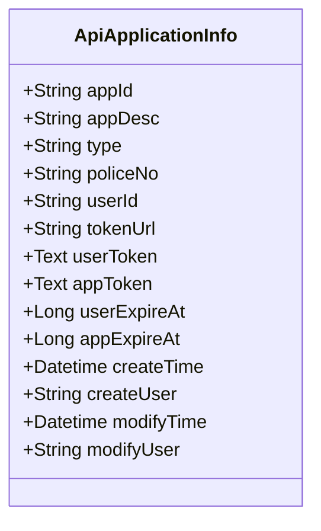
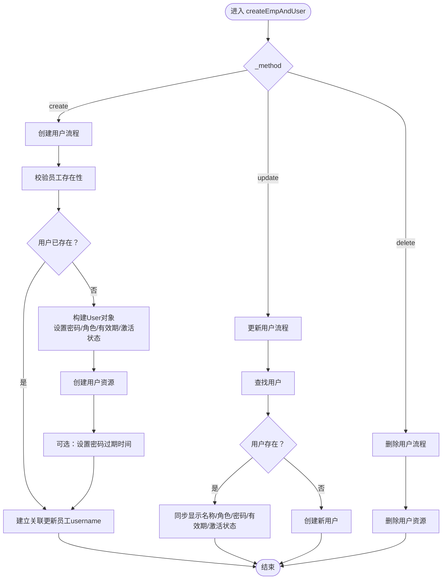
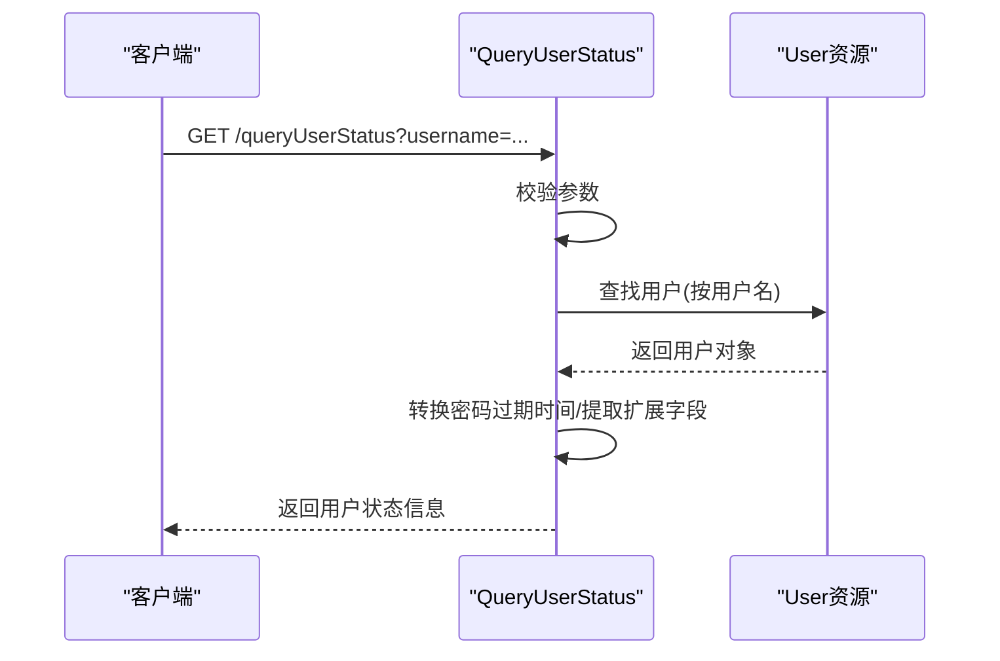
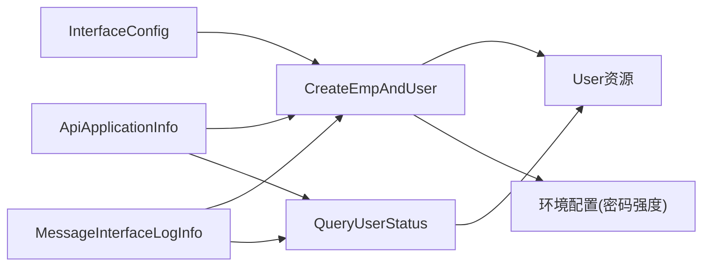

# 认证授权API

<cite>
**本文档引用的文件**
- [ApiApplicationInfo.json](file://Domain/接口管理/ApiApplicationInfo.json)
- [InterfaceConfig.json](file://Domain/接口管理/InterfaceConfig.json)
- [MessageInterfaceLogInfo.json](file://Domain/接口管理/MessageInterfaceLogInfo.json)
- [CreateEmpAndUser.groovy](file://bzc/公共资源管理/人员管理/人员信息/CreateEmpAndUser.groovy)
- [QueryUserStatus.groovy](file://bzc/公共资源管理/人员管理/人员信息/QueryUserStatus.groovy)
- [Employee.json](file://Domain/公共资源管理/人员管理/人员信息/Employee.json)
- [public-resource-management.skill](file://skills/business/public-resource-management.skill)
- [README.md](file://skills/README.md)
</cite>

## 目录
1. [简介](#简介)
2. [项目结构](#项目结构)
3. [核心组件](#核心组件)
4. [架构总览](#架构总览)
5. [详细组件分析](#详细组件分析)
6. [依赖分析](#依赖分析)
7. [性能考量](#性能考量)
8. [故障排查指南](#故障排查指南)
9. [结论](#结论)
10. [附录](#附录)

## 简介
本文件面向开发者，系统化梳理本仓库中与“认证授权”相关的API与能力边界，重点覆盖：
- 用户身份与令牌管理：用户创建/更新/删除、令牌URL配置、令牌信息与过期时间管理
- 权限与角色：基于角色的访问控制（RBAC）与用户状态查询
- 安全与合规：密码强度策略、令牌过期处理、日志审计
- 多租户与环境适配：应用级令牌与令牌URL的环境化配置
- API调用与集成：RESTful风格的查询接口与业务组件的统一规范

说明：当前仓库未发现OAuth2.0与JWT的显式实现代码，本文档在“概念性说明”部分给出集成建议与最佳实践，不作为已有功能的断言。

## 项目结构
围绕认证授权的关键文件分布于以下位置：
- Domain/接口管理：接口应用信息、接口配置、消息接口日志（支撑令牌URL、应用令牌、过期时间等配置与审计）
- bzc/公共资源管理/人员管理/人员信息：用户创建与同步、用户状态查询
- skills/business/public-resource-management.skill：模块规范与目录结构
- skills/README.md：技能规范层级与引用关系

**图表来源**
- [ApiApplicationInfo.json:1-431](file://Domain/接口管理/ApiApplicationInfo.json#L1-L431)
- [InterfaceConfig.json:1-379](file://Domain/接口管理/InterfaceConfig.json#L1-L379)
- [MessageInterfaceLogInfo.json:1-353](file://Domain/接口管理/MessageInterfaceLogInfo.json#L1-L353)
- [CreateEmpAndUser.groovy:1-590](file://bzc/公共资源管理/人员管理/人员信息/CreateEmpAndUser.groovy#L1-L590)
- [QueryUserStatus.groovy:1-144](file://bzc/公共资源管理/人员管理/人员信息/QueryUserStatus.groovy#L1-L144)
- [Employee.json:1-743](file://Domain/公共资源管理/人员管理/人员信息/Employee.json#L1-L743)
- [public-resource-management.skill:1-514](file://skills/business/public-resource-management.skill#L1-L514)
- [README.md:1-63](file://skills/README.md#L1-L63)

**章节来源**
- [README.md:1-63](file://skills/README.md#L1-L63)
- [public-resource-management.skill:1-514](file://skills/business/public-resource-management.skill#L1-L514)

## 核心组件
- 接口应用信息（ApiApplicationInfo）：提供令牌获取地址（tokenUrl）、用户令牌信息（userToken）、应用令牌信息（appToken）、用户令牌过期时间（userExpireAt）、应用令牌过期时间（appExpireAt）等字段，用于支撑外部系统对接与令牌生命周期管理。
- 接口配置（InterfaceConfig）：提供接口路径配置（interfaceUrl）、服务ID（serviceid）、用户ID（userid）、主体ID（subid）等，便于统一管理接口路由与鉴权上下文。
- 消息接口日志（MessageInterfaceLogInfo）：记录接口执行时间、入参、出参、执行结果、第三方耗时等，支撑安全审计与问题追踪。
- 用户创建与同步（CreateEmpAndUser）：负责员工与系统用户的同步创建/更新/删除，内置密码强度校验、默认角色合并、用户URI路径管理等。
- 用户状态查询（QueryUserStatus）：提供RESTful查询接口，返回用户密码有效期、激活状态、停用/启用时间等关键状态信息。
- 人员信息（Employee）：包含雇员ID、登录用户（username）等字段，支撑用户与员工的一对一映射关系。

**章节来源**
- [ApiApplicationInfo.json:187-328](file://Domain/接口管理/ApiApplicationInfo.json#L187-L328)
- [InterfaceConfig.json:139-242](file://Domain/接口管理/InterfaceConfig.json#L139-L242)
- [MessageInterfaceLogInfo.json:87-241](file://Domain/接口管理/MessageInterfaceLogInfo.json#L87-L241)
- [CreateEmpAndUser.groovy:75-130](file://bzc/公共资源管理/人员管理/人员信息/CreateEmpAndUser.groovy#L75-L130)
- [QueryUserStatus.groovy:33-109](file://bzc/公共资源管理/人员管理/人员信息/QueryUserStatus.groovy#L33-L109)
- [Employee.json:295-320](file://Domain/公共资源管理/人员管理/人员信息/Employee.json#L295-L320)

## 架构总览
认证授权相关能力由“领域模型 + 业务组件 + 规范约束”共同构成，形成“配置驱动 + 业务编排 + 审计留痕”的闭环。

**图表来源**
- [ApiApplicationInfo.json:187-328](file://Domain/接口管理/ApiApplicationInfo.json#L187-L328)
- [CreateEmpAndUser.groovy:140-232](file://bzc/公共资源管理/人员管理/人员信息/CreateEmpAndUser.groovy#L140-L232)
- [QueryUserStatus.groovy:62-109](file://bzc/公共资源管理/人员管理/人员信息/QueryUserStatus.groovy#L62-L109)
- [MessageInterfaceLogInfo.json:87-241](file://Domain/接口管理/MessageInterfaceLogInfo.json#L87-L241)
- [Employee.json:295-320](file://Domain/公共资源管理/人员管理/人员信息/Employee.json#L295-L320)

## 详细组件分析

### 接口应用信息（ApiApplicationInfo）
- 关键属性
  - tokenUrl：令牌获取地址，支持不同环境的差异化配置
  - userToken / appToken：用户令牌与应用令牌信息（生成后写入）
  - userExpireAt / appExpireAt：用户令牌与应用令牌过期时间（时间戳，默认12小时）
- 用途
  - 作为外部系统对接的统一入口，提供令牌获取地址与过期时间策略
  - 支持多环境部署下的URL动态化配置

**图表来源**
- [ApiApplicationInfo.json:61-320](file://Domain/接口管理/ApiApplicationInfo.json#L61-L320)

**章节来源**
- [ApiApplicationInfo.json:187-328](file://Domain/接口管理/ApiApplicationInfo.json#L187-L328)

### 用户创建与同步（CreateEmpAndUser）
- 能力概述
  - 支持根据 _method 参数执行创建/更新/删除操作
  - 内置密码强度校验与默认角色合并
  - 自动维护员工与系统的用户映射（username）
- 关键流程
  - 创建：校验员工存在性、用户名标准化、密码强度检查、创建用户资源、可选设置密码过期时间
  - 更新：同步显示名称、角色更新、密码变更（若提供）、密码有效期与激活状态更新
  - 删除：根据用户名查找并删除用户资源
- 安全要点
  - 密码以特定前缀存储，系统自动加密
  - 密码强度由系统配置决定（可通过环境变量读取）

**图表来源**
- [CreateEmpAndUser.groovy:91-130](file://bzc/公共资源管理/人员管理/人员信息/CreateEmpAndUser.groovy#L91-L130)
- [CreateEmpAndUser.groovy:140-232](file://bzc/公共资源管理/人员管理/人员信息/CreateEmpAndUser.groovy#L140-L232)
- [CreateEmpAndUser.groovy:241-329](file://bzc/公共资源管理/人员管理/人员信息/CreateEmpAndUser.groovy#L241-L329)
- [CreateEmpAndUser.groovy:338-356](file://bzc/公共资源管理/人员管理/人员信息/CreateEmpAndUser.groovy#L338-L356)

**章节来源**
- [CreateEmpAndUser.groovy:75-130](file://bzc/公共资源管理/人员管理/人员信息/CreateEmpAndUser.groovy#L75-L130)
- [CreateEmpAndUser.groovy:140-232](file://bzc/公共资源管理/人员管理/人员信息/CreateEmpAndUser.groovy#L140-L232)
- [CreateEmpAndUser.groovy:241-329](file://bzc/公共资源管理/人员管理/人员信息/CreateEmpAndUser.groovy#L241-L329)
- [CreateEmpAndUser.groovy:338-356](file://bzc/公共资源管理/人员管理/人员信息/CreateEmpAndUser.groovy#L338-L356)

### 用户状态查询（QueryUserStatus）
- 能力概述
  - 提供RESTful查询接口，返回用户密码有效期、激活状态、停用/启用时间、用户URI等
  - 支持GET请求处理
- 关键点
  - 校验用户名必填
  - 将基准密码过期时间转换为null以便前端展示
  - 从扩展字段提取用户停用/启用时间

**图表来源**
- [QueryUserStatus.groovy:33-109](file://bzc/公共资源管理/人员管理/人员信息/QueryUserStatus.groovy#L33-L109)

**章节来源**
- [QueryUserStatus.groovy:33-109](file://bzc/公共资源管理/人员管理/人员信息/QueryUserStatus.groovy#L33-L109)

### 接口配置（InterfaceConfig）
- 作用
  - 统一管理接口路径、服务ID、用户ID、主体ID等，便于与认证授权上下文绑定
- 适用场景
  - 与ApiApplicationInfo配合，实现令牌URL与接口路由的解耦

**章节来源**
- [InterfaceConfig.json:139-242](file://Domain/接口管理/InterfaceConfig.json#L139-L242)

### 消息接口日志（MessageInterfaceLogInfo）
- 作用
  - 记录接口执行时间、入参、出参、执行结果、第三方耗时等，支撑安全审计与问题追踪
- 价值
  - 为认证失败、权限拒绝、令牌过期等异常提供可追溯的日志证据

**章节来源**
- [MessageInterfaceLogInfo.json:87-241](file://Domain/接口管理/MessageInterfaceLogInfo.json#L87-L241)

### 人员信息（Employee）
- 作用
  - 作为员工与系统用户映射的载体，提供username字段，确保“雇员ID与登录用户一对一完全匹配”
- 与认证授权的关系
  - 通过CreateEmpAndUser与QueryUserStatus，实现用户生命周期与状态管理

**章节来源**
- [Employee.json:295-320](file://Domain/公共资源管理/人员管理/人员信息/Employee.json#L295-L320)

## 依赖分析
- 组件耦合
  - CreateEmpAndUser依赖User资源与系统安全工具（密码强度、用户名规范化）
  - QueryUserStatus依赖User资源与系统工具（日期转换、对象映射）
  - ApiApplicationInfo为外部系统提供令牌URL与过期时间配置
  - InterfaceConfig提供接口路由与鉴权上下文
  - MessageInterfaceLogInfo贯穿业务组件，提供审计能力
- 规范约束
  - skills/business/public-resource-management.skill定义了BZC包命名、类命名、目录结构等规范，保证认证授权相关组件的一致性与可维护性

**图表来源**
- [CreateEmpAndUser.groovy:16-31](file://bzc/公共资源管理/人员管理/人员信息/CreateEmpAndUser.groovy#L16-L31)
- [QueryUserStatus.groovy:14-15](file://bzc/公共资源管理/人员管理/人员信息/QueryUserStatus.groovy#L14-L15)
- [ApiApplicationInfo.json:187-328](file://Domain/接口管理/ApiApplicationInfo.json#L187-L328)
- [InterfaceConfig.json:139-242](file://Domain/接口管理/InterfaceConfig.json#L139-L242)
- [MessageInterfaceLogInfo.json:87-241](file://Domain/接口管理/MessageInterfaceLogInfo.json#L87-L241)

**章节来源**
- [public-resource-management.skill:76-96](file://skills/business/public-resource-management.skill#L76-L96)

## 性能考量
- 批量查询与N+1规避
  - 建议在复杂业务场景中采用RQL批量查询，减少数据库往返次数
- 令牌过期与刷新
  - 基于userExpireAt/appExpireAt进行定时刷新，避免频繁重建令牌带来的开销
- 日志落盘
  - MessageInterfaceLogInfo记录执行时长与第三方耗时，便于定位性能瓶颈

[本节为通用指导，无需具体文件引用]

## 故障排查指南
- 常见问题与处理
  - 用户名为空：QueryUserStatus在查询时会校验用户名必填，需确保请求参数正确
  - 密码强度不足：CreateEmpAndUser在创建/更新时会检查密码强度，需满足系统配置要求
  - 用户不存在：CreateEmpAndUser在更新时若用户不存在，会提示需要先创建用户
  - 密码过期时间基准值：QueryUserStatus会将特定基准时间转换为null，避免前端误解
- 审计与追踪
  - 通过MessageInterfaceLogInfo记录的入参、出参、执行结果与耗时，快速定位问题

**章节来源**
- [QueryUserStatus.groovy:66-69](file://bzc/公共资源管理/人员管理/人员信息/QueryUserStatus.groovy#L66-L69)
- [CreateEmpAndUser.groovy:180-191](file://bzc/公共资源管理/人员管理/人员信息/CreateEmpAndUser.groovy#L180-L191)
- [CreateEmpAndUser.groovy:299-305](file://bzc/公共资源管理/人员管理/人员信息/CreateEmpAndUser.groovy#L299-L305)
- [MessageInterfaceLogInfo.json:87-241](file://Domain/接口管理/MessageInterfaceLogInfo.json#L87-L241)

## 结论
本仓库在认证授权方面提供了完善的“用户生命周期管理 + 令牌配置 + 审计日志”能力，能够满足基本的用户身份与权限验证需求。对于OAuth2.0与JWT的集成，可在现有ApiApplicationInfo与InterfaceConfig的基础上进行扩展，结合安全规范与最佳实践，实现统一的令牌发放、刷新与校验机制。

[本节为总结性内容，无需具体文件引用]

## 附录

### API清单与规范

- 用户状态查询（QueryUserStatus）
  - 方法：GET
  - 路径：/queryUserStatus
  - 请求参数：
    - username：登录用户（必填）
  - 返回字段：
    - passwordLifetime：密码有效期（分钟）
    - passwordExpirationTime：密码过期时间
    - enabled：是否激活
    - userStatusTime：停用/启用时间
    - userUri：用户URI路径

- 用户创建/更新/删除（CreateEmpAndUser）
  - 方法：POST/PUT/DELETE（通过 _method 参数区分）
  - 路径：/createEmpAndUser
  - 请求参数（创建/更新）：
    - employee：员工编号（必填）
    - password：登录密码（创建时必填；更新时可选）
    - repassword：确认密码（创建/更新时必填）
    - roles：角色列表（可选，默认包含基础角色）
    - passwordExpirationTime：密码过期时间（可选）
    - passwordLifetime：密码有效期（分钟，可选）
    - enabled：是否激活（可选，默认true）
    - _method：执行方法（create/update/delete，必填）
  - 返回字段：
    - username：登录用户名
    - method：执行的方法

- 接口应用信息（ApiApplicationInfo）
  - 字段：
    - tokenUrl：令牌获取地址
    - userToken / appToken：用户令牌与应用令牌信息
    - userExpireAt / appExpireAt：用户令牌与应用令牌过期时间（时间戳）
    - createTime / modifyTime / createUser / modifyUser：系统字段

- 接口配置（InterfaceConfig）
  - 字段：
    - interfaceUrl：接口路径配置
    - serviceid / userid / subid：服务ID、用户ID、主体ID
    - createTime / modifyTime / createUser / modifyUser：系统字段

- 消息接口日志（MessageInterfaceLogInfo）
  - 字段：
    - logTime：日志时间
    - interfaceCode：接口代号
    - inParam / outParam：入参/输出（JSON格式）
    - result：执行结果（1成功/0失败）
    - execTime / execExtTime：执行时长/第三方时长
    - createTime / modifyTime / createUser / modifyUser：系统字段

**章节来源**
- [QueryUserStatus.groovy:33-109](file://bzc/公共资源管理/人员管理/人员信息/QueryUserStatus.groovy#L33-L109)
- [CreateEmpAndUser.groovy:75-130](file://bzc/公共资源管理/人员管理/人员信息/CreateEmpAndUser.groovy#L75-L130)
- [ApiApplicationInfo.json:187-328](file://Domain/接口管理/ApiApplicationInfo.json#L187-L328)
- [InterfaceConfig.json:139-242](file://Domain/接口管理/InterfaceConfig.json#L139-L242)
- [MessageInterfaceLogInfo.json:87-241](file://Domain/接口管理/MessageInterfaceLogInfo.json#L87-L241)

### OAuth2.0与JWT集成建议（概念性说明）
- 令牌发放
  - 使用ApiApplicationInfo.tokenUrl作为统一入口，返回访问令牌与刷新令牌
- 令牌校验
  - 在网关或服务端中间件中校验JWT签名、过期时间与声明
- 刷新机制
  - 基于userExpireAt/appExpireAt设定刷新窗口，提前触发刷新
- 多租户适配
  - 通过InterfaceConfig.serviceid、userid、subid区分租户上下文
- 安全加固
  - 强制HTTPS传输、短令牌生命周期、最小权限原则、定期轮换密钥

[本节为概念性说明，不对应具体代码文件]