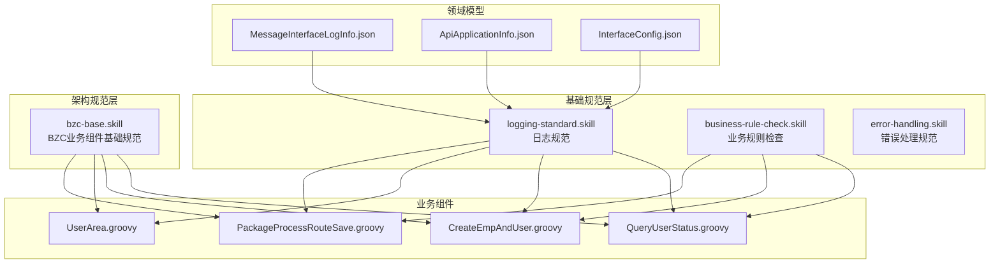
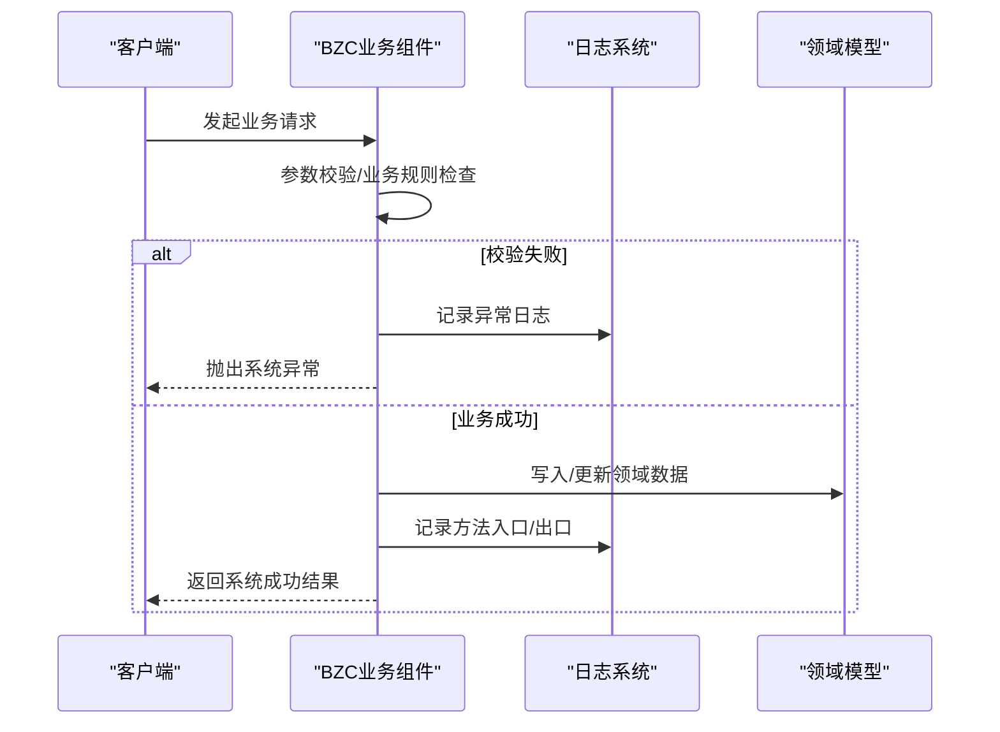
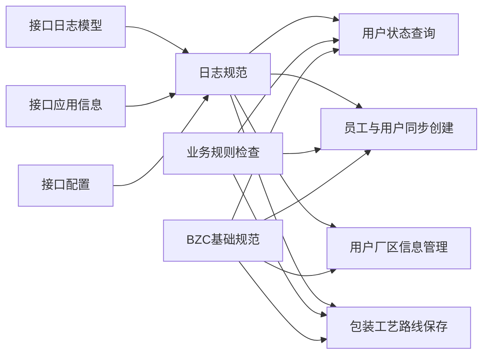

# 错误码规范

<cite>
**本文档引用的文件**
- [logging-standard.skill](file://skills/foundation/logging-standard.skill)
- [bzc-base.skill](file://skills/architecture/bzc-base.skill)
- [business-rule-check.skill](file://skills/foundation/business-rule-check.skill)
- [README.md](file://skills/README.md)
- [MessageInterfaceLogInfo.json](file://Domain/接口管理/MessageInterfaceLogInfo.json)
- [ApiApplicationInfo.json](file://Domain/接口管理/ApiApplicationInfo.json)
- [InterfaceConfig.json](file://Domain/接口管理/InterfaceConfig.json)
- [QueryUserStatus.groovy](file://bzc/公共资源管理/人员管理/人员信息/QueryUserStatus.groovy)
- [CreateEmpAndUser.groovy](file://bzc/公共资源管理/人员管理/人员信息/CreateEmpAndUser.groovy)
- [UserArea.groovy](file://bzc/公共资源管理/人员管理/人员信息/UserArea.groovy)
- [PackageProcessRouteSave.groovy](file://bzc/公共资源管理/工艺建模/包装工艺路线/PackageProcessRouteSave.groovy)
</cite>

## 目录
1. [引言](#引言)
2. [项目结构](#项目结构)
3. [核心组件](#核心组件)
4. [架构总览](#架构总览)
5. [详细组件分析](#详细组件分析)
6. [依赖分析](#依赖分析)
7. [性能考虑](#性能考虑)
8. [故障排除指南](#故障排除指南)
9. [结论](#结论)
10. [附录](#附录)

## 引言
本规范旨在统一 CMES 系统中的错误码与异常处理策略，确保 API 响应一致性、日志可观测性与问题可诊断性。通过对现有技能规范与业务组件的分析，明确异常类型、错误响应格式、日志记录规范与调试输出要求，并给出常见错误场景的诊断与预防建议。

## 项目结构
围绕错误处理与异常管理，系统主要由以下部分构成：
- 基础规范层（foundation）：定义错误处理与日志记录的通用规范
- 架构规范层（architecture）：定义 BZC 组件的类结构与模板
- 业务组件（bzc）：具体业务逻辑中抛出异常与返回结果的实现
- 领域模型（Domain）：接口日志、应用信息、接口配置等支撑数据结构

图表来源
- [logging-standard.skill:1-115](file://skills/foundation/logging-standard.skill#L1-L115)
- [business-rule-check.skill:117-144](file://skills/foundation/business-rule-check.skill#L117-L144)
- [bzc-base.skill:1-162](file://skills/architecture/bzc-base.skill#L1-L162)
- [MessageInterfaceLogInfo.json:1-290](file://Domain/接口管理/MessageInterfaceLogInfo.json#L1-L290)
- [ApiApplicationInfo.json:1-431](file://Domain/接口管理/ApiApplicationInfo.json#L1-L431)
- [InterfaceConfig.json:1-379](file://Domain/接口管理/InterfaceConfig.json#L1-L379)

章节来源
- [README.md:1-63](file://skills/README.md#L1-L63)

## 核心组件
- 异常类型与返回约定
  - 统一使用系统异常类型进行业务错误抛出
  - 成功返回统一使用系统结果常量
- 日志记录规范
  - 明确异常捕获、外部接口调用、方法入口/出口、关键数据变更等场景的日志记录要求
  - 规定日志消息格式、禁止记录内容与检查清单
- 业务规则校验
  - 非空、唯一性、联合唯一性、删除前下级引用检查等规则的生成与落地
- 接口日志与监控
  - 接口日志模型包含入参、出参、执行结果、执行时长等字段，支撑问题定位与性能分析

章节来源
- [logging-standard.skill:14-115](file://skills/foundation/logging-standard.skill#L14-L115)
- [bzc-base.skill:147-162](file://skills/architecture/bzc-base.skill#L147-L162)
- [business-rule-check.skill:48-144](file://skills/foundation/business-rule-check.skill#L48-L144)
- [MessageInterfaceLogInfo.json:111-222](file://Domain/接口管理/MessageInterfaceLogInfo.json#L111-L222)

## 架构总览
系统在“基础规范层”之上，通过“架构规范层”约束 BZC 组件的类结构与模板，业务组件在实现中严格遵循异常抛出与日志记录规范；同时，接口日志模型为问题诊断与性能分析提供数据支撑。

图表来源
- [logging-standard.skill:43-61](file://skills/foundation/logging-standard.skill#L43-L61)
- [bzc-base.skill:147-162](file://skills/architecture/bzc-base.skill#L147-L162)

## 详细组件分析

### 日志规范（logging-standard.skill）
- 日志方法与使用场景
  - 控制台输出方法
  - 方法入口/出口、异常捕获、外部接口调用、关键数据变更、条件分支等场景
- 日志格式与内容规范
  - 基本格式：操作描述 + 关键数据
  - 异常日志：记录异常详情并抛出系统异常
  - 外部接口日志：请求前与请求后分别记录参数与响应
- 日志内容与禁止事项
  - 应记录：方法名与关键参数、外部接口请求/响应、异常消息、数据变更关键信息、业务节点状态变化
  - 禁止：敏感信息、大量数据、循环逐条日志、无意义中间变量
- 检查清单
  - 异常捕获处有日志记录、外部接口调用有请求/响应日志、日志消息包含关键标识、不记录敏感信息、不在循环中逐条记录、日志消息使用中文与动词开头

章节来源
- [logging-standard.skill:1-115](file://skills/foundation/logging-standard.skill#L1-L115)

### BZC 业务组件基础规范（bzc-base.skill）
- 类结构与标准方法
  - 所有 BZC 类继承自基类，类名格式为模块名 + Info
  - 提供 main、业务方法、delete、RESTful 四种标准方法模板
- 编码习惯
  - 单点/批量删除判断、删除前检查下级关联关系、异常使用系统异常类型、成功返回系统结果常量
- 检查清单
  - 类继承自基类、类名格式正确、包含 main 方法、包含业务方法、包含 delete 方法、包含完整 RESTful 方法、导入顺序正确、使用 4 空格缩进、删除前检查下级关联、异常使用系统异常、成功返回系统结果常量

章节来源
- [bzc-base.skill:1-162](file://skills/architecture/bzc-base.skill#L1-L162)

### 业务规则检查（business-rule-check.skill）
- 业务规则生成与落地
  - 非空、唯一性、联合唯一性、删除前下级引用检查等规则的生成与落地
- 规范引用
  - 生成代码时必须遵守错误处理规范与日志规范
- 检查清单
  - Domain 已提供且字段完整、nullable=false 的字段已生成非空校验、unique=true 的字段已生成唯一性校验、unique=composite 的字段已生成联合唯一校验、删除操作已检查下级引用、业务特殊规则已确认并生成、异常使用系统异常、成功返回系统结果常量、异常捕获处有日志记录、外部接口调用有请求/响应日志

章节来源
- [business-rule-check.skill:48-144](file://skills/foundation/business-rule-check.skill#L48-L144)

### 接口日志模型（MessageInterfaceLogInfo.json）
- 字段说明
  - 日志时间、接口代号、入参（JSON 存储）、输出（JSON 存储）、执行结果（1 成功/0 失败）、执行时长、第三方时长等
- 用途
  - 记录接口执行信息，支撑问题排查与性能分析

章节来源
- [MessageInterfaceLogInfo.json:111-222](file://Domain/接口管理/MessageInterfaceLogInfo.json#L111-L222)

### 接口应用信息与接口配置（ApiApplicationInfo.json、InterfaceConfig.json）
- 接口应用信息
  - 应用编码、应用描述、数据类型、警号、用户编码、令牌获取地址、用户令牌信息、应用令牌信息、用户令牌过期时间、应用令牌过期时间等
- 接口配置
  - 接口代号、接口名称、接口描述、接口路径配置、服务ID、用户ID、主体ID、执行时间等
- 用途
  - 支撑接口鉴权、路由与执行监控

章节来源
- [ApiApplicationInfo.json:1-431](file://Domain/接口管理/ApiApplicationInfo.json#L1-L431)
- [InterfaceConfig.json:1-379](file://Domain/接口管理/InterfaceConfig.json#L1-L379)

### 业务组件中的异常与日志实践

#### 用户状态查询（QueryUserStatus.groovy）
- 异常处理
  - 校验用户名是否为空，为空时抛出系统异常
- 日志实践
  - 方法入口/出口记录关键参数与返回值，便于问题定位

章节来源
- [QueryUserStatus.groovy:62-109](file://bzc/公共资源管理/人员管理/人员信息/QueryUserStatus.groovy#L62-L109)

#### 员工与用户同步创建（CreateEmpAndUser.groovy）
- 异常处理
  - 方法类型不匹配、找不到雇员资料、密码强度不足、密码不一致等场景抛出系统异常
  - 使用系统结果常量作为成功返回
- 日志实践
  - 关键业务节点记录日志，异常捕获处记录异常详情

章节来源
- [CreateEmpAndUser.groovy:91-130](file://bzc/公共资源管理/人员管理/人员信息/CreateEmpAndUser.groovy#L91-L130)
- [CreateEmpAndUser.groovy:419-428](file://bzc/公共资源管理/人员管理/人员信息/CreateEmpAndUser.groovy#L419-L428)

#### 用户厂区信息管理（UserArea.groovy）
- 异常处理
  - 通过系统异常类型进行业务错误抛出
- 日志实践
  - 方法入口/出口、外部接口调用、关键数据变更等场景记录日志

章节来源
- [UserArea.groovy:42-101](file://bzc/公共资源管理/人员管理/人员信息/UserArea.groovy#L42-L101)
- [UserArea.groovy:192-233](file://bzc/公共资源管理/人员管理/人员信息/UserArea.groovy#L192-L233)

#### 包装工艺路线保存（PackageProcessRouteSave.groovy）
- 异常处理
  - 工艺路线编码唯一性校验失败时抛出系统异常
- 日志实践
  - 关键业务节点记录日志，异常捕获处记录异常详情

章节来源
- [PackageProcessRouteSave.groovy:39-59](file://bzc/公共资源管理/工艺建模/包装工艺路线/PackageProcessRouteSave.groovy#L39-L59)

## 依赖分析
- 规范依赖
  - 业务组件严格遵循基础规范与架构规范
  - 业务规则检查与错误处理规范共同约束异常抛出与捕获
- 数据依赖
  - 接口日志模型为异常与性能问题诊断提供数据支撑
  - 接口应用信息与接口配置为接口鉴权与路由提供依据

图表来源
- [logging-standard.skill:1-115](file://skills/foundation/logging-standard.skill#L1-L115)
- [business-rule-check.skill:117-144](file://skills/foundation/business-rule-check.skill#L117-L144)
- [bzc-base.skill:1-162](file://skills/architecture/bzc-base.skill#L1-L162)
- [MessageInterfaceLogInfo.json:111-222](file://Domain/接口管理/MessageInterfaceLogInfo.json#L111-L222)
- [ApiApplicationInfo.json:1-431](file://Domain/接口管理/ApiApplicationInfo.json#L1-L431)
- [InterfaceConfig.json:1-379](file://Domain/接口管理/InterfaceConfig.json#L1-L379)

## 性能考虑
- 日志量控制
  - 避免在循环内逐条记录日志，防止日志爆炸
  - 外部接口调用记录请求与响应，但避免记录大量数据
- 接口日志字段利用
  - 执行时长与第三方时长字段可用于性能瓶颈定位
- 业务规则前置校验
  - 在业务方法入口进行参数与规则校验，减少无效调用与异常开销

## 故障排除指南
- 常见错误场景与诊断
  - 参数为空或格式错误：检查业务方法入口日志与异常日志，确认参数校验是否覆盖
  - 唯一性冲突：查看唯一性校验逻辑与异常抛出，结合接口日志定位冲突数据
  - 外部接口调用失败：查看外部接口日志（请求/响应），记录异常详情并抛出系统异常
  - 删除失败（存在下级引用）：检查删除前的下级引用检查逻辑，结合系统异常消息定位问题
- 解决方案与预防措施
  - 解决方案：完善参数校验、修复唯一性冲突、优化外部接口调用、解除下级引用后再删除
  - 预防措施：严格执行业务规则检查清单、遵循日志规范、使用系统异常类型与成功返回常量
- 调试信息输出规范
  - 方法入口/出口、异常捕获、外部接口调用、关键数据变更等场景必须记录日志
  - 日志消息使用中文、动词开头、包含关键标识，避免记录敏感信息与大量数据

章节来源
- [logging-standard.skill:14-115](file://skills/foundation/logging-standard.skill#L14-L115)
- [business-rule-check.skill:128-144](file://skills/foundation/business-rule-check.skill#L128-L144)

## 结论
通过统一的错误处理与日志规范、严格的业务规则检查以及完善的接口日志模型，CMES 系统能够实现一致的错误响应、清晰的问题定位与高效的故障排除。建议在后续开发中持续遵循本规范，确保系统稳定性与可维护性。

## 附录
- 规范优先级与引用关系
  - 业务开发时遵循层级叠加原则：基础规范 → 架构规范 → 业务规范
  - 采用引用机制避免内容重复，业务规范中仅保留业务特定内容

章节来源
- [README.md:51-63](file://skills/README.md#L51-L63)