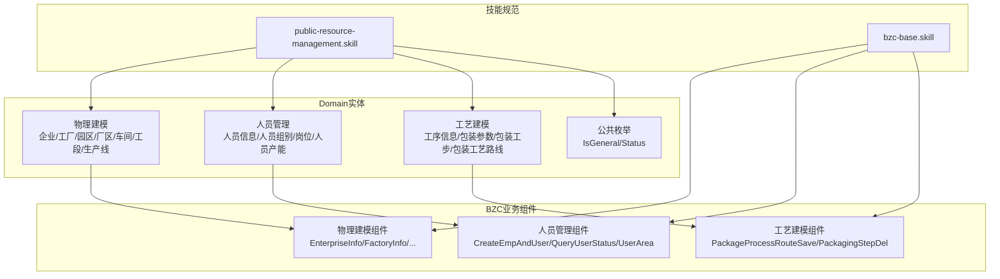
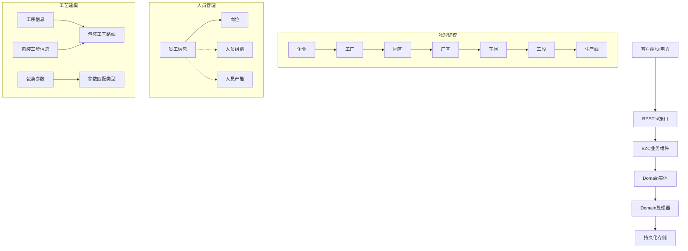
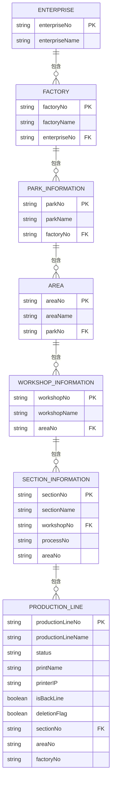
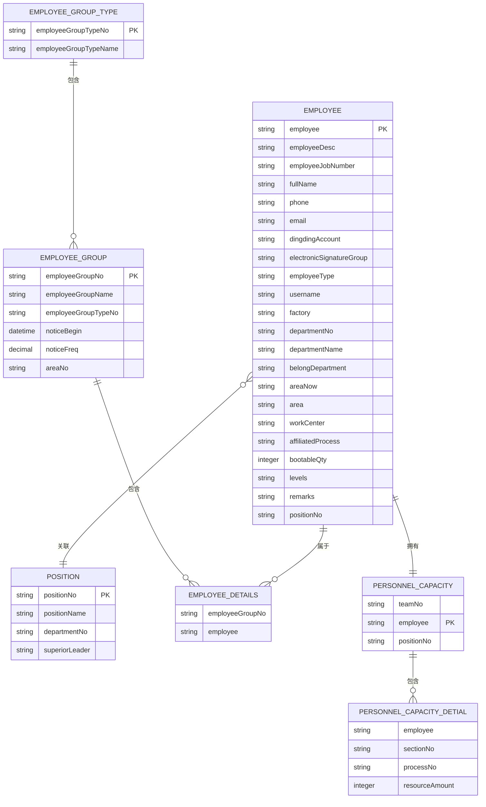
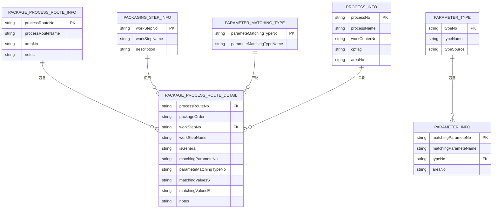
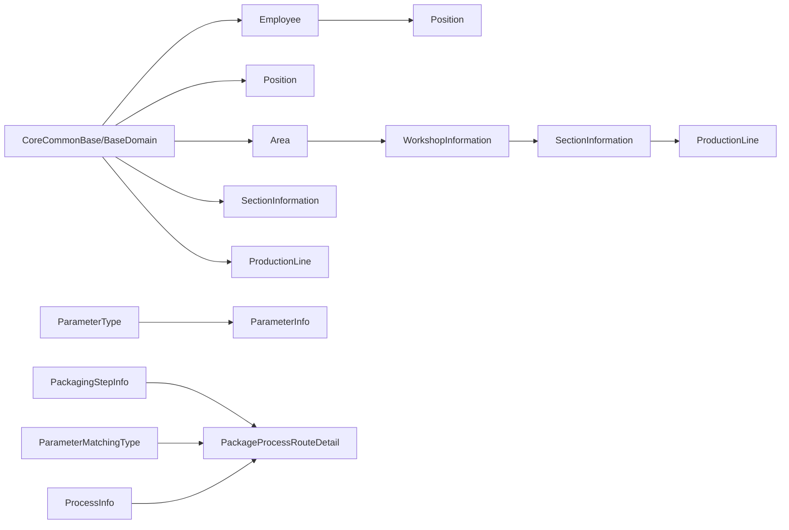

# 公共资源管理系统

<cite>
**本文档引用的文件**
- [Domain/公共资源管理/IsGeneral.json](file://Domain/公共资源管理/IsGeneral.json)
- [Domain/公共资源管理/Status.json](file://Domain/公共资源管理/Status.json)
- [Domain/公共资源管理/人员管理/人员信息/Employee.json](file://Domain/公共资源管理/人员管理/人员信息/Employee.json)
- [Domain/公共资源管理/人员管理/人员组别/EmployeeGroup.json](file://Domain/公共资源管理/人员管理/人员组别/EmployeeGroup.json)
- [Domain/公共资源管理/人员管理/岗位/Position.json](file://Domain/公共资源管理/人员管理/岗位/Position.json)
- [Domain/公共资源管理/工艺建模/工序信息/ProcessInfo.json](file://Domain/公共资源管理/工艺建模/工序信息/ProcessInfo.json)
- [Domain/公共资源管理/工艺建模/包装工艺路线/PackageProcessRouteInfo.json](file://Domain/公共资源管理/工艺建模/包装工艺路线/PackageProcessRouteInfo.json)
- [Domain/公共资源管理/物理建模/1_企业/Enterprise.json](file://Domain/公共资源管理/物理建模/1_企业/Enterprise.json)
- [Domain/公共资源管理/物理建模/2_工厂/Factory.json](file://Domain/公共资源管理/物理建模/2_工厂/Factory.json)
- [Domain/公共资源管理/物理建模/3_园区/ParkInformation.json](file://Domain/公共资源管理/物理建模/3_园区/ParkInformation.json)
- [Domain/公共资源管理/物理建模/4_厂区/Area.json](file://Domain/公共资源管理/物理建模/4_厂区/Area.json)
- [Domain/公共资源管理/物理建模/5_车间/WorkshopInformation.json](file://Domain/公共资源管理/物理建模/5_车间/WorkshopInformation.json)
- [Domain/公共资源管理/物理建模/6_工段/SectionInformation.json](file://Domain/公共资源管理/物理建模/6_工段/SectionInformation.json)
- [Domain/公共资源管理/物理建模/7_生产线/ProductionLine.json](file://Domain/公共资源管理/物理建模/7_生产线/ProductionLine.json)
- [skills/business/public-resource-management.skill](file://skills/business/public-resource-management.skill)
- [skills/architecture/bzc-base.skill](file://skills/architecture/bzc-base.skill)
</cite>

## 目录
1. [简介](#简介)
2. [项目结构](#项目结构)
3. [核心组件](#核心组件)
4. [架构总览](#架构总览)
5. [详细组件分析](#详细组件分析)
6. [依赖分析](#依赖分析)
7. [性能考虑](#性能考虑)
8. [故障排查指南](#故障排查指南)
9. [结论](#结论)
10. [附录](#附录)

## 简介
本项目是CMES公共资源管理系统，围绕“物理建模管理”、“人员管理”、“工艺建模”三大核心业务域构建，提供从企业到生产线的七级物理建模体系，支撑人员、岗位、产能、工序、包装工艺等业务的统一建模与管理。系统采用领域模型（Domain）与业务组件（BZC）分离的架构设计，确保数据模型稳定、业务逻辑可扩展。

## 项目结构
系统采用“技能规范 + 结构化数据模型 + 业务组件”的组织方式：
- 技能规范：定义了模块规范、命名约定、代码模板、RQL批量查询等开发标准
- Domain层：以JSON形式定义各业务实体及其属性、索引、处理器代码
- BZC层：以Groovy实现业务组件，封装CRUD、校验、级联操作等

图表来源
- [skills/business/public-resource-management.skill:1-514](file://skills/business/public-resource-management.skill#L1-L514)
- [skills/architecture/bzc-base.skill:1-162](file://skills/architecture/bzc-base.skill#L1-L162)

章节来源
- [skills/business/public-resource-management.skill:1-60](file://skills/business/public-resource-management.skill#L1-L60)

## 核心组件
- 物理建模：覆盖企业-工厂-园区-厂区-车间-工段-生产线的七级层级，支持层级间引用与删除校验
- 人员管理：员工信息、岗位、人员组别、人员产能，支持用户同步、默认厂区、权限隔离
- 工艺建模：工序信息、包装参数、包装工步、包装工艺路线，支持参数匹配、明细级联保存
- 公共枚举：IsGeneral（是否通用）、Status（状态），供明细表引用

章节来源
- [Domain/公共资源管理/物理建模/7_生产线/ProductionLine.json:1-431](file://Domain/公共资源管理/物理建模/7_生产线/ProductionLine.json#L1-L431)
- [Domain/公共资源管理/人员管理/人员信息/Employee.json:1-743](file://Domain/公共资源管理/人员管理/人员信息/Employee.json#L1-L743)
- [Domain/公共资源管理/工艺建模/工序信息/ProcessInfo.json:1-301](file://Domain/公共资源管理/工艺建模/工序信息/ProcessInfo.json#L1-L301)
- [Domain/公共资源管理/IsGeneral.json:1-223](file://Domain/公共资源管理/IsGeneral.json#L1-L223)
- [Domain/公共资源管理/Status.json:1-119](file://Domain/公共资源管理/Status.json#L1-L119)

## 架构总览
系统采用“领域模型 + 业务组件 + 技能规范”的分层架构：
- 领域模型（Domain）：以JSON定义实体结构、属性、处理器，继承通用基类，自动具备创建/修改时间与用户字段
- 业务组件（BZC）：以Groovy实现，遵循统一模板，提供RESTful接口与删除校验
- 技能规范：统一命名、包名、导入顺序、RQL批量查询等开发标准

图表来源
- [skills/business/public-resource-management.skill:122-226](file://skills/business/public-resource-management.skill#L122-L226)
- [skills/architecture/bzc-base.skill:1-27](file://skills/architecture/bzc-base.skill#L1-L27)

## 详细组件分析

### 物理建模管理（七级层级）
- 层级关系：企业 → 工厂 → 园区 → 厂区 → 车间 → 工段 → 生产线
- 关键特性：
  - 每级实体均包含编码（No）与名称（Name）字段
  - 删除时进行下级引用校验，避免破坏层级完整性
  - 厂区包含部门与工作中心关联表，删除时需考虑关联清理策略

图表来源
- [Domain/公共资源管理/物理建模/1_企业/Enterprise.json:1-223](file://Domain/公共资源管理/物理建模/1_企业/Enterprise.json#L1-L223)
- [Domain/公共资源管理/物理建模/2_工厂/Factory.json:1-249](file://Domain/公共资源管理/物理建模/2_工厂/Factory.json#L1-L249)
- [Domain/公共资源管理/物理建模/3_园区/ParkInformation.json:1-249](file://Domain/公共资源管理/物理建模/3_园区/ParkInformation.json#L1-L249)
- [Domain/公共资源管理/物理建模/4_厂区/Area.json:1-249](file://Domain/公共资源管理/物理建模/4_厂区/Area.json#L1-L249)
- [Domain/公共资源管理/物理建模/5_车间/WorkshopInformation.json:1-249](file://Domain/公共资源管理/物理建模/5_车间/WorkshopInformation.json#L1-L249)
- [Domain/公共资源管理/物理建模/6_工段/SectionInformation.json:1-301](file://Domain/公共资源管理/物理建模/6_工段/SectionInformation.json#L1-L301)
- [Domain/公共资源管理/物理建模/7_生产线/ProductionLine.json:1-431](file://Domain/公共资源管理/物理建模/7_生产线/ProductionLine.json#L1-L431)

章节来源
- [skills/business/public-resource-management.skill:122-226](file://skills/business/public-resource-management.skill#L122-L226)

### 人员管理
- 员工信息（Employee）：包含员工基本信息、用户同步、默认厂区、岗位编码等字段；Domain处理器在创建前自动填充钉钉账号默认值
- 人员组别（EmployeeGroup）：支持人员组类型、人员组与人员组明细的三级关系，删除时需同步清理明细
- 岗位（Position）：包含部门编码、上级领导等字段，删除时需检查是否存在引用
- 人员产能（PersonnelCapacity/PersonnelCapacityDetial）：主从表结构，删除主表需同步删除明细

图表来源
- [Domain/公共资源管理/人员管理/人员信息/Employee.json:1-743](file://Domain/公共资源管理/人员管理/人员信息/Employee.json#L1-L743)
- [Domain/公共资源管理/人员管理/岗位/Position.json:1-275](file://Domain/公共资源管理/人员管理/岗位/Position.json#L1-L275)
- [Domain/公共资源管理/人员管理/人员组别/EmployeeGroup.json:1-327](file://Domain/公共资源管理/人员管理/人员组别/EmployeeGroup.json#L1-L327)
- [Domain/公共资源管理/人员管理/人员产能/PersonnelCapacity.json:1-200](file://Domain/公共资源管理/人员管理/人员产能/PersonnelCapacity.json#L1-L200)
- [Domain/公共资源管理/人员管理/人员产能/PersonnelCapacityDetial.json:1-200](file://Domain/公共资源管理/人员管理/人员产能/PersonnelCapacityDetial.json#L1-L200)

章节来源
- [skills/business/public-resource-management.skill:229-356](file://skills/business/public-resource-management.skill#L229-L356)

### 工艺建模
- 工序信息（ProcessInfo）：包含工序编码、名称、工作中心、成品标识、厂区编码等字段
- 包装参数（ParameterInfo/ParameterType）：参数类型与参数明细，删除类型需检查明细引用
- 包装工步信息（PackagingStepInfo）：工步编码、名称、描述
- 包装工艺路线（PackageProcessRouteInfo/PackageProcessRouteDetail/ParameterMatchingType）：路线主表与明细表，明细包含参数匹配类型、匹配值区间、是否通用等字段；保存时由BZC组件处理级联

图表来源
- [Domain/公共资源管理/工艺建模/工序信息/ProcessInfo.json:1-301](file://Domain/公共资源管理/工艺建模/工序信息/ProcessInfo.json#L1-L301)
- [Domain/公共资源管理/工艺建模/包装工艺路线/PackageProcessRouteInfo.json:1-275](file://Domain/公共资源管理/工艺建模/包装工艺路线/PackageProcessRouteInfo.json#L1-L275)
- [Domain/公共资源管理/工艺建模/包装参数/ParameterInfo.json:1-200](file://Domain/公共资源管理/工艺建模/包装参数/ParameterInfo.json#L1-L200)
- [Domain/公共资源管理/工艺建模/包装参数/ParameterType.json:1-200](file://Domain/公共资源管理/工艺建模/包装参数/ParameterType.json#L1-L200)
- [Domain/公共资源管理/工艺建模/包装工步信息/PackagingStepInfo.json:1-200](file://Domain/公共资源管理/工艺建模/包装工步信息/PackagingStepInfo.json#L1-L200)
- [Domain/公共资源管理/工艺建模/包装工艺路线/PackageProcessRouteDetail.json:1-200](file://Domain/公共资源管理/工艺建模/包装工艺路线/PackageProcessRouteDetail.json#L1-L200)
- [Domain/公共资源管理/工艺建模/包装工艺路线/ParameterMatchingType.json:1-200](file://Domain/公共资源管理/工艺建模/包装工艺路线/ParameterMatchingType.json#L1-L200)

章节来源
- [skills/business/public-resource-management.skill:358-457](file://skills/business/public-resource-management.skill#L358-L457)

### 公共枚举与状态
- IsGeneral：通用布尔枚举，用于明细表的“是否通用”字段
- Status：状态枚举，包含状态编码与名称

章节来源
- [Domain/公共资源管理/IsGeneral.json:1-223](file://Domain/公共资源管理/IsGeneral.json#L1-L223)
- [Domain/公共资源管理/Status.json:1-119](file://Domain/公共资源管理/Status.json#L1-L119)

## 依赖分析
- Domain实体依赖通用基类（CoreCommonBase/BaseDomain），自动具备创建/修改时间与用户字段
- 物理建模模块具有强层级依赖，删除时需检查下级引用
- 人员与工艺模块多为独立实体，但存在跨实体引用（如岗位、参数匹配类型、工步等）
- BZC组件遵循统一模板，使用RQL批量查询优化性能，避免N+1问题

图表来源
- [skills/business/public-resource-management.skill:100-102](file://skills/business/public-resource-management.skill#L100-L102)
- [Domain/公共资源管理/人员管理/岗位/Position.json:1-275](file://Domain/公共资源管理/人员管理/岗位/Position.json#L1-L275)
- [Domain/公共资源管理/物理建模/4_厂区/Area.json:1-249](file://Domain/公共资源管理/物理建模/4_厂区/Area.json#L1-L249)
- [Domain/公共资源管理/物理建模/6_工段/SectionInformation.json:1-301](file://Domain/公共资源管理/物理建模/6_工段/SectionInformation.json#L1-L301)
- [Domain/公共资源管理/物理建模/7_生产线/ProductionLine.json:1-431](file://Domain/公共资源管理/物理建模/7_生产线/ProductionLine.json#L1-L431)
- [Domain/公共资源管理/工艺建模/包装参数/ParameterType.json:1-200](file://Domain/公共资源管理/工艺建模/包装参数/ParameterType.json#L1-L200)
- [Domain/公共资源管理/工艺建模/包装参数/ParameterInfo.json:1-200](file://Domain/公共资源管理/工艺建模/包装参数/ParameterInfo.json#L1-L200)
- [Domain/公共资源管理/工艺建模/包装工步信息/PackagingStepInfo.json:1-200](file://Domain/公共资源管理/工艺建模/包装工步信息/PackagingStepInfo.json#L1-L200)
- [Domain/公共资源管理/工艺建模/包装工艺路线/PackageProcessRouteDetail.json:1-200](file://Domain/公共资源管理/工艺建模/包装工艺路线/PackageProcessRouteDetail.json#L1-L200)
- [Domain/公共资源管理/工艺建模/包装工艺路线/ParameterMatchingType.json:1-200](file://Domain/公共资源管理/工艺建模/包装工艺路线/ParameterMatchingType.json#L1-L200)
- [Domain/公共资源管理/工艺建模/工序信息/ProcessInfo.json:1-301](file://Domain/公共资源管理/工艺建模/工序信息/ProcessInfo.json#L1-L301)

章节来源
- [skills/business/public-resource-management.skill:481-496](file://skills/business/public-resource-management.skill#L481-L496)

## 性能考虑
- 使用RQL批量查询替代循环单条查询，避免N+1问题
- 删除前进行下级引用检查，减少无效删除尝试
- Domain处理器中对默认值与唯一性进行预处理，降低数据库约束错误率

章节来源
- [skills/business/public-resource-management.skill:481-496](file://skills/business/public-resource-management.skill#L481-L496)

## 故障排查指南
- 删除异常：若提示“已在某下级信息使用”，需先清理下级引用再删除
- 唯一性冲突：员工ID、岗位编码、参数编码等字段唯一，需确保唯一性校验通过
- 用户同步问题：创建员工时会同步创建系统用户，默认钉钉账号为空时自动填充
- 参数匹配：包装工艺路线明细的匹配值区间与参数匹配类型需正确配置

章节来源
- [skills/architecture/bzc-base.skill:74-90](file://skills/architecture/bzc-base.skill#L74-L90)
- [skills/business/public-resource-management.skill:274-278](file://skills/business/public-resource-management.skill#L274-L278)
- [Domain/公共资源管理/人员管理/人员信息/Employee.json:737-743](file://Domain/公共资源管理/人员管理/人员信息/Employee.json#L737-L743)

## 结论
本系统通过七级物理建模、完善的人员与工艺建模能力，以及严格的删除校验与RQL批量查询优化，形成了稳定、可扩展的公共资源管理体系。技能规范确保了开发一致性与可维护性，适合在复杂制造环境中落地实施。

## 附录
- 开发模板与注释要求：参见BZC基础规范
- RQL批量查询最佳实践：参见技能规范中的RQL章节

章节来源
- [skills/architecture/bzc-base.skill:1-162](file://skills/architecture/bzc-base.skill#L1-L162)
- [skills/business/public-resource-management.skill:460-496](file://skills/business/public-resource-management.skill#L460-L496)