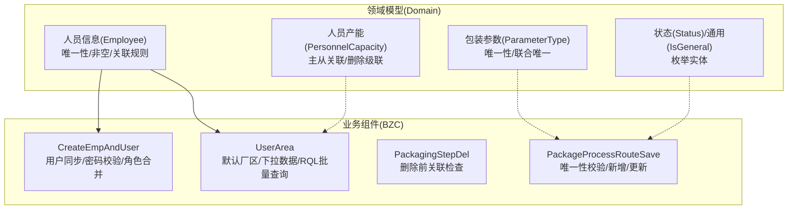
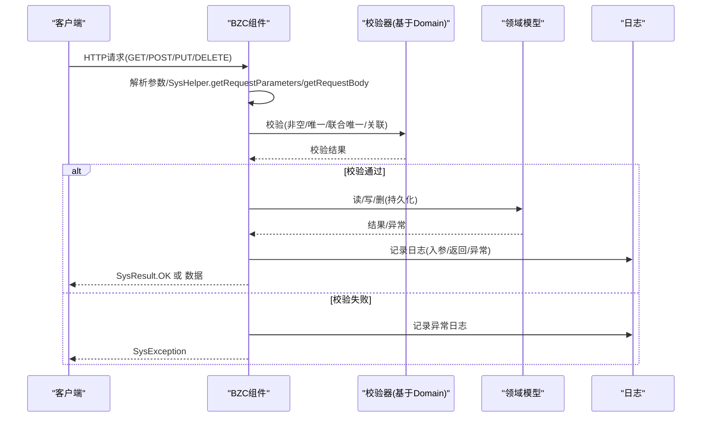
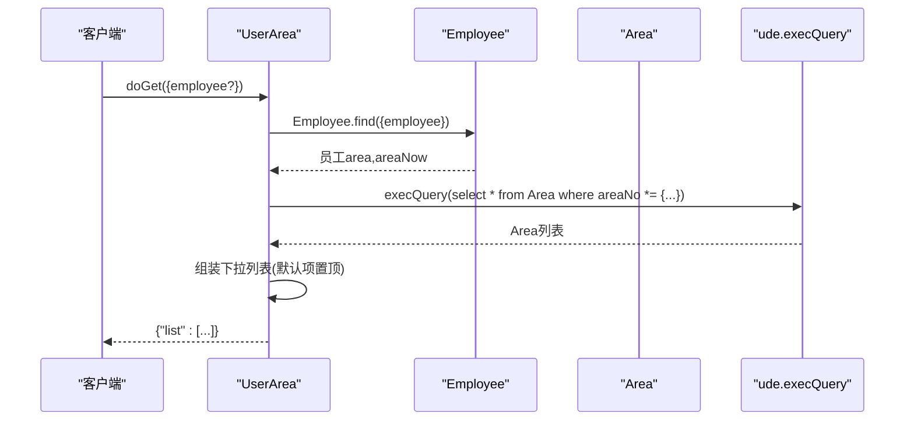
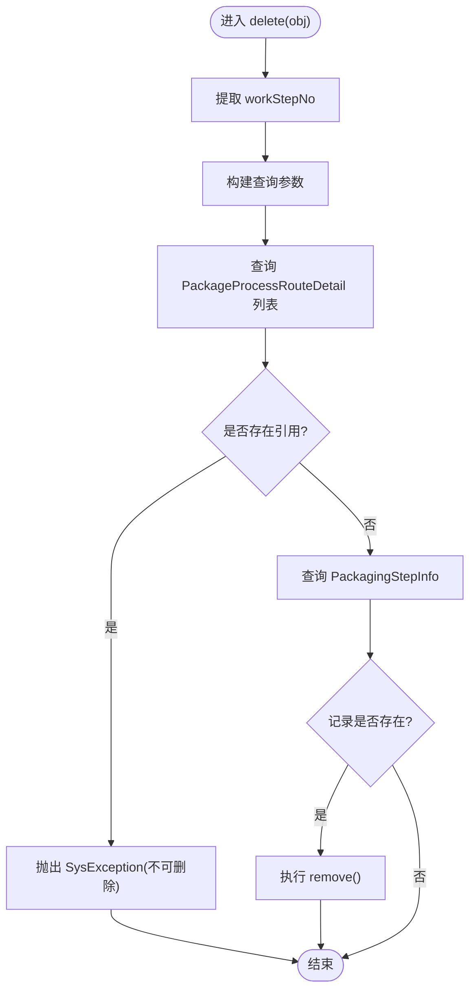
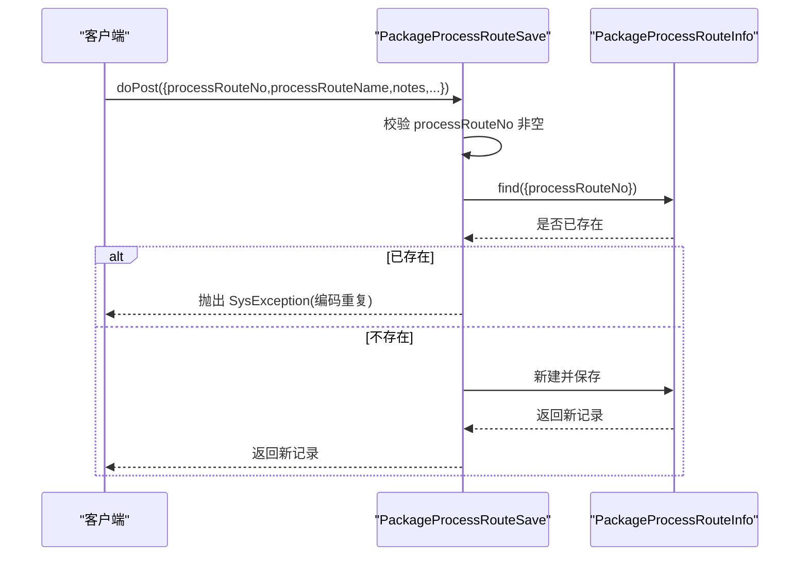
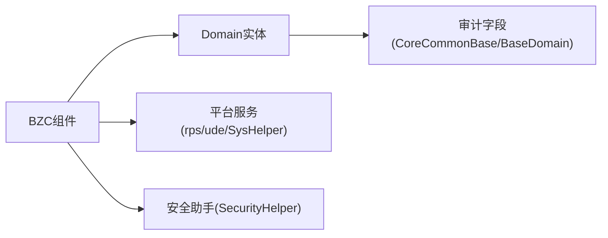

# 开发最佳实践

<cite>
**本文档引用的文件**
- [PersonnelCapacity.json](file://Domain/公共资源管理/人员管理/人员产能/PersonnelCapacity.json)
- [Employee.json](file://Domain/公共资源管理/人员管理/人员信息/Employee.json)
- [CreateEmpAndUser.groovy](file://bzc/公共资源管理/人员管理/人员信息/CreateEmpAndUser.groovy)
- [UserArea.groovy](file://bzc/公共资源管理/人员管理/人员信息/UserArea.groovy)
- [PackagingStepDel.groovy](file://bzc/公共资源管理/工艺建模/包装工步信息/PackagingStepDel.groovy)
- [PackageProcessRouteSave.groovy](file://bzc/公共资源管理/工艺建模/包装工艺路线/PackageProcessRouteSave.groovy)
- [bzc-base.skill](file://skills/architecture/bzc-base.skill)
- [public-resource-management.skill](file://skills/business/public-resource-management.skill)
- [business-rule-check.skill](file://skills/foundation/business-rule-check.skill)
- [logging-standard.skill](file://skills/foundation/logging-standard.skill)
- [dev-questions.skill](file://skills/foundation/dev-questions.skill)
- [IsGeneral.json](file://Domain/公共资源管理/IsGeneral.json)
- [Status.json](file://Domain/公共资源管理/Status.json)
- [ParameterType.json](file://Domain/公共资源管理/工艺建模/包装参数/ParameterType.json)
</cite>

## 目录
1. [引言](#引言)
2. [项目结构](#项目结构)
3. [核心组件](#核心组件)
4. [架构总览](#架构总览)
5. [详细组件分析](#详细组件分析)
6. [依赖分析](#依赖分析)
7. [性能考虑](#性能考虑)
8. [故障排除指南](#故障排除指南)
9. [结论](#结论)
10. [附录](#附录)

## 引言
本文件面向CMES项目BZC业务组件的开发与演进，系统总结开发规范、领域模型设计原则、业务规则实现方法与质量保障策略。重点覆盖公共资源管理模块（人员管理、物理建模、工艺建模）的典型实践，提供可复用的开发模式、重构技巧与调试方法，并给出团队协作流程、代码评审标准与持续集成建议，帮助不同经验层次的开发者提升效率与质量。

## 项目结构
CMES采用“领域模型（Domain）+ 业务组件（BZC）”双层结构：
- Domain层：以JSON定义实体与字段元数据，统一继承基类，内置审计字段与处理器骨架。
- BZC层：以Groovy实现业务组件，遵循统一包名、类名、REST方法与校验模板，支撑增删改查与复杂业务编排。



图表来源
- [Employee.json:1-743](file://Domain/公共资源管理/人员管理/人员信息/Employee.json#L1-L743)
- [PersonnelCapacity.json:1-249](file://Domain/公共资源管理/人员管理/人员产能/PersonnelCapacity.json#L1-L249)
- [ParameterType.json:1-249](file://Domain/公共资源管理/工艺建模/包装参数/ParameterType.json#L1-L249)
- [CreateEmpAndUser.groovy:1-590](file://bzc/公共资源管理/人员管理/人员信息/CreateEmpAndUser.groovy#L1-L590)
- [UserArea.groovy:1-235](file://bzc/公共资源管理/人员管理/人员信息/UserArea.groovy#L1-L235)
- [PackagingStepDel.groovy:1-79](file://bzc/公共资源管理/工艺建模/包装工步信息/PackagingStepDel.groovy#L1-L79)
- [PackageProcessRouteSave.groovy:1-82](file://bzc/公共资源管理/工艺建模/包装工艺路线/PackageProcessRouteSave.groovy#L1-L82)

章节来源
- [public-resource-management.skill:1-514](file://skills/business/public-resource-management.skill#L1-L514)

## 核心组件
- BZC基础规范：类继承BaseBZC、包命名、类名格式、导入顺序、main方法、REST方法模板、delete模板、注释规范与编码习惯。
- 业务规则检查：生成前必须执行的业务规则清单，包括非空、唯一、关联关系与联合唯一校验。
- 日志规范：统一日志记录方法、格式与禁止写法，强调异常捕获与外部接口调用的日志记录。
- 开发记录：生成流程中的时间点与疑问确认记录模板。

章节来源
- [bzc-base.skill:1-162](file://skills/architecture/bzc-base.skill#L1-L162)
- [business-rule-check.skill:1-144](file://skills/foundation/business-rule-check.skill#L1-L144)
- [logging-standard.skill:1-115](file://skills/foundation/logging-standard.skill#L1-L115)
- [dev-questions.skill:1-76](file://skills/foundation/dev-questions.skill#L1-L76)

## 架构总览
BZC组件通过统一的基类与模板，将业务逻辑与平台能力解耦：
- 统一入口：doGet/doPost/doPut/doDelete接收HTTP请求，映射到业务方法。
- 统一校验：基于Domain元数据生成非空、唯一、联合唯一与关联关系校验。
- 统一日志：在关键节点记录入参、返回值、异常与外部接口调用。
- 统一返回：成功返回SysResult.OK，异常抛出SysException。



图表来源
- [bzc-base.skill:92-122](file://skills/architecture/bzc-base.skill#L92-L122)
- [business-rule-check.skill:20-56](file://skills/foundation/business-rule-check.skill#L20-L56)
- [logging-standard.skill:25-61](file://skills/foundation/logging-standard.skill#L25-L61)

## 详细组件分析

### 人员管理：员工与用户同步（CreateEmpAndUser）
职责：在创建/修改/删除员工时，同步创建/更新/删除系统用户，校验密码强度与唯一性，合并默认角色与传入角色，支持密码有效期配置。

```mermaid
sequenceDiagram
participant U as "调用方"
participant B as "CreateEmpAndUser"
participant E as "Employee实体"
participant R as "资源库(rps)"
participant S as "安全助手(SecurityHelper)"
U->>B : createEmpAndUser({employee,password,repassword,roles,...})
B->>B : checkOrCreateClass()
B->>S : normalizeUsername(employee)
B->>E : Employee.find({employee})
E-->>B : 员工对象
alt 用户不存在
B->>B : checkPassword(password)
B->>R : createResource(User,...)
else 用户已存在
B->>R : updateResource(User,...)
end
B->>E : e.username=username; e.save()
B-->>U : 返回username与_method
```

图表来源
- [CreateEmpAndUser.groovy:91-232](file://bzc/公共资源管理/人员管理/人员信息/CreateEmpAndUser.groovy#L91-L232)

章节来源
- [CreateEmpAndUser.groovy:1-590](file://bzc/公共资源管理/人员管理/人员信息/CreateEmpAndUser.groovy#L1-L590)
- [Employee.json:1-743](file://Domain/公共资源管理/人员管理/人员信息/Employee.json#L1-L743)

### 人员管理：默认厂区维护（UserArea）
职责：提供用户默认厂区的保存与下拉数据获取，使用RQL批量查询避免N+1问题，支持空值处理与默认项优先展示。



图表来源
- [UserArea.groovy:113-183](file://bzc/公共资源管理/人员管理/人员信息/UserArea.groovy#L113-L183)

章节来源
- [UserArea.groovy:1-235](file://bzc/公共资源管理/人员管理/人员信息/UserArea.groovy#L1-L235)

### 工艺建模：包装工步删除（PackagingStepDel）
职责：删除前检查是否存在被包装工艺路线明细引用，存在则抛出异常阻止删除，否则执行物理删除。



图表来源
- [PackagingStepDel.groovy:66-78](file://bzc/公共资源管理/工艺建模/包装工步信息/PackagingStepDel.groovy#L66-L78)

章节来源
- [PackagingStepDel.groovy:1-79](file://bzc/公共资源管理/工艺建模/包装工步信息/PackagingStepDel.groovy#L1-L79)

### 工艺建模：包装工艺路线保存（PackageProcessRouteSave）
职责：在新增时校验processRouteNo唯一性，然后保存；在更新时根据_id定位并更新；统一返回保存/更新后的记录。



图表来源
- [PackageProcessRouteSave.groovy:39-81](file://bzc/公共资源管理/工艺建模/包装工艺路线/PackageProcessRouteSave.groovy#L39-L81)

章节来源
- [PackageProcessRouteSave.groovy:1-82](file://bzc/公共资源管理/工艺建模/包装工艺路线/PackageProcessRouteSave.groovy#L1-L82)

### 领域模型设计与业务规则
- 统一基类：所有实体继承CoreCommonBase或BaseDomain，自动具备_id、createTime、createUser、modifyTime、modifyUser等字段。
- 唯一性与非空：基于Domain元数据生成唯一性与非空校验；联合唯一通过复合字段组合校验。
- 关联关系：删除前检查下级是否被引用，避免破坏数据完整性。
- 枚举实体：IsGeneral与Status作为通用枚举，被多个明细表引用（如PackageProcessRouteDetail的isGeneral字段）。

章节来源
- [public-resource-management.skill:100-121](file://skills/business/public-resource-management.skill#L100-L121)
- [business-rule-check.skill:20-56](file://skills/foundation/business-rule-check.skill#L20-L56)
- [IsGeneral.json:1-223](file://Domain/公共资源管理/IsGeneral.json#L1-L223)
- [Status.json:1-119](file://Domain/公共资源管理/Status.json#L1-L119)

## 依赖分析
- 组件耦合：BZC组件依赖Domain实体与平台服务（rps、ude、SysHelper、SecurityHelper等），通过统一接口访问资源与执行查询。
- 外部依赖：安全相关依赖（密码强度、用户名规范化）、资源存储（用户、子分类）、RQL查询引擎。
- 潜在风险：循环依赖主要来自业务逻辑链路，应通过模板化的delete与校验流程降低耦合度。



图表来源
- [CreateEmpAndUser.groovy:1-50](file://bzc/公共资源管理/人员管理/人员信息/CreateEmpAndUser.groovy#L1-L50)
- [UserArea.groovy:1-20](file://bzc/公共资源管理/人员管理/人员信息/UserArea.groovy#L1-L20)
- [PackagingStepDel.groovy:1-10](file://bzc/公共资源管理/工艺建模/包装工步信息/PackagingStepDel.groovy#L1-L10)
- [PackageProcessRouteSave.groovy:1-10](file://bzc/公共资源管理/工艺建模/包装工艺路线/PackageProcessRouteSave.groovy#L1-L10)

## 性能考虑
- RQL批量查询：使用“*= 左连接”替代循环单条查询，避免N+1问题，显著提升批量读取性能。
- 批量查询对比：传统循环查询为N+1次，RQL批量查询为1次，性能差距明显。
- 日志节流：避免在大循环中逐条记录日志，防止日志风暴影响性能。

章节来源
- [public-resource-management.skill:481-496](file://skills/business/public-resource-management.skill#L481-L496)
- [logging-standard.skill:87-103](file://skills/foundation/logging-standard.skill#L87-L103)

## 故障排除指南
- 异常处理：统一使用SysException抛出业务异常，异常消息包含操作+主体+原因，便于定位问题。
- 日志记录：异常捕获处必须记录日志，外部接口调用需记录请求与响应，关键数据变更需记录变更前后信息。
- 常见问题：
  - 删除失败提示“已被下级使用”：检查关联关系校验逻辑，确认是否仍有明细引用。
  - 唯一性冲突：核对Domain唯一性元数据与生成的校验代码，确保编码唯一。
  - 用户同步失败：检查密码强度配置、用户名规范化与角色合并逻辑。

章节来源
- [business-rule-check.skill:117-127](file://skills/foundation/business-rule-check.skill#L117-L127)
- [logging-standard.skill:14-24](file://skills/foundation/logging-standard.skill#L14-L24)

## 结论
通过统一的BZC开发规范、严格的业务规则检查与日志标准，结合RQL批量查询与模板化删除流程，CMES项目在公共资源管理模块实现了高内聚、低耦合、易维护与高性能的业务组件体系。建议在团队协作中严格执行代码评审与持续集成流程，确保质量与一致性。

## 附录

### 开发模式与最佳实践
- 模板化开发：基于bzc-base.skill的类结构与方法模板快速生成组件，减少重复劳动。
- 业务规则前置：生成前执行business-rule-check.skill，确保Domain元数据驱动的校验代码完整准确。
- 日志规范：遵循logging-standard.skill，统一异常与外部接口日志记录，提升可观测性。
- 生成流程记录：dev-questions.skill用于记录时间点与疑问确认，形成可追溯的开发档案。

章节来源
- [bzc-base.skill:1-162](file://skills/architecture/bzc-base.skill#L1-L162)
- [business-rule-check.skill:1-144](file://skills/foundation/business-rule-check.skill#L1-L144)
- [logging-standard.skill:1-115](file://skills/foundation/logging-standard.skill#L1-L115)
- [dev-questions.skill:1-76](file://skills/foundation/dev-questions.skill#L1-L76)