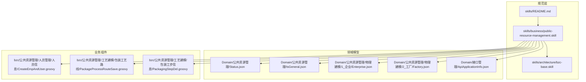
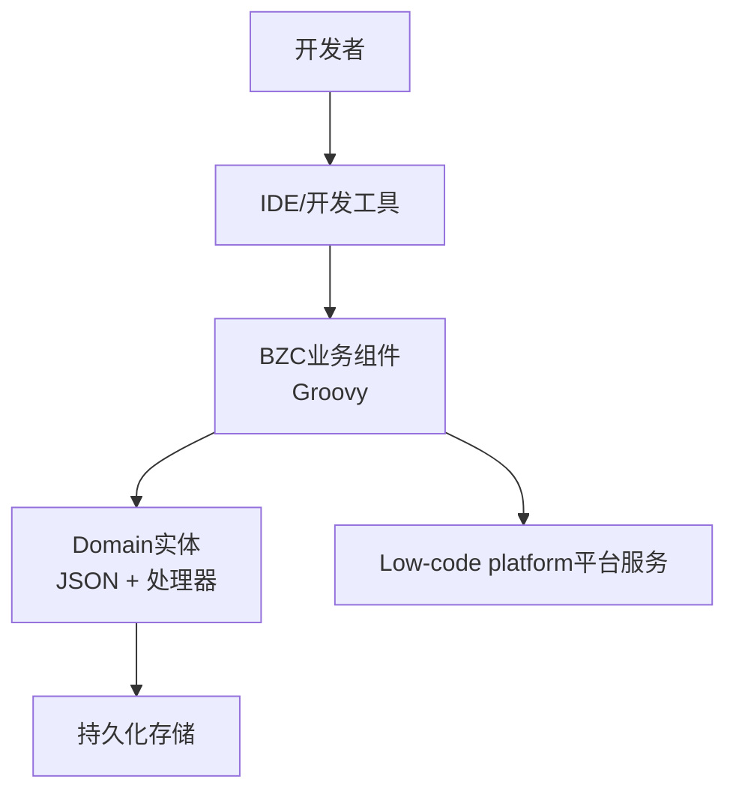
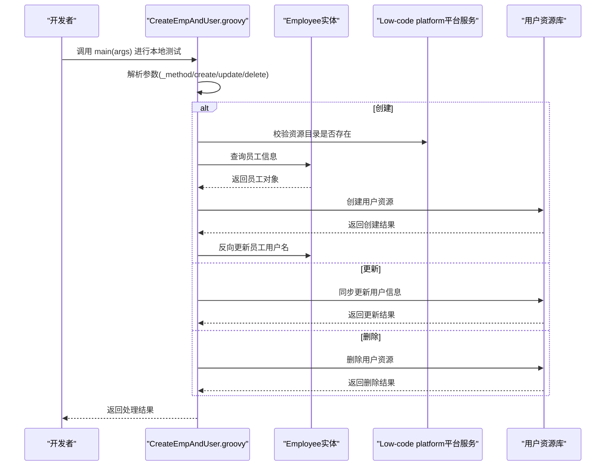
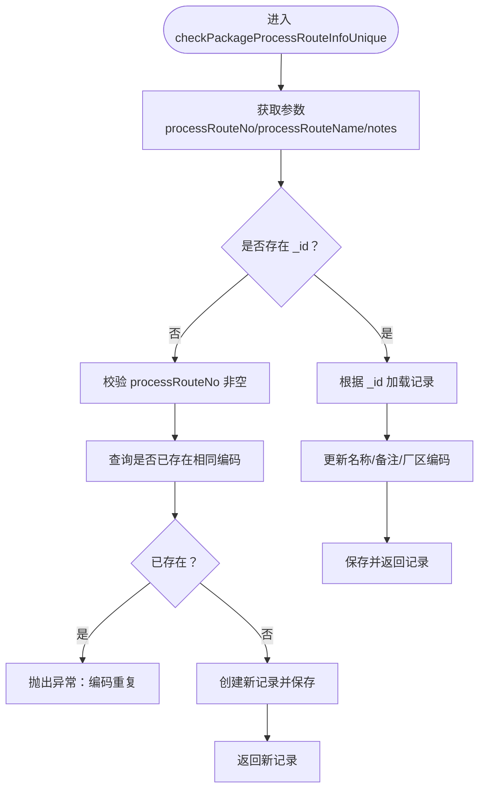
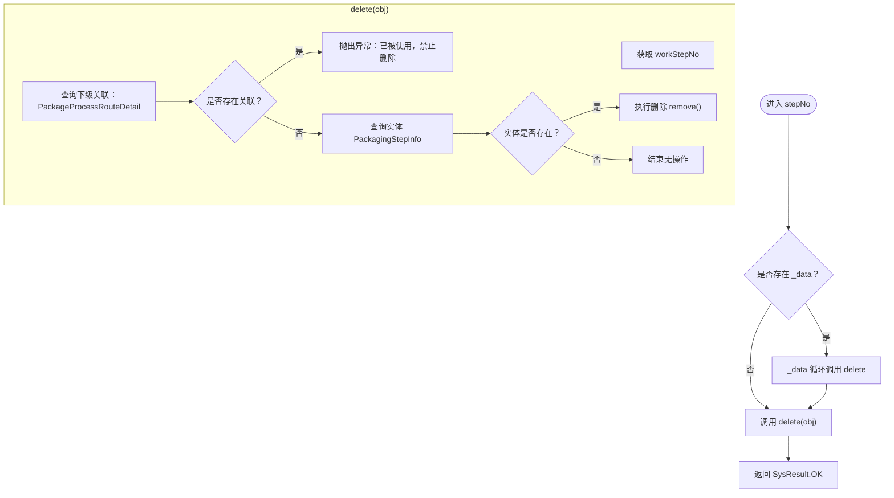
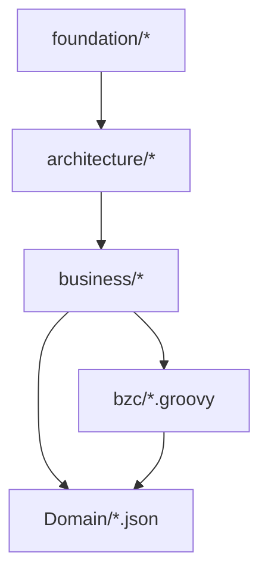

# 快速开始

<cite>
**本文引用的文件**
- [技能规范总览](file://skills/README.md)
- [BZC业务组件基础规范](file://skills/architecture/bzc-base.skill)
- [公共资源管理模块规范](file://skills/business/public-resource-management.skill)
- [状态枚举实体定义](file://Domain/公共资源管理/Status.json)
- [是否通用枚举实体定义](file://Domain/公共资源管理/IsGeneral.json)
- [企业实体定义](file://Domain/公共资源管理/物理建模/1_企业/Enterprise.json)
- [工厂实体定义](file://Domain/公共资源管理/物理建模/2_工厂/Factory.json)
- [员工与用户同步组件](file://bzc/公共资源管理/人员管理/人员信息/CreateEmpAndUser.groovy)
- [包装工艺路线保存组件](file://bzc/公共资源管理/工艺建模/包装工艺路线/PackageProcessRouteSave.groovy)
- [包装工步删除组件](file://bzc/公共资源管理/工艺建模/包装工步信息/PackagingStepDel.groovy)
- [接口应用信息实体定义](file://Domain/接口管理/ApiApplicationInfo.json)
</cite>

## 目录
1. [简介](#简介)
2. [项目结构](#项目结构)
3. [核心组件](#核心组件)
4. [架构总览](#架构总览)
5. [详细组件分析](#详细组件分析)
6. [依赖分析](#依赖分析)
7. [性能考虑](#性能考虑)
8. [故障排除指南](#故障排除指南)
9. [结论](#结论)
10. [附录](#附录)

## 简介
本指南面向首次参与CMES项目的开发者，目标是在最短时间内完成Low-code platform平台环境准备、开发工具配置与项目依赖设置，并通过第一个BZC业务组件的完整示例（从创建到部署）掌握开发流程。文档同时提供常见配置与调试技巧，以及常见问题的解决方案，帮助新开发者快速上手。

## 项目结构
CMES项目采用“技能规范 + Domain实体 + BZC业务组件”的分层组织方式：
- skills：规范与最佳实践，分为基础规范层、架构规范层、业务规范层
- Domain：以JSON形式定义的领域模型（实体与属性）
- bzc：以Groovy编写的业务组件，封装RESTful接口与业务逻辑
- utils：工具类与辅助脚本（本指南暂不涉及）

**图表来源**
- [技能规范总览:1-63](file://skills/README.md#L1-L63)
- [BZC业务组件基础规范:1-162](file://skills/architecture/bzc-base.skill#L1-L162)
- [公共资源管理模块规范:1-514](file://skills/business/public-resource-management.skill#L1-L514)
- [状态枚举实体定义:1-119](file://Domain/公共资源管理/Status.json#L1-L119)
- [是否通用枚举实体定义:1-223](file://Domain/公共资源管理/IsGeneral.json#L1-L223)
- [企业实体定义:1-223](file://Domain/公共资源管理/物理建模/1_企业/Enterprise.json#L1-L223)
- [工厂实体定义:1-249](file://Domain/公共资源管理/物理建模/2_工厂/Factory.json#L1-L249)
- [接口应用信息实体定义:1-431](file://Domain/接口管理/ApiApplicationInfo.json#L1-L431)
- [员工与用户同步组件:1-590](file://bzc/公共资源管理/人员管理/人员信息/CreateEmpAndUser.groovy#L1-L590)
- [包装工艺路线保存组件:1-82](file://bzc/公共资源管理/工艺建模/包装工艺路线/PackageProcessRouteSave.groovy#L1-L82)
- [包装工步删除组件:1-79](file://bzc/公共资源管理/工艺建模/包装工步信息/PackagingStepDel.groovy#L1-L79)

**章节来源**
- [技能规范总览:1-63](file://skills/README.md#L1-L63)
- [公共资源管理模块规范:1-514](file://skills/business/public-resource-management.skill#L1-L514)

## 核心组件
- 技能规范：提供开发规范、导入顺序、类结构模板、RESTful方法模板、注释与编码习惯等，确保代码一致性与可维护性。
- Domain实体：以JSON定义实体属性、索引、处理器代码骨架，支撑BZC组件的数据访问与业务规则。
- BZC业务组件：基于BaseBZC基类，实现RESTful接口与业务方法，负责数据校验、关联检查、删除保护与结果返回。

**章节来源**
- [BZC业务组件基础规范:1-162](file://skills/architecture/bzc-base.skill#L1-L162)
- [公共资源管理模块规范:1-514](file://skills/business/public-resource-management.skill#L1-L514)

## 架构总览
CMES采用“规范驱动 + 领域模型 + 业务组件”的三层架构：
- 规范层：统一代码风格、导入顺序、类结构与方法模板
- 领域模型层：以JSON定义实体与属性，提供处理器骨架
- 业务组件层：以Groovy实现RESTful接口与业务逻辑，调用Domain实体与平台服务

[本图为概念性架构示意，无需代码映射来源]

## 详细组件分析

### 第一个BZC业务组件：员工与用户同步
本节以“员工与用户同步”组件为例，演示从创建到部署的完整流程。

**图表来源**
- [员工与用户同步组件:1-590](file://bzc/公共资源管理/人员管理/人员信息/CreateEmpAndUser.groovy#L1-L590)

**章节来源**
- [员工与用户同步组件:1-590](file://bzc/公共资源管理/人员管理/人员信息/CreateEmpAndUser.groovy#L1-L590)

### 第二个BZC业务组件：包装工艺路线保存
演示唯一性校验与保存/更新流程。

**图表来源**
- [包装工艺路线保存组件:1-82](file://bzc/公共资源管理/工艺建模/包装工艺路线/PackageProcessRouteSave.groovy#L1-L82)

**章节来源**
- [包装工艺路线保存组件:1-82](file://bzc/公共资源管理/工艺建模/包装工艺路线/PackageProcessRouteSave.groovy#L1-L82)

### 第三个BZC业务组件：包装工步删除
演示单点/批量删除与下级关联检查。

**图表来源**
- [包装工步删除组件:1-79](file://bzc/公共资源管理/工艺建模/包装工步信息/PackagingStepDel.groovy#L1-L79)

**章节来源**
- [包装工步删除组件:1-79](file://bzc/公共资源管理/工艺建模/包装工步信息/PackagingStepDel.groovy#L1-L79)

## 依赖分析
- 规范依赖：业务开发需遵循“基础规范 → 架构规范 → 业务规范”的层级叠加原则，避免重复内容，采用引用机制提升复用性。
- 技术依赖：BZC组件继承BaseBZC，导入顺序严格遵循javax.servlet.http → com.lowcode-platform.common → com.lowcode-platform.system.base → com.lowcode-platform.system.services → com.lowcode-platform.system.ude → app.base.domain的顺序。
- 数据依赖：Domain实体定义了属性、唯一性、索引与处理器骨架；BZC组件通过实体类进行数据访问与业务校验。

**图表来源**
- [技能规范总览:1-63](file://skills/README.md#L1-L63)
- [BZC业务组件基础规范:1-162](file://skills/architecture/bzc-base.skill#L1-L162)
- [公共资源管理模块规范:1-514](file://skills/business/public-resource-management.skill#L1-L514)

**章节来源**
- [技能规范总览:1-63](file://skills/README.md#L1-L63)
- [BZC业务组件基础规范:1-162](file://skills/architecture/bzc-base.skill#L1-L162)
- [公共资源管理模块规范:1-514](file://skills/business/public-resource-management.skill#L1-L514)

## 性能考虑
- RQL批量查询：使用“*= 左连接”替代循环单条查询，避免N+1问题，提升批量场景性能。
- 批量删除：通过一次性查询下级关联列表，减少数据库往返次数。
- 密码强度校验：在创建/更新用户时进行密码强度检查，避免后续认证失败导致的额外开销。

[本节为通用指导，无需具体文件来源]

## 故障排除指南
- 导入顺序错误：检查import顺序是否符合规范，否则可能导致编译或运行时异常。
- 类结构不符合模板：确认类继承BaseBZC、方法命名与RESTful方法模板一致。
- 删除失败异常：当实体存在下级引用时会抛出异常，需先清理关联再删除。
- 唯一性冲突：保存时若违反唯一性约束会抛出异常，需调整编码或名称。
- 用户同步异常：创建/更新用户时需提供有效密码、确认密码一致且满足强度要求。

**章节来源**
- [BZC业务组件基础规范:1-162](file://skills/architecture/bzc-base.skill#L1-L162)
- [员工与用户同步组件:1-590](file://bzc/公共资源管理/人员管理/人员信息/CreateEmpAndUser.groovy#L1-L590)
- [包装工艺路线保存组件:1-82](file://bzc/公共资源管理/工艺建模/包装工艺路线/PackageProcessRouteSave.groovy#L1-L82)
- [包装工步删除组件:1-79](file://bzc/公共资源管理/工艺建模/包装工步信息/PackagingStepDel.groovy#L1-L79)

## 结论
通过本快速开始指南，您已了解CMES项目的整体结构、开发规范与典型业务组件的实现方式。建议按照“规范先行、实体驱动、组件落地”的路径推进开发，结合示例组件逐步掌握创建、调试与部署流程。

[本节为总结性内容，无需具体文件来源]

## 附录

### 环境搭建与开发工具配置
- Low-code platform平台安装与配置：根据平台官方文档完成安装与初始化，确保开发环境可用。
- 开发工具：推荐使用支持Groovy与JSON的IDE，启用代码提示与语法检查。
- 依赖设置：确保项目根目录包含skills、Domain、bzc等目录结构，且文件命名与路径符合规范。

[本节为通用指导，无需具体文件来源]

### 基本开发环境要求与前置知识
- Groovy语言基础：熟悉Groovy语法、集合操作与异常处理。
- JSON与REST：理解JSON结构与HTTP RESTful接口设计。
- 平台服务：了解Low-code platform平台提供的服务与工具类（如rps、SysHelper、SecurityHelper等）。

[本节为通用指导，无需具体文件来源]

### 常见开发配置与调试技巧
- 本地测试：在BZC组件中使用main方法构造参数进行本地调试。
- 日志规范：遵循日志规范，记录关键业务节点与异常信息。
- 错误处理：使用SysException抛出业务异常，SysResult.OK表示成功返回。

**章节来源**
- [BZC业务组件基础规范:1-162](file://skills/architecture/bzc-base.skill#L1-L162)