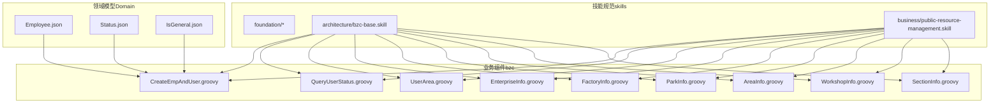
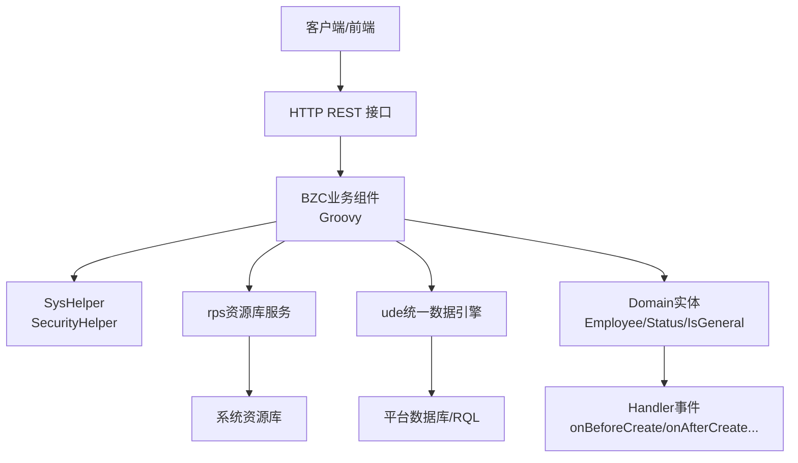
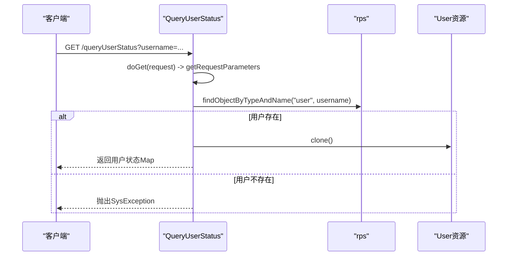
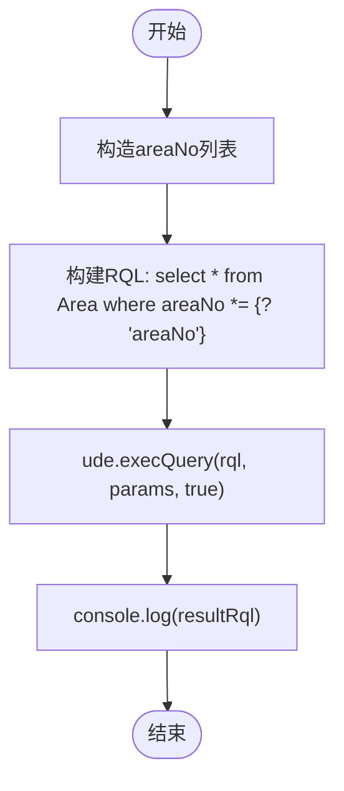
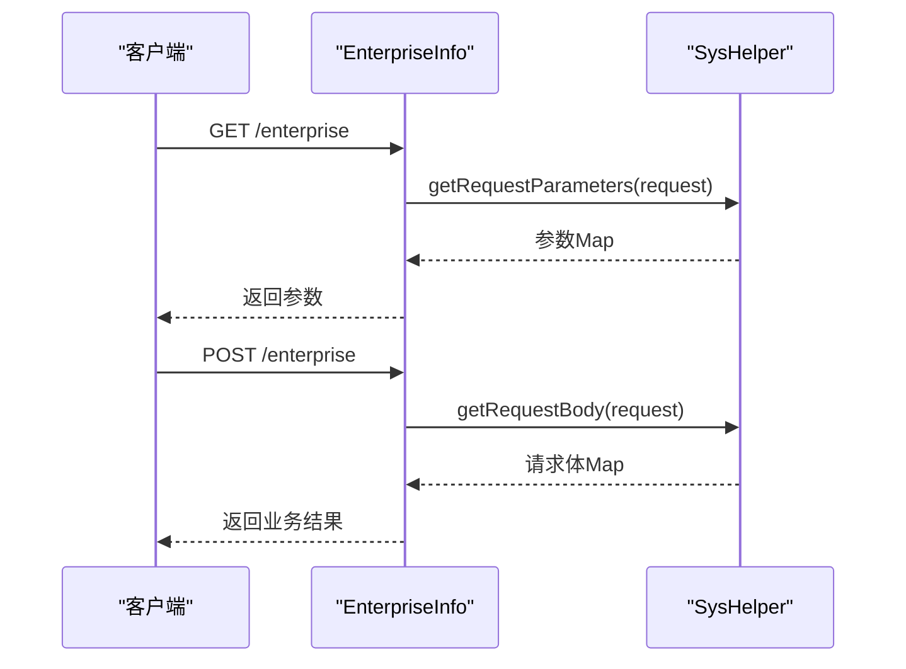

# 技术栈与依赖

<cite>
**本文档引用的文件**
- [skills/README.md](file://skills/README.md)
- [skills/architecture/bzc-base.skill](file://skills/architecture/bzc-base.skill)
- [skills/business/public-resource-management.skill](file://skills/business/public-resource-management.skill)
- [Domain/公共资源管理/人员管理/人员信息/Employee.json](file://Domain/公共资源管理/人员管理/人员信息/Employee.json)
- [Domain/公共资源管理/Status.json](file://Domain/公共资源管理/Status.json)
- [Domain/公共资源管理/IsGeneral.json](file://Domain/公共资源管理/IsGeneral.json)
- [bzc/公共资源管理/人员管理/人员信息/CreateEmpAndUser.groovy](file://bzc/公共资源管理/人员管理/人员信息/CreateEmpAndUser.groovy)
- [bzc/公共资源管理/人员管理/人员信息/QueryUserStatus.groovy](file://bzc/公共资源管理/人员管理/人员信息/QueryUserStatus.groovy)
- [bzc/公共资源管理/人员管理/人员信息/UserArea.groovy](file://bzc/公共资源管理/人员管理/人员信息/UserArea.groovy)
- [bzc/公共资源管理/物理建模/1_企业/EnterpriseInfo.groovy](file://bzc/公共资源管理/物理建模/1_企业/EnterpriseInfo.groovy)
- [bzc/公共资源管理/物理建模/2_工厂/FactoryInfo.groovy](file://bzc/公共资源管理/物理建模/2_工厂/FactoryInfo.groovy)
- [bzc/公共资源管理/物理建模/3_园区/ParkInfo.groovy](file://bzc/公共资源管理/物理建模/3_园区/ParkInfo.groovy)
- [bzc/公共资源管理/物理建模/4_厂区/AreaInfo.groovy](file://bzc/公共资源管理/物理建模/4_厂区/AreaInfo.groovy)
- [bzc/公共资源管理/物理建模/5_车间/WorkshopInfo.groovy](file://bzc/公共资源管理/物理建模/5_车间/WorkshopInfo.groovy)
- [bzc/公共资源管理/物理建模/6_工段/SectionInfo.groovy](file://bzc/公共资源管理/物理建模/6_工段/SectionInfo.groovy)
</cite>

## 目录
1. [引言](#引言)
2. [项目结构](#项目结构)
3. [核心组件](#核心组件)
4. [架构总览](#架构总览)
5. [详细组件分析](#详细组件分析)
6. [依赖分析](#依赖分析)
7. [性能考量](#性能考量)
8. [故障排查指南](#故障排查指南)
9. [结论](#结论)
10. [附录](#附录)

## 引言
本文件面向CMES项目的技术栈与依赖，聚焦Low-code platform平台的业务组件（BZC）与领域模型（Domain）的协作方式，系统梳理Groovy在项目中的应用模式、平台API与RQL查询语言的使用规范，并给出外部依赖库的作用与导入顺序、版本兼容性建议、技术选型理由与替代方案对比，以及平台知识（API、RQL、工具类）的使用指南，帮助开发者快速理解并高效参与开发。

## 项目结构
CMES项目采用“技能规范（skills）+ 业务组件（bzc）+ 领域模型（Domain）”三层规范与实现分离的组织方式：
- skills：统一沉淀平台规范与知识，分为foundation（基础）、architecture（架构）、business（业务）三层，形成可复用的模板与约束。
- bzc：业务组件层，以Groovy实现，封装RESTful接口与业务逻辑，遵循统一的类结构与导入顺序规范。
- Domain：领域模型层，以JSON定义实体结构与属性元数据，配套Handler事件处理与继承体系。



图表来源
- [skills/architecture/bzc-base.skill:1-162](file://skills/architecture/bzc-base.skill#L1-L162)
- [skills/business/public-resource-management.skill:1-514](file://skills/business/public-resource-management.skill#L1-L514)
- [bzc/公共资源管理/人员管理/人员信息/CreateEmpAndUser.groovy:1-590](file://bzc/公共资源管理/人员管理/人员信息/CreateEmpAndUser.groovy#L1-L590)
- [bzc/公共资源管理/人员管理/人员信息/QueryUserStatus.groovy:1-144](file://bzc/公共资源管理/人员管理/人员信息/QueryUserStatus.groovy#L1-L144)
- [bzc/公共资源管理/人员管理/人员信息/UserArea.groovy:141-155](file://bzc/公共资源管理/人员管理/人员信息/UserArea.groovy#L141-L155)
- [bzc/公共资源管理/物理建模/1_企业/EnterpriseInfo.groovy:48-69](file://bzc/公共资源管理/物理建模/1_企业/EnterpriseInfo.groovy#L48-L69)
- [bzc/公共资源管理/物理建模/2_工厂/FactoryInfo.groovy:48-69](file://bzc/公共资源管理/物理建模/2_工厂/FactoryInfo.groovy#L48-L69)
- [bzc/公共资源管理/物理建模/3_园区/ParkInfo.groovy:48-70](file://bzc/公共资源管理/物理建模/3_园区/ParkInfo.groovy#L48-L70)
- [bzc/公共资源管理/物理建模/4_厂区/AreaInfo.groovy:49-70](file://bzc/公共资源管理/物理建模/4_厂区/AreaInfo.groovy#L49-L70)
- [bzc/公共资源管理/物理建模/5_车间/WorkshopInfo.groovy:48-69](file://bzc/公共资源管理/物理建模/5_车间/WorkshopInfo.groovy#L48-L69)
- [bzc/公共资源管理/物理建模/6_工段/SectionInfo.groovy:48-69](file://bzc/公共资源管理/物理建模/6_工段/SectionInfo.groovy#L48-L69)
- [Domain/公共资源管理/人员管理/人员信息/Employee.json:1-743](file://Domain/公共资源管理/人员管理/人员信息/Employee.json#L1-L743)
- [Domain/公共资源管理/Status.json:1-119](file://Domain/公共资源管理/Status.json#L1-L119)
- [Domain/公共资源管理/IsGeneral.json:1-223](file://Domain/公共资源管理/IsGeneral.json#L1-L223)

章节来源
- [skills/README.md:1-63](file://skills/README.md#L1-L63)
- [skills/architecture/bzc-base.skill:1-162](file://skills/architecture/bzc-base.skill#L1-L162)
- [skills/business/public-resource-management.skill:1-514](file://skills/business/public-resource-management.skill#L1-L514)

## 核心组件
- BZC业务组件：以Groovy实现，统一继承自BaseBZC，提供main测试入口、业务方法、delete删除方法与标准RESTful doGet/doPost/doPut/doDelete方法模板，严格遵循导入顺序与注释规范。
- Domain领域模型：以JSON定义实体与属性，支持Handler事件（onBeforeCreate/onAfterCreate等），部分实体继承自CoreCommonBase或BaseDomain，具备统一的审计字段。
- 平台API与RQL：通过SysHelper、rps、ude、SecurityHelper等平台能力访问系统资源、执行RQL查询、进行安全处理与资源操作。

章节来源
- [skills/architecture/bzc-base.skill:1-162](file://skills/architecture/bzc-base.skill#L1-L162)
- [Domain/公共资源管理/人员管理/人员信息/Employee.json:1-743](file://Domain/公共资源管理/人员管理/人员信息/Employee.json#L1-L743)
- [Domain/公共资源管理/Status.json:1-119](file://Domain/公共资源管理/Status.json#L1-L119)
- [Domain/公共资源管理/IsGeneral.json:1-223](file://Domain/公共资源管理/IsGeneral.json#L1-L223)

## 架构总览
Low-code platform平台在CMES中的技术栈与交互关系如下：
- 运行时：Groovy脚本在Low-code platform运行时环境中执行，通过平台提供的系统服务与资源库进行数据访问与业务编排。
- 依赖注入与工具：通过SysHelper、rps（资源库服务）、ude（统一数据引擎）、SecurityHelper等平台API完成请求参数解析、资源查询/创建/更新/删除、RQL批量查询、密码强度校验等。
- 数据模型：Domain实体由JSON定义，Handler负责生命周期事件；业务组件通过实体类与平台API协同，实现业务逻辑与数据一致性。



图表来源
- [bzc/公共资源管理/人员管理/人员信息/CreateEmpAndUser.groovy:1-590](file://bzc/公共资源管理/人员管理/人员信息/CreateEmpAndUser.groovy#L1-L590)
- [bzc/公共资源管理/人员管理/人员信息/QueryUserStatus.groovy:1-144](file://bzc/公共资源管理/人员管理/人员信息/QueryUserStatus.groovy#L1-L144)
- [Domain/公共资源管理/人员管理/人员信息/Employee.json:1-743](file://Domain/公共资源管理/人员管理/人员信息/Employee.json#L1-L743)
- [Domain/公共资源管理/Status.json:1-119](file://Domain/公共资源管理/Status.json#L1-L119)
- [Domain/公共资源管理/IsGeneral.json:1-223](file://Domain/公共资源管理/IsGeneral.json#L1-L223)

## 详细组件分析

### 人员管理：员工与用户同步（CreateEmpAndUser）
- 职责：在创建/修改/删除员工时，同步创建/更新/删除系统用户，维护用户名与员工信息的双向关联。
- 关键流程：
  - 校验与创建用户分类目录
  - 根据_method执行create/update/delete
  - 密码强度校验、密码有效期设置、角色合并、用户URI构建与资源创建/更新/删除
  - 反向更新员工的username字段
- 平台API与工具：
  - rps：资源库服务，用于查找/创建/更新/删除用户资源
  - SecurityHelper：用户名标准化、密码强度校验
  - SysHelper：获取Spring Environment Bean
  - Util：字符串与日期工具
  - HttpServletRequest：RESTful请求参数解析

```mermaid
sequenceDiagram
participant C as "客户端"
participant B as "CreateEmpAndUser"
participant S as "SecurityHelper"
participant R as "rps"
participant D as "Employee实体"
C->>B : POST /createEmpAndUser含_method/密码/角色等
B->>B : 校验并创建用户分类目录
alt _method == create
B->>S : normalizeUsername(employee)
B->>R : findObjectByTypeAndName("user", username)
B->>D : Employee.find({employee})
B->>R : createResource(User, resUri)
B->>D : e.username = username; e.save()
else _method == update
B->>R : findObjectByTypeAndName("user", username)
B->>R : updateResource(User)
else _method == delete
B->>R : deleteResource(User.uri)
end
B-->>C : 返回username与method
```

图表来源
- [bzc/公共资源管理/人员管理/人员信息/CreateEmpAndUser.groovy:91-130](file://bzc/公共资源管理/人员管理/人员信息/CreateEmpAndUser.groovy#L91-L130)
- [bzc/公共资源管理/人员管理/人员信息/CreateEmpAndUser.groovy:140-232](file://bzc/公共资源管理/人员管理/人员信息/CreateEmpAndUser.groovy#L140-L232)
- [bzc/公共资源管理/人员管理/人员信息/CreateEmpAndUser.groovy:241-329](file://bzc/公共资源管理/人员管理/人员信息/CreateEmpAndUser.groovy#L241-L329)
- [bzc/公共资源管理/人员管理/人员信息/CreateEmpAndUser.groovy:338-356](file://bzc/公共资源管理/人员管理/人员信息/CreateEmpAndUser.groovy#L338-L356)

章节来源
- [bzc/公共资源管理/人员管理/人员信息/CreateEmpAndUser.groovy:1-590](file://bzc/公共资源管理/人员管理/人员信息/CreateEmpAndUser.groovy#L1-L590)
- [skills/architecture/bzc-base.skill:29-46](file://skills/architecture/bzc-base.skill#L29-L46)

### 人员管理：用户状态查询（QueryUserStatus）
- 职责：根据用户名查询用户状态信息（密码有效期、激活状态、停用/启用时间等）。
- 关键流程：
  - doGet解析请求参数
  - rps按用户名查找用户
  - Util.toMap克隆用户对象并返回



图表来源
- [bzc/公共资源管理/人员管理/人员信息/QueryUserStatus.groovy:40-45](file://bzc/公共资源管理/人员管理/人员信息/QueryUserStatus.groovy#L40-L45)
- [bzc/公共资源管理/人员管理/人员信息/QueryUserStatus.groovy:62-81](file://bzc/公共资源管理/人员管理/人员信息/QueryUserStatus.groovy#L62-L81)

章节来源
- [bzc/公共资源管理/人员管理/人员信息/QueryUserStatus.groovy:1-144](file://bzc/公共资源管理/人员管理/人员信息/QueryUserStatus.groovy#L1-L144)

### 人员管理：用户默认厂区（UserArea）
- 职责：基于RQL批量查询厂区信息，避免N+1问题。
- 关键流程：
  - 构造areaNo列表
  - 使用RQL select * from Area where areaNo *= {? 'areaNo'} 批量查询
  - 记录日志并返回结果



图表来源
- [bzc/公共资源管理/人员管理/人员信息/UserArea.groovy:141-155](file://bzc/公共资源管理/人员管理/人员信息/UserArea.groovy#L141-L155)

章节来源
- [bzc/公共资源管理/人员管理/人员信息/UserArea.groovy:141-155](file://bzc/公共资源管理/人员管理/人员信息/UserArea.groovy#L141-L155)

### 物理建模：RESTful接口模板（企业/工厂/园区/厂区/车间/工段）
- 职责：提供统一的RESTful接口模板，便于快速实现各层级物理建模实体的CRUD。
- 关键流程：
  - doGet：SysHelper.getRequestParameters(request) -> 返回参数
  - doPost：SysHelper.getRequestBody(request) -> 调用业务方法
  - doDelete/doPut：返回SysResult.OK



图表来源
- [bzc/公共资源管理/物理建模/1_企业/EnterpriseInfo.groovy:48-69](file://bzc/公共资源管理/物理建模/1_企业/EnterpriseInfo.groovy#L48-L69)
- [bzc/公共资源管理/物理建模/2_工厂/FactoryInfo.groovy:48-69](file://bzc/公共资源管理/物理建模/2_工厂/FactoryInfo.groovy#L48-L69)
- [bzc/公共资源管理/物理建模/3_园区/ParkInfo.groovy:48-70](file://bzc/公共资源管理/物理建模/3_园区/ParkInfo.groovy#L48-L70)
- [bzc/公共资源管理/物理建模/4_厂区/AreaInfo.groovy:49-70](file://bzc/公共资源管理/物理建模/4_厂区/AreaInfo.groovy#L49-L70)
- [bzc/公共资源管理/物理建模/5_车间/WorkshopInfo.groovy:48-69](file://bzc/公共资源管理/物理建模/5_车间/WorkshopInfo.groovy#L48-L69)
- [bzc/公共资源管理/物理建模/6_工段/SectionInfo.groovy:48-69](file://bzc/公共资源管理/物理建模/6_工段/SectionInfo.groovy#L48-L69)

章节来源
- [bzc/公共资源管理/物理建模/1_企业/EnterpriseInfo.groovy:48-69](file://bzc/公共资源管理/物理建模/1_企业/EnterpriseInfo.groovy#L48-L69)
- [bzc/公共资源管理/物理建模/2_工厂/FactoryInfo.groovy:48-69](file://bzc/公共资源管理/物理建模/2_工厂/FactoryInfo.groovy#L48-L69)
- [bzc/公共资源管理/物理建模/3_园区/ParkInfo.groovy:48-70](file://bzc/公共资源管理/物理建模/3_园区/ParkInfo.groovy#L48-L70)
- [bzc/公共资源管理/物理建模/4_厂区/AreaInfo.groovy:49-70](file://bzc/公共资源管理/物理建模/4_厂区/AreaInfo.groovy#L49-L70)
- [bzc/公共资源管理/物理建模/5_车间/WorkshopInfo.groovy:48-69](file://bzc/公共资源管理/物理建模/5_车间/WorkshopInfo.groovy#L48-L69)
- [bzc/公共资源管理/物理建模/6_工段/SectionInfo.groovy:48-69](file://bzc/公共资源管理/物理建模/6_工段/SectionInfo.groovy#L48-L69)

## 依赖分析
- 外部依赖库与作用
  - javax.servlet.http.HttpServletRequest：处理HTTP请求参数与请求体，统一RESTful接口入口。
  - com.lowcode-platform.common.*：通用工具类（如Util、SysResult、SysException等）。
  - com.lowcode-platform.system.base.BaseBZC：BZC业务组件基类，提供统一继承与生命周期。
  - com.lowcode-platform.system.services.rps：资源库服务，提供资源的创建、查询、更新、删除能力。
  - com.lowcode-platform.system.ude：统一数据引擎，提供RQL查询执行能力。
  - app.base.domain.public_resource_management.personnel_management.employee_information.Employee：领域模型类，用于员工实体的查询与持久化。
  - com.lowcode-platform.system.repository.User：系统用户资源类，用于用户创建与同步。
  - com.lowcode-platform.security.common.SecurityHelper：安全工具类，提供用户名标准化与密码强度校验。
  - org.springframework.core.env.Environment：Spring环境配置，用于读取系统安全策略（如最小密码强度）。
- 导入顺序与版本兼容性
  - 导入顺序严格遵循：javax.servlet.http.* → com.lowcode-platform.common.* → com.lowcode-platform.system.base.* → com.lowcode-platform.system.services.* → com.lowcode-platform.system.ude.* → app.base.domain.*，确保依赖解析与IDE提示的一致性。
  - 版本兼容性建议：以平台发布说明为准；若升级平台版本，优先验证rps、ude、SecurityHelper等API的变更与废弃情况，确保导入与调用方式保持一致。

章节来源
- [skills/architecture/bzc-base.skill:29-46](file://skills/architecture/bzc-base.skill#L29-L46)
- [bzc/公共资源管理/人员管理/人员信息/CreateEmpAndUser.groovy:1-32](file://bzc/公共资源管理/人员管理/人员信息/CreateEmpAndUser.groovy#L1-L32)
- [bzc/公共资源管理/人员管理/人员信息/QueryUserStatus.groovy:1-15](file://bzc/公共资源管理/人员管理/人员信息/QueryUserStatus.groovy#L1-L15)
- [Domain/公共资源管理/人员管理/人员信息/Employee.json:737-743](file://Domain/公共资源管理/人员管理/人员信息/Employee.json#L737-L743)

## 性能考量
- RQL批量查询：使用“*= 左连接”替代循环单条查询，避免N+1问题，显著提升批量查询性能。
- 批量查询语法：select * from Entity where field *= {? 'field'}，通过ude.execQuery(rql, params, returnList)执行。
- 性能对比：传统循环查询为N+1次，RQL批量查询为1次，推荐在涉及多实体关联的场景中统一采用RQL。

章节来源
- [skills/business/public-resource-management.skill:481-495](file://skills/business/public-resource-management.skill#L481-L495)
- [bzc/公共资源管理/人员管理/人员信息/UserArea.groovy:147-153](file://bzc/公共资源管理/人员管理/人员信息/UserArea.groovy#L147-L153)

## 故障排查指南
- 常见异常与处理
  - SysException：统一异常抛出，用于业务校验失败（如密码强度不足、用户不存在、参数为空等）。
  - SysResult.OK：成功返回的标准结果，用于RESTful接口的统一响应。
- 排查步骤
  - 检查请求参数：确认_getRequestParameters/getRequestBody解析是否正确。
  - 检查资源存在性：使用rps.findObjectByTypeAndName确认用户/实体是否存在。
  - 检查RQL语法：确认“*=”连接符与参数绑定正确，避免MongoDB原生语法导致的不兼容。
  - 检查导入顺序：确保导入顺序与规范一致，避免类解析冲突。

章节来源
- [bzc/公共资源管理/人员管理/人员信息/CreateEmpAndUser.groovy:419-428](file://bzc/公共资源管理/人员管理/人员信息/CreateEmpAndUser.groovy#L419-L428)
- [bzc/公共资源管理/人员管理/人员信息/QueryUserStatus.groovy:67-69](file://bzc/公共资源管理/人员管理/人员信息/QueryUserStatus.groovy#L67-L69)
- [skills/architecture/bzc-base.skill:140-146](file://skills/architecture/bzc-base.skill#L140-L146)

## 结论
CMES项目依托Low-code platform平台，采用“技能规范 + BZC业务组件 + Domain领域模型”的分层架构，结合Groovy脚本化的高灵活性与平台API的强能力，实现了人员管理与物理建模等核心业务的快速落地。通过严格的导入顺序、统一的RESTful模板与RQL批量查询规范，项目在可维护性与性能上取得平衡。建议在后续迭代中持续遵循技能规范，关注平台版本升级对API的影响，确保依赖与实现的兼容性。

## 附录

### 平台API与工具类使用指南
- SysHelper
  - getRequestParameters(request)：解析GET请求参数
  - getRequestBody(request)：解析POST/PUT请求体
  - SysResult.OK：成功返回
- rps（资源库服务）
  - findObjectByTypeAndName(type, name, startsUri, clazz)：按类型与名称查找资源
  - createResource(obj, uri)：创建资源
  - updateResource(obj)：更新资源
  - deleteResource(uri)：删除资源
  - objectExists(uri)：判断资源是否存在
- ude（统一数据引擎）
  - execQuery(rql, params, returnList)：执行RQL查询
- SecurityHelper
  - normalizeUsername(employee)：用户名标准化
  - checkPasswordStrength(password)：密码强度校验
- Util
  - isStringBlank(str)：字符串判空
  - toDate(str)：字符串转日期
  - toMap(obj)：对象转Map
- HttpServletRequest
  - 作为RESTful接口参数载体，统一在doGet/doPost/doPut/doDelete中使用SysHelper解析

章节来源
- [bzc/公共资源管理/人员管理/人员信息/CreateEmpAndUser.groovy:421-428](file://bzc/公共资源管理/人员管理/人员信息/CreateEmpAndUser.groovy#L421-L428)
- [bzc/公共资源管理/人员管理/人员信息/QueryUserStatus.groovy:74-81](file://bzc/公共资源管理/人员管理/人员信息/QueryUserStatus.groovy#L74-L81)
- [bzc/公共资源管理/人员管理/人员信息/UserArea.groovy:149-153](file://bzc/公共资源管理/人员管理/人员信息/UserArea.groovy#L149-L153)

### RQL查询语言使用指南
- 语法要点
  - 使用“*= 左连接”替代循环查询，避免N+1
  - 平台不支持MongoDB原生语法（如$in），请使用RQL
  - 通过ude.execQuery(rql, params, true)执行
- 性能对比
  - 传统循环查询：N+1次，差
  - RQL批量查询：1次，好

章节来源
- [skills/business/public-resource-management.skill:481-495](file://skills/business/public-resource-management.skill#L481-L495)

### Groovy应用与最佳实践
- 类结构与继承
  - 统一继承BaseBZC，类名格式为{模块名}Info
  - 提供main测试入口、业务方法、delete方法与标准RESTful方法
- 导入顺序
  - 严格遵循javax.servlet.http.* → com.lowcode-platform.common.* → com.lowcode-platform.system.base.* → com.lowcode-platform.system.services.* → com.lowcode-platform.system.ude.* → app.base.domain.*
- 注释与编码习惯
  - 每行代码需注释，注释清晰说明意图
  - 使用4空格缩进、方法间空行、单点/批量删除判断逻辑、删除前检查下级关联、SysException异常、SysResult.OK成功返回

章节来源
- [skills/architecture/bzc-base.skill:1-162](file://skills/architecture/bzc-base.skill#L1-L162)