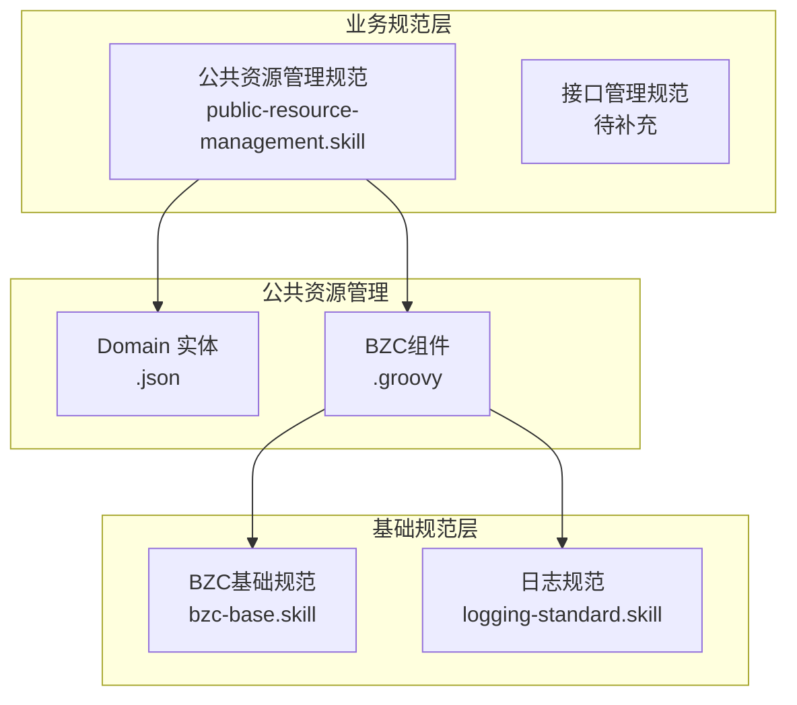
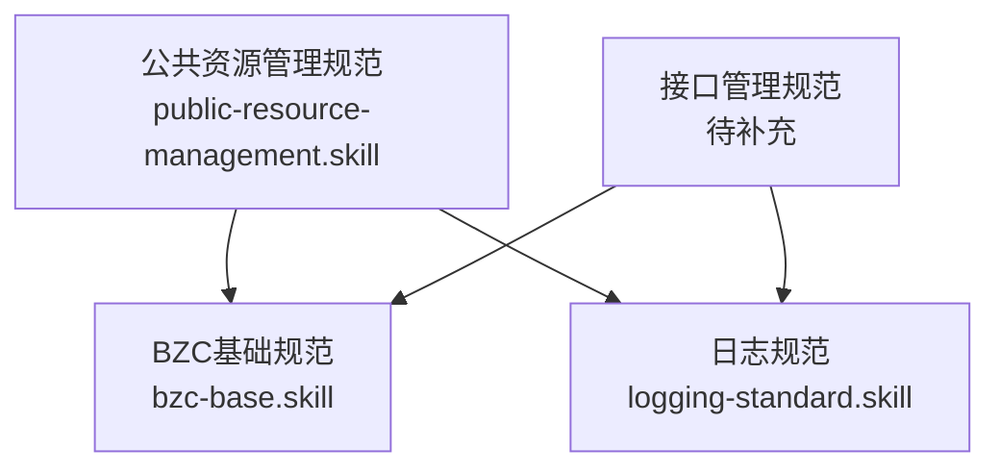
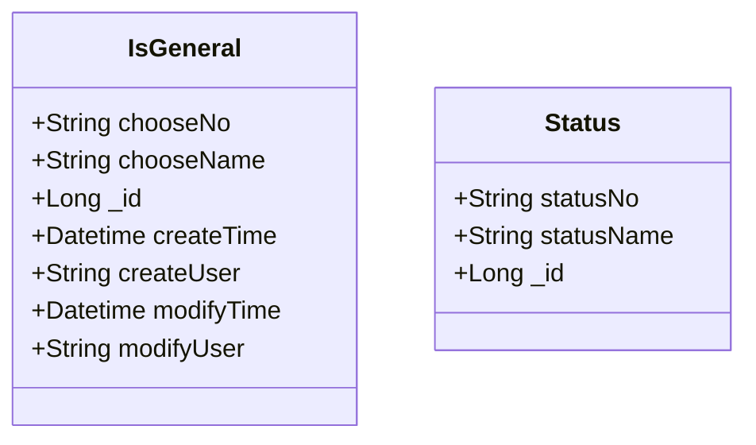
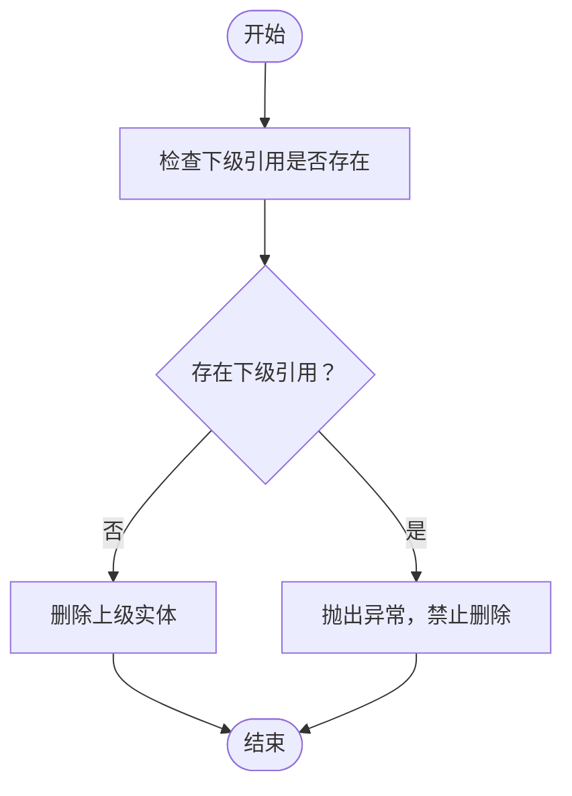
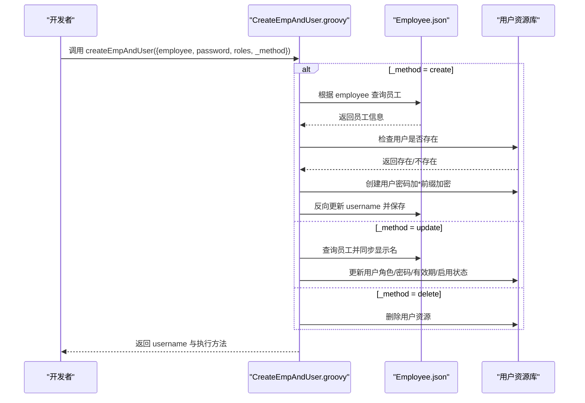
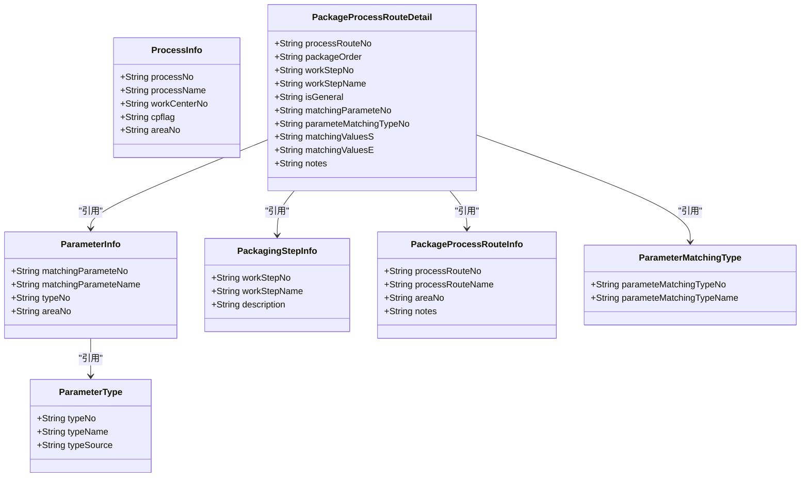
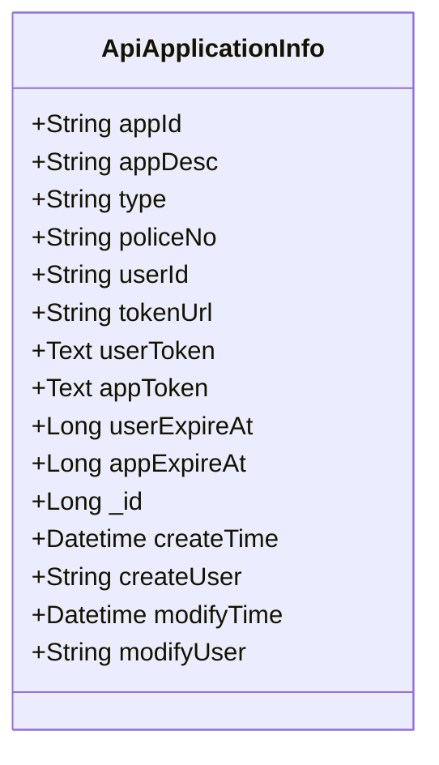
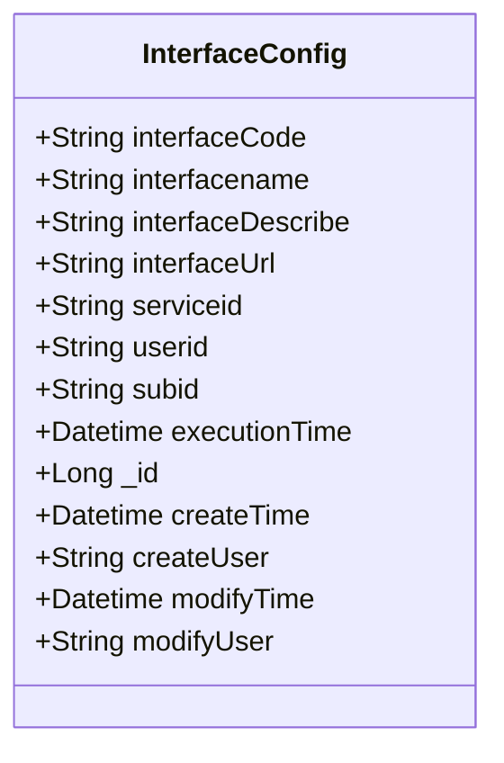
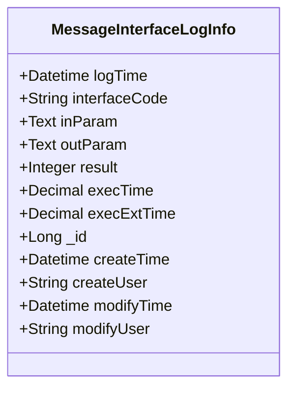
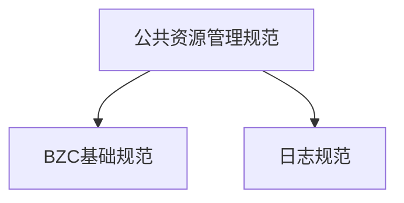

# 业务规范层

<cite>
**本文档引用的文件**
- [public-resource-management.skill](file://skills/business/public-resource-management.skill)
- [bzc-base.skill](file://skills/architecture/bzc-base.skill)
- [logging-standard.skill](file://skills/foundation/logging-standard.skill)
- [IsGeneral.json](file://Domain/公共资源管理/IsGeneral.json)
- [Status.json](file://Domain/公共资源管理/Status.json)
- [Employee.json](file://Domain/公共资源管理/人员管理/人员信息/Employee.json)
- [ProcessInfo.json](file://Domain/公共资源管理/工艺建模/工序信息/ProcessInfo.json)
- [ProductionLine.json](file://Domain/公共资源管理/物理建模/7_生产线/ProductionLine.json)
- [ApiApplicationInfo.json](file://Domain/接口管理/ApiApplicationInfo.json)
- [InterfaceConfig.json](file://Domain/接口管理/InterfaceConfig.json)
- [MessageInterfaceLogInfo.json](file://Domain/接口管理/MessageInterfaceLogInfo.json)
- [CreateEmpAndUser.groovy](file://bzc/公共资源管理/人员管理/人员信息/CreateEmpAndUser.groovy)
- [PackageProcessRouteSave.groovy](file://bzc/公共资源管理/工艺建模/包装工艺路线/PackageProcessRouteSave.groovy)
</cite>

## 目录
1. [引言](#引言)
2. [项目结构](#项目结构)
3. [核心组件](#核心组件)
4. [架构总览](#架构总览)
5. [详细组件分析](#详细组件分析)
6. [依赖分析](#依赖分析)
7. [性能考量](#性能考量)
8. [故障排除指南](#故障排除指南)
9. [结论](#结论)
10. [附录](#附录)

## 引言
本文件系统化梳理 CMES 项目业务规范层的两大核心模块：公共资源管理与接口管理。前者覆盖公共枚举、物理建模层级、人员管理流程与工艺建模配置；后者涵盖 API 应用信息管理、接口配置规则、接口日志记录与 OA 系统集成。文档同时阐明业务规范与基础规范、架构规范的层级叠加关系与引用机制，提供业务场景示例与实现指导，并给出维护策略与更新机制，确保规范随业务演进持续保持一致性与可操作性。

## 项目结构
业务规范层由三层构成：
- 业务规范层（skills/business/*.skill）：定义各模块的业务规则、字段规范、包命名与类命名约定、删除校验与引用关系等。
- 基础规范层（skills/architecture/*.skill）：定义 BZC 组件的类结构、导入顺序、RESTful 方法模板、删除模板与检查清单。
- 基础设施规范层（skills/foundation/*.skill）：定义日志规范、RQL 批量查询规范等通用基础设施要求。

公共资源管理模块的目录结构与文件类型严格对齐：
- Domain 实体：以 .json 文件定义领域模型与属性元数据，继承 CoreCommonBase 或 BaseDomain，统一具备创建/修改时间与用户字段。
- BZC 业务组件：以 .groovy 文件实现业务逻辑，遵循 BaseBZC 继承体系与方法模板。

**图表来源**
- [public-resource-management.skill:1-514](file://skills/business/public-resource-management.skill#L1-L514)
- [bzc-base.skill:1-162](file://skills/architecture/bzc-base.skill#L1-L162)
- [logging-standard.skill:1-115](file://skills/foundation/logging-standard.skill#L1-L115)

**章节来源**
- [public-resource-management.skill:1-60](file://skills/business/public-resource-management.skill#L1-L60)

## 核心组件
本节聚焦公共资源管理与接口管理两大模块的核心组件及其规范。

- 公共枚举实体
  - IsGeneral：通用布尔型枚举，包含 chooseNo、chooseName 字段，供工艺建模明细表引用。
  - Status：状态枚举，包含 statusNo、statusName 字段，供状态管理使用。
- 物理建模层级
  - 企业 → 工厂 → 园区 → 厂区 → 车间 → 工段 → 生产线，逐级继承与引用，删除时需检查下级引用。
- 人员管理
  - Employee：员工信息主表，包含唯一 employee 字段、用户同步逻辑、默认厂区与钉钉账号默认值。
  - 人员组别：EmployeeGroupType → EmployeeGroup → EmployeeDetails（含联合唯一）。
  - 人员产能：PersonnelCapacity → PersonnelCapacityDetial（含删除级联）。
  - 岗位：Position，删除前需检查 Employee 与 PersonnelCapacity 引用。
- 工艺建模
  - ProcessInfo：工序信息，包含工作中心编码、成品标识、厂区编码等。
  - 包装参数：ParameterType → ParameterInfo（联合唯一）。
  - 包装工步信息：PackagingStepInfo。
  - 包装工艺路线：PackageProcessRouteInfo → PackageProcessRouteDetail（含参数匹配类型与区间匹配）。
- 接口管理
  - ApiApplicationInfo：接口应用信息，包含应用编码、令牌获取地址、用户/应用令牌及过期时间等。
  - InterfaceConfig：接口配置，包含接口代号、名称、路径、服务ID、用户ID、主体ID与执行时间等。
  - MessageInterfaceLogInfo：接口日志，记录接口执行时间、入参/出参（JSON）、结果与第三方耗时等。

**章节来源**
- [IsGeneral.json:1-223](file://Domain/公共资源管理/IsGeneral.json#L1-L223)
- [Status.json:1-119](file://Domain/公共资源管理/Status.json#L1-L119)
- [Employee.json:1-743](file://Domain/公共资源管理/人员管理/人员信息/Employee.json#L1-L743)
- [ProcessInfo.json:1-301](file://Domain/公共资源管理/工艺建模/工序信息/ProcessInfo.json#L1-L301)
- [ProductionLine.json:1-431](file://Domain/公共资源管理/物理建模/7_生产线/ProductionLine.json#L1-L431)
- [ApiApplicationInfo.json:1-431](file://Domain/接口管理/ApiApplicationInfo.json#L1-L431)
- [InterfaceConfig.json:1-379](file://Domain/接口管理/InterfaceConfig.json#L1-L379)
- [MessageInterfaceLogInfo.json:1-353](file://Domain/接口管理/MessageInterfaceLogInfo.json#L1-L353)

## 架构总览
业务规范层与基础规范层的叠加关系如下：
- 业务规范层定义模块边界、实体字段与业务规则；
- 基础规范层提供 BZC 组件的类结构、导入顺序、RESTful 方法模板与删除模板；
- 基础设施规范层提供日志与查询等通用能力。

**图表来源**
- [public-resource-management.skill:1-514](file://skills/business/public-resource-management.skill#L1-L514)
- [bzc-base.skill:1-162](file://skills/architecture/bzc-base.skill#L1-L162)
- [logging-standard.skill:1-115](file://skills/foundation/logging-standard.skill#L1-L115)

## 详细组件分析

### 公共资源管理模块

#### 公共枚举实体
- IsGeneral：用于“是否通用”等通用布尔型枚举，供工艺建模明细表引用。
- Status：用于状态管理，包含状态编码与状态名称。

**图表来源**
- [IsGeneral.json:34-223](file://Domain/公共资源管理/IsGeneral.json#L34-L223)
- [Status.json:34-119](file://Domain/公共资源管理/Status.json#L34-L119)

**章节来源**
- [IsGeneral.json:1-223](file://Domain/公共资源管理/IsGeneral.json#L1-L223)
- [Status.json:1-119](file://Domain/公共资源管理/Status.json#L1-L119)
- [public-resource-management.skill:104-121](file://skills/business/public-resource-management.skill#L104-L121)

#### 物理建模层级管理
- 层级关系：企业 → 工厂 → 园区 → 厂区 → 车间 → 工段 → 生产线。
- 删除校验：删除上级模块前需检查下级引用，存在引用则抛出异常，无引用则允许删除。
- 厂区关联表：Area 下包含部门与工作中心关联表，删除 Area 时需考虑是否同步清理关联数据。

**图表来源**
- [public-resource-management.skill:221-226](file://skills/business/public-resource-management.skill#L221-L226)

**章节来源**
- [ProductionLine.json:1-431](file://Domain/公共资源管理/物理建模/7_生产线/ProductionLine.json#L1-L431)
- [public-resource-management.skill:122-226](file://skills/business/public-resource-management.skill#L122-L226)

#### 人员管理流程
- 员工信息（Employee）：唯一 employee 字段、用户同步逻辑、默认厂区与钉钉账号默认值（Handler 中 onBeforeCreate 自动赋值）。
- 用户同步组件（CreateEmpAndUser.groovy）：支持创建/修改/删除员工对应的系统用户，包含密码强度校验、角色合并、用户分类目录创建与密码过期时间设置。
- 人员组别：EmployeeGroupType → EmployeeGroup → EmployeeDetails（联合唯一），删除时需同步处理明细。
- 人员产能：PersonnelCapacity → PersonnelCapacityDetial（删除级联）。
- 岗位（Position）：删除前需检查 Employee 与 PersonnelCapacity 引用。

**图表来源**
- [CreateEmpAndUser.groovy:91-130](file://bzc/公共资源管理/人员管理/人员信息/CreateEmpAndUser.groovy#L91-L130)
- [Employee.json:737-743](file://Domain/公共资源管理/人员管理/人员信息/Employee.json#L737-L743)

**章节来源**
- [Employee.json:1-743](file://Domain/公共资源管理/人员管理/人员信息/Employee.json#L1-L743)
- [CreateEmpAndUser.groovy:1-590](file://bzc/公共资源管理/人员管理/人员信息/CreateEmpAndUser.groovy#L1-L590)
- [public-resource-management.skill:229-356](file://skills/business/public-resource-management.skill#L229-L356)

#### 工艺建模配置
- 工序信息（ProcessInfo）：包含工序编码、名称、工作中心编码、成品标识、厂区编码等。
- 包装参数：ParameterType → ParameterInfo（联合唯一），支持按类型与参数编码组合唯一。
- 包装工步信息（PackagingStepInfo）：包含工步编码、名称与描述。
- 包装工艺路线：PackageProcessRouteInfo → PackageProcessRouteDetail（含参数匹配类型与区间匹配），保存时校验 processRouteNo 唯一性。

**图表来源**
- [ProcessInfo.json:34-295](file://Domain/公共资源管理/工艺建模/工序信息/ProcessInfo.json#L34-L295)
- [ApiApplicationInfo.json:34-425](file://Domain/接口管理/ApiApplicationInfo.json#L34-L425)

**章节来源**
- [ProcessInfo.json:1-301](file://Domain/公共资源管理/工艺建模/工序信息/ProcessInfo.json#L1-L301)
- [ApiApplicationInfo.json:1-431](file://Domain/接口管理/ApiApplicationInfo.json#L1-L431)
- [public-resource-management.skill:358-458](file://skills/business/public-resource-management.skill#L358-L458)

### 接口管理规范

#### API 应用信息管理
- ApiApplicationInfo：包含应用编码、描述、数据类型、警号、用户编码、令牌获取地址、用户/应用令牌及过期时间等字段，继承 CoreCommonBase，自动具备创建/修改时间与用户字段。

**图表来源**
- [ApiApplicationInfo.json:34-425](file://Domain/接口管理/ApiApplicationInfo.json#L34-L425)

**章节来源**
- [ApiApplicationInfo.json:1-431](file://Domain/接口管理/ApiApplicationInfo.json#L1-L431)

#### 接口配置规则
- InterfaceConfig：包含接口代号、名称、描述、接口路径、服务ID、用户ID、主体ID与执行时间等字段，继承 CoreCommonBase。

**图表来源**
- [InterfaceConfig.json:34-373](file://Domain/接口管理/InterfaceConfig.json#L34-L373)

**章节来源**
- [InterfaceConfig.json:1-379](file://Domain/接口管理/InterfaceConfig.json#L1-L379)

#### 接口日志记录
- MessageInterfaceLogInfo：记录接口执行时间、入参/出参（JSON）、执行结果（1=成功，0=失败）、执行时长与第三方耗时等，继承 CoreCommonBase。

**图表来源**
- [MessageInterfaceLogInfo.json:34-347](file://Domain/接口管理/MessageInterfaceLogInfo.json#L34-L347)

**章节来源**
- [MessageInterfaceLogInfo.json:1-353](file://Domain/接口管理/MessageInterfaceLogInfo.json#L1-L353)

#### OA 系统集成
- 建议在接口管理中预留 OA 集成通道，通过 ApiApplicationInfo 的 tokenUrl 与令牌字段实现统一认证与授权，结合 InterfaceConfig 的接口路径与服务ID进行对接。
- 日志记录建议遵循 logging-standard.skill，对外部接口调用进行请求/响应记录，避免记录敏感信息。

**章节来源**
- [ApiApplicationInfo.json:190-216](file://Domain/接口管理/ApiApplicationInfo.json#L190-L216)
- [InterfaceConfig.json:140-190](file://Domain/接口管理/InterfaceConfig.json#L140-L190)
- [logging-standard.skill:1-115](file://skills/foundation/logging-standard.skill#L1-L115)

## 依赖分析
- 业务规范层对基础规范层的依赖体现在：
  - BZC 组件必须继承 BaseBZC，遵循类结构与方法模板；
  - 删除逻辑需遵循删除模板，先检查下级引用再执行删除；
  - 日志记录需遵循日志规范，统一格式与内容要求。
- 物理建模模块的层级依赖体现在删除校验与引用关系；
- 人员与工艺模块的依赖体现在实体间的外键引用与删除级联。

**图表来源**
- [public-resource-management.skill:1-514](file://skills/business/public-resource-management.skill#L1-L514)
- [bzc-base.skill:1-162](file://skills/architecture/bzc-base.skill#L1-L162)
- [logging-standard.skill:1-115](file://skills/foundation/logging-standard.skill#L1-L115)

**章节来源**
- [public-resource-management.skill:1-514](file://skills/business/public-resource-management.skill#L1-L514)
- [bzc-base.skill:1-162](file://skills/architecture/bzc-base.skill#L1-L162)
- [logging-standard.skill:1-115](file://skills/foundation/logging-standard.skill#L1-L115)

## 性能考量
- RQL 批量查询：使用 *= 左连接替代循环单条查询，避免 N+1 问题；通过 ude.execQuery(rql, params, returnList) 执行。
- 性能对比：传统循环查询 N+1 次，RQL 批量查询仅 1 次。
- 删除校验：在删除前进行下级引用检查，避免后续查询时出现性能问题。

**章节来源**
- [public-resource-management.skill:481-496](file://skills/business/public-resource-management.skill#L481-L496)

## 故障排除指南
- 删除异常：若删除失败提示“已在下级信息使用”，需先清理下级引用或调整业务流程。
- 用户同步异常：检查 CreateEmpAndUser.groovy 中的密码强度校验、角色合并与用户分类目录创建逻辑。
- 接口日志异常：遵循 logging-standard.skill，记录请求/响应与异常信息，避免记录敏感数据与大对象。

**章节来源**
- [bzc-base.skill:74-90](file://skills/architecture/bzc-base.skill#L74-L90)
- [logging-standard.skill:1-115](file://skills/foundation/logging-standard.skill#L1-L115)

## 结论
业务规范层通过公共资源管理与接口管理两大模块，建立了统一的实体规范、业务流程与基础设施要求。业务规范层与基础规范层、基础设施规范层形成清晰的层级叠加关系，既保证了模块内的一致性，又提供了可复用的基础能力。建议在实际开发中严格遵循规范，结合示例组件与模板快速落地，并通过日志与删除模板保障系统稳定性与可维护性。

## 附录

### 业务场景示例与实现指导
- 员工入职流程：调用 CreateEmpAndUser.groovy 的 createEmpAndUser，自动创建系统用户并反向更新 Employee.username。
- 包装工艺路线保存：调用 PackageProcessRouteSave.groovy 的 checkPackageProcessRouteInfoUnique，先校验 processRouteNo 唯一性再保存或更新。
- 物理建模删除：在删除企业/工厂等上级实体前，先检查下级实体是否存在引用，避免破坏数据完整性。

**章节来源**
- [CreateEmpAndUser.groovy:91-130](file://bzc/公共资源管理/人员管理/人员信息/CreateEmpAndUser.groovy#L91-L130)
- [PackageProcessRouteSave.groovy:39-81](file://bzc/公共资源管理/工艺建模/包装工艺路线/PackageProcessRouteSave.groovy#L39-L81)
- [public-resource-management.skill:221-226](file://skills/business/public-resource-management.skill#L221-L226)

### 维护策略与更新机制
- 新增子模块：在 bzc/公共资源管理/{新模块名}/ 与 Domain/公共资源管理/{新模块名}/ 下同步创建目录与文件。
- 复杂模块扩展：针对复杂业务模块（如生产制造）可单独创建子 skill，如 production-management.skill。
- 规范升级：当业务需求变化时，优先在业务规范层进行修订，再通过基础规范层与基础设施规范层进行配套更新。

**章节来源**
- [public-resource-management.skill:498-510](file://skills/business/public-resource-management.skill#L498-L510)