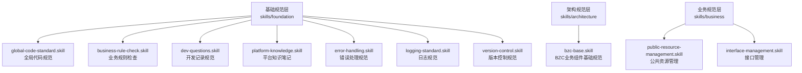
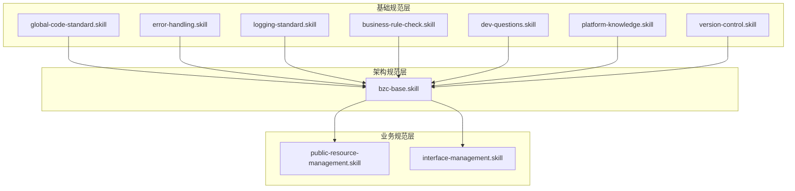
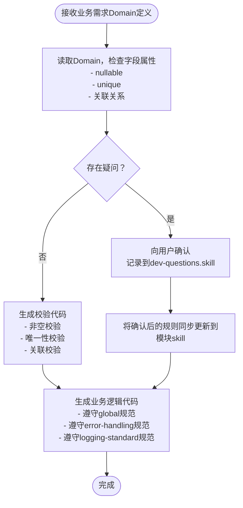
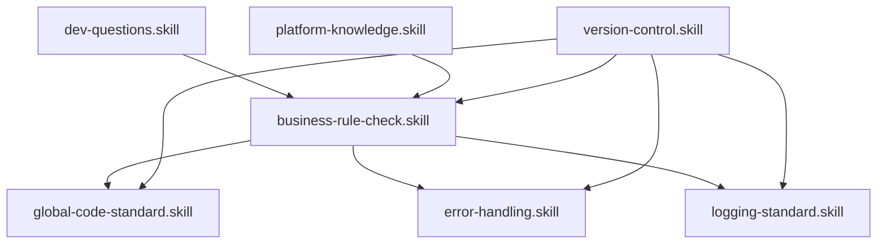

# 基础规范层

<cite>
**本文档引用的文件**
- [skills/README.md](file://skills/README.md)
- [foundation/business-rule-check.skill](file://skills/foundation/business-rule-check.skill)
- [foundation/dev-questions.skill](file://skills/foundation/dev-questions.skill)
- [foundation/logging-standard.skill](file://skills/foundation/logging-standard.skill)
- [foundation/platform-knowledge.skill](file://skills/foundation/platform-knowledge.skill)
- [foundation/error-handling.skill](file://skills/foundation/error-handling.skill)
- [foundation/version-control.skill](file://skills/foundation/version-control.skill)
- [foundation/global-code-standard.skill](file://skills/foundation/global-code-standard.skill)
- [architecture/bzc-base.skill](file://skills/architecture/bzc-base.skill)
</cite>

## 目录
1. [引言](#引言)
2. [项目结构](#项目结构)
3. [核心组件](#核心组件)
4. [架构总览](#架构总览)
5. [详细组件分析](#详细组件分析)
6. [依赖分析](#依赖分析)
7. [性能考虑](#性能考虑)
8. [故障排除指南](#故障排除指南)
9. [结论](#结论)
10. [附录](#附录)

## 引言
本文件系统化梳理CMES项目基础规范层的七个核心规范文件，面向开发者提供统一的代码质量与开发流程标准。内容覆盖全局代码规范、业务规则检查、开发记录规范、平台知识笔记、错误处理规范、日志规范与版本控制规范，并给出与架构规范、业务规范的协同关系与落地建议。

## 项目结构
基础规范层位于skills/foundation目录，包含以下七个规范文件：
- 全局代码规范：统一注释、目录结构与生成流程要求
- 业务规则检查：生成前的非空、唯一性、关联关系校验清单与生成规则
- 开发记录规范：时间节点与疑问确认记录模板与流程
- 平台知识笔记：API使用、RQL查询与工具类应用要点
- 错误处理规范：异常抛出、捕获与返回值标准
- 日志规范：记录时机、格式要求与禁止事项
- 版本控制规范：提交格式与目录同步要求

**图表来源**
- [skills/README.md:23-42](file://skills/README.md#L23-L42)

**章节来源**
- [skills/README.md:3-21](file://skills/README.md#L3-L21)
- [skills/README.md:23-42](file://skills/README.md#L23-L42)

## 核心组件
- 全局代码规范：定义注释标准、目录结构规范与生成流程要求，确保跨模块一致性
- 业务规则检查：生成代码前的强制检查清单，涵盖非空、唯一性、关联关系与特殊业务规则
- 开发记录规范：记录生成过程中的关键时间节点与疑问确认，形成可追溯的开发轨迹
- 平台知识笔记：沉淀API使用、RQL查询与工具类应用的最佳实践
- 错误处理规范：统一异常抛出、捕获与返回值标准，提升系统健壮性
- 日志规范：明确日志记录时机、格式与禁止事项，保障可观测性
- 版本控制规范：规范提交信息与目录同步策略，保证版本演进有序

**章节来源**
- [skills/README.md:25-33](file://skills/README.md#L25-L33)

## 架构总览
基础规范层与架构规范层、业务规范层共同构成CMES规范体系。开发流程遵循“基础规范 → 架构规范 → 业务规范”的层级叠加原则，避免重复与冲突。

**图表来源**
- [skills/README.md:51-63](file://skills/README.md#L51-L63)

## 详细组件分析

### 全局代码规范
- 注释标准
  - 方法注释：使用块注释，说明方法职责与关键参数
  - 行内注释：简洁明确，解释关键逻辑或风险点
  - 注释位置：代码上方或行尾，保持可读性
- 目录结构规范
  - 模块化组织：按系统菜单结构建立目录
  - 文件命名：模块名.skill，保持一致性
  - 新增流程：按层级放入对应目录，避免内容重复
- 生成流程
  - 生成前检查：遵循业务规则检查清单
  - 生成后确认：检查注释完整性、删除逻辑正确性与边界情况
  - 规范引用：业务skill仅保留特定内容，通用内容引用对应基础规范

**章节来源**
- [skills/README.md:44-63](file://skills/README.md#L44-L63)

### 业务规则检查
- 检查时机
  - 生成代码前必须执行业务规则检查
  - 存在疑问时必须向用户确认后方可继续
- 检查清单
  - Domain是否已提供
  - 非空校验：nullable=false的字段必须生成非空校验
  - 唯一性校验：unique=true的字段必须生成唯一性校验
  - 关联关系校验：删除操作必须检查下级是否被引用
  - 业务特殊规则：确认后方可生成
- 校验逻辑生成规则
  - 非空校验：对关键字段进行空值判断并抛出SysException
  - 唯一性校验：查询是否存在重复值并抛出SysException
  - 关联关系校验：删除前检查子实体引用，存在引用则抛出SysException
  - 联合唯一性校验：多字段组合唯一性检查
- 疑问反馈格式
  - 使用统一表格格式，包含序号、字段/规则、Domain定义、疑问内容
- 记录更新
  - 将确认后的业务规则同步更新到对应模块的skill文件中
- 检查流程图
  - 接收业务需求（Domain定义）→ 读取Domain并检查字段属性 → 有疑问/无疑问 → 向用户确认/生成校验代码 → 生成业务逻辑代码并遵守global、error-handling、logging-standard规范

**图表来源**
- [business-rule-check.skill:84-115](file://skills/foundation/business-rule-check.skill#L84-L115)

**章节来源**
- [business-rule-check.skill:5-18](file://skills/foundation/business-rule-check.skill#L5-L18)
- [business-rule-check.skill:10-18](file://skills/foundation/business-rule-check.skill#L10-L18)
- [business-rule-check.skill:20-56](file://skills/foundation/business-rule-check.skill#L20-L56)
- [business-rule-check.skill:67-78](file://skills/foundation/business-rule-check.skill#L67-L78)
- [business-rule-check.skill:80-82](file://skills/foundation/business-rule-check.skill#L80-L82)
- [business-rule-check.skill:84-115](file://skills/foundation/business-rule-check.skill#L84-L115)

### 开发记录规范
- 记录格式
  - 时间节点记录：日期-模块/功能，记录关键时间点与事件描述
  - 疑问确认记录：统一表格格式，包含确认时间、问题描述、确认结果与备注
- 生成流程疑问清单
  - 代码生成前必问：下级模块、Entity类名、字段命名、包路径
  - 生成后确认：代码结构、注释、删除逻辑、边界情况
- 示例
  - 时间记录示例：展示从开始生成到最终确认的完整流程
  - 疑问确认示例：针对具体模块的确认记录模板
- 使用说明
  - 每次生成前先列出疑问清单
  - 生成过程中有疑问随时暂停确认
  - 生成完成后发送确认给用户并更新记录

**章节来源**
- [dev-questions.skill:5-21](file://skills/foundation/dev-questions.skill#L5-L21)
- [dev-questions.skill:23-37](file://skills/foundation/dev-questions.skill#L23-L37)
- [dev-questions.skill:39-60](file://skills/foundation/dev-questions.skill#L39-L60)
- [dev-questions.skill:71-76](file://skills/foundation/dev-questions.skill#L71-L76)

### 平台知识笔记
- API使用
  - doGet/doPost区分：根据HTTP方法选择合适的参数解析方式
  - 参数解析：GET使用请求参数，POST/PUT使用请求体
- RQL查询
  - 查询条件构造：支持等值、范围、模糊等常用条件
  - 结果集处理：注意分页与排序
- 工具类应用
  - JSON序列化/反序列化：统一使用平台工具类
  - 日志工具：统一使用console.log输出
  - 异常封装：统一使用SysException

**章节来源**
- [platform-knowledge.skill](file://skills/foundation/platform-knowledge.skill)

### 错误处理规范
- 异常抛出
  - 统一使用SysException，消息包含操作+主体+原因
  - 避免空catch块与e.printStackTrace()
- 异常捕获
  - 捕获异常时必须记录日志
  - 对外返回统一使用SysResult.OK表示成功
- 返回值标准
  - 成功：SysResult.OK
  - 失败：SysException并记录日志

**章节来源**
- [error-handling.skill](file://skills/foundation/error-handling.skill)

### 日志规范
- 日志方法
  - 控制台输出：console.log(message)
- 使用场景
  - 业务方法入口/出口：记录关键入参/返回值
  - 异常捕获：记录异常信息
  - 外部接口调用：记录请求与响应
  - 关键数据变更：记录变更前后数据
  - 条件分支：复杂逻辑时可记录
- 日志格式
  - 基本格式：操作描述 + 关键数据
  - 方法入口日志：记录方法名称与关键参数
  - 异常日志：记录异常详情
  - 外部接口日志：请求前与响应后分别记录
- 内容规范
  - 应该记录：方法名称与关键参数、外部接口请求/响应、异常错误消息、数据变更关键信息、重要业务节点状态变化
  - 不应记录：敏感信息（密码、密钥、Token）、大量数据、循环内逐条日志、无意义中间变量
  - 消息规范：使用中文、动词开头、简洁明确、包含关键标识（编号/名称）
- 禁止写法
  - 日志内容过于简单
  - 记录敏感信息
  - 记录大量数据
  - 循环内逐条记录

**章节来源**
- [logging-standard.skill:5-24](file://skills/foundation/logging-standard.skill#L5-L24)
- [logging-standard.skill:25-61](file://skills/foundation/logging-standard.skill#L25-L61)
- [logging-standard.skill:63-86](file://skills/foundation/logging-standard.skill#L63-L86)
- [logging-standard.skill:87-103](file://skills/foundation/logging-standard.skill#L87-L103)

### 版本控制规范
- 提交格式
  - 标题：简明描述变更内容
  - 描述：说明变更动机、影响范围与注意事项
- 目录同步
  - 新增/删除文件需同步更新skills目录结构
  - 保持模块化组织，避免内容重复

**章节来源**
- [version-control.skill](file://skills/foundation/version-control.skill)

## 依赖分析
基础规范层内部各规范文件相互依赖，形成闭环约束：
- 业务规则检查依赖全局代码规范（注释与生成流程）、错误处理规范（异常抛出与返回值）、日志规范（异常捕获处的日志记录）
- 开发记录规范为业务规则检查提供可追溯的证据链
- 平台知识笔记为业务规则检查与日志规范提供平台技术细节支撑
- 版本控制规范保障规范本身的演进有序

**图表来源**
- [business-rule-check.skill:117-126](file://skills/foundation/business-rule-check.skill#L117-L126)
- [skills/README.md:51-63](file://skills/README.md#L51-L63)

**章节来源**
- [business-rule-check.skill:117-126](file://skills/foundation/business-rule-check.skill#L117-L126)
- [skills/README.md:51-63](file://skills/README.md#L51-L63)

## 性能考虑
- 日志记录
  - 避免在循环内逐条记录日志，防止日志风暴
  - 控制日志量，避免记录大量数据
- 异常处理
  - 捕获异常时记录必要信息，避免空catch块
  - 统一异常消息格式，便于检索与定位
- 生成流程
  - 生成前先执行业务规则检查，减少返工成本
  - 使用统一模板与工具类，降低生成复杂度

[本节为通用指导，不涉及具体文件分析]

## 故障排除指南
- 生成失败
  - 检查业务规则检查清单是否全部通过
  - 确认异常抛出与捕获是否符合错误处理规范
  - 核对日志记录是否满足日志规范要求
- 代码不一致
  - 对照全局代码规范检查注释与目录结构
  - 确认版本控制规范是否得到遵守
- 平台集成问题
  - 参考平台知识笔记中的API使用与RQL查询要点
  - 核对工具类使用是否正确

**章节来源**
- [business-rule-check.skill:106-115](file://skills/foundation/business-rule-check.skill#L106-L115)
- [logging-standard.skill:105-115](file://skills/foundation/logging-standard.skill#L105-L115)
- [error-handling.skill](file://skills/foundation/error-handling.skill)

## 结论
基础规范层通过七个核心规范文件，为CMES项目提供了统一的代码质量与开发流程标准。遵循“基础规范 → 架构规范 → 业务规范”的层级叠加原则，结合平台知识笔记与版本控制规范，能够有效提升开发效率、降低维护成本并增强系统可观测性与稳定性。

[本节为总结性内容，不涉及具体文件分析]

## 附录
- 规范优先级：首先遵守基础规范，其次遵守架构规范，最后遵守业务规范
- 规范引用关系：业务skill中通用内容引用对应基础规范，避免重复

**章节来源**
- [skills/README.md:51-63](file://skills/README.md#L51-L63)