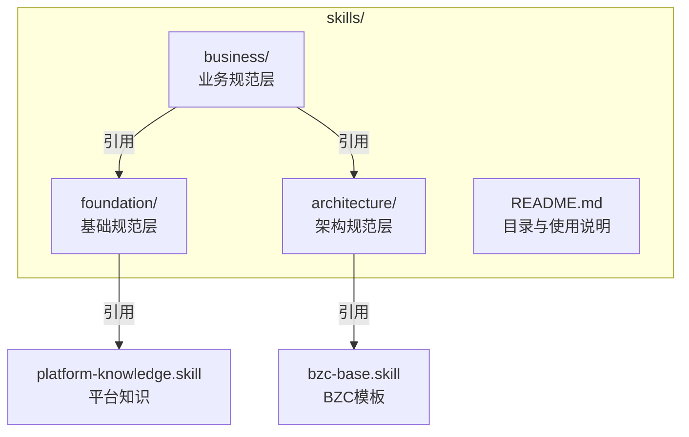
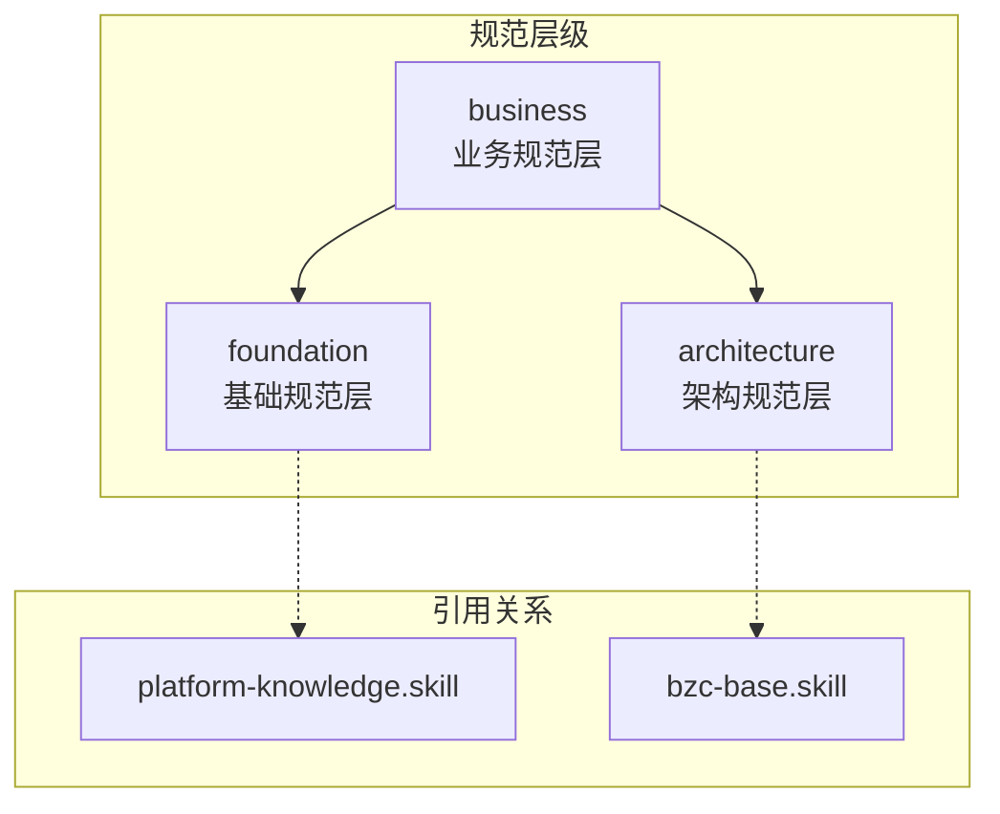
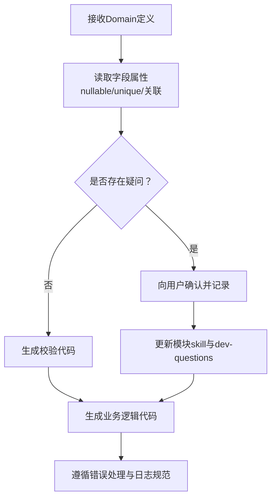
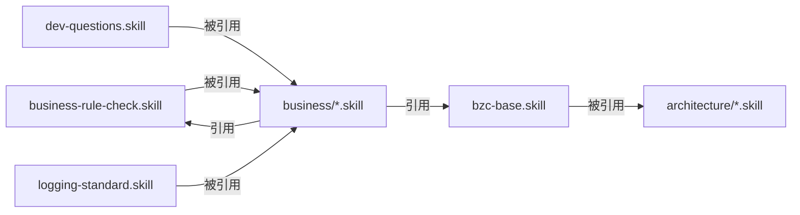

# 技能规范体系

<cite>
**本文档引用的文件**
- [skills/README.md](file://skills/README.md)
- [skills/foundation/business-rule-check.skill](file://skills/foundation/business-rule-check.skill)
- [skills/foundation/dev-questions.skill](file://skills/foundation/dev-questions.skill)
- [skills/foundation/logging-standard.skill](file://skills/foundation/logging-standard.skill)
- [skills/architecture/bzc-base.skill](file://skills/architecture/bzc-base.skill)
- [skills/business/public-resource-management.skill](file://skills/business/public-resource-management.skill)
- [Domain/公共资源管理/Status.json](file://Domain/公共资源管理/Status.json)
- [Domain/公共资源管理/IsGeneral.json](file://Domain/公共资源管理/IsGeneral.json)
- [Domain/接口管理/ApiApplicationInfo.json](file://Domain/接口管理/ApiApplicationInfo.json)
</cite>

## 目录
1. [引言](#引言)
2. [项目结构](#项目结构)
3. [核心组件](#核心组件)
4. [架构总览](#架构总览)
5. [详细组件分析](#详细组件分析)
6. [依赖分析](#依赖分析)
7. [性能考量](#性能考量)
8. [故障排除指南](#故障排除指南)
9. [结论](#结论)
10. [附录](#附录)

## 引言
本文件系统化阐述 CMES 项目的技能规范体系架构，围绕 foundation（基础规范层）、architecture（架构规范层）、business（业务规范层）三层设计，明确规范优先级与叠加原则，并给出规范文件的应用场景、引用机制与落地实践建议。目标是为团队提供统一标准与指导原则，提升代码质量与开发效率。

## 项目结构
CMES 技能规范仓库采用“三层 + 多模块”的组织方式：
- foundation：全局通用规范，覆盖代码注释、业务规则检查、开发记录、错误处理、日志、版本控制等
- architecture：技术架构规范，聚焦 BZC 业务组件的类结构、模板与编码习惯
- business：业务模块专属规范，按系统菜单结构组织，如公共资源管理、接口管理等

图表来源
- [skills/README.md:1-63](file://skills/README.md#L1-L63)

章节来源
- [skills/README.md:3-63](file://skills/README.md#L3-L63)

## 核心组件
本节从三层视角梳理关键规范组件及其职责与优先级：

- 基础规范层（foundation）
  - 全局代码规范：统一注释、目录结构与生成流程
  - 业务规则检查：生成代码前的必经校验，确保非空、唯一性、关联关系等
  - 开发记录规范：记录开发节点与疑问确认
  - 平台知识笔记：API、RQL、工具类等技术细节
  - 错误处理规范：异常抛出、捕获与返回值约定
  - 日志规范：记录时机、格式与禁止事项
  - 版本控制规范：提交格式与目录同步

- 架构规范层（architecture）
  - BZC 业务组件基础规范：类结构、导入顺序、main/RESTful 模板、注释与编码习惯

- 业务规范层（business）
  - 公共资源管理：物理建模、人员管理、工艺建模的实体与字段规范
  - 接口管理：接口应用信息、接口配置、接口日志、OA对接等

章节来源
- [skills/README.md:23-63](file://skills/README.md#L23-L63)

## 架构总览
三层规范的叠加与引用关系如下：
- 业务开发遵循“foundation → architecture → business”的优先级
- 为避免重复，业务 skill 中仅保留模块特定内容，通用内容通过引用基础规范实现复用
- 平台技术细节引用 platform-knowledge.skill，代码模板引用 bzc-base.skill

图表来源
- [skills/README.md:58-63](file://skills/README.md#L58-L63)
- [skills/architecture/bzc-base.skill:1-162](file://skills/architecture/bzc-base.skill#L1-L162)
- [skills/foundation/logging-standard.skill:1-115](file://skills/foundation/logging-standard.skill#L1-L115)

## 详细组件分析

### 基础规范层（foundation）

#### 业务规则检查（business-rule-check.skill）
- 目标：在生成 BZC 代码前强制执行业务规则校验，确保逻辑完整性
- 关键点
  - 检查时机：生成前必须完成
  - 检查清单：非空、唯一性、关联关系、特殊规则
  - 生成规则：针对 nullable/unique/composite/关联关系生成相应校验代码
  - 疑问反馈：标准化的确认表格与记录更新流程
- 流程图（概念示意）

章节来源
- [skills/foundation/business-rule-check.skill:1-144](file://skills/foundation/business-rule-check.skill#L1-L144)

#### 开发记录规范（dev-questions.skill）
- 目标：规范化记录开发过程中的时间节点与疑问确认
- 关键点
  - 时间节点记录格式与示例
  - 疑问确认表格与生成前后确认清单
  - 示例：包装工艺路线模块的典型问题与确认
- 使用说明
  - 生成前列出疑问清单
  - 生成中随时暂停确认
  - 生成后发送确认并更新记录

章节来源
- [skills/foundation/dev-questions.skill:1-76](file://skills/foundation/dev-questions.skill#L1-L76)

#### 日志规范（logging-standard.skill）
- 目标：统一日志记录方式，便于问题排查与监控
- 关键点
  - 日志方法与使用场景（入口/出口、异常捕获、外部接口、关键数据变更、条件分支）
  - 日志格式与消息规范（中文、动词开头、关键标识）
  - 禁止写法：简单日志、敏感信息、大量数据、循环逐条记录
- 检查清单：异常捕获日志、接口请求/响应日志、消息规范等

章节来源
- [skills/foundation/logging-standard.skill:1-115](file://skills/foundation/logging-standard.skill#L1-L115)

### 架构规范层（architecture）

#### BZC 业务组件基础规范（bzc-base.skill）
- 目标：提供 BZC 组件的统一类结构、模板与编码习惯
- 关键点
  - 类结构：继承 BaseBZC、类名格式 {模块名}Info
  - 导入顺序：javax.servlet.http.* → com.lowcode-platform.* → app.base.domain.*
  - 模板：main 方法、业务方法、delete 方法、RESTful doGet/doPost/doPut/doDelete
  - 注释与编码习惯：4空格缩进、方法空行、单点/批量删除判断、SysException、SysResult.OK
- 检查清单：类继承、类名、main 方法、业务/删除/RESTful 方法、导入顺序、编码习惯等

章节来源
- [skills/architecture/bzc-base.skill:1-162](file://skills/architecture/bzc-base.skill#L1-L162)

### 业务规范层（business）

#### 公共资源管理（public-resource-management.skill）
- 目标：为公共资源管理模块提供统一的 BZC 与 Domain 规范
- 关键点
  - 目录结构：bzc/ 与 Domain/ 的完整同步
  - 文件类型：.json（Domain）、.groovy（BZC）
  - 字段命名：xxNo/xxName 规范
  - 包命名：公共资源管理的子模块与功能模块包路径
  - 类命名：BZC 组件与 Domain 实体命名规则
  - 通用实体：IsGeneral（是否通用）、Status（状态）的字段与继承关系
  - 子模块规范：物理建模（层级关系与删除校验）、人员管理（员工、组别、产能、岗位）、工艺建模（工序、参数、工步、路线）
  - 代码规范：注释要求、方法模板（引用 bzc-base）、RQL 批量查询（引用 platform-knowledge）
- 层级关系说明：物理建模模块具有明确层级，删除时需检查下级引用；人员与工艺模块多为独立实体，无层级约束

章节来源
- [skills/business/public-resource-management.skill:1-514](file://skills/business/public-resource-management.skill#L1-L514)

#### 公共枚举实体（Domain 示例）
- IsGeneral（是否通用）
  - 继承 CoreCommonBase，具备通用字段（_id、createTime、createUser、modifyTime、modifyUser）
  - 字段：chooseNo、chooseName
- Status（状态）
  - 继承 BaseDomain，仅 _id 字段
  - 字段：statusNo、statusName

章节来源
- [Domain/公共资源管理/IsGeneral.json:1-223](file://Domain/公共资源管理/IsGeneral.json#L1-L223)
- [Domain/公共资源管理/Status.json:1-119](file://Domain/公共资源管理/Status.json#L1-L119)

#### 接口管理（概念说明）
- 业务规范层包含接口管理模块，涵盖接口应用信息、接口配置、接口日志、OA 对接等内容
- Domain/接口管理/ApiApplicationInfo.json 提供接口应用信息的字段定义与处理器代码模板

章节来源
- [skills/business/public-resource-management.skill:1-514](file://skills/business/public-resource-management.skill#L1-L514)
- [Domain/接口管理/ApiApplicationInfo.json:1-431](file://Domain/接口管理/ApiApplicationInfo.json#L1-L431)

## 依赖分析
三层规范之间的耦合与引用关系如下：
- business 层依赖 foundation 与 architecture 的通用规范
- foundation 层内部通过 platform-knowledge.skill 与 bzc-base.skill 进行技术细节与模板复用
- business 层内部通过引用实现模块特定内容与通用内容的解耦

图表来源
- [skills/README.md:58-63](file://skills/README.md#L58-L63)
- [skills/foundation/business-rule-check.skill:1-144](file://skills/foundation/business-rule-check.skill#L1-L144)
- [skills/architecture/bzc-base.skill:1-162](file://skills/architecture/bzc-base.skill#L1-L162)

章节来源
- [skills/README.md:58-63](file://skills/README.md#L58-L63)

## 性能考量
- RQL 批量查询：通过 *= 左连接替代循环单条查询，避免 N+1 问题，提升性能
- 平台限制：不支持 MongoDB 原生语法（如 $in），需使用 RQL
- 性能对比：传统循环查询 N+1 次 vs RQL 批量查询 1 次

章节来源
- [skills/business/public-resource-management.skill:481-495](file://skills/business/public-resource-management.skill#L481-L495)

## 故障排除指南
- 业务规则检查未通过
  - 现象：生成前提示存在疑问或未满足校验条件
  - 处理：根据 business-rule-check.skill 的确认表格与检查清单逐项核对并更新模块 skill
- 日志记录不符合规范
  - 现象：异常捕获处无日志、外部接口调用无请求/响应日志、记录敏感信息或循环逐条日志
  - 处理：参照 logging-standard.skill 的禁止写法与检查清单进行修正
- BZC 组件不符合架构规范
  - 现象：类未继承 BaseBZC、main 方法缺失、导入顺序错误、未使用 SysException/SysResult.OK
  - 处理：依据 bzc-base.skill 的模板与检查清单补齐

章节来源
- [skills/foundation/business-rule-check.skill:105-144](file://skills/foundation/business-rule-check.skill#L105-L144)
- [skills/foundation/logging-standard.skill:87-115](file://skills/foundation/logging-standard.skill#L87-L115)
- [skills/architecture/bzc-base.skill:147-162](file://skills/architecture/bzc-base.skill#L147-L162)

## 结论
CMES 技能规范体系以三层架构为核心，通过“foundation → architecture → business”的优先级与引用机制，实现了通用规范与模块专属规范的有机融合。团队在实际开发中应严格遵循层级叠加原则，结合具体规范文件的模板与检查清单，确保代码质量与开发效率的持续提升。

## 附录

### 规范优先级与叠加原则
- 业务开发时，遵循层级叠加原则：
  1) 首先遵守 foundation 基础规范
  2) 其次遵守 architecture 架构规范
  3) 最后遵守 business 业务规范

章节来源
- [skills/README.md:51-57](file://skills/README.md#L51-L57)

### 规范引用机制
- 平台技术细节（RQL 查询、API 用法等）→ platform-knowledge.skill
- 代码模板（类结构、方法模板等）→ bzc-base.skill
- 业务 skill 中只保留业务特定内容，通用内容引用对应基础规范

章节来源
- [skills/README.md:58-63](file://skills/README.md#L58-L63)