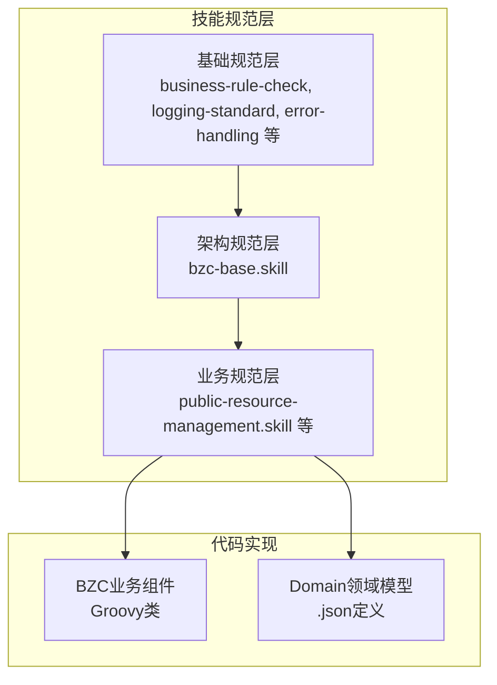
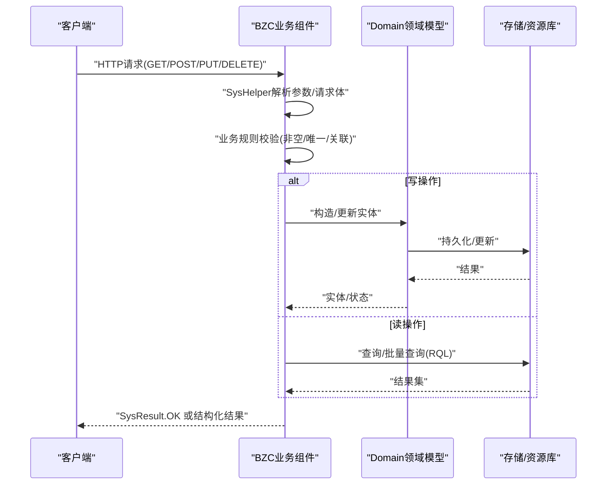
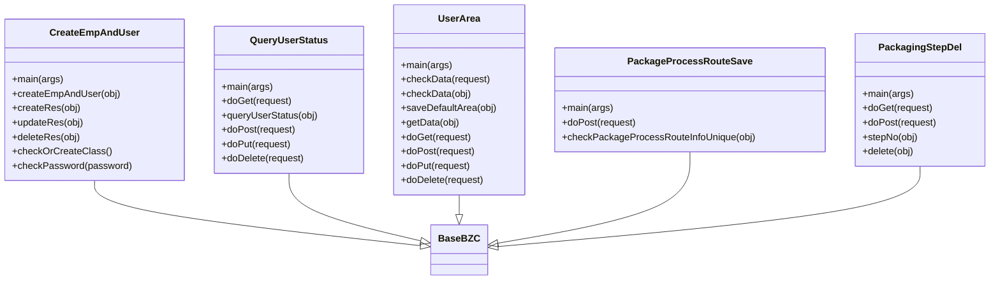
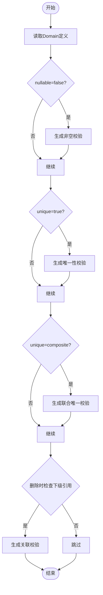
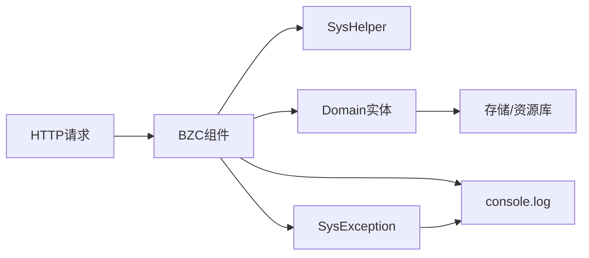

# 架构规范层

<cite>
**本文档引用的文件**
- [skills/architecture/bzc-base.skill](file://skills/architecture/bzc-base.skill)
- [skills/business/public-resource-management.skill](file://skills/business/public-resource-management.skill)
- [skills/foundation/business-rule-check.skill](file://skills/foundation/business-rule-check.skill)
- [skills/foundation/logging-standard.skill](file://skills/foundation/logging-standard.skill)
- [skills/README.md](file://skills/README.md)
- [bzc/公共资源管理/人员管理/人员信息/CreateEmpAndUser.groovy](file://bzc/公共资源管理/人员管理/人员信息/CreateEmpAndUser.groovy)
- [bzc/公共资源管理/人员管理/人员信息/QueryUserStatus.groovy](file://bzc/公共资源管理/人员管理/人员信息/QueryUserStatus.groovy)
- [bzc/公共资源管理/人员管理/人员信息/UserArea.groovy](file://bzc/公共资源管理/人员管理/人员信息/UserArea.groovy)
- [bzc/公共资源管理/工艺建模/包装工艺路线/PackageProcessRouteSave.groovy](file://bzc/公共资源管理/工艺建模/包装工艺路线/PackageProcessRouteSave.groovy)
- [bzc/公共资源管理/工艺建模/包装工步信息/PackagingStepDel.groovy](file://bzc/公共资源管理/工艺建模/包装工步信息/PackagingStepDel.groovy)
- [Domain/公共资源管理/人员管理/人员信息/Employee.json](file://Domain/公共资源管理/人员管理/人员信息/Employee.json)
- [Domain/公共资源管理/工艺建模/包装工艺路线/PackageProcessRouteInfo.json](file://Domain/公共资源管理/工艺建模/包装工艺路线/PackageProcessRouteInfo.json)
- [Domain/公共资源管理/工艺建模/包装工步信息/PackagingStepInfo.json](file://Domain/公共资源管理/工艺建模/包装工步信息/PackagingStepInfo.json)
- [Domain/公共资源管理/物理建模/7_生产线/ProductionLine.json](file://Domain/公共资源管理/物理建模/7_生产线/ProductionLine.json)
</cite>

## 目录
1. [引言](#引言)
2. [项目结构](#项目结构)
3. [核心组件](#核心组件)
4. [架构总览](#架构总览)
5. [详细组件分析](#详细组件分析)
6. [依赖分析](#依赖分析)
7. [性能考量](#性能考量)
8. [故障排查指南](#故障排查指南)
9. [结论](#结论)
10. [附录](#附录)

## 引言
本文件面向CMES项目的“架构规范层”，聚焦BZC（业务组件）的类结构设计、方法模板与编码习惯，以及与领域模型的交互模式、数据流转机制、组件通信协议、错误传播与状态管理策略。同时总结架构层面的性能、可扩展性与可维护性设计原则，并提供可复用的最佳实践与示例路径，帮助开发者正确应用BZC架构模式。

## 项目结构
CMES采用“技能（Skill）”分层规范体系：
- 基础规范层（foundation）：全局代码规范、业务规则检查、日志规范、错误处理等
- 架构规范层（architecture）：BZC业务组件基础规范
- 业务规范层（business）：按系统菜单结构组织的模块专属规范

图表来源
- [skills/README.md:1-63](file://skills/README.md#L1-L63)
- [skills/architecture/bzc-base.skill:1-162](file://skills/architecture/bzc-base.skill#L1-L162)
- [skills/business/public-resource-management.skill:1-514](file://skills/business/public-resource-management.skill#L1-L514)

章节来源
- [skills/README.md:1-63](file://skills/README.md#L1-L63)

## 核心组件
- BZC业务组件：以“模块名Info”或“业务功能名”命名，继承自BaseBZC，提供main测试入口、业务方法、delete删除方法、RESTful方法（doGet/doPost/doPut/doDelete）。
- 导入顺序：javax.servlet.http.* → com.lowcode-platform.common.* → com.lowcode-platform.system.base.* → com.lowcode-platform.system.services.* → com.lowcode-platform.system.ude.* → app.base.domain.*。
- 编码习惯：4空格缩进、方法间空行、单点/批量删除判断、删除前检查下级关联、SysException异常、SysResult.OK返回。

章节来源
- [skills/architecture/bzc-base.skill:1-162](file://skills/architecture/bzc-base.skill#L1-L162)

## 架构总览
BZC组件与Domain实体的交互遵循“请求→BZC→领域模型→持久化”的链路，BZC负责：
- 参数解析与校验（非空、唯一、联合唯一、关联校验）
- 业务编排与状态管理
- 错误传播与日志记录
- RESTful协议适配

图表来源
- [skills/architecture/bzc-base.skill:92-122](file://skills/architecture/bzc-base.skill#L92-L122)
- [skills/business/public-resource-management.skill:481-496](file://skills/business/public-resource-management.skill#L481-L496)

## 详细组件分析

### BZC类结构与方法模板
- 类结构：继承BaseBZC，命名规范为{模块名}Info或{业务功能名}。
- 标准方法：main测试入口、业务方法、delete删除方法、RESTful四法。
- 删除模板：先查下级关联，再执行删除或抛异常。
- RESTful模板：GET/POST/PUT/DELETE分别映射到参数解析、业务处理、空实现或OK返回。

图表来源
- [bzc/公共资源管理/人员管理/人员信息/CreateEmpAndUser.groovy:37-590](file://bzc/公共资源管理/人员管理/人员信息/CreateEmpAndUser.groovy#L37-L590)
- [bzc/公共资源管理/人员管理/人员信息/QueryUserStatus.groovy:21-144](file://bzc/公共资源管理/人员管理/人员信息/QueryUserStatus.groovy#L21-L144)
- [bzc/公共资源管理/人员管理/人员信息/UserArea.groovy:23-235](file://bzc/公共资源管理/人员管理/人员信息/UserArea.groovy#L23-L235)
- [bzc/公共资源管理/工艺建模/包装工艺路线/PackageProcessRouteSave.groovy:13-82](file://bzc/公共资源管理/工艺建模/包装工艺路线/PackageProcessRouteSave.groovy#L13-L82)
- [bzc/公共资源管理/工艺建模/包装工步信息/PackagingStepDel.groovy:14-79](file://bzc/公共资源管理/工艺建模/包装工步信息/PackagingStepDel.groovy#L14-L79)

章节来源
- [skills/architecture/bzc-base.skill:9-122](file://skills/architecture/bzc-base.skill#L9-L122)

### 业务规则检查与校验模板
- 生成代码前必须执行业务规则检查，确保非空、唯一、联合唯一、关联关系校验完整。
- 自动生成校验代码：非空、唯一、联合唯一、删除前关联检查。
- 规则确认与记录：通过dev-questions.skill记录，同步更新模块skill。

图表来源
- [skills/foundation/business-rule-check.skill:20-56](file://skills/foundation/business-rule-check.skill#L20-L56)

章节来源
- [skills/foundation/business-rule-check.skill:1-144](file://skills/foundation/business-rule-check.skill#L1-L144)

### 日志规范与错误传播
- 日志方法：console.log；推荐记录方法入口/出口、异常、外部接口调用、关键数据变更。
- 错误传播：统一使用SysException抛出业务异常，SysResult.OK表示成功；异常捕获处必须记录日志。
- 外部接口调用：请求前/后记录请求参数与响应结果。

章节来源
- [skills/foundation/logging-standard.skill:1-115](file://skills/foundation/logging-standard.skill#L1-L115)

### 公共资源管理模块规范
- 目录结构：bzc/公共资源管理/与Domain/公共资源管理/严格对齐，即使暂无对应文件也要保留目录。
- 包命名：BZC包名为app.base.bzcomponent.public_resource_management.{子模块}.{功能模块}；Domain包名为app.base.domain.public_resource_management.{子模块}.{功能模块}。
- 类命名：BZC组件为{模块名}Info或{业务功能名}；Domain实体为{模块名}或{模块名}Information。
- 字段命名：xxNo代表编号，xxName代表名称。
- 公共枚举：IsGeneral（是否通用）、Status（状态）。

章节来源
- [skills/business/public-resource-management.skill:1-514](file://skills/business/public-resource-management.skill#L1-L514)

### 具体组件示例与最佳实践

#### 人员信息：CreateEmpAndUser
- 功能：员工与用户同步创建/修改/删除，密码强度校验，用户分类目录检查与创建。
- 关键点：合并默认角色与传入角色、密码一致性校验、用户URI路径、密码过期时间设置。
- 最佳实践：使用checkOrCreateClass确保用户分类存在；mergeLists去重合并角色；checkPassword基于系统配置校验强度。

章节来源
- [bzc/公共资源管理/人员管理/人员信息/CreateEmpAndUser.groovy:1-590](file://bzc/公共资源管理/人员管理/人员信息/CreateEmpAndUser.groovy#L1-L590)

#### 人员信息：QueryUserStatus
- 功能：查询用户状态（密码有效期、激活状态、停用/启用时间）。
- 关键点：SysHelper.getRequestParameters解析参数；User资源查询；密码永不过期时间转换为null；扩展字段userStatusTime提取。
- 最佳实践：参数非空校验；返回结构化结果；RESTful四法齐全。

章节来源
- [bzc/公共资源管理/人员管理/人员信息/QueryUserStatus.groovy:1-144](file://bzc/公共资源管理/人员管理/人员信息/QueryUserStatus.groovy#L1-L144)

#### 人员信息：UserArea
- 功能：维护用户默认厂区信息，提供下拉选择与保存。
- 关键点：RQL批量查询避免N+1；默认厂区优先展示；保存时同步更新Employee.areaNow。
- 最佳实践：使用RQL左连接查询；判空处理；日志记录关键步骤。

章节来源
- [bzc/公共资源管理/人员管理/人员信息/UserArea.groovy:1-235](file://bzc/公共资源管理/人员管理/人员信息/UserArea.groovy#L1-L235)

#### 工艺建模：PackageProcessRouteSave
- 功能：包装工艺路线唯一性校验与保存/更新。
- 关键点：新增时校验processRouteNo唯一；更新时按_id查询；保存/更新后返回记录对象。
- 最佳实践：非空校验与唯一性校验模板化；返回结构化结果。

章节来源
- [bzc/公共资源管理/工艺建模/包装工艺路线/PackageProcessRouteSave.groovy:1-82](file://bzc/公共资源管理/工艺建模/包装工艺路线/PackageProcessRouteSave.groovy#L1-L82)

#### 工艺建模：PackagingStepDel
- 功能：包装工步信息删除，支持单点/批量删除。
- 关键点：删除前检查是否在包装工艺路线明细中使用；存在引用则抛异常；无引用则执行删除。
- 最佳实践：delete模板化；批量删除遍历调用delete；SysResult.OK返回。

章节来源
- [bzc/公共资源管理/工艺建模/包装工步信息/PackagingStepDel.groovy:1-79](file://bzc/公共资源管理/工艺建模/包装工步信息/PackagingStepDel.groovy#L1-L79)

## 依赖分析
- 组件耦合：BZC组件依赖BaseBZC（继承关系）、SysHelper（参数解析）、rps/ude（资源/查询）、Domain实体（持久化）。
- 外部依赖：javax.servlet.http.*（HTTP协议）、com.lowcode-platform.*（平台能力）、app.base.domain.*（领域模型）。
- 依赖链：请求→BZC→SysHelper→Domain→存储；异常统一通过SysException传播，日志统一通过console.log记录。

图表来源
- [skills/architecture/bzc-base.skill:92-122](file://skills/architecture/bzc-base.skill#L92-L122)
- [skills/foundation/logging-standard.skill:1-115](file://skills/foundation/logging-standard.skill#L1-L115)

章节来源
- [skills/architecture/bzc-base.skill:29-46](file://skills/architecture/bzc-base.skill#L29-L46)

## 性能考量
- RQL批量查询：使用“*= 左连接”替代循环单条查询，避免N+1问题；一次查询返回多条结果。
- 性能对比：传统循环查询N+1次，RQL批量查询仅1次。
- 建议：在涉及多实体关联的读取场景，优先采用RQL批量查询；对大列表日志输出进行节流，避免日志爆炸。

章节来源
- [skills/business/public-resource-management.skill:481-496](file://skills/business/public-resource-management.skill#L481-L496)

## 故障排查指南
- 业务规则检查清单：确保Domain字段属性（nullable/unique/复合唯一/关联关系）均已生成校验代码。
- 异常与日志：异常捕获处必须记录日志；外部接口调用前后记录请求/响应；避免空catch块与e.printStackTrace()。
- 删除失败：若提示“已被下级使用”，需先清理下级引用或调整业务流程。
- 密码问题：密码强度不足会抛出SysException；密码过期时间格式需符合预期。

章节来源
- [skills/foundation/business-rule-check.skill:128-144](file://skills/foundation/business-rule-check.skill#L128-L144)
- [skills/foundation/logging-standard.skill:105-115](file://skills/foundation/logging-standard.skill#L105-L115)

## 结论
BZC架构规范层通过统一的类结构、方法模板与编码习惯，结合严格的业务规则检查与日志/错误规范，确保了CMES项目在公共资源管理等领域的可维护性与一致性。通过RQL批量查询与领域模型解耦，进一步提升了性能与可扩展性。建议在新模块开发中严格遵循本规范，确保代码质量与团队协作效率。

## 附录
- 检查清单（BZC基础规范）
  - 类继承自BaseBZC、类名格式为{模块名}Info
  - 包含main测试入口、业务方法、delete方法（含下级检查）
  - 包含完整的RESTful方法
  - Import顺序符合规范
  - 缩进与注释规范
  - 单点/批量删除逻辑正确
  - 删除前检查下级关联
  - 异常用SysException，成功返回SysResult.OK

章节来源
- [skills/architecture/bzc-base.skill:147-162](file://skills/architecture/bzc-base.skill#L147-L162)