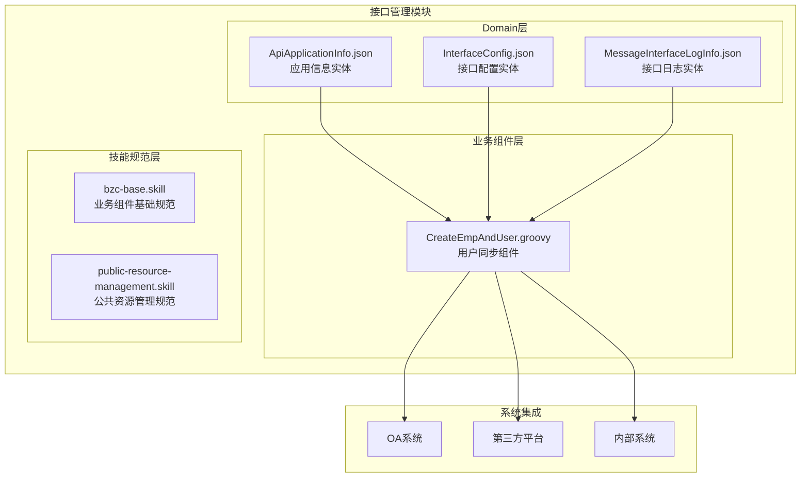
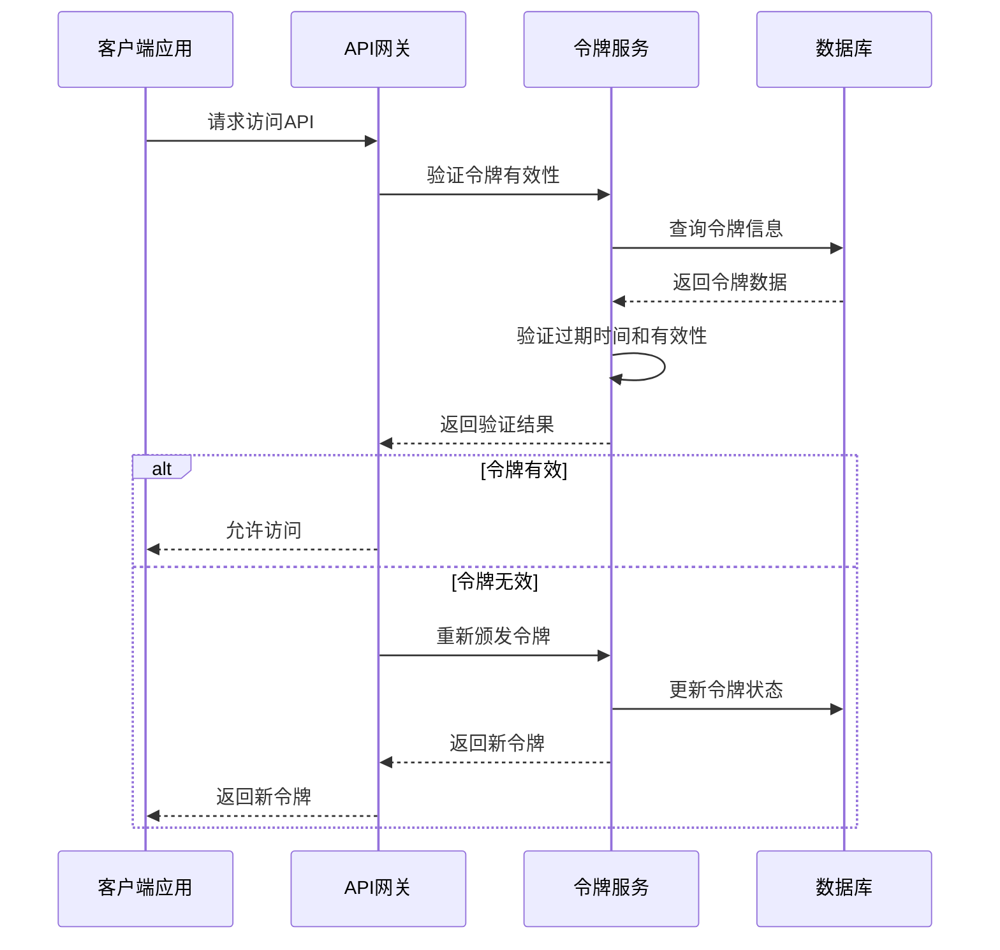
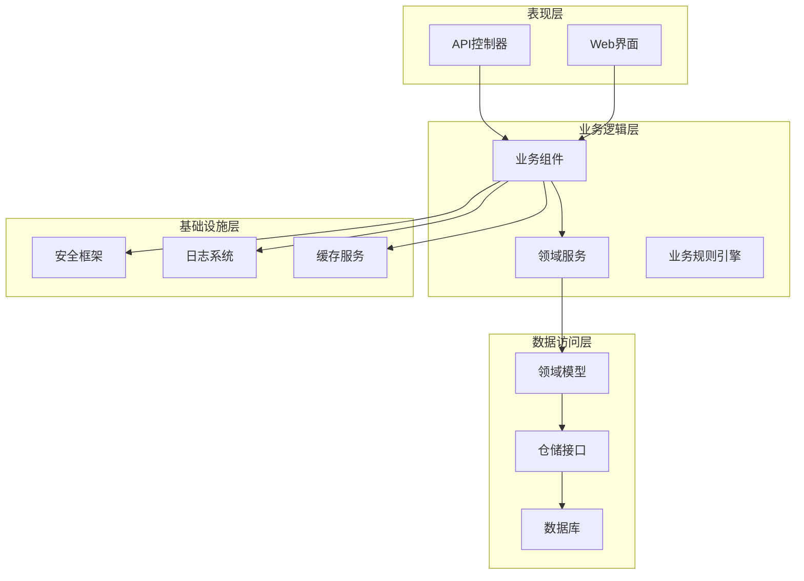
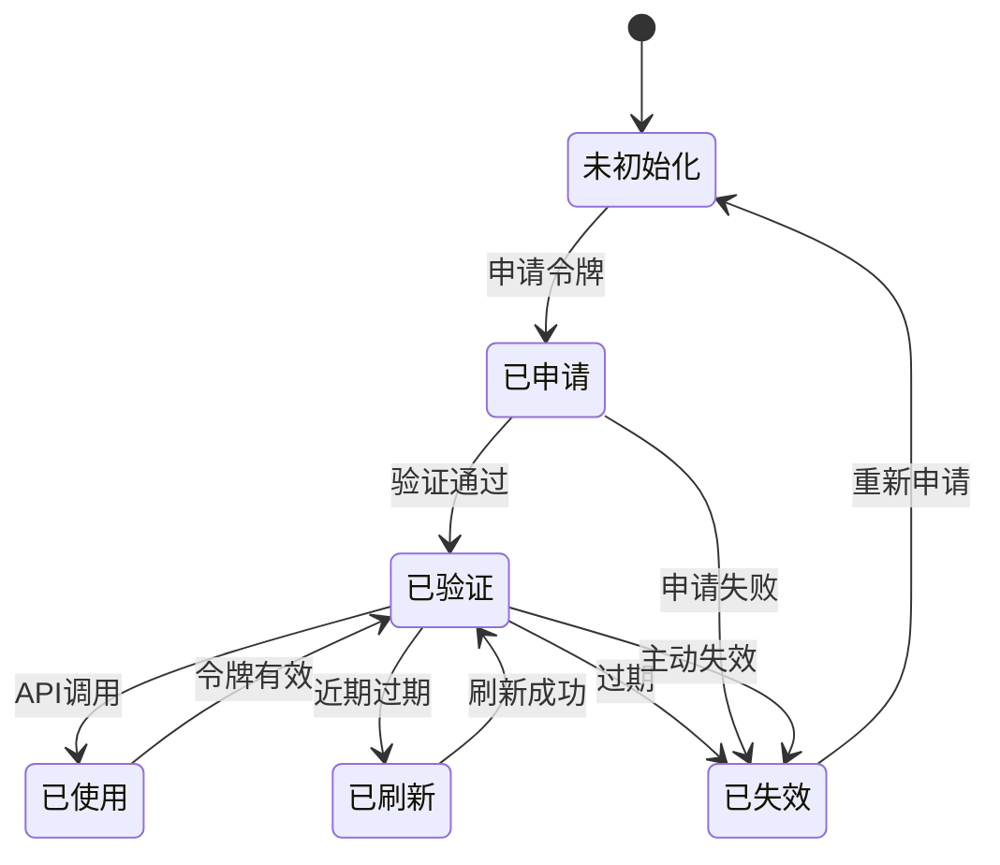
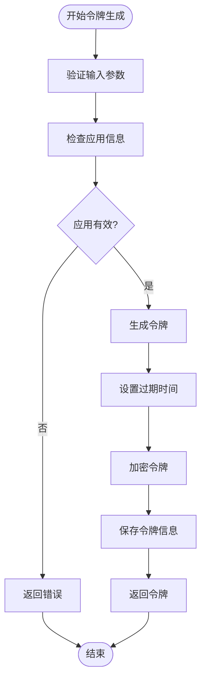
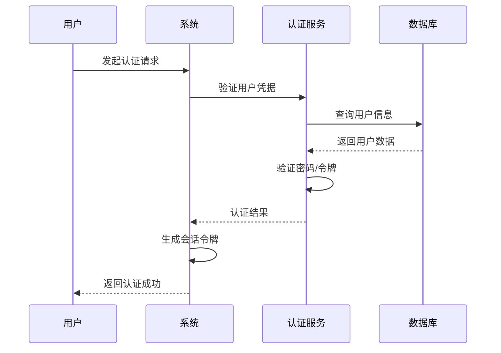
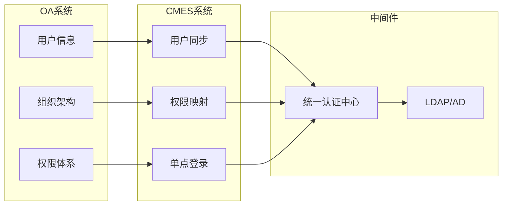
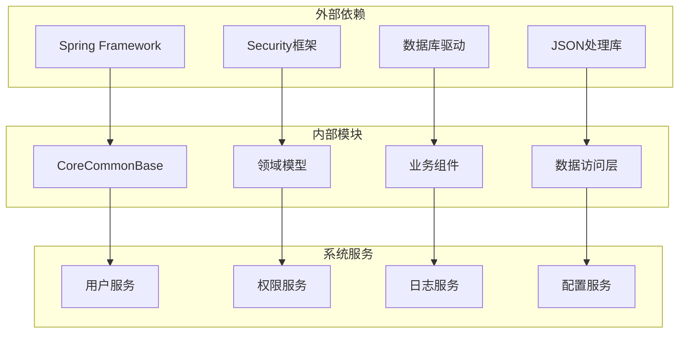
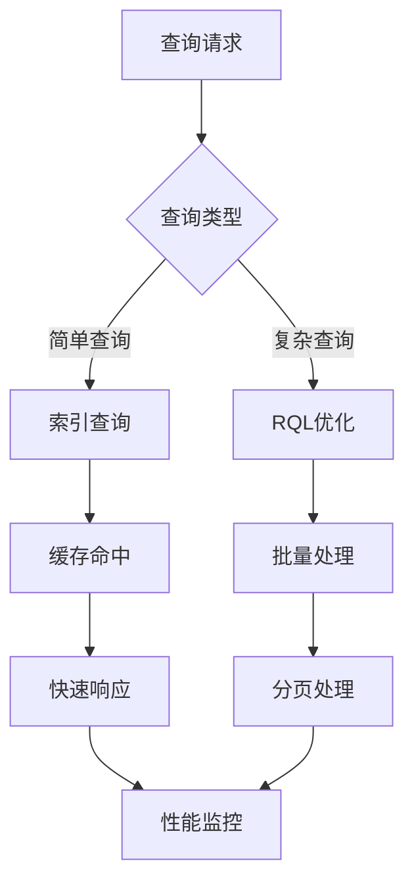

# API应用信息管理

<cite>
**本文档引用的文件**
- [ApiApplicationInfo.json](file://Domain/接口管理/ApiApplicationInfo.json)
- [InterfaceConfig.json](file://Domain/接口管理/InterfaceConfig.json)
- [MessageInterfaceLogInfo.json](file://Domain/接口管理/MessageInterfaceLogInfo.json)
- [CreateEmpAndUser.groovy](file://bzc/公共资源管理/人员管理/人员信息/CreateEmpAndUser.groovy)
- [bzc-base.skill](file://skills/architecture/bzc-base.skill)
- [public-resource-management.skill](file://skills/business/public-resource-management.skill)
</cite>

## 目录
1. [简介](#简介)
2. [项目结构](#项目结构)
3. [核心组件](#核心组件)
4. [架构概览](#架构概览)
5. [详细组件分析](#详细组件分析)
6. [依赖分析](#依赖分析)
7. [性能考虑](#性能考虑)
8. [故障排除指南](#故障排除指南)
9. [结论](#结论)

## 简介

API应用信息管理模块是CMES系统中负责管理第三方API应用接入的核心模块。该模块提供了完整的API应用生命周期管理功能，包括应用注册、配置、令牌管理和安全控制等关键能力。

本模块基于领域驱动设计（DDD）原则构建，采用分层架构模式，将业务逻辑与技术实现分离，确保系统的可维护性和可扩展性。模块支持多种数据类型的应用接入，包括OA系统集成、第三方平台对接等场景。

## 项目结构

CMES系统的API应用信息管理模块遵循清晰的分层架构设计：

**图表来源**
- [ApiApplicationInfo.json:1-431](file://Domain/接口管理/ApiApplicationInfo.json#L1-L431)
- [InterfaceConfig.json:1-379](file://Domain/接口管理/InterfaceConfig.json#L1-L379)
- [MessageInterfaceLogInfo.json:1-353](file://Domain/接口管理/MessageInterfaceLogInfo.json#L1-L353)

**章节来源**
- [ApiApplicationInfo.json:1-431](file://Domain/接口管理/ApiApplicationInfo.json#L1-L431)
- [InterfaceConfig.json:1-379](file://Domain/接口管理/InterfaceConfig.json#L1-L379)
- [MessageInterfaceLogInfo.json:1-353](file://Domain/接口管理/MessageInterfaceLogInfo.json#L1-L353)

## 核心组件

### ApiApplicationInfo实体

ApiApplicationInfo是API应用信息管理的核心实体，定义了第三方应用接入所需的所有关键信息。

#### 核心字段定义

| 字段名 | 数据类型 | 描述 | 约束条件 |
|--------|----------|------|----------|
| appId | String | 应用编码 | 长度255，可为空 |
| appDesc | String | 应用描述 | 长度255，可为空 |
| type | String | 数据类型 | 长度50，可为空 |
| policeNo | String | 警号 | 长度255，可为空 |
| userId | String | 用户编码 | 长度255，可为空 |
| tokenUrl | String | 令牌获取地址 | 长度255，可为空 |
| userToken | Text | 用户令牌信息 | 可为空 |
| appToken | Text | 应用令牌信息 | 可为空 |
| userExpireAt | Long | 用户令牌过期时间 | 时间戳格式，可为空 |
| appExpireAt | Long | 应用令牌过期时间 | 时间戳格式，可为空 |

#### 令牌管理机制

系统采用双令牌机制确保安全性：

**图表来源**
- [ApiApplicationInfo.json:191-320](file://Domain/接口管理/ApiApplicationInfo.json#L191-L320)

**章节来源**
- [ApiApplicationInfo.json:65-320](file://Domain/接口管理/ApiApplicationInfo.json#L65-L320)

### InterfaceConfig接口配置

InterfaceConfig实体负责管理API接口的配置信息，支持多平台、多环境的灵活配置。

#### 接口配置字段

| 字段名 | 数据类型 | 描述 | 约束条件 |
|--------|----------|------|----------|
| interfaceCode | String | 接口代号 | 长度50，可为空 |
| interfacename | String | 接口名称 | 长度30，可为空 |
| interfaceDescribe | String | 接口描述 | 长度200，可为空 |
| interfaceUrl | String | 接口路径配置 | 长度255，可为空 |
| serviceid | String | 服务ID | 长度255，可为空 |
| userid | String | 用户ID | 长度255，可为空 |
| subid | String | 主体ID | 长度255，可为空 |

**章节来源**
- [InterfaceConfig.json:65-242](file://Domain/接口管理/InterfaceConfig.json#L65-L242)

### MessageInterfaceLogInfo接口日志

MessageInterfaceLogInfo实体提供完整的接口调用日志记录功能，支持性能监控和审计追踪。

#### 日志记录字段

| 字段名 | 数据类型 | 描述 | 约束条件 |
|--------|----------|------|----------|
| logTime | Datetime | 日志时间 | 可为空 |
| interfaceCode | String | 接口代号 | 长度255，可为空 |
| inParam | Text | 入参 | JSON格式存储，可为空 |
| outParam | Text | 输出 | JSON格式存储，可为空 |
| result | Integer | 执行结果 | 1=成功，0=失败，可为空 |
| execTime | Decimal | 执行时长 | 精度18,6，可为空 |
| execExtTime | Decimal | 第三方时长 | 精度18,6，可为空 |

**章节来源**
- [MessageInterfaceLogInfo.json:65-242](file://Domain/接口管理/MessageInterfaceLogInfo.json#L65-L242)

## 架构概览

API应用信息管理模块采用分层架构设计，确保各层职责清晰、耦合度低：

**图表来源**
- [bzc-base.skill:1-162](file://skills/architecture/bzc-base.skill#L1-L162)
- [public-resource-management.skill:1-514](file://skills/business/public-resource-management.skill#L1-L514)

### 安全策略

系统实施多层次的安全防护策略：

1. **身份认证**：支持多种认证方式，包括OAuth、JWT、API Key等
2. **授权控制**：基于角色的访问控制（RBAC），细粒度权限管理
3. **数据加密**：敏感数据传输和存储加密
4. **审计日志**：完整的操作日志记录和追踪
5. **速率限制**：防止API滥用和DDoS攻击

## 详细组件分析

### 令牌管理系统

令牌管理系统是API应用信息管理的核心组件，负责令牌的生成、验证、刷新和失效处理。

#### 令牌生命周期管理

**图表来源**
- [ApiApplicationInfo.json:273-320](file://Domain/接口管理/ApiApplicationInfo.json#L273-L320)

#### 令牌生成流程

**图表来源**
- [ApiApplicationInfo.json:195-268](file://Domain/接口管理/ApiApplicationInfo.json#L195-L268)

**章节来源**
- [ApiApplicationInfo.json:195-320](file://Domain/接口管理/ApiApplicationInfo.json#L195-L320)

### 用户认证流程

系统支持多种用户认证方式，确保不同场景下的安全访问：

#### 认证流程图

**图表来源**
- [CreateEmpAndUser.groovy:140-200](file://bzc/公共资源管理/人员管理/人员信息/CreateEmpAndUser.groovy#L140-L200)

**章节来源**
- [CreateEmpAndUser.groovy:140-200](file://bzc/公共资源管理/人员管理/人员信息/CreateEmpAndUser.groovy#L140-L200)

### OA系统集成方案

系统提供完整的OA系统集成功能，支持统一身份认证和权限管理：

#### OA集成架构

**图表来源**
- [CreateEmpAndUser.groovy:1-200](file://bzc/公共资源管理/人员管理/人员信息/CreateEmpAndUser.groovy#L1-L200)

**章节来源**
- [CreateEmpAndUser.groovy:1-200](file://bzc/公共资源管理/人员管理/人员信息/CreateEmpAndUser.groovy#L1-L200)

## 依赖分析

API应用信息管理模块的依赖关系呈现清晰的层次化特征：

**图表来源**
- [bzc-base.skill:39-46](file://skills/architecture/bzc-base.skill#L39-L46)

### 技术栈依赖

| 依赖类型 | 组件 | 版本 | 用途 |
|----------|------|------|------|
| 核心框架 | Spring | 5.x | 依赖注入和AOP |
| 安全框架 | Spring Security | 5.x | 认证授权 |
| 数据库 | MongoDB | 4.x | 文档存储 |
| JSON处理 | Jackson | 2.x | 数据序列化 |
| 日志系统 | Logback | 1.x | 日志记录 |

**章节来源**
- [bzc-base.skill:39-46](file://skills/architecture/bzc-base.skill#L39-L46)

## 性能考虑

### 令牌性能优化

系统采用多种策略优化令牌管理性能：

1. **缓存策略**：热点令牌缓存，减少数据库查询
2. **批量操作**：支持批量令牌刷新和验证
3. **异步处理**：令牌过期检测采用异步任务
4. **连接池**：数据库连接池优化

### 查询性能优化

**图表来源**
- [public-resource-management.skill:481-495](file://skills/business/public-resource-management.skill#L481-L495)

## 故障排除指南

### 常见问题及解决方案

#### 令牌相关问题

| 问题类型 | 症状 | 可能原因 | 解决方案 |
|----------|------|----------|----------|
| 令牌过期 | 401未授权 | 过期时间设置不当 | 实施令牌刷新机制 |
| 令牌无效 | 认证失败 | 令牌格式错误 | 验证令牌格式和签名 |
| 令牌泄露 | 安全风险 | 传输过程未加密 | 启用HTTPS和加密存储 |
| 令牌冲突 | 并发问题 | 多实例竞争 | 实施分布式锁 |

#### 性能问题

| 问题类型 | 症状 | 可能原因 | 解决方案 |
|----------|------|----------|----------|
| 响应缓慢 | 接口超时 | 数据库查询慢 | 优化索引和查询 |
| 内存泄漏 | OOM错误 | 令牌缓存未清理 | 实施缓存清理策略 |
| 并发冲突 | 数据不一致 | 锁竞争 | 优化并发控制 |

**章节来源**
- [public-resource-management.skill:481-495](file://skills/business/public-resource-management.skill#L481-L495)

## 结论

API应用信息管理模块通过精心设计的架构和完善的组件实现了对第三方API应用的全面管理。模块具备以下核心优势：

1. **完整性**：覆盖应用注册、配置、令牌管理、安全控制等全流程
2. **安全性**：多层安全防护，支持多种认证方式
3. **可扩展性**：模块化设计，易于扩展新功能
4. **性能优化**：针对高并发场景进行专门优化
5. **可观测性**：完整的日志记录和监控能力

该模块为CMES系统的API生态建设奠定了坚实基础，支持企业级应用的稳定运行和持续发展。