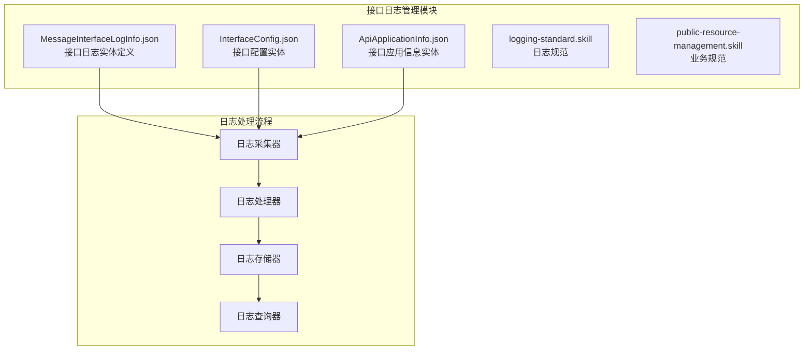
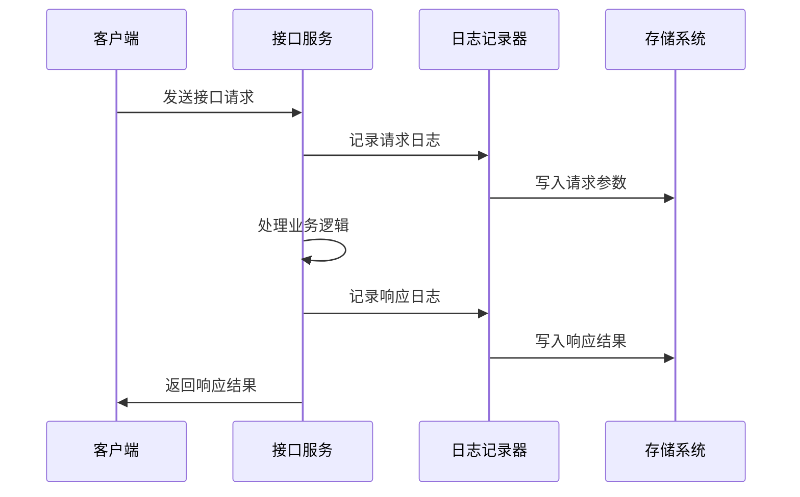
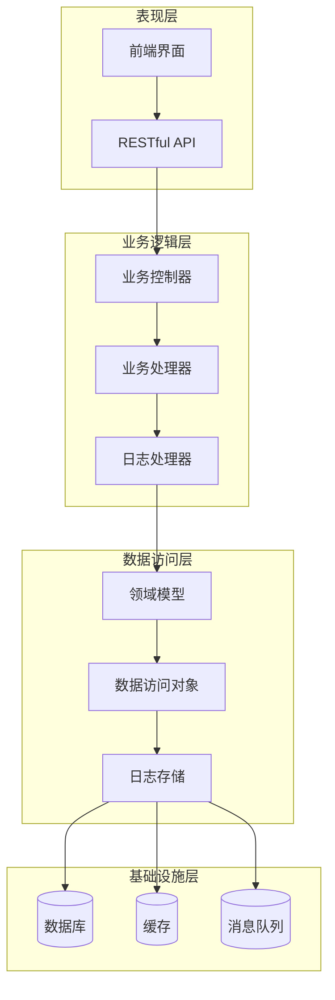
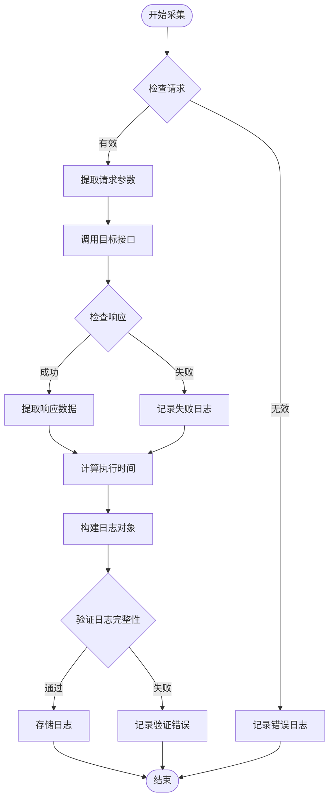
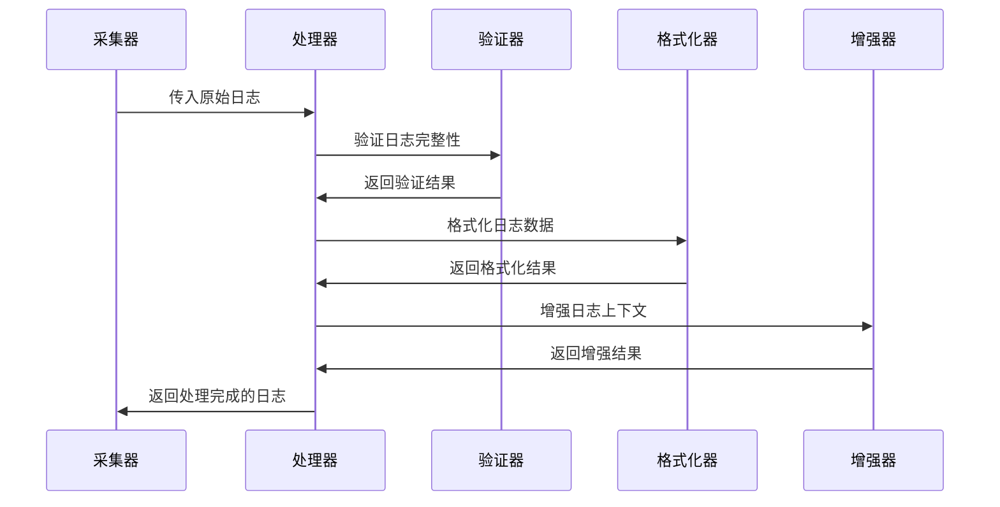
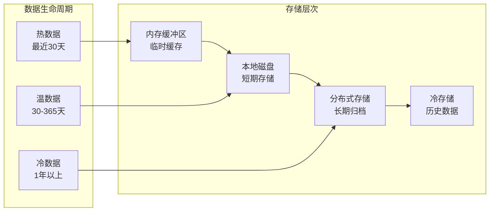
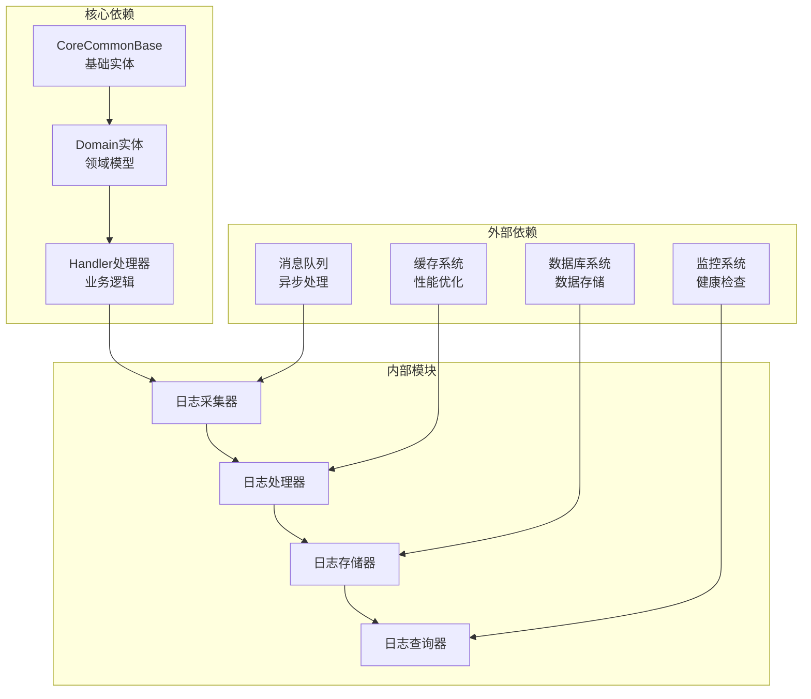
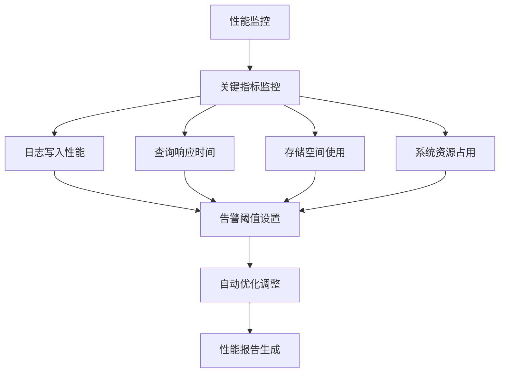
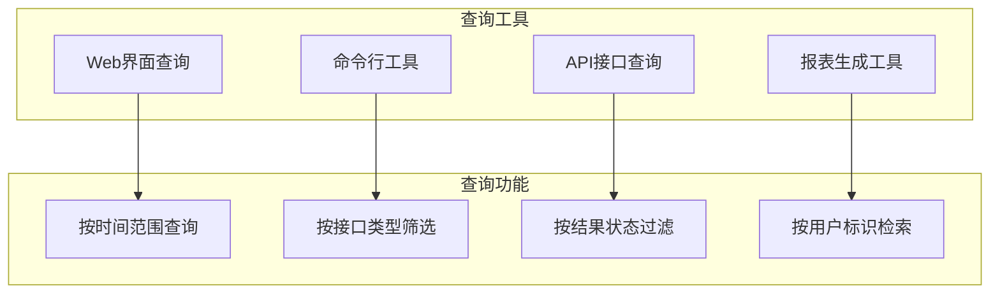

# 接口日志管理

<cite>
**本文档引用的文件**
- [MessageInterfaceLogInfo.json](file://Domain/接口管理/MessageInterfaceLogInfo.json)
- [InterfaceConfig.json](file://Domain/接口管理/InterfaceConfig.json)
- [ApiApplicationInfo.json](file://Domain/接口管理/ApiApplicationInfo.json)
- [logging-standard.skill](file://skills/foundation/logging-standard.skill)
- [public-resource-management.skill](file://skills/business/public-resource-management.skill)
</cite>

## 目录
1. [简介](#简介)
2. [项目结构](#项目结构)
3. [核心组件](#核心组件)
4. [架构概览](#架构概览)
5. [详细组件分析](#详细组件分析)
6. [依赖关系分析](#依赖关系分析)
7. [性能考虑](#性能考虑)
8. [故障排除指南](#故障排除指南)
9. [结论](#结论)

## 简介

接口日志管理模块是CMES（制造执行系统）中的关键基础设施组件，负责记录和管理所有接口调用的日志信息。该模块通过标准化的日志记录机制，为系统监控、故障诊断、性能分析和合规审计提供了全面的支持。

本模块的核心目标是：
- 统一接口调用日志的采集和存储标准
- 提供完整的日志查询和分析能力
- 支持异常监控和告警机制
- 确保日志数据的安全性和完整性
- 为运维人员提供高效的日志管理工具

## 项目结构

接口日志管理模块主要由以下核心文件组成：

**图表来源**
- [MessageInterfaceLogInfo.json:1-353](file://Domain/接口管理/MessageInterfaceLogInfo.json#L1-L353)
- [InterfaceConfig.json:1-379](file://Domain/接口管理/InterfaceConfig.json#L1-L379)
- [ApiApplicationInfo.json:1-431](file://Domain/接口管理/ApiApplicationInfo.json#L1-L431)

**章节来源**
- [MessageInterfaceLogInfo.json:1-353](file://Domain/接口管理/MessageInterfaceLogInfo.json#L1-L353)
- [InterfaceConfig.json:1-379](file://Domain/接口管理/InterfaceConfig.json#L1-L379)
- [ApiApplicationInfo.json:1-431](file://Domain/接口管理/ApiApplicationInfo.json#L1-L431)

## 核心组件

### MessageInterfaceLogInfo 实体

MessageInterfaceLogInfo 是接口日志管理的核心实体，定义了完整的日志记录结构和字段规范。

#### 核心字段定义

| 字段名 | 数据类型 | 描述 | 用途 |
|--------|----------|------|------|
| logTime | Datetime | 日志时间戳 | 记录接口调用的具体时间 |
| interfaceCode | String | 接口代号 | 标识调用的接口类型 |
| inParam | Text | 入参 | JSON格式存储的请求参数 |
| outParam | Text | 输出 | JSON格式存储的响应结果 |
| result | Integer | 执行结果 | 1表示成功，0表示失败 |
| execTime | Decimal | 执行时长 | 接口执行耗时（秒） |
| execExtTime | Decimal | 第三方时长 | 外部接口调用耗时（秒） |
| createUser | String | 创建用户 | 日志创建者信息 |
| createTime | Datetime | 创建时间 | 日志记录时间 |

#### 日志记录机制

**图表来源**
- [logging-standard.skill:54-61](file://skills/foundation/logging-standard.skill#L54-L61)

**章节来源**
- [MessageInterfaceLogInfo.json:65-241](file://Domain/接口管理/MessageInterfaceLogInfo.json#L65-L241)

### InterfaceConfig 实体

InterfaceConfig 实体用于管理接口配置信息，为日志记录提供上下文数据。

#### 接口配置字段

| 字段名 | 数据类型 | 描述 | 用途 |
|--------|----------|------|------|
| interfaceCode | String | 接口代号 | 唯一标识接口 |
| interfacename | String | 接口名称 | 接口显示名称 |
| interfaceUrl | String | 接口路径 | 接口访问URL |
| serviceid | String | 服务ID | 服务标识符 |
| userid | String | 用户ID | 调用用户标识 |
| subid | String | 主体ID | 业务主体标识 |
| executionTime | Datetime | 执行时间 | 接口执行时间戳 |

**章节来源**
- [InterfaceConfig.json:65-241](file://Domain/接口管理/InterfaceConfig.json#L65-L241)

### ApiApplicationInfo 实体

ApiApplicationInfo 实体管理API应用相关信息，为日志记录提供应用级别的上下文。

#### 应用信息字段

| 字段名 | 数据类型 | 描述 | 用途 |
|--------|----------|------|------|
| appId | String | 应用编码 | 应用唯一标识 |
| appDesc | String | 应用描述 | 应用功能描述 |
| type | String | 数据类型 | 应用类型标识 |
| policeNo | String | 警号 | 用户身份标识 |
| userId | String | 用户编码 | 用户唯一标识 |
| tokenUrl | String | 令牌获取地址 | Token获取URL |
| userToken | Text | 用户令牌信息 | 用户认证令牌 |
| appToken | Text | 应用令牌信息 | 应用认证令牌 |
| userExpireAt | Long | 用户令牌过期时间 | Token过期时间戳 |
| appExpireAt | Long | 应用令牌过期时间 | Token过期时间戳 |

**章节来源**
- [ApiApplicationInfo.json:65-320](file://Domain/接口管理/ApiApplicationInfo.json#L65-L320)

## 架构概览

接口日志管理模块采用分层架构设计，确保系统的可扩展性和可维护性。

**图表来源**
- [logging-standard.skill:14-24](file://skills/foundation/logging-standard.skill#L14-L24)

## 详细组件分析

### 日志采集器组件

日志采集器是接口日志管理的核心组件，负责实时捕获接口调用信息并进行初步处理。

#### 采集流程

**图表来源**
- [logging-standard.skill:44-52](file://skills/foundation/logging-standard.skill#L44-L52)

#### 关键特性

1. **实时采集**: 支持异步日志采集，不影响接口正常响应
2. **参数过滤**: 自动过滤敏感信息，保护用户隐私
3. **时间统计**: 精确记录接口执行时间和网络延迟
4. **异常处理**: 完善的异常捕获和恢复机制

**章节来源**
- [logging-standard.skill:54-61](file://skills/foundation/logging-standard.skill#L54-L61)

### 日志处理器组件

日志处理器负责对采集到的日志数据进行格式化、验证和增强处理。

#### 处理流程

**图表来源**
- [logging-standard.skill:25-32](file://skills/foundation/logging-standard.skill#L25-L32)

#### 处理功能

1. **数据验证**: 检查必填字段和数据类型
2. **格式转换**: 将复杂数据结构转换为标准格式
3. **上下文增强**: 添加调用方信息、时间戳等元数据
4. **压缩优化**: 对大容量日志进行压缩存储

**章节来源**
- [logging-standard.skill:63-77](file://skills/foundation/logging-standard.skill#L63-L77)

### 日志存储组件

日志存储组件提供高效、可靠的日志数据持久化能力。

#### 存储策略

**图表来源**
- [MessageInterfaceLogInfo.json:123-163](file://Domain/接口管理/MessageInterfaceLogInfo.json#L123-L163)

#### 存储特性

1. **分层存储**: 根据数据新鲜度采用不同的存储策略
2. **自动清理**: 定期清理过期日志数据
3. **压缩存储**: 采用高效的压缩算法减少存储空间
4. **备份机制**: 多副本备份确保数据安全

**章节来源**
- [MessageInterfaceLogInfo.json:175-215](file://Domain/接口管理/MessageInterfaceLogInfo.json#L175-L215)

## 依赖关系分析

接口日志管理模块与其他系统组件存在密切的依赖关系。

**图表来源**
- [MessageInterfaceLogInfo.json:29](file://Domain/接口管理/MessageInterfaceLogInfo.json#L29)
- [InterfaceConfig.json:29](file://Domain/接口管理/InterfaceConfig.json#L29)

### 依赖关系特点

1. **低耦合高内聚**: 各组件职责明确，相互依赖程度适中
2. **可扩展性强**: 支持新的日志类型和存储策略
3. **容错能力**: 具备完善的异常处理和恢复机制
4. **性能优化**: 采用异步处理和缓存机制提升性能

**章节来源**
- [public-resource-management.skill:100-102](file://skills/business/public-resource-management.skill#L100-L102)

## 性能考虑

接口日志管理模块在设计时充分考虑了性能影响，采用了多种优化策略。

### 性能指标

| 指标类型 | 目标值 | 说明 |
|----------|--------|------|
| 日志写入延迟 | < 100ms | 单条日志写入时间 |
| 并发处理能力 | > 1000 QPS | 同时处理的日志数量 |
| 存储空间利用率 | > 80% | 有效存储空间占比 |
| 查询响应时间 | < 500ms | 常用查询平均响应 |
| 系统资源占用 | < 50% | CPU和内存使用率 |

### 性能优化策略

1. **异步处理**: 采用异步写入机制，避免阻塞主线程
2. **批量写入**: 将多个日志合并为批次写入，减少IO操作
3. **智能缓存**: 缓存热点日志数据，提升查询性能
4. **索引优化**: 为常用查询字段建立合适索引
5. **数据压缩**: 对日志数据进行压缩存储，节省空间

### 性能监控

**图表来源**
- [logging-standard.skill:105-115](file://skills/foundation/logging-standard.skill#L105-L115)

## 故障排除指南

### 常见问题及解决方案

#### 日志丢失问题

**问题现象**: 部分接口调用日志无法查询到

**可能原因**:
1. 日志采集器异常停止
2. 存储系统故障
3. 网络传输中断
4. 缓存失效

**解决方案**:
1. 检查日志采集器运行状态
2. 验证存储系统可用性
3. 监控网络连接稳定性
4. 清理缓存并重新加载

#### 日志查询缓慢

**问题现象**: 日志查询响应时间过长

**可能原因**:
1. 查询条件过于宽泛
2. 缺少合适的索引
3. 数据量过大
4. 系统资源不足

**解决方案**:
1. 优化查询条件和时间范围
2. 为常用查询字段添加索引
3. 分页查询和限制结果集大小
4. 增加系统资源或优化配置

#### 存储空间不足

**问题现象**: 磁盘空间使用率达到上限

**可能原因**:
1. 日志数据增长过快
2. 清理策略配置不当
3. 存储空间分配不合理
4. 数据重复或冗余

**解决方案**:
1. 调整日志保留期限
2. 优化存储策略和压缩比
3. 增加存储空间或清理历史数据
4. 审计日志数据质量和重复情况

### 调试工具和方法

#### 日志查询工具

#### 性能分析工具

1. **日志分析器**: 分析日志模式和异常趋势
2. **性能监控器**: 实时监控系统性能指标
3. **容量规划器**: 预测存储需求和容量规划
4. **告警系统**: 自动检测异常并发送告警

**章节来源**
- [logging-standard.skill:87-103](file://skills/foundation/logging-standard.skill#L87-L103)

## 结论

接口日志管理模块通过标准化的日志记录机制和完善的管理体系，为CMES系统的稳定运行提供了重要保障。该模块具有以下显著优势：

1. **标准化程度高**: 统一的日志格式和记录规范
2. **功能完善**: 覆盖日志采集、存储、查询、分析的全流程
3. **性能优异**: 采用多种优化策略确保系统高性能运行
4. **安全可靠**: 完善的安全保护和访问控制机制
5. **易于维护**: 清晰的架构设计和丰富的监控工具

通过持续的优化和完善，接口日志管理模块将继续为CMES系统的数字化转型提供强有力的技术支撑。