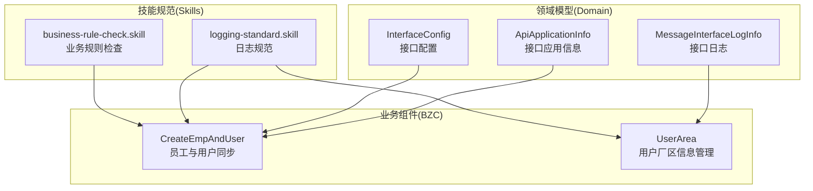
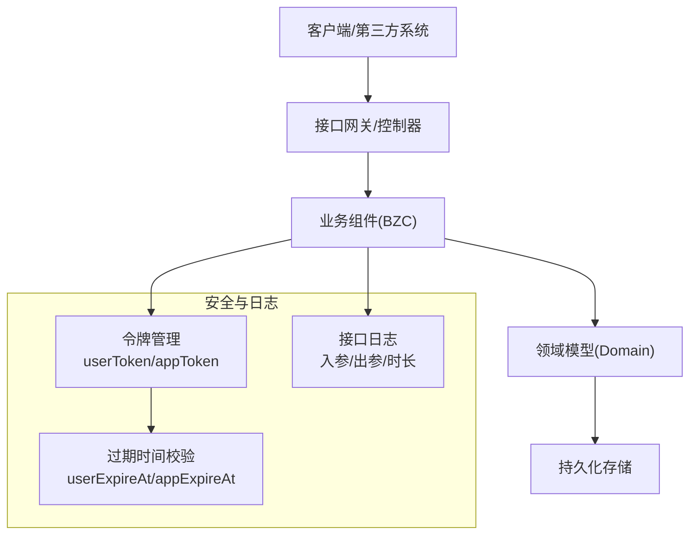
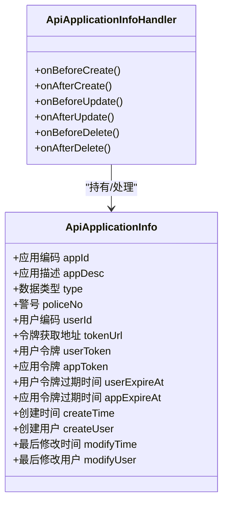
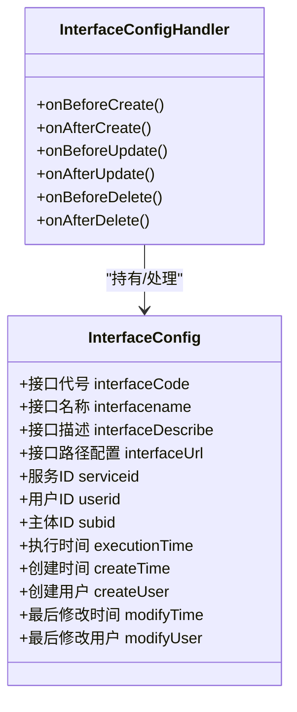
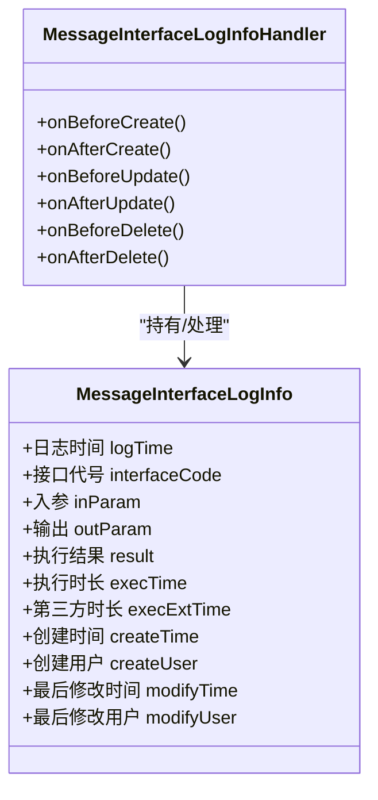
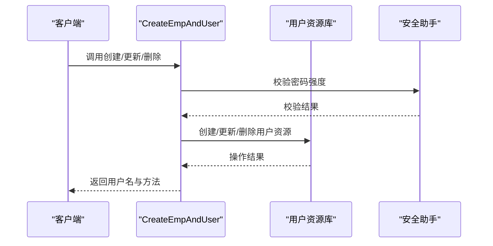
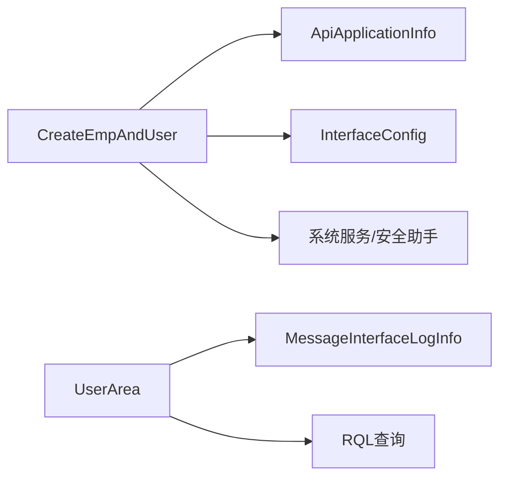

# 接口管理系统

<cite>
**本文档引用的文件**
- [ApiApplicationInfo.json](file://Domain/接口管理/ApiApplicationInfo.json)
- [InterfaceConfig.json](file://Domain/接口管理/InterfaceConfig.json)
- [MessageInterfaceLogInfo.json](file://Domain/接口管理/MessageInterfaceLogInfo.json)
- [CreateEmpAndUser.groovy](file://bzc/公共资源管理/人员管理/人员信息/CreateEmpAndUser.groovy)
- [UserArea.groovy](file://bzc/公共资源管理/人员管理/人员信息/UserArea.groovy)
- [README.md](file://skills/README.md)
- [logging-standard.skill](file://skills/foundation/logging-standard.skill)
- [business-rule-check.skill](file://skills/foundation/business-rule-check.skill)
</cite>

## 目录
1. [简介](#简介)
2. [项目结构](#项目结构)
3. [核心组件](#核心组件)
4. [架构概览](#架构概览)
5. [详细组件分析](#详细组件分析)
6. [依赖分析](#依赖分析)
7. [性能考虑](#性能考虑)
8. [故障排除指南](#故障排除指南)
9. [结论](#结论)
10. [附录](#附录)

## 简介
本文件为CMES接口管理系统的详细技术文档，面向API开发者与集成工程师，全面阐述接口应用信息管理、接口配置管理、接口日志管理三大核心功能模块的设计理念、数据模型、处理流程与最佳实践。文档同时覆盖接口安全机制、认证授权流程、数据传输协议、版本管理与向后兼容策略，并提供与OA系统的集成方案与第三方系统对接实现思路。

## 项目结构
系统采用分层架构，核心围绕“领域模型（Domain）+ 业务组件（BZC）+ 技能规范（Skills）”组织：
- Domain层：定义接口应用信息、接口配置、接口日志等核心实体及其属性与元数据
- BZC层：封装业务逻辑，如用户与员工同步、用户厂区信息维护等
- Skills层：提供日志规范、业务规则检查、错误处理等开发与质量保障规范

**图表来源**
- [ApiApplicationInfo.json:1-431](file://Domain/接口管理/ApiApplicationInfo.json#L1-L431)
- [InterfaceConfig.json:1-379](file://Domain/接口管理/InterfaceConfig.json#L1-L379)
- [MessageInterfaceLogInfo.json:1-353](file://Domain/接口管理/MessageInterfaceLogInfo.json#L1-L353)
- [CreateEmpAndUser.groovy:1-590](file://bzc/公共资源管理/人员管理/人员信息/CreateEmpAndUser.groovy#L1-L590)
- [UserArea.groovy:1-235](file://bzc/公共资源管理/人员管理/人员信息/UserArea.groovy#L1-L235)
- [README.md:1-63](file://skills/README.md#L1-L63)

**章节来源**
- [README.md:1-63](file://skills/README.md#L1-L63)

## 核心组件
本节对三大核心组件进行深入分析，包括数据模型、关键属性、处理流程与集成点。

- 接口应用信息（ApiApplicationInfo）
  - 用途：存储应用与用户的身份凭证、令牌获取地址及过期时间等
  - 关键属性：应用编码、应用描述、数据类型、警号、用户编码、令牌获取地址、用户令牌、应用令牌、用户令牌过期时间、应用令牌过期时间等
  - 处理：领域处理器支持创建/更新/删除前后的事件钩子，便于扩展安全与审计逻辑

- 接口配置（InterfaceConfig）
  - 用途：定义接口的代号、名称、描述、路径配置以及服务/用户/主体ID等
  - 关键属性：接口代号、接口名称、接口描述、接口路径配置、服务ID、用户ID、主体ID、执行时间等
  - 处理：领域处理器提供生命周期事件，便于在接口注册/变更时执行校验与联动

- 接口日志（MessageInterfaceLogInfo）
  - 用途：记录接口执行的入参、出参、执行结果、执行时长、第三方接口耗时等
  - 关键属性：日志时间、接口代号、入参（JSON）、输出（JSON）、执行结果（成功/失败）、执行时长、第三方时长等
  - 处理：领域处理器提供生命周期事件，便于在日志落库前后进行格式化与归档

**章节来源**
- [ApiApplicationInfo.json:34-431](file://Domain/接口管理/ApiApplicationInfo.json#L34-L431)
- [InterfaceConfig.json:34-379](file://Domain/接口管理/InterfaceConfig.json#L34-L379)
- [MessageInterfaceLogInfo.json:34-353](file://Domain/接口管理/MessageInterfaceLogInfo.json#L34-L353)

## 架构概览
系统整体架构以领域模型为核心，业务组件负责具体业务流程，技能规范保障开发质量与一致性。接口安全与认证授权通过应用/用户令牌与过期时间实现，结合日志体系实现可追溯性。

**图表来源**
- [ApiApplicationInfo.json:191-320](file://Domain/接口管理/ApiApplicationInfo.json#L191-L320)
- [InterfaceConfig.json:139-242](file://Domain/接口管理/InterfaceConfig.json#L139-L242)
- [MessageInterfaceLogInfo.json:61-242](file://Domain/接口管理/MessageInterfaceLogInfo.json#L61-L242)

## 详细组件分析

### 组件A：接口应用信息管理
- 数据模型与关系
  - 应用信息实体包含应用标识、用户标识、令牌获取地址、令牌内容与过期时间等字段
  - 过期时间采用时间戳表示，便于统一计算与比较
- 处理流程
  - 创建/更新时触发领域处理器事件，可用于生成/刷新令牌与校验令牌有效性
  - 删除时清理相关令牌与关联数据
- 安全要点
  - 令牌内容字段采用文本类型存储，需配合访问控制与传输加密
  - 过期时间字段用于强制刷新，降低长期有效令牌的风险

**图表来源**
- [ApiApplicationInfo.json:34-431](file://Domain/接口管理/ApiApplicationInfo.json#L34-L431)

**章节来源**
- [ApiApplicationInfo.json:34-431](file://Domain/接口管理/ApiApplicationInfo.json#L34-L431)

### 组件B：接口配置管理
- 数据模型与关系
  - 接口配置实体包含接口代号、名称、描述、路径配置与服务/用户/主体ID等
  - 支持记录接口执行时间，便于监控与审计
- 处理流程
  - 新增/修改接口配置时，可通过领域处理器执行业务规则检查与联动更新
  - 删除时需检查是否存在依赖，避免破坏性变更

**图表来源**
- [InterfaceConfig.json:34-379](file://Domain/接口管理/InterfaceConfig.json#L34-L379)

**章节来源**
- [InterfaceConfig.json:34-379](file://Domain/接口管理/InterfaceConfig.json#L34-L379)

### 组件C：接口日志管理
- 数据模型与关系
  - 日志实体记录接口调用的关键信息，包括入参、出参、执行结果与耗时
  - 支持区分系统内部执行时长与第三方接口执行时长
- 处理流程
  - 接口调用前后通过领域处理器记录日志，便于问题定位与性能分析
  - 日志字段采用文本类型存储JSON，便于灵活扩展

**图表来源**
- [MessageInterfaceLogInfo.json:34-353](file://Domain/接口管理/MessageInterfaceLogInfo.json#L34-L353)

**章节来源**
- [MessageInterfaceLogInfo.json:34-353](file://Domain/接口管理/MessageInterfaceLogInfo.json#L34-L353)

### 组件D：业务组件与安全集成
- 员工与用户同步（CreateEmpAndUser）
  - 提供创建/更新/删除员工与系统用户的同步能力
  - 支持密码强度校验、默认角色合并、用户分类目录检查与创建
  - 通过领域模型与系统服务实现用户资源的创建、更新与删除
- 用户厂区信息管理（UserArea）
  - 提供用户默认厂区的保存、获取与下拉选择数据查询
  - 使用RQL批量查询避免N+1问题，提升性能

**图表来源**
- [CreateEmpAndUser.groovy:91-130](file://bzc/公共资源管理/人员管理/人员信息/CreateEmpAndUser.groovy#L91-L130)
- [CreateEmpAndUser.groovy:419-428](file://bzc/公共资源管理/人员管理/人员信息/CreateEmpAndUser.groovy#L419-L428)

**章节来源**
- [CreateEmpAndUser.groovy:1-590](file://bzc/公共资源管理/人员管理/人员信息/CreateEmpAndUser.groovy#L1-L590)
- [UserArea.groovy:1-235](file://bzc/公共资源管理/人员管理/人员信息/UserArea.groovy#L1-L235)

## 依赖分析
- 组件耦合关系
  - 业务组件依赖领域模型与系统服务，通过资源库与安全助手实现用户与资源管理
  - 领域模型通过处理器扩展生命周期事件，增强可维护性与可扩展性
- 外部依赖
  - 系统服务与安全助手提供密码强度校验、资源创建/更新/删除等能力
  - RQL查询用于批量数据获取，减少数据库往返次数

**图表来源**
- [CreateEmpAndUser.groovy:1-590](file://bzc/公共资源管理/人员管理/人员信息/CreateEmpAndUser.groovy#L1-L590)
- [UserArea.groovy:1-235](file://bzc/公共资源管理/人员管理/人员信息/UserArea.groovy#L1-L235)
- [ApiApplicationInfo.json:34-431](file://Domain/接口管理/ApiApplicationInfo.json#L34-L431)
- [InterfaceConfig.json:34-379](file://Domain/接口管理/InterfaceConfig.json#L34-L379)
- [MessageInterfaceLogInfo.json:34-353](file://Domain/接口管理/MessageInterfaceLogInfo.json#L34-L353)

**章节来源**
- [CreateEmpAndUser.groovy:1-590](file://bzc/公共资源管理/人员管理/人员信息/CreateEmpAndUser.groovy#L1-L590)
- [UserArea.groovy:1-235](file://bzc/公共资源管理/人员管理/人员信息/UserArea.groovy#L1-L235)

## 性能考虑
- 批量查询优化
  - 使用RQL批量查询避免N+1问题，减少数据库压力
- 日志记录策略
  - 控制日志体量，避免记录大对象与敏感信息
  - 在循环中谨慎记录日志，防止日志风暴
- 令牌管理
  - 合理设置令牌过期时间，平衡安全性与用户体验
  - 定期轮换令牌，降低泄露风险

**章节来源**
- [UserArea.groovy:147-155](file://bzc/公共资源管理/人员管理/人员信息/UserArea.groovy#L147-L155)
- [logging-standard.skill:1-115](file://skills/foundation/logging-standard.skill#L1-L115)

## 故障排除指南
- 常见问题与处理
  - 密码强度不足：根据系统配置的最小密码强度要求进行校验，不符合将抛出异常
  - 用户资源不存在：在创建用户前检查并创建用户分类目录，确保路径正确
  - 外部接口调用失败：记录请求与响应日志，定位问题并重试
- 错误处理规范
  - 使用SysException抛出业务异常，消息包含操作、主体与原因
  - 成功返回使用SysResult.OK，保持接口一致性

**章节来源**
- [CreateEmpAndUser.groovy:419-428](file://bzc/公共资源管理/人员管理/人员信息/CreateEmpAndUser.groovy#L419-L428)
- [logging-standard.skill:43-52](file://skills/foundation/logging-standard.skill#L43-L52)

## 结论
CMES接口管理系统通过清晰的领域模型、可扩展的业务组件与严格的技能规范，实现了接口应用信息、接口配置与接口日志的全生命周期管理。结合令牌管理与日志体系，系统在保证安全性的同时具备良好的可观测性与可维护性。建议在实际集成中遵循本文档的安全与性能建议，确保系统稳定运行。

## 附录

### 接口安全机制与认证授权流程
- 令牌管理
  - 应用令牌与用户令牌分别存储，支持独立过期时间控制
  - 令牌获取地址支持多环境配置，便于跨平台部署
- 认证授权
  - 通过应用/用户令牌进行身份识别与权限校验
  - 建议在接口层增加统一的鉴权拦截器，集中处理令牌校验与权限判断

**章节来源**
- [ApiApplicationInfo.json:191-320](file://Domain/接口管理/ApiApplicationInfo.json#L191-L320)

### 数据传输协议与版本管理
- 协议建议
  - 优先使用HTTPS与JSON格式传输，确保数据完整性与机密性
  - 接口路径配置支持版本前缀，便于演进与向后兼容
- 版本管理
  - 采用语义化版本控制，重大变更发布新版本并标注废弃旧版本
  - 通过接口描述与执行时间记录版本演进轨迹

**章节来源**
- [InterfaceConfig.json:139-242](file://Domain/接口管理/InterfaceConfig.json#L139-L242)

### 与OA系统的集成方案
- 集成点
  - 通过接口配置定义OA接口的路径与参数
  - 使用日志记录外部接口调用的请求与响应，便于排障
- 实施步骤
  - 在接口配置中注册OA接口代号与路径
  - 在业务组件中调用OA接口并记录日志
  - 监控执行时长与第三方时长，评估集成性能

**章节来源**
- [InterfaceConfig.json:139-242](file://Domain/接口管理/InterfaceConfig.json#L139-L242)
- [MessageInterfaceLogInfo.json:61-242](file://Domain/接口管理/MessageInterfaceLogInfo.json#L61-L242)

### 第三方系统对接实现方案
- 对接流程
  - 在接口配置中定义第三方接口的路径与参数
  - 在业务组件中封装第三方调用逻辑，统一异常处理与日志记录
  - 通过接口日志统计第三方接口的执行时长与成功率
- 最佳实践
  - 对第三方接口调用增加超时与重试机制
  - 使用令牌管理与过期时间控制第三方访问权限

**章节来源**
- [MessageInterfaceLogInfo.json:61-242](file://Domain/接口管理/MessageInterfaceLogInfo.json#L61-L242)
- [ApiApplicationInfo.json:191-320](file://Domain/接口管理/ApiApplicationInfo.json#L191-L320)