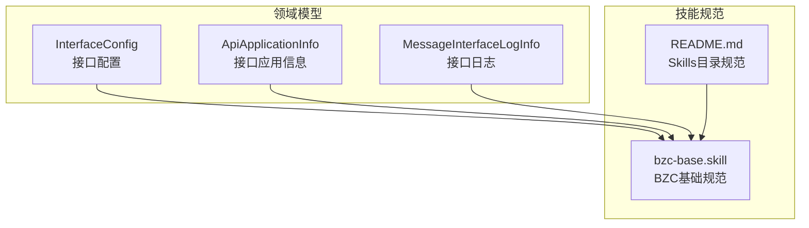
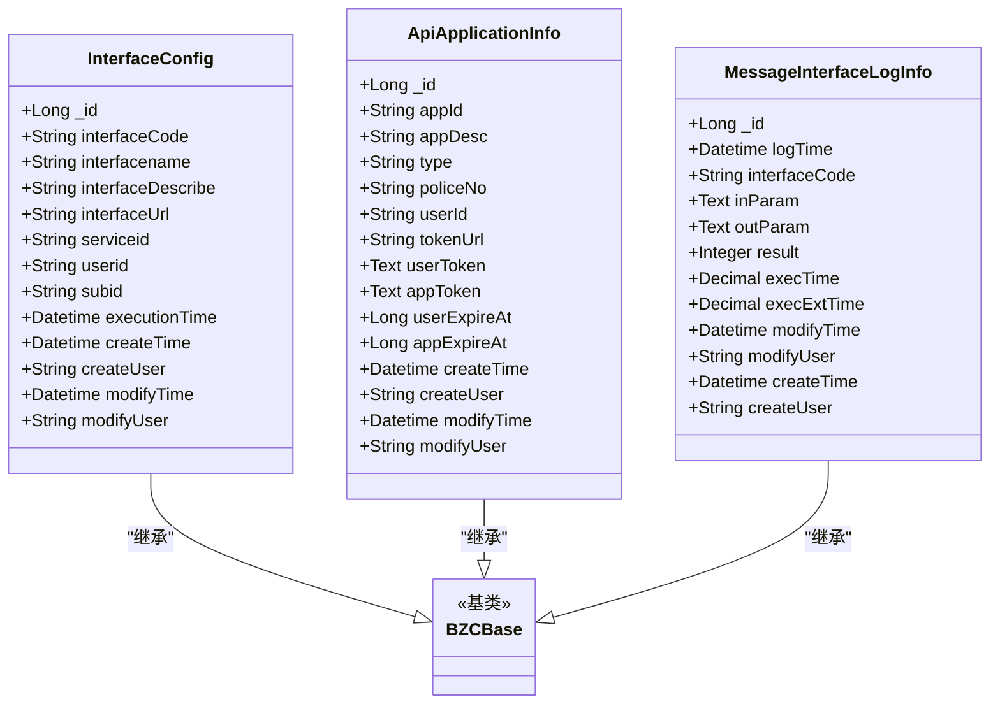
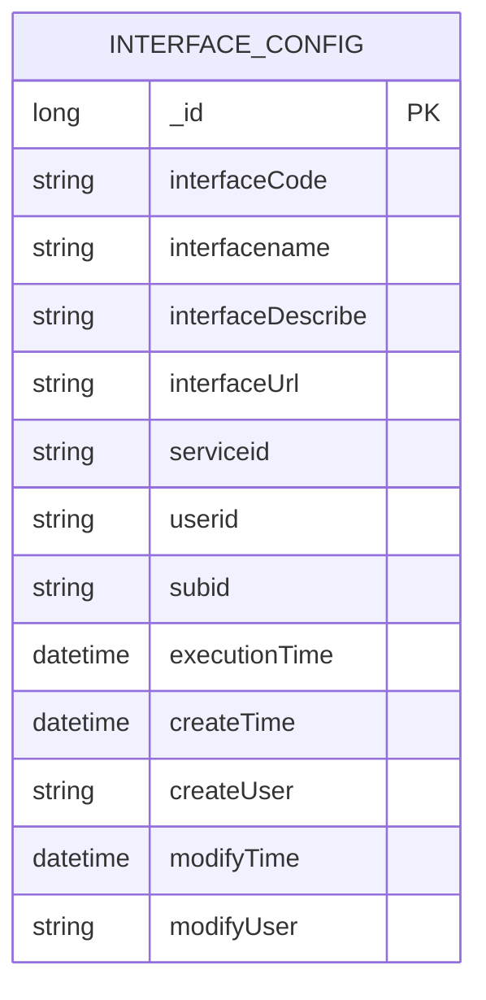
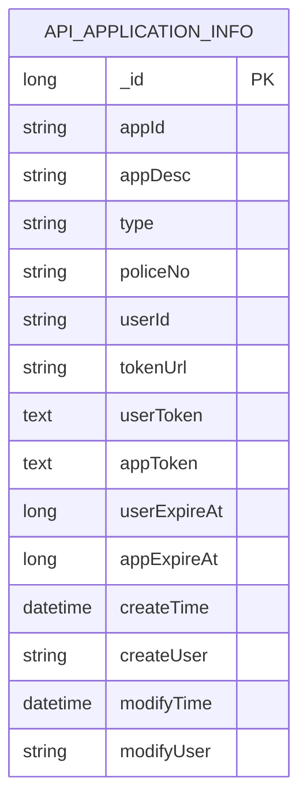
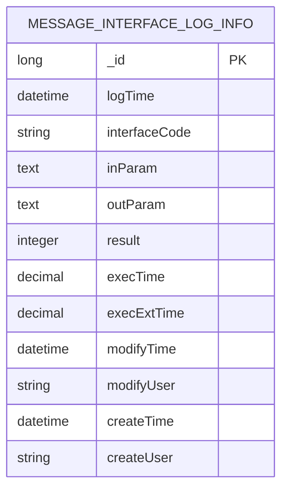
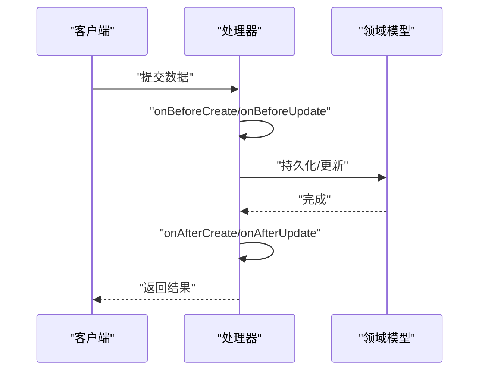
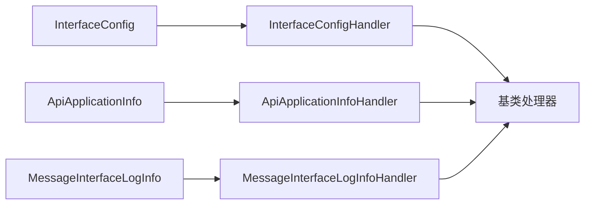

# 接口配置管理

<cite>
**本文档引用的文件**
- [InterfaceConfig.json](file://Domain/接口管理/InterfaceConfig.json)
- [ApiApplicationInfo.json](file://Domain/接口管理/ApiApplicationInfo.json)
- [MessageInterfaceLogInfo.json](file://Domain/接口管理/MessageInterfaceLogInfo.json)
- [bzc-base.skill](file://skills/architecture/bzc-base.skill)
- [README.md](file://skills/README.md)
</cite>

## 目录
1. [简介](#简介)
2. [项目结构](#项目结构)
3. [核心组件](#核心组件)
4. [架构总览](#架构总览)
5. [详细组件分析](#详细组件分析)
6. [依赖分析](#依赖分析)
7. [性能考虑](#性能考虑)
8. [故障排查指南](#故障排查指南)
9. [结论](#结论)
10. [附录](#附录)

## 简介
本文件面向系统管理员与开发工程师，系统化梳理接口配置管理模块的设计与实现要点，围绕以下目标展开：
- 深入解析 InterfaceConfig 实体的数据结构与配置参数定义
- 解释接口路由配置、访问控制规则、请求限制设置与响应格式定义
- 提供接口启用/禁用、参数验证、权限控制的配置指南
- 覆盖接口版本管理、向后兼容性保证与配置变更的回滚机制
- 阐述接口性能监控、限流策略与故障恢复的配置方法
- 形成接口配置的标准化操作流程与最佳实践建议

## 项目结构
接口配置管理模块位于 Domain/接口管理 目录，包含三个核心领域模型：
- InterfaceConfig：接口配置实体，定义接口元数据与运行时属性
- ApiApplicationInfo：接口应用信息实体，承载应用与令牌相关信息
- MessageInterfaceLogInfo：接口日志实体，记录接口执行过程与结果

**图表来源**
- [InterfaceConfig.json:1-379](file://Domain/接口管理/InterfaceConfig.json#L1-L379)
- [ApiApplicationInfo.json:1-431](file://Domain/接口管理/ApiApplicationInfo.json#L1-L431)
- [MessageInterfaceLogInfo.json:1-353](file://Domain/接口管理/MessageInterfaceLogInfo.json#L1-L353)
- [bzc-base.skill:1-162](file://skills/architecture/bzc-base.skill#L1-L162)
- [README.md:1-63](file://skills/README.md#L1-L63)

**章节来源**
- [InterfaceConfig.json:1-379](file://Domain/接口管理/InterfaceConfig.json#L1-L379)
- [ApiApplicationInfo.json:1-431](file://Domain/接口管理/ApiApplicationInfo.json#L1-L431)
- [MessageInterfaceLogInfo.json:1-353](file://Domain/接口管理/MessageInterfaceLogInfo.json#L1-L353)
- [bzc-base.skill:1-162](file://skills/architecture/bzc-base.skill#L1-L162)
- [README.md:1-63](file://skills/README.md#L1-L63)

## 核心组件
本节聚焦 InterfaceConfig 的数据结构与配置参数，帮助读者快速理解接口配置的核心字段及其约束。

- 主键与标识
  - _id：Long 类型，主键，不可为空
  - interfaceCode：String 类型，长度 50，可为空，用于标识接口代号
  - interfacename：String 类型，长度 30，可为空，用于显示接口名称
  - interfaceDescribe：String 类型，长度 200，可为空，用于描述接口用途
  - interfaceUrl：String 类型，长度 255，可为空，用于配置接口路径
  - serviceid：String 类型，长度 255，可为空，用于标识服务ID
  - userid：String 类型，长度 255，可为空，用于标识用户ID
  - subid：String 类型，长度 255，可为空，用于标识主体ID
  - executionTime：Datetime 类型，可为空，用于记录执行时间
  - createTime/createUser/modifyTime/modifyUser：标准审计字段，均来自基类

- 数据类型与约束
  - 字符串字段支持长度限制与可空性配置
  - 时间字段支持格式化展示（如日志中的日期格式）
  - 审计字段遵循统一的基类约定，确保一致性

- 处理器与扩展
  - handlerCode：定义领域模型处理器，包含生命周期事件（创建/更新/删除前后）
  - objectExt.handlerMethods：预留处理器方法集合
  - deriveFromBaseDomain：继承自基类领域模型

**章节来源**
- [InterfaceConfig.json:34-379](file://Domain/接口管理/InterfaceConfig.json#L34-L379)

## 架构总览
接口配置管理模块采用“领域模型 + 技能规范”的架构设计：
- 领域模型负责数据结构与行为边界
- 技能规范提供编码风格、导入顺序、RESTful 方法模板等约束
- 日志模型独立于业务模型，用于记录接口执行情况

**图表来源**
- [InterfaceConfig.json:1-379](file://Domain/接口管理/InterfaceConfig.json#L1-L379)
- [ApiApplicationInfo.json:1-431](file://Domain/接口管理/ApiApplicationInfo.json#L1-L431)
- [MessageInterfaceLogInfo.json:1-353](file://Domain/接口管理/MessageInterfaceLogInfo.json#L1-L353)
- [bzc-base.skill:1-162](file://skills/architecture/bzc-base.skill#L1-L162)

## 详细组件分析

### InterfaceConfig 实体分析
- 字段设计
  - 接口标识：interfaceCode、interfacename、interfaceDescribe
  - 路由与服务：interfaceUrl、serviceid
  - 访问主体：userid、subid
  - 执行与审计：executionTime、createTime/createUser、modifyTime/modifyUser
- 约束与扩展
  - 可空性与长度约束明确，便于前端与后端协同
  - 审计字段统一，便于追踪变更历史
  - 处理器预留了创建/更新/删除前后的事件钩子，可用于扩展业务逻辑

**图表来源**
- [InterfaceConfig.json:34-379](file://Domain/接口管理/InterfaceConfig.json#L34-L379)

**章节来源**
- [InterfaceConfig.json:34-379](file://Domain/接口管理/InterfaceConfig.json#L34-L379)

### ApiApplicationInfo 实体分析
- 字段设计
  - 应用标识：appId、appDesc、type、policeNo、userId
  - 令牌与有效期：userToken、appToken、userExpireAt、appExpireAt
  - 令牌获取地址：tokenUrl
  - 审计字段：createTime、createUser、modifyTime、modifyUser
- 用途
  - 作为接口访问的身份凭证与权限载体
  - 支持用户令牌与应用令牌的分离管理

**图表来源**
- [ApiApplicationInfo.json:34-431](file://Domain/接口管理/ApiApplicationInfo.json#L34-L431)

**章节来源**
- [ApiApplicationInfo.json:34-431](file://Domain/接口管理/ApiApplicationInfo.json#L34-L431)

### MessageInterfaceLogInfo 实体分析
- 字段设计
  - 日志时间：logTime
  - 关联接口：interfaceCode
  - 参数与结果：inParam、outParam、result
  - 性能指标：execTime、execExtTime
  - 审计字段：modifyTime/modifyUser、createTime/createUser
- 用途
  - 记录接口执行详情，支撑性能监控与问题定位

**图表来源**
- [MessageInterfaceLogInfo.json:34-353](file://Domain/接口管理/MessageInterfaceLogInfo.json#L34-L353)

**章节来源**
- [MessageInterfaceLogInfo.json:34-353](file://Domain/接口管理/MessageInterfaceLogInfo.json#L34-L353)

### 处理器与生命周期事件
- InterfaceConfigHandler/ApiApplicationInfoHandler/MessageInterfaceLogInfoHandler
  - 继承自基类处理器，覆盖 onBeforeCreate/onAfterCreate/onBeforeUpdate/onAfterUpdate/onBeforeDelete/onAfterDelete
  - 可用于实现参数校验、权限检查、审计日志等横切关注点

**图表来源**
- [InterfaceConfig.json:375-379](file://Domain/接口管理/InterfaceConfig.json#L375-L379)
- [ApiApplicationInfo.json:427-431](file://Domain/接口管理/ApiApplicationInfo.json#L427-L431)
- [MessageInterfaceLogInfo.json:349-353](file://Domain/接口管理/MessageInterfaceLogInfo.json#L349-L353)

**章节来源**
- [InterfaceConfig.json:375-379](file://Domain/接口管理/InterfaceConfig.json#L375-L379)
- [ApiApplicationInfo.json:427-431](file://Domain/接口管理/ApiApplicationInfo.json#L427-L431)
- [MessageInterfaceLogInfo.json:349-353](file://Domain/接口管理/MessageInterfaceLogInfo.json#L349-L353)

## 依赖分析
- 组件耦合
  - 三者均继承自基类领域模型，具备统一的审计与扩展能力
  - 处理器与领域模型强绑定，生命周期事件贯穿数据变更
- 外部依赖
  - 技能规范对导入顺序、RESTful 方法模板进行约束，提升代码一致性
  - 日志模型独立于业务模型，降低耦合度，便于监控与审计

**图表来源**
- [InterfaceConfig.json:375-379](file://Domain/接口管理/InterfaceConfig.json#L375-L379)
- [ApiApplicationInfo.json:427-431](file://Domain/接口管理/ApiApplicationInfo.json#L427-L431)
- [MessageInterfaceLogInfo.json:349-353](file://Domain/接口管理/MessageInterfaceLogInfo.json#L349-L353)
- [bzc-base.skill:1-162](file://skills/architecture/bzc-base.skill#L1-L162)

**章节来源**
- [bzc-base.skill:1-162](file://skills/architecture/bzc-base.skill#L1-L162)

## 性能考虑
- 日志指标
  - execTime：接口执行时长，用于评估接口性能
  - execExtTime：第三方接口执行时长，用于识别外部依赖瓶颈
- 监控建议
  - 基于日志模型建立性能看板，设置阈值告警
  - 结合接口URL与接口代号进行聚合分析
- 限流策略
  - 在网关或服务层结合应用ID与用户ID实施速率限制
  - 对高频接口设置配额与熔断保护
- 故障恢复
  - 通过日志模型记录错误上下文，配合重试与降级策略
  - 对令牌过期场景，结合 userExpireAt/appExpireAt 自动刷新

**章节来源**
- [MessageInterfaceLogInfo.json:190-242](file://Domain/接口管理/MessageInterfaceLogInfo.json#L190-L242)
- [ApiApplicationInfo.json:270-320](file://Domain/接口管理/ApiApplicationInfo.json#L270-L320)

## 故障排查指南
- 常见问题定位
  - 接口无响应：检查 executionTime 与 execExtTime，确认是否存在外部依赖超时
  - 参数异常：核对 inParam 与 outParam，结合接口代号定位具体接口
  - 权限失败：核对 ApiApplicationInfo 中的令牌与有效期
- 回滚机制
  - 利用 modifyTime/modifyUser 与 createTime/createUser 追溯变更
  - 在处理器中记录变更前状态，必要时执行逆向操作
- 日志规范
  - 遵循日志规范，确保关键路径均有可观测性数据

**章节来源**
- [MessageInterfaceLogInfo.json:34-353](file://Domain/接口管理/MessageInterfaceLogInfo.json#L34-L353)
- [ApiApplicationInfo.json:270-320](file://Domain/接口管理/ApiApplicationInfo.json#L270-L320)

## 结论
接口配置管理模块通过清晰的领域模型、统一的技能规范与完善的日志体系，实现了接口配置、访问控制与性能监控的闭环管理。建议在实际落地中：
- 严格遵循技能规范，确保代码一致性与可维护性
- 将接口配置与令牌管理解耦，提升安全性与灵活性
- 建立基于日志的性能监控与告警体系，保障线上稳定性

## 附录

### 接口配置标准化操作流程
- 新增接口
  - 在 InterfaceConfig 中填写接口代号、名称、描述与路径
  - 在 ApiApplicationInfo 中配置应用ID与令牌信息
  - 启用接口并记录创建人与创建时间
- 修改接口
  - 通过处理器 onBeforeUpdate/onAfterUpdate 记录变更
  - 更新接口URL或令牌信息，确保令牌未过期
- 禁用接口
  - 标记接口状态（如通过扩展字段），停止新请求接入
  - 对存量请求设置熔断与降级策略
- 回滚配置
  - 基于审计字段定位变更时间点
  - 在处理器中执行逆向操作或恢复到上一个稳定版本

**章节来源**
- [InterfaceConfig.json:34-379](file://Domain/接口管理/InterfaceConfig.json#L34-L379)
- [ApiApplicationInfo.json:34-431](file://Domain/接口管理/ApiApplicationInfo.json#L34-L431)
- [bzc-base.skill:1-162](file://skills/architecture/bzc-base.skill#L1-L162)

### 最佳实践建议
- 参数验证
  - 在处理器中对关键字段进行必填与格式校验
- 权限控制
  - 通过 ApiApplicationInfo 的应用ID与用户ID进行鉴权
- 版本管理
  - 使用接口代号与描述区分版本，保持向后兼容
- 性能监控
  - 基于日志模型建立指标与看板，设置阈值告警
- 故障恢复
  - 对令牌过期与外部依赖超时制定自动恢复策略

**章节来源**
- [MessageInterfaceLogInfo.json:34-353](file://Domain/接口管理/MessageInterfaceLogInfo.json#L34-L353)
- [ApiApplicationInfo.json:270-320](file://Domain/接口管理/ApiApplicationInfo.json#L270-L320)
- [bzc-base.skill:1-162](file://skills/architecture/bzc-base.skill#L1-L162)