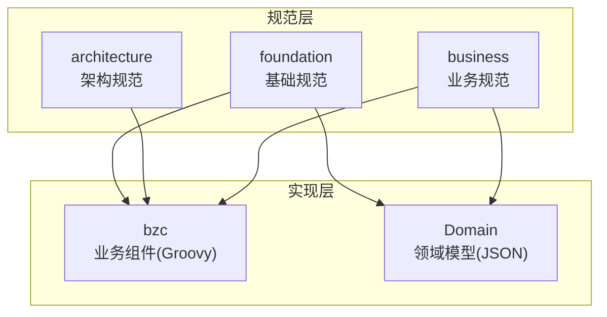
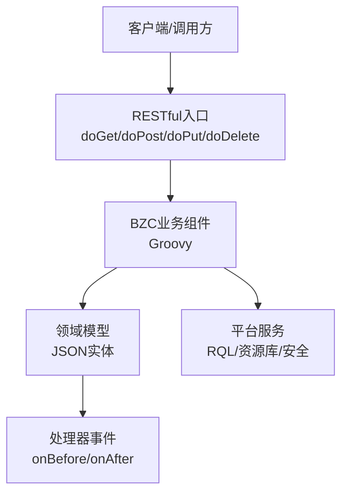
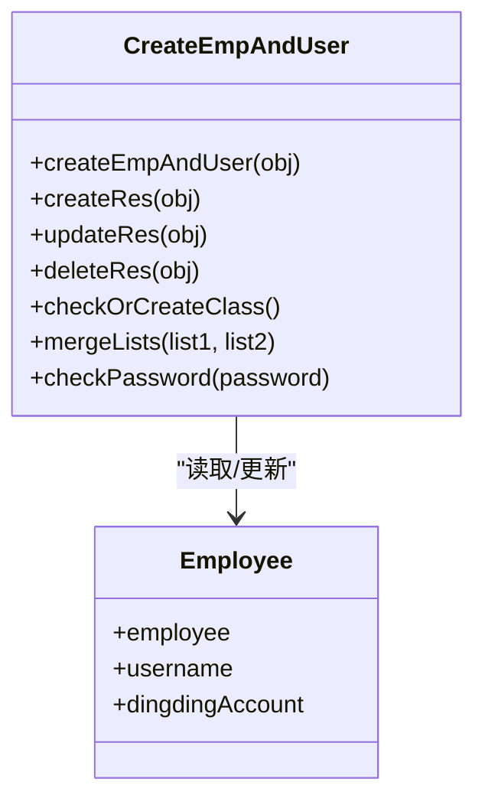
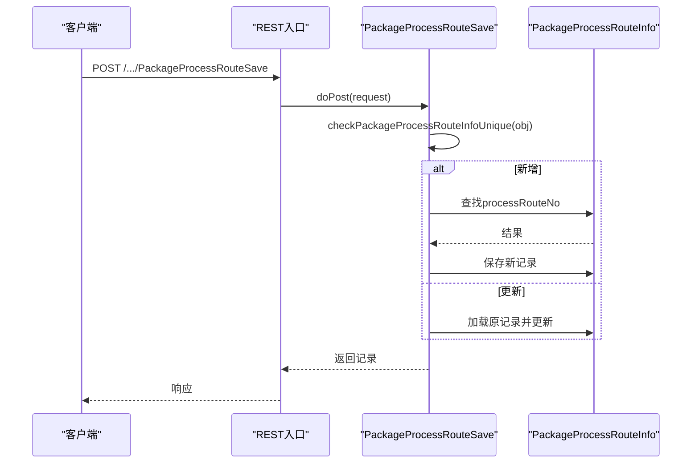
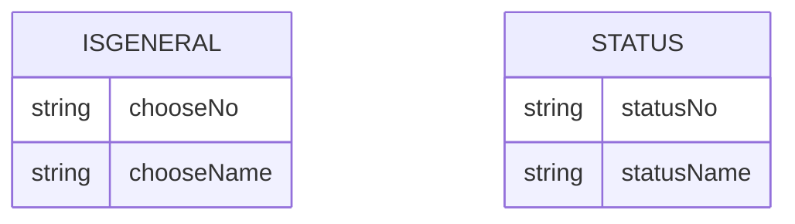
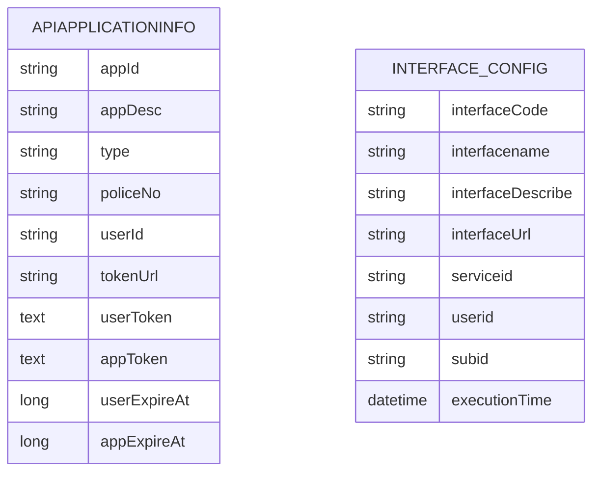
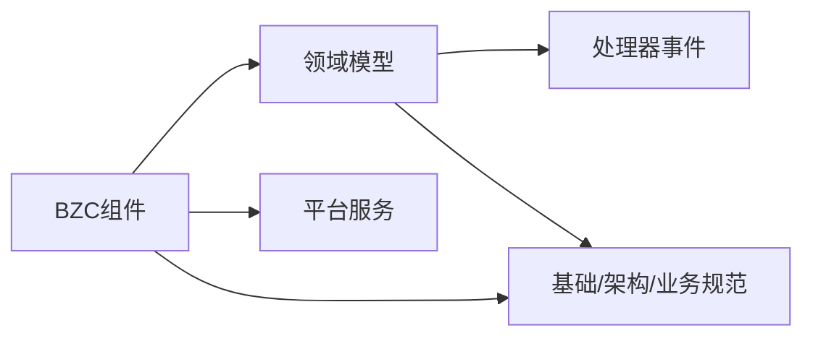

# 故障排除与FAQ

<cite>
**本文档引用的文件**
- [IsGeneral.json](file://Domain/公共资源管理/IsGeneral.json)
- [Status.json](file://Domain/公共资源管理/Status.json)
- [ApiApplicationInfo.json](file://Domain/接口管理/ApiApplicationInfo.json)
- [InterfaceConfig.json](file://Domain/接口管理/InterfaceConfig.json)
- [README.md](file://skills/README.md)
- [dev-questions.skill](file://skills/foundation/dev-questions.skill)
- [logging-standard.skill](file://skills/foundation/logging-standard.skill)
- [bzc-base.skill](file://skills/architecture/bzc-base.skill)
- [public-resource-management.skill](file://skills/business/public-resource-management.skill)
- [CreateEmpAndUser.groovy](file://bzc/公共资源管理/人员管理/人员信息/CreateEmpAndUser.groovy)
- [PackageProcessRouteSave.groovy](file://bzc/公共资源管理/工艺建模/包装工艺路线/PackageProcessRouteSave.groovy)
- [Employee.json](file://Domain/公共资源管理/人员管理/人员信息/Employee.json)
- [PackageProcessRouteInfo.json](file://Domain/公共资源管理/工艺建模/包装工艺路线/PackageProcessRouteInfo.json)
</cite>

## 目录
1. [简介](#简介)
2. [项目结构](#项目结构)
3. [核心组件](#核心组件)
4. [架构总览](#架构总览)
5. [详细组件分析](#详细组件分析)
6. [依赖分析](#依赖分析)
7. [性能考虑](#性能考虑)
8. [故障排除指南](#故障排除指南)
9. [结论](#结论)
10. [附录](#附录)

## 简介
本文件面向CMES项目的开发者与运维人员，系统性梳理开发与运行过程中常见问题及解决方案，覆盖开发环境、运行时错误、性能瓶颈与集成故障的排查方法。同时建立知识库，涵盖代码规范、架构设计与平台使用要点，并提供社区支持与升级维护信息，帮助快速定位与修复问题。

## 项目结构
CMES项目采用“技能规范”与“业务组件/领域模型”双轨组织方式：
- skills：规范层（foundation/architecture/business），沉淀全局代码规范、架构约束与业务专属规范
- bzc：业务组件（Groovy），承载RESTful与业务逻辑
- Domain：领域模型（JSON），描述实体结构与处理器代码

图表来源
- [README.md:1-63](file://skills/README.md#L1-L63)

章节来源
- [README.md:1-63](file://skills/README.md#L1-L63)

## 核心组件
- 基础规范：统一代码风格、日志规范、错误处理、版本控制、平台知识等
- 架构规范：BZC组件类结构、导入顺序、RESTful模板、注释与编码习惯
- 业务规范：公共资源管理与接口管理模块的实体、字段、包命名、删除校验与RQL批量查询规范
- 业务组件：以Groovy实现的BZC类，提供RESTful入口与业务方法
- 领域模型：JSON定义的实体属性、索引、处理器代码与派生关系

章节来源
- [bzc-base.skill:1-162](file://skills/architecture/bzc-base.skill#L1-L162)
- [public-resource-management.skill:1-514](file://skills/business/public-resource-management.skill#L1-L514)
- [logging-standard.skill:1-115](file://skills/foundation/logging-standard.skill#L1-L115)

## 架构总览
CMES采用“规范驱动 + 组件化 + 领域模型”的架构模式：
- 规范层确保一致性与可维护性
- 业务组件通过RESTful方法接收请求，调用领域模型与平台服务
- 领域模型内置处理器事件，支持前置/后置钩子与派生字段
- 平台提供RQL查询能力，避免N+1问题

图表来源
- [bzc-base.skill:92-122](file://skills/architecture/bzc-base.skill#L92-L122)
- [public-resource-management.skill:481-495](file://skills/business/public-resource-management.skill#L481-L495)

## 详细组件分析

### 人员与用户同步组件（CreateEmpAndUser）
职责：在创建/修改/删除员工时同步创建/修改/删除系统用户，处理密码强度、角色合并、用户组分类等。

图表来源
- [CreateEmpAndUser.groovy:37-590](file://bzc/公共资源管理/人员管理/人员信息/CreateEmpAndUser.groovy#L37-L590)
- [Employee.json:1-743](file://Domain/公共资源管理/人员管理/人员信息/Employee.json#L1-L743)

章节来源
- [CreateEmpAndUser.groovy:91-130](file://bzc/公共资源管理/人员管理/人员信息/CreateEmpAndUser.groovy#L91-L130)
- [CreateEmpAndUser.groovy:140-232](file://bzc/公共资源管理/人员管理/人员信息/CreateEmpAndUser.groovy#L140-L232)
- [CreateEmpAndUser.groovy:241-329](file://bzc/公共资源管理/人员管理/人员信息/CreateEmpAndUser.groovy#L241-L329)
- [CreateEmpAndUser.groovy:338-356](file://bzc/公共资源管理/人员管理/人员信息/CreateEmpAndUser.groovy#L338-L356)
- [CreateEmpAndUser.groovy:388-410](file://bzc/公共资源管理/人员管理/人员信息/CreateEmpAndUser.groovy#L388-L410)
- [CreateEmpAndUser.groovy:419-428](file://bzc/公共资源管理/人员管理/人员信息/CreateEmpAndUser.groovy#L419-L428)

### 包装工艺路线保存组件（PackageProcessRouteSave）
职责：在新增/更新包装工艺路线时进行唯一性校验与保存，保证processRouteNo唯一。

图表来源
- [PackageProcessRouteSave.groovy:29-82](file://bzc/公共资源管理/工艺建模/包装工艺路线/PackageProcessRouteSave.groovy#L29-L82)
- [PackageProcessRouteInfo.json:62-85](file://Domain/公共资源管理/工艺建模/包装工艺路线/PackageProcessRouteInfo.json#L62-L85)

章节来源
- [PackageProcessRouteSave.groovy:39-81](file://bzc/公共资源管理/工艺建模/包装工艺路线/PackageProcessRouteSave.groovy#L39-L81)
- [public-resource-management.skill:451-457](file://skills/business/public-resource-management.skill#L451-L457)

### 公共枚举实体（IsGeneral/Status）
职责：提供通用的“是否通用”和“状态”枚举，供其他实体引用。

图表来源
- [IsGeneral.json:34-112](file://Domain/公共资源管理/IsGeneral.json#L34-L112)
- [Status.json:34-112](file://Domain/公共资源管理/Status.json#L34-L112)

章节来源
- [IsGeneral.json:106-121](file://Domain/公共资源管理/IsGeneral.json#L106-L121)
- [Status.json:113-119](file://Domain/公共资源管理/Status.json#L113-L119)

### 接口管理领域模型（ApiApplicationInfo/InterfaceConfig）
职责：存储接口应用信息与接口配置，支持令牌URL、用户/应用令牌、过期时间等字段。

图表来源
- [ApiApplicationInfo.json:34-268](file://Domain/接口管理/ApiApplicationInfo.json#L34-L268)
- [InterfaceConfig.json:34-268](file://Domain/接口管理/InterfaceConfig.json#L34-L268)

章节来源
- [ApiApplicationInfo.json:1-431](file://Domain/接口管理/ApiApplicationInfo.json#L1-L431)
- [InterfaceConfig.json:1-379](file://Domain/接口管理/InterfaceConfig.json#L1-L379)

## 依赖分析
- 组件耦合
  - BZC组件依赖平台服务（RQL、资源库、安全）、领域模型与HTTP请求
  - 领域模型通过处理器事件扩展生命周期行为
- 规范约束
  - 基础规范约束导入顺序、注释与编码习惯
  - 架构规范约束BZC类结构与RESTful模板
  - 业务规范约束包命名、字段命名、删除校验与RQL使用

图表来源
- [bzc-base.skill:29-47](file://skills/architecture/bzc-base.skill#L29-L47)
- [public-resource-management.skill:76-97](file://skills/business/public-resource-management.skill#L76-L97)

章节来源
- [bzc-base.skill:1-162](file://skills/architecture/bzc-base.skill#L1-L162)
- [public-resource-management.skill:1-514](file://skills/business/public-resource-management.skill#L1-L514)

## 性能考虑
- RQL批量查询
  - 使用“*= 左连接”替代循环单条查询，避免N+1问题
  - 语法：select * from Entity where field *= {? 'field'}，通过ude.execQuery执行
- 性能对比
  - 传统循环查询：N+1次，差
  - RQL批量查询：1次，好

章节来源
- [public-resource-management.skill:481-495](file://skills/business/public-resource-management.skill#L481-L495)

## 故障排除指南

### 一、开发环境问题
- 症状：编译/运行报错，提示类找不到或导入顺序错误
  - 排查要点
    - 检查导入顺序是否符合规范（foundation/import顺序）
    - 确认包路径与类名是否符合命名规范（architecture/包命名）
  - 解决步骤
    - 按规范调整import顺序与包名
    - 确保类继承BaseBZC且包含main方法与RESTful方法
- 症状：本地调试无法进入业务方法
  - 排查要点
    - main方法是否正确构造参数并调用业务方法
  - 解决步骤
    - 参考模板在main中构造参数并打印结果

章节来源
- [bzc-base.skill:29-47](file://skills/architecture/bzc-base.skill#L29-L47)
- [bzc-base.skill:48-72](file://skills/architecture/bzc-base.skill#L48-L72)
- [bzc-base.skill:92-122](file://skills/architecture/bzc-base.skill#L92-L122)

### 二、运行时错误

#### 2.1 员工与用户同步异常
- 症状：创建/更新用户时报密码强度不足、两次密码不一致、用户已存在等
  - 排查要点
    - 密码强度是否低于系统配置的最小强度
    - 确认密码与确认密码是否一致
    - 用户是否已存在
  - 解决步骤
    - 提升密码强度或调整系统配置
    - 确保两次输入一致
    - 若用户已存在，走更新流程而非创建

章节来源
- [CreateEmpAndUser.groovy:175-191](file://bzc/公共资源管理/人员管理/人员信息/CreateEmpAndUser.groovy#L175-L191)
- [CreateEmpAndUser.groovy:419-428](file://bzc/公共资源管理/人员管理/人员信息/CreateEmpAndUser.groovy#L419-L428)

#### 2.2 包装工艺路线唯一性冲突
- 症状：新增时提示“工艺路线编码已存在”
  - 排查要点
    - processRouteNo是否重复
  - 解决步骤
    - 更换唯一编码或执行更新流程

章节来源
- [PackageProcessRouteSave.groovy:55-59](file://bzc/公共资源管理/工艺建模/包装工艺路线/PackageProcessRouteSave.groovy#L55-L59)
- [public-resource-management.skill:451-457](file://skills/business/public-resource-management.skill#L451-L457)

#### 2.3 删除失败（存在下级引用）
- 症状：删除物理建模实体时报“已在下级信息使用”
  - 排查要点
    - 是否存在下级实体引用
  - 解决步骤
    - 清理下级实体后再删除，或按业务规则允许级联处理

章节来源
- [public-resource-management.skill:221-226](file://skills/business/public-resource-management.skill#L221-L226)

#### 2.4 领域模型字段缺失或默认值异常
- 症状：字段为空或默认值不符合预期
  - 排查要点
    - 检查领域模型字段定义与处理器事件（如EmployeeHandler中对dingdingAccount的默认赋值）
  - 解决步骤
    - 在处理器onBeforeCreate中补齐默认值，或在UI/调用端补齐必填字段

章节来源
- [Employee.json:706-742](file://Domain/公共资源管理/人员管理/人员信息/Employee.json#L706-L742)
- [Employee.json:739-742](file://Domain/公共资源管理/人员管理/人员信息/Employee.json#L739-L742)

### 三、性能瓶颈
- 症状：接口响应慢、数据库压力大
  - 排查要点
    - 是否存在循环单条查询引发N+1
  - 解决步骤
    - 改用RQL批量查询，减少查询次数

章节来源
- [public-resource-management.skill:481-495](file://skills/business/public-resource-management.skill#L481-L495)

### 四、集成故障
- 症状：接口应用信息/接口配置无法正确获取令牌或执行
  - 排查要点
    - tokenUrl、userToken、appToken、过期时间字段是否正确写入
    - 接口路径与服务ID是否匹配
  - 解决步骤
    - 校验配置字段与平台对接规范，重新生成令牌并更新过期时间

章节来源
- [ApiApplicationInfo.json:190-268](file://Domain/接口管理/ApiApplicationInfo.json#L190-L268)
- [InterfaceConfig.json:140-268](file://Domain/接口管理/InterfaceConfig.json#L140-L268)

### 五、日志与排障最佳实践
- 日志记录
  - 方法入口/出口、异常捕获、外部接口调用、关键数据变更均需记录
  - 避免记录敏感信息与大量数据
- 检查清单
  - 异常捕获处有日志记录
  - 外部接口调用有请求/响应日志
  - 日志消息包含关键标识（编号/名称）
  - 没有记录敏感信息
  - 没有在循环中逐条记录日志
  - 日志消息使用中文、动词开头

章节来源
- [logging-standard.skill:14-24](file://skills/foundation/logging-standard.skill#L14-L24)
- [logging-standard.skill:63-77](file://skills/foundation/logging-standard.skill#L63-L77)
- [logging-standard.skill:105-115](file://skills/foundation/logging-standard.skill#L105-L115)

### 六、开发记录与规范遵循
- 生成前必问：下级模块、实体类名、字段命名、包路径
- 生成后确认：代码结构、注释、删除逻辑、边界情况
- 疑问确认：记录问题描述、确认结果与备注

章节来源
- [dev-questions.skill:23-38](file://skills/foundation/dev-questions.skill#L23-L38)
- [dev-questions.skill:62-76](file://skills/foundation/dev-questions.skill#L62-L76)

## 结论
通过规范驱动与组件化架构，CMES项目在一致性、可维护性与可扩展性方面具备良好基础。建议在日常开发中严格遵循基础/架构/业务三层规范，结合RQL批量查询与完善的日志记录，快速定位并解决开发与运行时问题。遇到复杂模块可进一步拆分子skill，保持模块边界清晰。

## 附录

### A. 社区支持与反馈渠道
- 规范与模板参考
  - 平台知识笔记（API、RQL、工具类）
  - BZC业务组件基础规范（类结构、模板、编码习惯）
  - 业务模块专属规范（公共资源管理、接口管理）

章节来源
- [README.md:58-63](file://skills/README.md#L58-L63)

### B. 升级与维护信息
- 层级优先级：基础规范 → 架构规范 → 业务规范
- 内容引用机制：平台技术细节 → platform-knowledge.skill；代码模板 → bzc-base.skill；业务模块只保留业务特定内容

章节来源
- [README.md:51-57](file://skills/README.md#L51-L57)