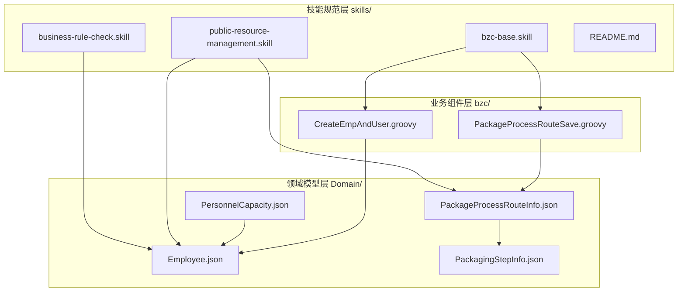
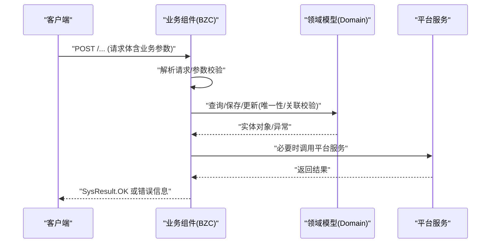
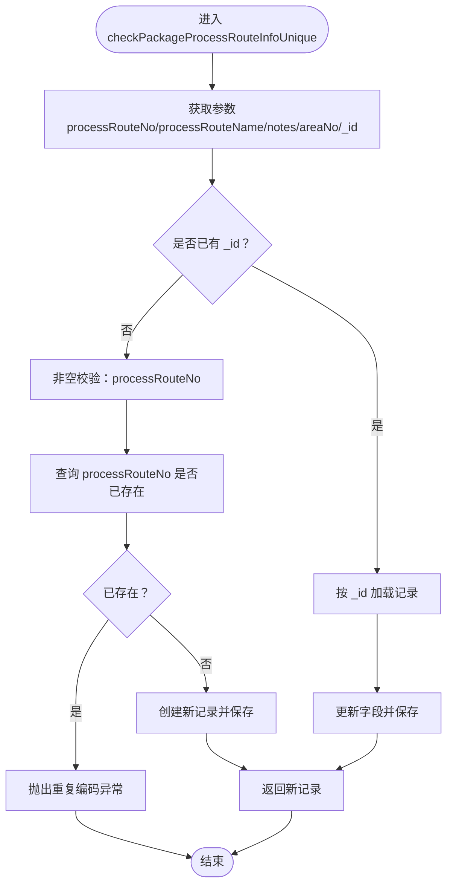
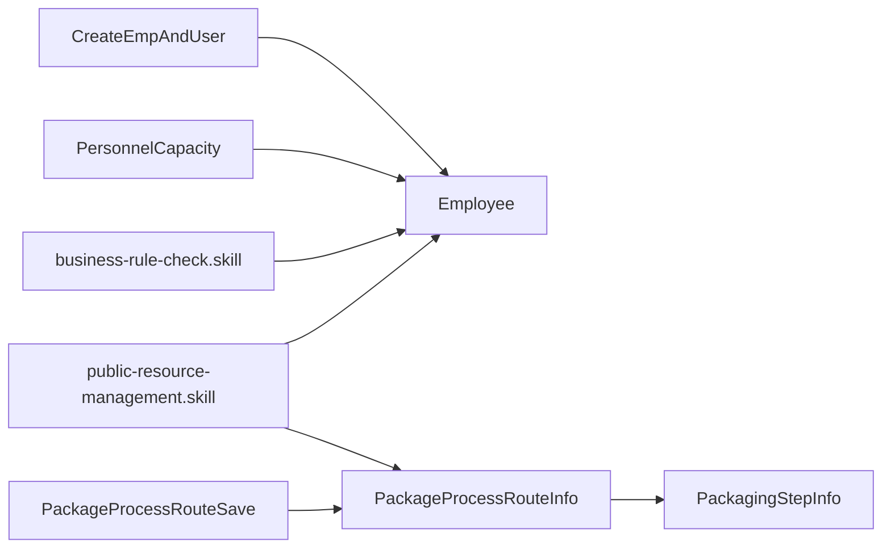

# 目录结构详解

<cite>
**本文引用的文件**
- [Domain/公共资源管理/人员管理/人员产能/PersonnelCapacity.json](file://Domain/公共资源管理/人员管理/人员产能/PersonnelCapacity.json)
- [Domain/公共资源管理/人员管理/人员信息/Employee.json](file://Domain/公共资源管理/人员管理/人员信息/Employee.json)
- [bzc/公共资源管理/人员管理/人员信息/CreateEmpAndUser.groovy](file://bzc/公共资源管理/人员管理/人员信息/CreateEmpAndUser.groovy)
- [bzc/公共资源管理/工艺建模/包装工艺路线/PackageProcessRouteSave.groovy](file://bzc/公共资源管理/工艺建模/包装工艺路线/PackageProcessRouteSave.groovy)
- [Domain/公共资源管理/工艺建模/包装工艺路线/PackageProcessRouteInfo.json](file://Domain/公共资源管理/工艺建模/包装工艺路线/PackageProcessRouteInfo.json)
- [Domain/公共资源管理/工艺建模/包装工步信息/PackagingStepInfo.json](file://Domain/公共资源管理/工艺建模/包装工步信息/PackagingStepInfo.json)
- [skills/architecture/bzc-base.skill](file://skills/architecture/bzc-base.skill)
- [skills/business/public-resource-management.skill](file://skills/business/public-resource-management.skill)
- [skills/foundation/business-rule-check.skill](file://skills/foundation/business-rule-check.skill)
- [skills/README.md](file://skills/README.md)
</cite>

## 目录
1. [引言](#引言)
2. [项目结构](#项目结构)
3. [核心组件](#核心组件)
4. [架构总览](#架构总览)
5. [详细组件分析](#详细组件分析)
6. [依赖分析](#依赖分析)
7. [性能考量](#性能考量)
8. [故障排查指南](#故障排查指南)
9. [结论](#结论)
10. [附录](#附录)

## 引言
本文件面向CMES项目的开发者与维护者，系统性解析项目目录组织与分层职责，重点阐述bzc/（业务组件层）、Domain/（领域模型层）、skills/（技能规范层）的设计理念、使用规范与最佳实践。同时，结合具体文件路径与结构，给出业务组件层与领域模型层的关系与交互方式、文件命名规范、导入依赖顺序、架构分层的演进建议与未来扩展方向，并提供清晰的项目导航指南，帮助快速定位与理解相关功能模块。

## 项目结构
CMES项目采用“模块化+分层”的组织方式：
- bzc/：业务组件层，承载业务编排、HTTP REST适配、调用领域模型与平台服务，统一以Groovy实现。
- Domain/：领域模型层，以JSON描述实体结构、字段属性、事件处理器等，驱动平台生成与运行时行为。
- skills/：技能规范层，按基础规范、架构规范、业务规范三层组织，沉淀全局与模块化的开发规范与检查清单。



**图表来源**
- [bzc/公共资源管理/人员管理/人员信息/CreateEmpAndUser.groovy](file://bzc/公共资源管理/人员管理/人员信息/CreateEmpAndUser.groovy)
- [bzc/公共资源管理/工艺建模/包装工艺路线/PackageProcessRouteSave.groovy](file://bzc/公共资源管理/工艺建模/包装工艺路线/PackageProcessRouteSave.groovy)
- [Domain/公共资源管理/人员管理/人员信息/Employee.json](file://Domain/公共资源管理/人员管理/人员信息/Employee.json)
- [Domain/公共资源管理/人员管理/人员产能/PersonnelCapacity.json](file://Domain/公共资源管理/人员管理/人员产能/PersonnelCapacity.json)
- [Domain/公共资源管理/工艺建模/包装工艺路线/PackageProcessRouteInfo.json](file://Domain/公共资源管理/工艺建模/包装工艺路线/PackageProcessRouteInfo.json)
- [Domain/公共资源管理/工艺建模/包装工步信息/PackagingStepInfo.json](file://Domain/公共资源管理/工艺建模/包装工步信息/PackagingStepInfo.json)
- [skills/architecture/bzc-base.skill](file://skills/architecture/bzc-base.skill)
- [skills/business/public-resource-management.skill](file://skills/business/public-resource-management.skill)
- [skills/foundation/business-rule-check.skill](file://skills/foundation/business-rule-check.skill)
- [skills/README.md](file://skills/README.md)

**章节来源**
- [skills/README.md:1-63](file://skills/README.md#L1-L63)

## 核心组件
- 业务组件层（bzc/）：以Groovy实现，统一继承BaseBZC，提供RESTful方法与业务方法模板，负责参数解析、调用领域模型、平台服务与返回结果。
- 领域模型层（Domain/）：以JSON描述实体结构与字段属性，自动派生通用字段（如创建/修改时间、用户），并可定义处理器事件（onBeforeCreate/Update/Delete等）。
- 技能规范层（skills/）：foundation（基础规范）、architecture（架构规范）、business（业务规范）三层协同，确保生成与开发质量。

**章节来源**
- [skills/architecture/bzc-base.skill:1-162](file://skills/architecture/bzc-base.skill#L1-L162)
- [skills/business/public-resource-management.skill:1-514](file://skills/business/public-resource-management.skill#L1-L514)
- [skills/foundation/business-rule-check.skill:1-144](file://skills/foundation/business-rule-check.skill#L1-L144)

## 架构总览
CMES采用“领域驱动 + 业务组件编排”的架构风格：
- 领域模型（Domain）定义业务实体与字段约束，平台基于JSON生成持久化与基础事件。
- 业务组件（bzc）封装业务流程，对接HTTP请求，调用领域模型与平台服务，实现唯一性校验、批量/单点删除、RQL批量查询等。
- 技能规范（skills）提供生成前的业务规则检查、模板与最佳实践，确保一致性与可维护性。



**图表来源**
- [bzc/公共资源管理/工艺建模/包装工艺路线/PackageProcessRouteSave.groovy](file://bzc/公共资源管理/工艺建模/包装工艺路线/PackageProcessRouteSave.groovy)
- [Domain/公共资源管理/工艺建模/包装工艺路线/PackageProcessRouteInfo.json](file://Domain/公共资源管理/工艺建模/包装工艺路线/PackageProcessRouteInfo.json)
- [skills/architecture/bzc-base.skill:92-122](file://skills/architecture/bzc-base.skill#L92-L122)

## 详细组件分析

### 业务组件：CreateEmpAndUser（人员与用户同步）
- 职责：在创建/修改/删除员工时，同步创建/更新/删除系统用户，维护员工与用户的关联。
- 关键点：
  - 包命名：app.base.bzcomponent.public_resource_management.personnel_management.employee_information
  - 导入顺序：javax.servlet.http.* → com.lowcode-platform.common.* → com.lowcode-platform.system.base.* → com.lowcode-platform.system.services.* → com.lowcode-platform.system.ude.* → app.base.domain.*
  - 核心方法：createEmpAndUser、createRes、updateRes、deleteRes、checkOrCreateClass、checkPassword、mergeLists 等。
  - 依赖领域模型：Employee（用于读取员工信息并反向写入username）。
  - 依赖平台服务：rps（资源库）、User（用户资源）、SecurityHelper（用户名标准化与密码强度校验）。

```mermaid
sequenceDiagram
participant Client as "客户端"
participant BZC as "CreateEmpAndUser"
participant Domain as "Employee"
participant Platform as "用户资源/安全"
Client->>BZC : "create/update/delete(含employee/password等)"
BZC->>BZC : "checkOrCreateClass/mergeLists/checkPassword"
BZC->>Domain : "Employee.find(employee)"
Domain-->>BZC : "员工对象"
alt 创建/更新
BZC->>Platform : "rps.create/updateResource(User)"
BZC->>Domain : "e.username=用户名; e.save()"
else 删除
BZC->>Platform : "rps.deleteResource(User)"
end
BZC-->>Client : "{username, method}"
```

**图表来源**
- [bzc/公共资源管理/人员管理/人员信息/CreateEmpAndUser.groovy](file://bzc/公共资源管理/人员管理/人员信息/CreateEmpAndUser.groovy)
- [Domain/公共资源管理/人员管理/人员信息/Employee.json](file://Domain/公共资源管理/人员管理/人员信息/Employee.json)

**章节来源**
- [bzc/公共资源管理/人员管理/人员信息/CreateEmpAndUser.groovy:1-590](file://bzc/公共资源管理/人员管理/人员信息/CreateEmpAndUser.groovy#L1-L590)
- [skills/architecture/bzc-base.skill:29-46](file://skills/architecture/bzc-base.skill#L29-L46)

### 业务组件：PackageProcessRouteSave（包装工艺路线保存）
- 职责：对PackageProcessRouteInfo进行唯一性校验与保存/更新，体现BZC的RESTful与业务方法模板。
- 关键点：
  - 包命名：app.base.bzcomponent.public_resource_management.process_modeling.package_process_route
  - 导入顺序：同上。
  - 核心方法：doPost（解析请求体）、checkPackageProcessRouteInfoUnique（唯一性校验与保存/更新）。
  - 依赖领域模型：PackageProcessRouteInfo（processRouteNo唯一性校验）。



**图表来源**
- [bzc/公共资源管理/工艺建模/包装工艺路线/PackageProcessRouteSave.groovy](file://bzc/公共资源管理/工艺建模/包装工艺路线/PackageProcessRouteSave.groovy)
- [Domain/公共资源管理/工艺建模/包装工艺路线/PackageProcessRouteInfo.json](file://Domain/公共资源管理/工艺建模/包装工艺路线/PackageProcessRouteInfo.json)

**章节来源**
- [bzc/公共资源管理/工艺建模/包装工艺路线/PackageProcessRouteSave.groovy:1-82](file://bzc/公共资源管理/工艺建模/包装工艺路线/PackageProcessRouteSave.groovy#L1-L82)
- [skills/architecture/bzc-base.skill:58-90](file://skills/architecture/bzc-base.skill#L58-L90)

### 领域模型：Employee（人员信息）
- 设计要点：
  - 继承CoreCommonBase，自动具备_id、createTime、createUser、modifyTime、modifyUser等字段。
  - 字段命名规范：xxNo（编码）、xxName（名称）等。
  - 特殊规则：dingdingAccount默认取employee值（在Domain Handler的onBeforeCreate中处理）；employee唯一；与用户同步。
- 处理器事件：onBeforeCreate/onAfterCreate/onBeforeUpdate/onAfterUpdate/onBeforeDelete/onAfterDelete。

**章节来源**
- [Domain/公共资源管理/人员管理/人员信息/Employee.json:1-743](file://Domain/公共资源管理/人员管理/人员信息/Employee.json#L1-L743)
- [skills/business/public-resource-management.skill:239-279](file://skills/business/public-resource-management.skill#L239-L279)

### 领域模型：PersonnelCapacity（人员产能）
- 设计要点：
  - 主表PersonnelCapacity与明细PersonnelCapacityDetial关联，删除主表需同步删除明细。
  - 字段：teamNo、employee（唯一）、positionNo等。
- 处理器事件：同上。

**章节来源**
- [Domain/公共资源管理/人员管理/人员产能/PersonnelCapacity.json:1-249](file://Domain/公共资源管理/人员管理/人员产能/PersonnelCapacity.json#L1-L249)
- [skills/business/public-resource-management.skill:317-342](file://skills/business/public-resource-management.skill#L317-L342)

### 领域模型：PackagingStepInfo（包装工步信息）
- 设计要点：
  - 主键：workStepNo（唯一）。
  - 字段：workStepName、description等。
- 处理器事件：同上。

**章节来源**
- [Domain/公共资源管理/工艺建模/包装工步信息/PackagingStepInfo.json:1-249](file://Domain/公共资源管理/工艺建模/包装工步信息/PackagingStepInfo.json#L1-L249)

### 领域模型：PackageProcessRouteInfo（包装工艺路线）
- 设计要点：
  - 主键：processRouteNo（唯一）。
  - 字段：processRouteName、areaNo、notes等。
- 处理器事件：同上。

**章节来源**
- [Domain/公共资源管理/工艺建模/包装工艺路线/PackageProcessRouteInfo.json:1-275](file://Domain/公共资源管理/工艺建模/包装工艺路线/PackageProcessRouteInfo.json#L1-L275)

## 依赖分析
- 组件耦合与内聚：
  - BZC组件对Domain实体的强依赖体现在字段校验、唯一性与关联关系检查；对平台服务的依赖体现在资源库操作与安全工具。
  - Domain实体通过JSON定义字段属性与处理器事件，降低业务组件对底层实现细节的感知。
- 直接与间接依赖：
  - BZC → Domain（读写）→ 平台服务（rps、SecurityHelper等）。
  - skills规范为BZC与Domain提供生成与开发约束，间接影响组件设计。
- 循环依赖规避：
  - 通过skills规范与Domain JSON定义，避免业务组件与领域模型间的循环依赖。



**图表来源**
- [bzc/公共资源管理/人员管理/人员信息/CreateEmpAndUser.groovy](file://bzc/公共资源管理/人员管理/人员信息/CreateEmpAndUser.groovy)
- [bzc/公共资源管理/工艺建模/包装工艺路线/PackageProcessRouteSave.groovy](file://bzc/公共资源管理/工艺建模/包装工艺路线/PackageProcessRouteSave.groovy)
- [Domain/公共资源管理/人员管理/人员信息/Employee.json](file://Domain/公共资源管理/人员管理/人员信息/Employee.json)
- [Domain/公共资源管理/人员管理/人员产能/PersonnelCapacity.json](file://Domain/公共资源管理/人员管理/人员产能/PersonnelCapacity.json)
- [Domain/公共资源管理/工艺建模/包装工艺路线/PackageProcessRouteInfo.json](file://Domain/公共资源管理/工艺建模/包装工艺路线/PackageProcessRouteInfo.json)
- [Domain/公共资源管理/工艺建模/包装工步信息/PackagingStepInfo.json](file://Domain/公共资源管理/工艺建模/包装工步信息/PackagingStepInfo.json)
- [skills/business/public-resource-management.skill](file://skills/business/public-resource-management.skill)
- [skills/foundation/business-rule-check.skill](file://skills/foundation/business-rule-check.skill)

**章节来源**
- [skills/business/public-resource-management.skill:460-496](file://skills/business/public-resource-management.skill#L460-L496)

## 性能考量
- RQL批量查询：避免N+1问题，使用“*= 左连接”一次性查询，减少数据库往返。
- 删除前检查：对存在下级引用的实体进行前置校验，避免脏数据与外键约束异常。
- 代码模板与注释：统一的类结构与方法模板有助于提升可读性与可维护性，减少性能回归风险。

**章节来源**
- [skills/business/public-resource-management.skill:481-496](file://skills/business/public-resource-management.skill#L481-L496)
- [skills/architecture/bzc-base.skill:138-145](file://skills/architecture/bzc-base.skill#L138-L145)

## 故障排查指南
- 常见异常与处理：
  - 唯一性冲突：在保存/更新前进行唯一性校验，抛出明确异常信息。
  - 关联引用：删除前检查是否存在下级引用，存在则抛出异常提示。
  - 非空校验：对nullable=false的字段进行必填校验。
- 日志与错误处理：
  - 遵循错误处理与日志规范，异常捕获处记录日志，外部接口调用有请求/响应日志。
- 检查清单：
  - 生成代码前执行业务规则检查，确认Domain字段属性与业务特殊规则。

**章节来源**
- [skills/foundation/business-rule-check.skill:10-144](file://skills/foundation/business-rule-check.skill#L10-L144)
- [skills/architecture/bzc-base.skill:124-145](file://skills/architecture/bzc-base.skill#L124-L145)

## 结论
CMES项目通过skills规范统一了开发流程与质量标准，bzc层承担业务编排与平台集成，Domain层聚焦领域语义与约束，三者协同实现了高内聚、低耦合的分层架构。建议在新增模块时严格遵循skills规范，保持bzc与Domain目录结构一致，持续完善业务规则检查与RQL批量查询实践，以保障系统的可扩展性与稳定性。

## 附录

### 文件命名规范与导入顺序
- 文件类型：.json（Domain实体）、.groovy（BZC业务组件）。
- 包命名：
  - BZC：app.base.bzcomponent.public_resource_management.{子模块}.{功能模块}
  - Domain：app.base.domain.public_resource_management.{子模块}.{功能模块}
- 导入顺序（BZC）：javax.servlet.http.* → com.lowcode-platform.common.* → com.lowcode-platform.system.base.* → com.lowcode-platform.system.services.* → com.lowcode-platform.system.ude.* → app.base.domain.*

**章节来源**
- [skills/business/public-resource-management.skill:64-96](file://skills/business/public-resource-management.skill#L64-L96)
- [skills/architecture/bzc-base.skill:29-46](file://skills/architecture/bzc-base.skill#L29-L46)

### 目录结构演进与未来扩展
- 演进原因：以模块化菜单结构组织bzc与Domain，确保目录结构一致，便于生成与维护。
- 扩展方向：
  - 新增子模块：在对应目录下同时创建bzc与Domain目录。
  - 复杂模块：可拆分为独立的business skill文件，如production-management.skill、quality-management.skill。

**章节来源**
- [skills/business/public-resource-management.skill:498-510](file://skills/business/public-resource-management.skill#L498-L510)