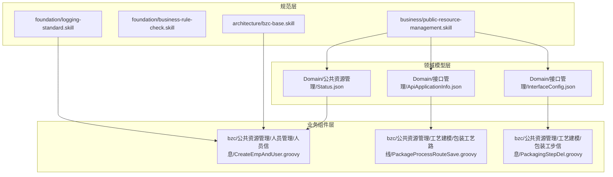
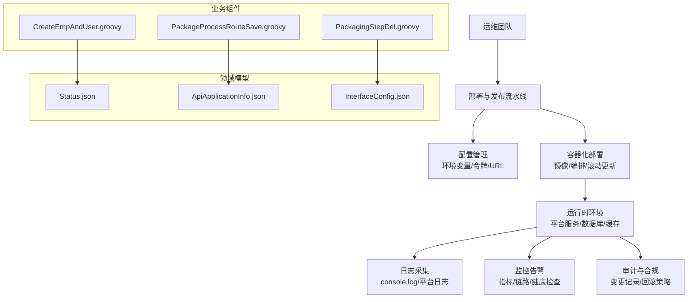
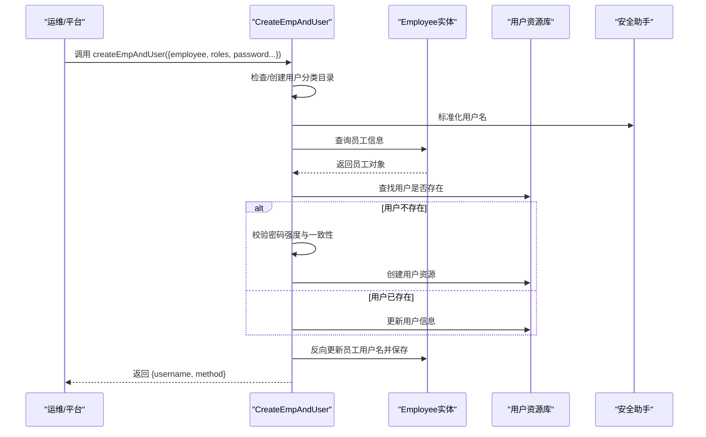
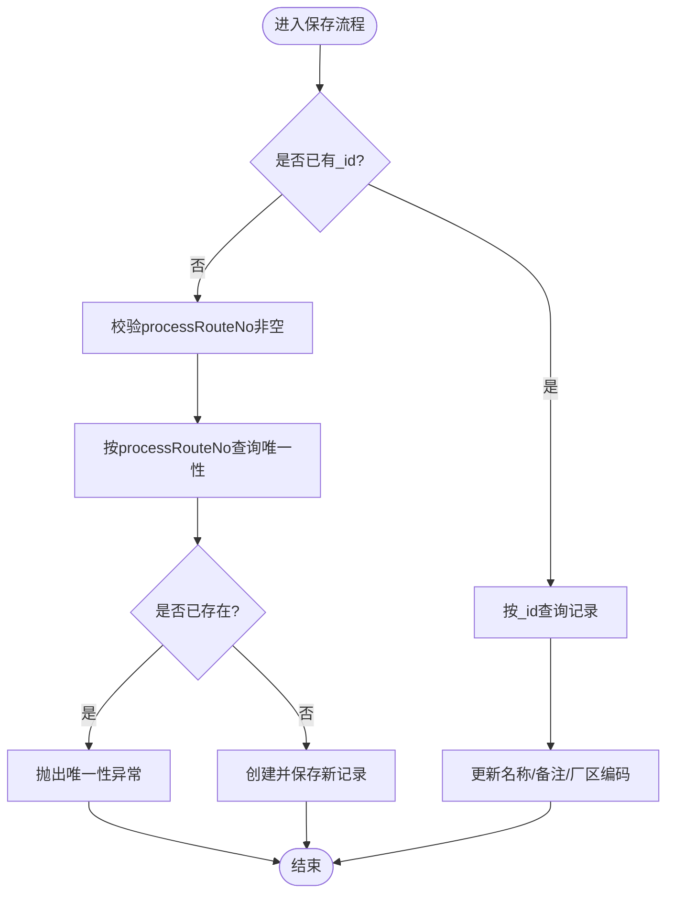
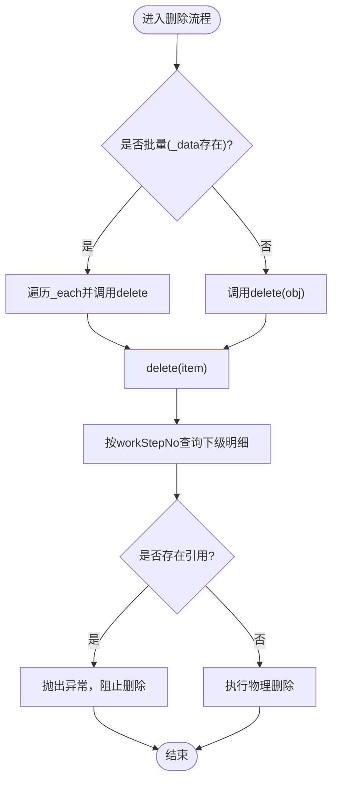
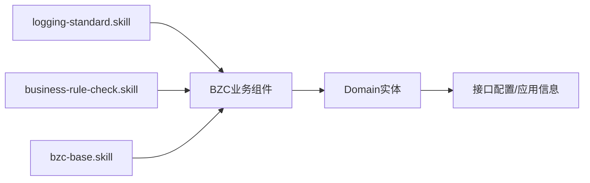

# 部署与运维

<cite>
**本文引用的文件**
- [skills/README.md](file://skills/README.md)
- [skills/architecture/bzc-base.skill](file://skills/architecture/bzc-base.skill)
- [skills/foundation/logging-standard.skill](file://skills/foundation/logging-standard.skill)
- [skills/business/public-resource-management.skill](file://skills/business/public-resource-management.skill)
- [Domain/公共资源管理/Status.json](file://Domain/公共资源管理/Status.json)
- [Domain/接口管理/ApiApplicationInfo.json](file://Domain/接口管理/ApiApplicationInfo.json)
- [Domain/接口管理/InterfaceConfig.json](file://Domain/接口管理/InterfaceConfig.json)
- [bzc/公共资源管理/人员管理/人员信息/CreateEmpAndUser.groovy](file://bzc/公共资源管理/人员管理/人员信息/CreateEmpAndUser.groovy)
- [bzc/公共资源管理/工艺建模/包装工艺路线/PackageProcessRouteSave.groovy](file://bzc/公共资源管理/工艺建模/包装工艺路线/PackageProcessRouteSave.groovy)
- [bzc/公共资源管理/工艺建模/包装工步信息/PackagingStepDel.groovy](file://bzc/公共资源管理/工艺建模/包装工步信息/PackagingStepDel.groovy)
</cite>

## 目录
1. [简介](#简介)
2. [项目结构](#项目结构)
3. [核心组件](#核心组件)
4. [架构总览](#架构总览)
5. [详细组件分析](#详细组件分析)
6. [依赖分析](#依赖分析)
7. [性能考量](#性能考量)
8. [故障排查指南](#故障排查指南)
9. [结论](#结论)
10. [附录](#附录)

## 简介
本指南面向CMES系统的运维团队，提供从生产环境部署、配置与依赖管理，到监控、日志与故障诊断，再到性能调优、容量规划、灾难恢复、版本发布与回滚、变更管理以及运维自动化与容器化落地的完整方案。文档以仓库中的技能规范与领域/业务组件为依据，结合CMES平台的BZC业务组件与Domain实体，形成可执行的运维蓝图。

## 项目结构
CMES项目采用“技能规范 + 领域模型 + 业务组件”的分层组织方式：
- skills：规范层，定义全局代码规范、架构规范与业务规范，确保开发与运维一致性
- Domain：领域模型层，以JSON描述实体结构与处理器代码
- bzc：业务组件层，以Groovy实现RESTful与业务逻辑，封装数据访问与平台能力

**图示来源**
- [skills/README.md:1-63](file://skills/README.md#L1-L63)
- [skills/architecture/bzc-base.skill:1-162](file://skills/architecture/bzc-base.skill#L1-L162)
- [skills/business/public-resource-management.skill:1-514](file://skills/business/public-resource-management.skill#L1-L514)
- [Domain/公共资源管理/Status.json:1-119](file://Domain/公共资源管理/Status.json#L1-L119)
- [Domain/接口管理/ApiApplicationInfo.json:1-431](file://Domain/接口管理/ApiApplicationInfo.json#L1-L431)
- [Domain/接口管理/InterfaceConfig.json:1-379](file://Domain/接口管理/InterfaceConfig.json#L1-L379)
- [bzc/公共资源管理/人员管理/人员信息/CreateEmpAndUser.groovy:1-590](file://bzc/公共资源管理/人员管理/人员信息/CreateEmpAndUser.groovy#L1-L590)
- [bzc/公共资源管理/工艺建模/包装工艺路线/PackageProcessRouteSave.groovy:1-82](file://bzc/公共资源管理/工艺建模/包装工艺路线/PackageProcessRouteSave.groovy#L1-L82)
- [bzc/公共资源管理/工艺建模/包装工步信息/PackagingStepDel.groovy:1-79](file://bzc/公共资源管理/工艺建模/包装工步信息/PackagingStepDel.groovy#L1-L79)

**章节来源**
- [skills/README.md:1-63](file://skills/README.md#L1-L63)

## 核心组件
- 规范体系：以foundation与architecture层的规范为基线，确保代码质量与一致性；business层细化到模块专属规范
- 领域模型：Status、ApiApplicationInfo、InterfaceConfig等实体定义了系统基础数据结构与处理器
- 业务组件：CreateEmpAndUser、PackageProcessRouteSave、PackagingStepDel等封装了用户同步、路由保存与工步删除等关键业务

**章节来源**
- [skills/foundation/logging-standard.skill:1-115](file://skills/foundation/logging-standard.skill#L1-L115)
- [skills/architecture/bzc-base.skill:1-162](file://skills/architecture/bzc-base.skill#L1-L162)
- [skills/business/public-resource-management.skill:1-514](file://skills/business/public-resource-management.skill#L1-L514)
- [Domain/公共资源管理/Status.json:1-119](file://Domain/公共资源管理/Status.json#L1-L119)
- [Domain/接口管理/ApiApplicationInfo.json:1-431](file://Domain/接口管理/ApiApplicationInfo.json#L1-L431)
- [Domain/接口管理/InterfaceConfig.json:1-379](file://Domain/接口管理/InterfaceConfig.json#L1-L379)
- [bzc/公共资源管理/人员管理/人员信息/CreateEmpAndUser.groovy:1-590](file://bzc/公共资源管理/人员管理/人员信息/CreateEmpAndUser.groovy#L1-L590)
- [bzc/公共资源管理/工艺建模/包装工艺路线/PackageProcessRouteSave.groovy:1-82](file://bzc/公共资源管理/工艺建模/包装工艺路线/PackageProcessRouteSave.groovy#L1-L82)
- [bzc/公共资源管理/工艺建模/包装工步信息/PackagingStepDel.groovy:1-79](file://bzc/公共资源管理/工艺建模/包装工步信息/PackagingStepDel.groovy#L1-L79)

## 架构总览
CMES采用“规范驱动 + 领域建模 + BZC组件”的分层架构。业务组件通过平台提供的服务与工具类访问资源库、执行RQL查询、处理用户与角色等系统资源，同时遵循统一的日志与错误处理规范。

[本图为概念性架构示意，无需图示来源]

## 详细组件分析

### 组件A：用户与员工同步（CreateEmpAndUser）
- 职责：在创建/修改/删除员工时，同步创建/更新/删除系统用户，维护用户名、角色、密码与激活状态
- 关键流程：
  - 检查并创建用户分类目录
  - 根据员工编号标准化用户名
  - 校验密码强度与一致性
  - 创建/更新用户资源并反向更新员工用户名
  - 支持密码过期时间与角色合并

**图示来源**
- [bzc/公共资源管理/人员管理/人员信息/CreateEmpAndUser.groovy:91-232](file://bzc/公共资源管理/人员管理/人员信息/CreateEmpAndUser.groovy#L91-L232)

**章节来源**
- [bzc/公共资源管理/人员管理/人员信息/CreateEmpAndUser.groovy:1-590](file://bzc/公共资源管理/人员管理/人员信息/CreateEmpAndUser.groovy#L1-L590)
- [skills/architecture/bzc-base.skill:92-122](file://skills/architecture/bzc-base.skill#L92-L122)
- [skills/foundation/logging-standard.skill:14-61](file://skills/foundation/logging-standard.skill#L14-L61)

### 组件B：包装工艺路线保存（PackageProcessRouteSave）
- 职责：保存或更新包装工艺路线，校验processRouteNo唯一性
- 关键流程：
  - 新增：校验编码非空与唯一，保存新记录
  - 更新：根据_id查询并更新名称、备注、厂区编码

**图示来源**
- [bzc/公共资源管理/工艺建模/包装工艺路线/PackageProcessRouteSave.groovy:39-81](file://bzc/公共资源管理/工艺建模/包装工艺路线/PackageProcessRouteSave.groovy#L39-L81)

**章节来源**
- [bzc/公共资源管理/工艺建模/包装工艺路线/PackageProcessRouteSave.groovy:1-82](file://bzc/公共资源管理/工艺建模/包装工艺路线/PackageProcessRouteSave.groovy#L1-L82)
- [skills/business/public-resource-management.skill:451-456](file://skills/business/public-resource-management.skill#L451-L456)

### 组件C：包装工步删除（PackagingStepDel）
- 职责：删除包装工步，检查是否在工艺路线明细中被引用
- 关键流程：
  - 支持单点/批量删除
  - 删除前查询下级明细，若存在引用则抛出异常

**图示来源**
- [bzc/公共资源管理/工艺建模/包装工步信息/PackagingStepDel.groovy:50-78](file://bzc/公共资源管理/工艺建模/包装工步信息/PackagingStepDel.groovy#L50-L78)

**章节来源**
- [bzc/公共资源管理/工艺建模/包装工步信息/PackagingStepDel.groovy:1-79](file://bzc/公共资源管理/工艺建模/包装工步信息/PackagingStepDel.groovy#L1-L79)
- [skills/business/public-resource-management.skill:451-456](file://skills/business/public-resource-management.skill#L451-L456)

### 领域模型：接口配置（InterfaceConfig）
- 用途：存储接口代号、名称、路径、服务ID、用户ID、主体ID及执行时间等
- 关键点：提供统一的接口元数据管理，支撑接口应用信息与日志联动

**章节来源**
- [Domain/接口管理/InterfaceConfig.json:1-379](file://Domain/接口管理/InterfaceConfig.json#L1-L379)

### 领域模型：接口应用信息（ApiApplicationInfo）
- 用途：存储应用编码、描述、类型、警号、用户编码、令牌URL、用户/应用令牌与过期时间等
- 关键点：与接口配置协同，支撑跨平台令牌获取与过期管理

**章节来源**
- [Domain/接口管理/ApiApplicationInfo.json:1-431](file://Domain/接口管理/ApiApplicationInfo.json#L1-L431)

### 领域模型：状态（Status）
- 用途：提供状态编码与名称的基础枚举
- 关键点：被多个明细表引用，如包装工艺路线明细的isGeneral字段

**章节来源**
- [Domain/公共资源管理/Status.json:1-119](file://Domain/公共资源管理/Status.json#L1-L119)
- [skills/business/public-resource-management.skill:104-121](file://skills/business/public-resource-management.skill#L104-L121)

## 依赖分析
- 组件与规范的耦合
  - BZC组件严格遵循bzc-base.skill的类结构、导入顺序与RESTful模板
  - 日志规范要求在关键入口、异常捕获、外部接口调用处记录日志
  - 业务规范对实体字段命名、包命名、层级关系与删除校验提出约束
- 组件与领域模型的耦合
  - 业务组件通过平台API访问Domain实体，执行查询、保存与删除
  - 删除前的下级引用检查与唯一性校验由组件内部逻辑保证
- 运行时依赖
  - 用户资源库（User）、安全助手（SecurityHelper）、系统环境（Environment）等

**图示来源**
- [skills/foundation/logging-standard.skill:14-61](file://skills/foundation/logging-standard.skill#L14-L61)
- [skills/architecture/bzc-base.skill:1-162](file://skills/architecture/bzc-base.skill#L1-L162)
- [skills/business/public-resource-management.skill:460-496](file://skills/business/public-resource-management.skill#L460-L496)

**章节来源**
- [skills/README.md:23-63](file://skills/README.md#L23-L63)

## 性能考量
- 批量查询与N+1优化
  - 使用RQL左连接一次性查询，避免循环单条查询导致的N+1问题
  - 公共资源管理模块建议在删除与查询场景采用RQL批量查询
- 删除校验与事务
  - 删除前检查下级引用，避免破坏数据完整性
  - 对于跨实体的级联保存/删除，建议在组件中显式处理并记录日志
- 日志与可观测性
  - 在方法入口/出口、异常捕获、外部接口调用处记录关键信息
  - 控制日志体量，避免在大列表循环中逐条记录

**章节来源**
- [skills/business/public-resource-management.skill:481-496](file://skills/business/public-resource-management.skill#L481-L496)
- [skills/foundation/logging-standard.skill:14-61](file://skills/foundation/logging-standard.skill#L14-L61)

## 故障排查指南
- 常见问题定位
  - 用户同步失败：检查员工是否存在、密码强度与一致性、用户分类目录是否创建
  - 工艺路线保存冲突：核对processRouteNo唯一性与必填校验
  - 工步删除受阻：检查是否在包装工艺路线明细中被引用
- 日志与审计
  - 使用console.log记录关键入参与返回值、异常信息与外部接口请求/响应
  - 审计变更：记录创建/修改/删除的用户与时间
- 快速恢复
  - 对于唯一性冲突，修正编码后重试
  - 对于引用冲突，先清理下级引用再执行删除

**章节来源**
- [bzc/公共资源管理/人员管理/人员信息/CreateEmpAndUser.groovy:140-232](file://bzc/公共资源管理/人员管理/人员信息/CreateEmpAndUser.groovy#L140-L232)
- [bzc/公共资源管理/工艺建模/包装工艺路线/PackageProcessRouteSave.groovy:39-81](file://bzc/公共资源管理/工艺建模/包装工艺路线/PackageProcessRouteSave.groovy#L39-L81)
- [bzc/公共资源管理/工艺建模/包装工步信息/PackagingStepDel.groovy:66-78](file://bzc/公共资源管理/工艺建模/包装工步信息/PackagingStepDel.groovy#L66-L78)
- [skills/foundation/logging-standard.skill:14-61](file://skills/foundation/logging-standard.skill#L14-L61)

## 结论
CMES的运维体系以规范为纲、以领域模型为基、以BZC组件为体。通过严格的代码与业务规范、完善的日志与监控、以及针对删除与唯一性等关键流程的防御性设计，可实现稳定、可演进、可审计的生产环境运维。建议在CI/CD中固化规范检查与单元测试，并结合容器化与滚动更新策略，持续提升交付效率与系统韧性。

## 附录

### A. 生产环境部署流程（建议）
- 准备阶段
  - 环境准备：容器运行时、平台服务、数据库、缓存与消息队列
  - 配置准备：环境变量（如密码强度、令牌URL）、密钥与证书
- 构建与打包
  - 基于技能规范进行静态检查与单元测试
  - 生成业务组件与领域模型的制品
- 发布与滚动更新
  - 使用容器镜像与编排工具进行滚动更新
  - 发布后执行健康检查与端到端验证
- 回滚策略
  - 保留最近N个版本镜像
  - 通过编排工具快速回滚至上一个稳定版本

[本节为通用流程建议，无需章节来源]

### B. 监控与日志
- 监控指标：CPU/内存/磁盘/网络、业务关键指标（用户同步成功率、路由保存耗时）
- 日志采集：统一收集console.log与平台日志，按模块与级别归档
- 告警策略：异常率、延迟、可用性阈值告警

[本节为通用实践建议，无需章节来源]

### C. 容灾与备份
- 数据备份：定期导出关键Domain实体与用户资源
- 容灾演练：模拟节点故障与网络分区，验证恢复时间与数据一致性
- 灾难恢复：基于备份快速重建服务，验证令牌与权限一致性

[本节为通用实践建议，无需章节来源]

### D. 版本发布与变更管理
- 提交规范：遵循version-control.skill的提交格式
- 变更评审：重大变更需业务与架构双评审
- 回滚流程：标准化回滚步骤与验证清单

[本节为通用实践建议，无需章节来源]

### E. 运维自动化与容器化
- 基础设施即代码：使用声明式配置管理平台资源
- 容器化：将业务组件与平台服务打包为镜像，统一版本管理
- 自动化：CI/CD流水线集成规范检查、测试与发布

[本节为通用实践建议，无需章节来源]