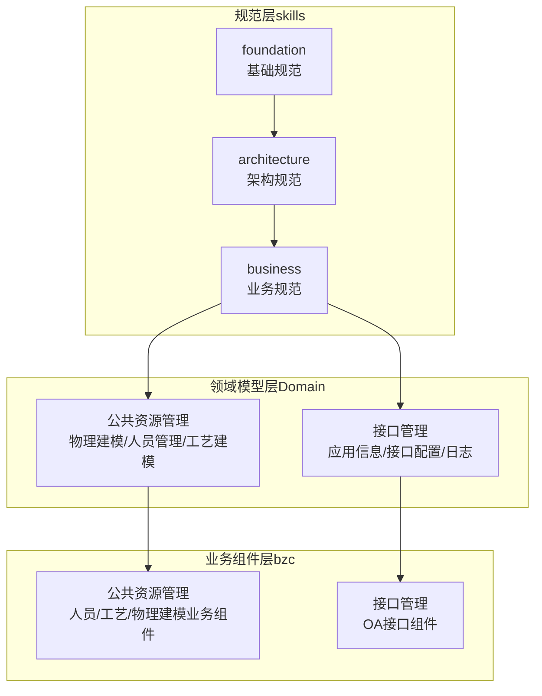
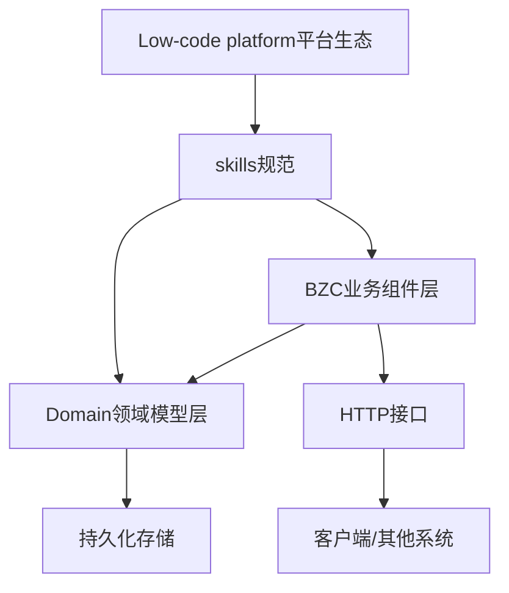
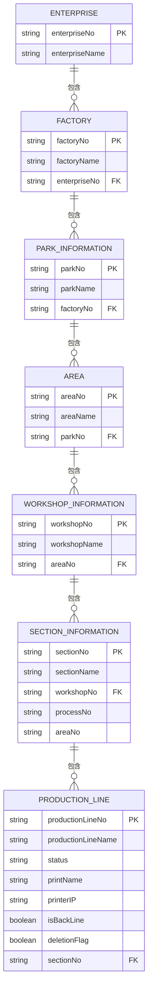
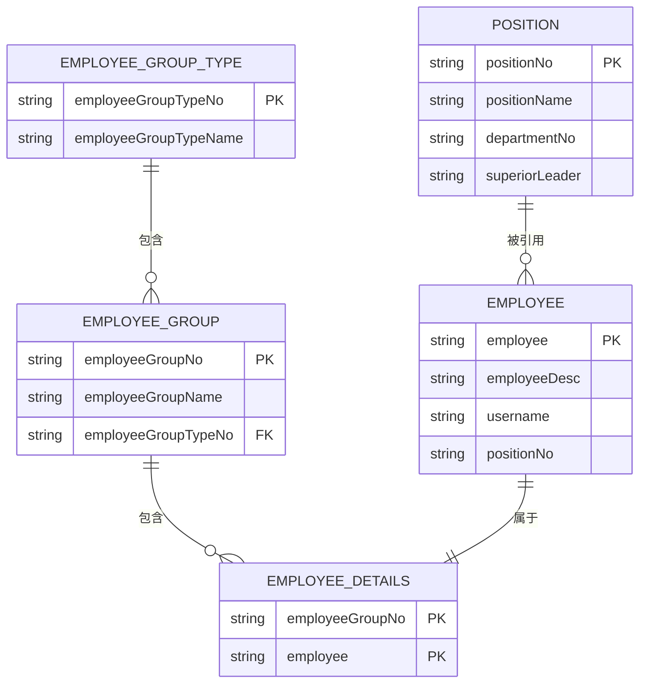
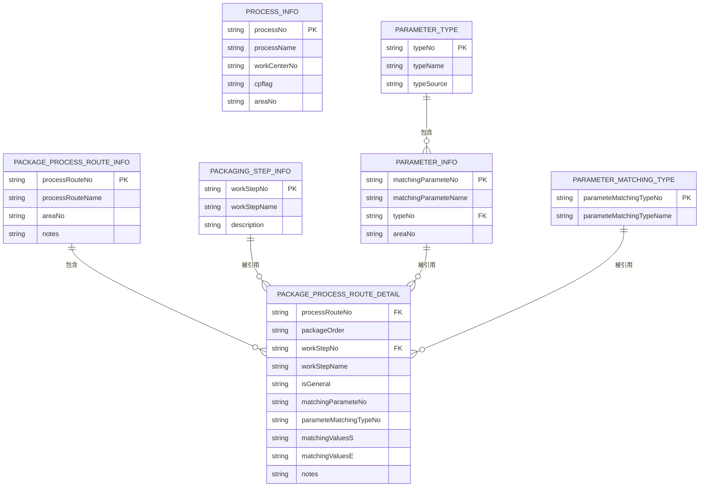
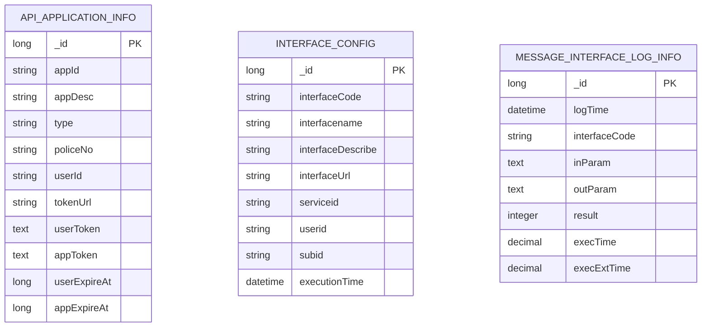
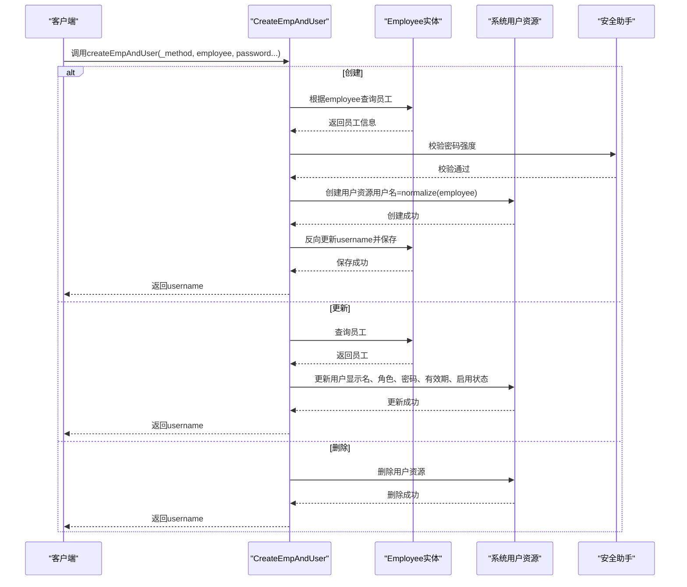
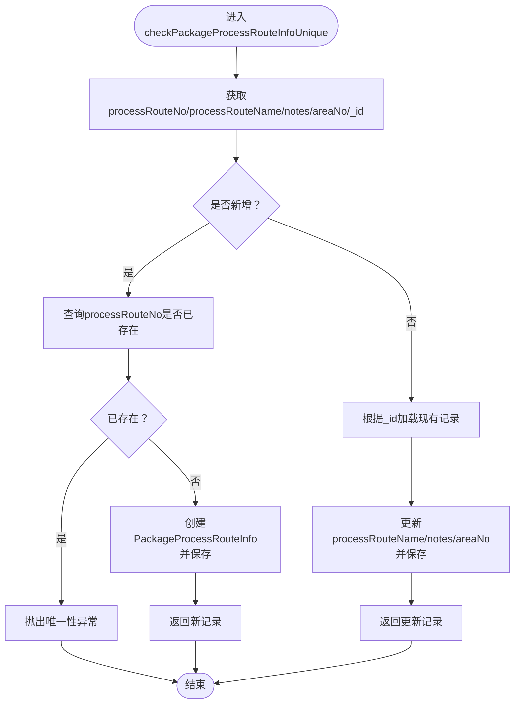
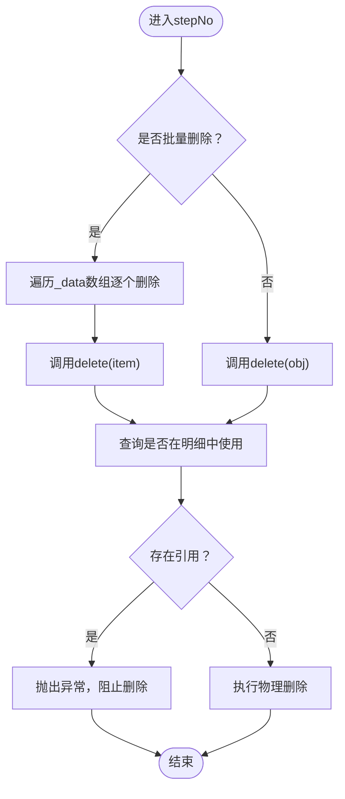
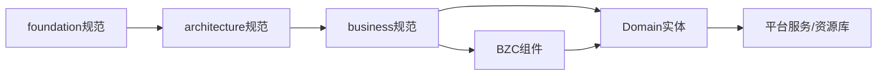

# 项目概述

<cite>
**本文档引用的文件**
- [README.md](file://skills/README.md)
- [bzc-base.skill](file://skills/architecture/bzc-base.skill)
- [public-resource-management.skill](file://skills/business/public-resource-management.skill)
- [IsGeneral.json](file://Domain/公共资源管理/IsGeneral.json)
- [Status.json](file://Domain/公共资源管理/Status.json)
- [ApiApplicationInfo.json](file://Domain/接口管理/ApiApplicationInfo.json)
- [InterfaceConfig.json](file://Domain/接口管理/InterfaceConfig.json)
- [MessageInterfaceLogInfo.json](file://Domain/接口管理/MessageInterfaceLogInfo.json)
- [Enterprise.json](file://Domain/公共资源管理/物理建模/1_企业/Enterprise.json)
- [PackageProcessRouteInfo.json](file://Domain/公共资源管理/工艺建模/包装工艺路线/PackageProcessRouteInfo.json)
- [Employee.json](file://Domain/公共资源管理/人员管理/人员信息/Employee.json)
- [CreateEmpAndUser.groovy](file://bzc/公共资源管理/人员管理/人员信息/CreateEmpAndUser.groovy)
- [PackageProcessRouteSave.groovy](file://bzc/公共资源管理/工艺建模/包装工艺路线/PackageProcessRouteSave.groovy)
- [PackagingStepDel.groovy](file://bzc/公共资源管理/工艺建模/包装工步信息/PackagingStepDel.groovy)
</cite>

## 目录
1. [引言](#引言)
2. [项目结构](#项目结构)
3. [核心组件](#核心组件)
4. [架构总览](#架构总览)
5. [详细组件分析](#详细组件分析)
6. [依赖关系分析](#依赖关系分析)
7. [性能考量](#性能考量)
8. [故障排查指南](#故障排查指南)
9. [结论](#结论)
10. [附录](#附录)

## 引言
FlexPilot 是一套面向低代码 MES 平台的 AI 辅助开发环境。业务代码（BZC 业务组件、Domain 领域模型、微流）托管在低代码平台服务器上，本仓库通过分层技能规范（skills）、服务器文件同步与执行工具链、以及项目知识库（wiki/），让 AI 编程工具能够规范、高效地参与平台业务开发，形成“本地修改 → 上传 → 执行验证”的完整闭环。

本文档及知识库的其余篇章，描述的是该低代码平台上承载的业务系统 —— CMES 制造业执行系统。它是一套面向制造企业的数字化执行平台，围绕“公共资源管理”和“接口管理”两大核心域构建，支撑企业物理建模（企业-工厂-园区-厂区-车间-工段-生产线）、人员管理（员工、岗位、人员组别、产能）、工艺建模（工序、包装参数、包装工步、包装工艺路线）等业务场景。系统以Low-code platform为基础，采用BZC（业务组件）+Domain（领域模型）的双轨架构，结合统一的技能规范（skills）体系，确保代码质量、一致性与可维护性。

CMES 旨在：
- 提升制造业执行效率与透明度
- 实现跨系统接口的标准化与可观测
- 通过组件化与领域建模，降低变更成本，增强扩展能力
- 支撑企业数字化转型，实现数据驱动的生产决策

## 项目结构
系统采用模块化分层组织：
- skills：规范层（foundation/architecture/business），定义全局代码规范、架构约定与业务规范
- Domain：领域模型层，以JSON描述实体结构与属性元数据
- bzc：业务组件层，以Groovy实现RESTful业务逻辑与数据处理
- utils：工具与辅助模块（当前仓库未包含具体实现）

图示来源
- [README.md:1-63](file://skills/README.md#L1-L63)
- [public-resource-management.skill:1-514](file://skills/business/public-resource-management.skill#L1-L514)

章节来源
- [README.md:1-63](file://skills/README.md#L1-L63)
- [public-resource-management.skill:1-514](file://skills/business/public-resource-management.skill#L1-L514)

## 核心组件
- 公共资源管理
  - 物理建模：企业、工厂、园区、厂区、车间、工段、生产线，支持层级关系与删除校验
  - 人员管理：员工、岗位、人员组别、人员产能，支持用户同步、默认厂区、钉钉账号默认值等规则
  - 工艺建模：工序、包装参数、包装工步、包装工艺路线，支持唯一性校验与明细级联
- 接口管理
  - 接口应用信息：应用编码、令牌、过期时间等
  - 接口配置：接口路径、服务ID、用户ID、主体ID、执行时间等
  - 接口日志：执行时间、入参、出参、结果、第三方耗时等

章节来源
- [public-resource-management.skill:1-514](file://skills/business/public-resource-management.skill#L1-L514)
- [ApiApplicationInfo.json:1-431](file://Domain/接口管理/ApiApplicationInfo.json#L1-L431)
- [InterfaceConfig.json:1-379](file://Domain/接口管理/InterfaceConfig.json#L1-L379)
- [MessageInterfaceLogInfo.json:1-353](file://Domain/接口管理/MessageInterfaceLogInfo.json#L1-L353)

## 架构总览
系统采用“平台生态 + 组件化 + 领域建模”的设计思路：
- Low-code platform平台生态：依托平台提供的基础设施（资源库、用户、安全、服务等），BZC组件通过统一的导入顺序、RESTful方法模板、异常与返回规范，实现业务快速落地
- BZC业务组件化：每个业务组件封装单一职责，提供RESTful入口与删除校验，遵循统一模板，保证一致性与可测试性
- 领域模型（Domain）：以JSON描述实体结构，自动派生通用字段（创建/修改时间、用户），部分枚举实体（如状态、是否通用）被多个模块复用

图示来源
- [bzc-base.skill:1-162](file://skills/architecture/bzc-base.skill#L1-L162)
- [public-resource-management.skill:1-514](file://skills/business/public-resource-management.skill#L1-L514)

## 详细组件分析

### 公共资源管理-物理建模
- 层级关系与约束
  - 企业 → 工厂 → 园区 → 厂区 → 车间 → 工段 → 生产线
  - 删除校验：删除上级模块前需检查是否存在下级引用，避免破坏数据完整性
  - 厂区关联：Area包含部门与工作中心关联表，删除Area时需考虑是否同步清理关联数据
- 关键实体
  - Enterprise（企业）：主键标识为enterpriseNo，唯一性约束
  - Area（厂区）：包含AreaDepartmentCorrelation与AreaWcCorrelation两个关联表
  - ProductionLine（生产线）：包含状态、打印机信息、是否返修线、删除标记等字段

图示来源
- [Enterprise.json:1-223](file://Domain/公共资源管理/物理建模/1_企业/Enterprise.json#L1-L223)
- [public-resource-management.skill:122-226](file://skills/business/public-resource-management.skill#L122-L226)

章节来源
- [public-resource-management.skill:122-226](file://skills/business/public-resource-management.skill#L122-L226)
- [Enterprise.json:1-223](file://Domain/公共资源管理/物理建模/1_企业/Enterprise.json#L1-L223)

### 公共资源管理-人员管理
- 员工（Employee）
  - 唯一性：employee字段唯一
  - 用户同步：创建员工时同步创建系统用户，钉钉账号默认取employee值
  - 默认厂区：员工可设置默认厂区，切换厂区不影响权限
- 人员组别（EmployeeGroup/EmployeeGroupType/EmployeeDetails）
  - 删除EmployeeGroupType需检查引用；删除EmployeeGroup需同步删除明细
  - 明细表联合唯一（employeeGroupNo+employee）
- 岗位（Position）
  - 删除前需检查是否存在员工或产能引用

图示来源
- [Employee.json:1-743](file://Domain/公共资源管理/人员管理/人员信息/Employee.json#L1-L743)
- [public-resource-management.skill:229-355](file://skills/business/public-resource-management.skill#L229-L355)

章节来源
- [Employee.json:1-743](file://Domain/公共资源管理/人员管理/人员信息/Employee.json#L1-L743)
- [public-resource-management.skill:229-355](file://skills/business/public-resource-management.skill#L229-L355)

### 公共资源管理-工艺建模
- 工序信息（ProcessInfo）
  - 关联工作中心、厂区、成品标识等
- 包装参数（ParameterType/ParameterInfo）
  - ParameterType为主表，ParameterInfo为明细，联合唯一（matchingParameteNo+typeNo）
- 包装工步（PackagingStepInfo）
  - 工步编码唯一，删除前需检查是否在工艺路线明细中使用
- 包装工艺路线（PackageProcessRouteInfo/Detail/ParameterMatchingType）
  - 路线编码唯一，保存时进行唯一性校验；明细包含是否通用、参数匹配类型、匹配值区间等

图示来源
- [public-resource-management.skill:358-457](file://skills/business/public-resource-management.skill#L358-L457)
- [PackageProcessRouteInfo.json:1-275](file://Domain/公共资源管理/工艺建模/包装工艺路线/PackageProcessRouteInfo.json#L1-L275)

章节来源
- [public-resource-management.skill:358-457](file://skills/business/public-resource-management.skill#L358-L457)
- [PackageProcessRouteInfo.json:1-275](file://Domain/公共资源管理/工艺建模/包装工艺路线/PackageProcessRouteInfo.json#L1-L275)

### 接口管理
- 接口应用信息（ApiApplicationInfo）
  - 应用编码、描述、数据类型、用户与应用令牌、过期时间等
- 接口配置（InterfaceConfig）
  - 接口代号、名称、描述、路径、服务ID、用户ID、主体ID、执行时间等
- 接口日志（MessageInterfaceLogInfo）
  - 记录接口执行时间、入参、出参、结果、执行时长、第三方耗时等

图示来源
- [ApiApplicationInfo.json:1-431](file://Domain/接口管理/ApiApplicationInfo.json#L1-L431)
- [InterfaceConfig.json:1-379](file://Domain/接口管理/InterfaceConfig.json#L1-L379)
- [MessageInterfaceLogInfo.json:1-353](file://Domain/接口管理/MessageInterfaceLogInfo.json#L1-L353)

章节来源
- [ApiApplicationInfo.json:1-431](file://Domain/接口管理/ApiApplicationInfo.json#L1-L431)
- [InterfaceConfig.json:1-379](file://Domain/接口管理/InterfaceConfig.json#L1-L379)
- [MessageInterfaceLogInfo.json:1-353](file://Domain/接口管理/MessageInterfaceLogInfo.json#L1-L353)

### BZC业务组件-员工与用户同步
- CreateEmpAndUser
  - 支持创建/更新/删除员工对应的系统用户
  - 密码强度校验、默认角色合并、用户分类目录检查、密码过期时间设置等
  - 员工与用户双向关联（员工表username字段）

图示来源
- [CreateEmpAndUser.groovy:1-590](file://bzc/公共资源管理/人员管理/人员信息/CreateEmpAndUser.groovy#L1-L590)
- [Employee.json:1-743](file://Domain/公共资源管理/人员管理/人员信息/Employee.json#L1-L743)

章节来源
- [CreateEmpAndUser.groovy:1-590](file://bzc/公共资源管理/人员管理/人员信息/CreateEmpAndUser.groovy#L1-L590)
- [Employee.json:1-743](file://Domain/公共资源管理/人员管理/人员信息/Employee.json#L1-L743)

### BZC业务组件-包装工艺路线保存
- PackageProcessRouteSave
  - 校验路线编码唯一性，新增或更新路线信息
  - 通过RESTful POST接收请求体，返回保存后的记录

图示来源
- [PackageProcessRouteSave.groovy:1-82](file://bzc/公共资源管理/工艺建模/包装工艺路线/PackageProcessRouteSave.groovy#L1-L82)
- [PackageProcessRouteInfo.json:1-275](file://Domain/公共资源管理/工艺建模/包装工艺路线/PackageProcessRouteInfo.json#L1-L275)

章节来源
- [PackageProcessRouteSave.groovy:1-82](file://bzc/公共资源管理/工艺建模/包装工艺路线/PackageProcessRouteSave.groovy#L1-L82)
- [PackageProcessRouteInfo.json:1-275](file://Domain/公共资源管理/工艺建模/包装工艺路线/PackageProcessRouteInfo.json#L1-L275)

### BZC业务组件-包装工步删除
- PackagingStepDel
  - 支持单点/批量删除，删除前检查是否在工艺路线明细中使用
  - 使用RESTful GET/POST处理请求参数与业务逻辑

图示来源
- [PackagingStepDel.groovy:1-79](file://bzc/公共资源管理/工艺建模/包装工步信息/PackagingStepDel.groovy#L1-L79)

章节来源
- [PackagingStepDel.groovy:1-79](file://bzc/公共资源管理/工艺建模/包装工步信息/PackagingStepDel.groovy#L1-L79)

## 依赖关系分析
- 技能规范依赖
  - foundation（基础规范）→ architecture（架构规范）→ business（业务规范）
  - 业务开发遵循“先基础、再架构、后业务”的叠加原则
- 组件与领域模型耦合
  - BZC组件通过统一导入顺序与平台服务访问Domain实体
  - Domain实体自动派生通用字段，减少重复代码
- 枚举与复用
  - IsGeneral、Status等公共枚举被多个模块（如工艺路线明细）引用，提升一致性与可维护性

图示来源
- [README.md:51-63](file://skills/README.md#L51-L63)
- [bzc-base.skill:29-46](file://skills/architecture/bzc-base.skill#L29-L46)

章节来源
- [README.md:51-63](file://skills/README.md#L51-L63)
- [bzc-base.skill:29-46](file://skills/architecture/bzc-base.skill#L29-L46)

## 性能考量
- RQL批量查询优化
  - 使用“*= 左连接”替代循环单条查询，避免N+1问题
  - 通过ude.execQuery执行RQL，显著提升批量查询性能
- 删除校验与事务
  - 删除前检查下级引用，避免脏数据；在BZC中统一抛出SysException，便于上层捕获与回滚
- 日志与监控
  - 接口日志记录执行时长与第三方耗时，便于性能分析与瓶颈定位

章节来源
- [public-resource-management.skill:481-496](file://skills/business/public-resource-management.skill#L481-L496)
- [MessageInterfaceLogInfo.json:1-353](file://Domain/接口管理/MessageInterfaceLogInfo.json#L1-L353)

## 故障排查指南
- 常见异常
  - 唯一性冲突：如包装工艺路线编码重复、员工ID重复
  - 引用约束：删除前检查是否存在下级引用（如工步在明细中使用、岗位被员工或产能引用）
  - 密码强度不足：创建/更新用户时若密码强度不达标将抛出异常
- 排查步骤
  - 查看接口日志（入参、出参、执行时长、结果）定位问题
  - 检查BZC组件的删除校验逻辑与异常抛出点
  - 使用RQL批量查询核对关联数据是否存在

章节来源
- [PackageProcessRouteSave.groovy:39-81](file://bzc/公共资源管理/工艺建模/包装工艺路线/PackageProcessRouteSave.groovy#L39-L81)
- [PackagingStepDel.groovy:66-78](file://bzc/公共资源管理/工艺建模/包装工步信息/PackagingStepDel.groovy#L66-L78)
- [CreateEmpAndUser.groovy:419-428](file://bzc/公共资源管理/人员管理/人员信息/CreateEmpAndUser.groovy#L419-L428)
- [MessageInterfaceLogInfo.json:1-353](file://Domain/接口管理/MessageInterfaceLogInfo.json#L1-L353)

## 结论
CMES制造业执行系统通过Low-code platform平台生态与BZC组件化架构，实现了公共资源管理与接口管理的高内聚、低耦合。以领域模型为核心的数据建模与统一的技能规范，确保了系统的可扩展性与可维护性。在制造业数字化转型中，该系统能够有效支撑物理建模、人员管理、工艺建模等关键业务，同时通过标准化接口与完善的日志体系，为跨系统协同与运营监控提供坚实基础。

## 附录
- 术语说明
  - BZC：业务组件（Business Component），封装单一业务职责
  - Domain：领域模型，描述实体结构与属性
  - RQL：Low-code platform平台查询语言，用于批量查询与关联查询
  - SysResult/SysException：平台统一返回与异常处理约定
- 参考文件
  - skills规范：foundation/architecture/business
  - Domain实体：公共资源管理/接口管理下的各类JSON
  - BZC组件：对应模块下的Groovy文件

章节来源
- [README.md:1-63](file://skills/README.md#L1-L63)
- [bzc-base.skill:1-162](file://skills/architecture/bzc-base.skill#L1-L162)
- [public-resource-management.skill:1-514](file://skills/business/public-resource-management.skill#L1-L514)